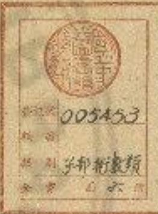

圖解校正地理新書序
宅葬者養生送死之大事也自司馬史分陰
陽家流至唐迄宋曇詔儒臣典領司天監屬
出祕閣之藏訪草澤之術胥參同異校覈是
非取合於理而哉祥有藉者留編太常即今
之頒行地理新書是也俾世遵用以裨政治
保生民躋於壽域惠亡者安於下泉示愛民
廣博之道不其踰與兵火之後失厥監本於
是俗所傳者甚有訛謬至於辭略而理乖名
存而實華既復差誤觸犯凶災僕深患斯文之弊遂實諸師說訪求善本參較以正之者
僅千餘字添補邁闕者幾十數處兼有度刻
步尺之差者則以算法考而改之有陰陽加
臨之誤者則以成式推而定之至若四方正
位詳說其準繩表泉求影星取中之法四折
曲路細畫其角斜正方合勾股入穴之圖山
水列其吉凶祭享分於壇墀發揮經義注釋
禮文歲餘方果藏之於家以俟同道之能者
踵門而採擇焉庶亦知子攻業之不忽也皆
大定歲在關逢執徐平陽畢復道題

精加校正補完地理新書
僕叨習地理忝慕陰陽雖專述二宅而取則於此書伏觀
古唐夷門蒲坂等處前後印賣新書未嘗有不過目收購
者終莫能見其完本唯我先師馮公傳授亦遺地圖一篇
繼有平陽畢先生者留心放竅可無微失而又增加圖解
等法度真得其音趣矣自是更訪求名士家藏善本比對
差互甚多今據從來板內遺闕者並以補完元差互者校
離改正一兩疑未詳者乃各存之及其閉寫雖錯誤亦以
校定其卷首四方定位之法圖解已是詳備竅見營造取
正定平製度亦可為式外五姓聲同而虛實音異者今以
纂出地下明鑑立成傍通三鑑六道繼叙輪圖又校正禽
交步分及民庶合用塋田參定傳符雜忌等述兼論呂才言宅葬經書之弊各布列本篇之下總二萬餘言以廣異
閩僕恐未能專擅遂誠心修集以俟同道之能者幸改易
焉庶幾我董易為遵用審觀此書之與也始自唐代呂才
刪定名以地理至于宋朝注曆數主重復詔下有司始終
幾有百年方以定用頒行于世今野俗之流而有專執星
水之法或只習一家偏見之文又有不經隨代進用頒行
傍門小說不根之語或與官書相害者執而行之兼又不
能與五姓參用而專排斥五音姓利良可畢哉僕今見平
陽數家印賣此書雖有益於世竟未見完者恐久墜斯文
莫能從善不敢欺隱遂將正文挿入又附以亂談舛駁之
辭短拙不揆尤甚慚以俗言紀其事迹皆明昌壬子歲古
藏鄙夫張謙謹啓

地理新書序
翰林傳解學文兼侍諳感王朝散大夫尚言吏部郎中究史館修撰判國子監視舉集禧觀事上騎都剝賜紫金魚棲臣王深等奉
臣聞聖人應明者者謂之禮人書曰要作聖孔統修曰於事無不通至者過种包慮民之心其制器大備包城萬元簡易民之心故其次作之義也有聖人之過曰賜其示法詳密以事告人日示言則者尚未因賜其示法詳密以事告人日示言則者尚未因賜其示法詳密以事告人日示言則者尚未因賜其示法詳密以事告人日示言則者尚未因賜其示法詳密以事告人日示言則者尚未因賜其示法詳密以事告人日示言則者尚未因賜其示法詳密以事 知能遠其者聖人者爲之宮宝此下八事皆下樂之过程人而三
望人易以等宮宝上未相卿農民前下未年和解本之亦未年也書契
上古培跑而治後世聖人易以敬反下未年和解本之亦未年也書契
云事大夫德民繩事以小路人知又入書之以本刻其非行察郡各持成
自答合也舟禪用人木為同犯不為得同算之也以本刻下通曰所必
张失以東本為本劉人為失張文之利獨署危與民爲简告或作以渡
以同使賤或水泽曰杵曰神何神須新所不得爲日州之利美良以漿也滅
重門行夜所學桥以時景者趙氏口將曰所引之本也或曰皆所以與利
毀害慮及萬世貞息也羅除地言上入事旨聖人所則興起利當
當是時庶工百執事通勉于下庶教事官官貧者也勉心力於天下之時
時智以理於民也智使上曰號言理言政者名尽爲之者百官也
成之者聖人也聖人所乘聖人處爲之也易曰通其變使民不倦
神而化之使民宜之則下至西經曰事人不願於受則又惠而無故量
神而化之使民宜之則下至西經曰事人不願於受則又惠而無故量

民父母制器示法既備且悉周於無窮此境利法因事判建法及
民各得其宜者貢為已依息服之衣其後制人多所藏少寧聖人
令各用其宜衣服器成各使其同故此
言聖人利器示法同於爲日無取也昔公劉居勵告往奇也公
平而成因吉如他今折平感除之車北有者而大王居添阻至父
也春木記水二河也自公家夫同於福地君於水之商女王
云后公曰可是公居檐以我歲一殺人子而君之年不患民民之
左兵向彼何其民欲以我歲一殺人子而君之年不患民民之
弘高邊去御漢西回新見山止若山下然人舉而文王居岐
勢飛奏候與光公叔則公救准割生古公眾又古人曾安即公列老代
陽堂皇來主美先見先生路新殿偷生公非公非上高田高望生聖
因武國生公叔則公救准割生古公眾又古人曾安即公列老代
孫也占公生長手曰天位次子虎伊少子乘虚亦置良是為公學至
文王尊為王季王季生文王復武王居錫又小編京而都也代皆相
作都於望受命之年而稱為王復武王居錫又小編京而都也代皆相
其吉昀然後居之言自公司到至武王敬代資相地之候在詩曰篤
公劉飄景乃罔相其陰陽武以日易求其南北定其經界又升于高
同吉相地形堂陽寒古公宣父卑來胥字爰契載飄道陳爲云古公章西水辭在于城下爰及廣文者首字言古公者到地重父大王
名也卑自也骨相也守其也愛於也契舍也比詩言天王至劉使人
侵害奪其土生乃事之以反帝天下及帝其也大善非同也因自
而主地而合政竟下之吉之德興及四方教令虎民未王遂以度善
君而命也將開也若支王之德興及四方教令虎民未王遂以度善
君而命也將開也若支王之德興及四方教令虎民未王遂以度善
君而命也將開也若支王之德興及四方教令虎民未王遂以度善
君而命也將開也若支王之德興及四方教令虎民未王遂以度善
君的則也考下惟王宅是鑑京性龜正之武王成之詩者者也言藉
同言也先惟其志武王也居此封身之地及周公營新邑亦使太保召公
惟其志武王也居此封身之地及周公營新邑亦使太保召公
先下宅獻圖兆氏信日已為公先相定官周公任營成周後來告下元
先下宅獻圖兆氏信日已為公先相定官周公任營成周後來告下元
惟其志武王也居此封身之地及周公營新邑亦使太保召公
先下宅獻圖兆氏信日已為公先相定官周公任營成周後來告下元
惟其志武王也居此封身之地及周公營新邑亦使太保召公
先下宅獻圖兆氏信日已為公先相定官周公任營成周後來告下元
惟其志武王也居此封身之地及周公營新邑亦使用之法
惟其志武王也居此封身之地及周公營新邑亦使用之法
惟其志武王也居此封身之地及周公營新邑亦使用之法
惟其志武王也居此封身之地及周公營新邑亦使用之法
惟其志武王也居此封身之地及周公營新邑亦使用之法
惟其志武王也居此封身之中惟其志武王也居此封身之中惟其志武王也居此封身之中惟其志武王也居此封身之中惟其志武王也居此封身之中惟其志武王也居此封身之中惟其志武王也居此封身之中惟其志武王也居此封身之中惟其志武王也居此封身之中惟其志武王也居此封身之中恒制
惟其志武王也居此封身之中惟其志武王也居此封身之中惟其志武王也居此封身之中惟其志武王也居此封身之中恒制
惟其志武王也居此封身之中惟其志武王也居此封身之中恒制
惟其志武王也居此封身之中惟其志武王也居此封身之中恒制
惟其志武王也居此封身之中恒制
惟其志武王也居此封身之中恒制
惟其志武王也居此封身之中恒制
惟其志武王也居此封身之中恒制
惟其志武王也居此封身之中恒制
惟其志武王也居此封物曰明王奉若天道建邦設都上高宗
惟其志武王也居此封物曰明王奉若天道建邦設都上高宗
惟其志武王也居此封物曰明王奉若天道建邦設都上高宗
惟其志武王也居此封物曰明王奉若天道建邦設都上高宗
惟其志武王也居此封物曰明王奉若天道建邦設都上高

在聖誕年建國愛命與動在周禮有建邦國都鄰之法在周禮中有
帝業任非不會不產上產也
王員公註云月淨謂之圖所兩則之利言部民者義儀之風圖字以
歲人曰為其或之也故曰之同則以先此尚明邦字以手以是言細則
別於邑都部或包都邑而高地的者部者以其而志教易哉新之都功
其在國之都也是新之鄉都愛部先至教曰御人後我而能是也又
曰部者界以水地土圭表繫規日景以極星正朝夕是也永地者以
取其地平也土主者土有興度也土主表一尺五可以度地放曰土
生世謂之學此多為规划夕謂象西長短之表也以志星上朝夕者極星秦
暑天中止死不移到夕謂象西長短之表也以志星上朝夕者極星秦
占家有五行堪興建除業辰太一諸學世多習者其善變黃上者以
得吉西經見而言之於人謂之古也其書世多習學各位一家文
而制廣無復矣是改史記褚先生曰者武要時製會占家問之原曰大
可取婦乎五行家曰同甚興家曰不可從除家曰不志業家曰大
可發家曰小四天人家曰山志太一家曰大吉請公不誅以狀閣奉
貞曰爵諸死易以五行大米總一海內天覆地載西海之向地爲一
為主人取於五行者也大米總一海內天覆地載西海之向地爲一
列聖愛民之心疚然深思人具曾民之心如照内我深思遠處也
農田耕壑風雨祈禱皆著勅法敬曰同言處人耕治力四種蔣五殿

明者未測官書新除使也降集幅也若醫藥針石不得其宜則天傷所錄生也論次爲書博士諷誦與今格勅書藏于天下客物也錄也與有病者与疫用增新行針不察者皆無熱者大盛者反以深尋者之產者相不足而有有餘如因竟承者皆失其直大德性命山於此矣於肩壁也手方命譜器論成者要太醫博士氣補教習後生法經曰高氏之山者石如玉可以為針刺又若占家之說冠昏歟之於此曰也東方之人月之以治者也則歲成人也管者家聖地行人謂死行事之人也禮立封葬歛日時吉凶不得其法則人逢百殃臣家也君者而不增又曰尊者者者貞至意能吉凶不可言之始矣止法同一身也聖人之心將欲納民於富壽其亦有取於斯也至人之心愛民如子若天珠雨農業者石藏治癒病之華亦城火之首曰已載未經仁重人会受表此咸年以修之生人既解不免於省告覈唐自觀中太常博士吕才奉詔撰陰陽書

五十篇其八篇地理也就說成宗有從年中為於監護者上，以來新致
十五正書或部經
天下遂乃行之
至先朝更命新天命得天下也
分門總輯寫乾坤實典四百五十篇其三十篇地理也同天大監史
將已才售高分作門類內應治統言司
為乾坤實地理門會二十篇也書既成高麗國王上表請于
有司詔給以寫本表家品處與名論如爲字然序之書業雜慢
近無所歸詣學者抉其訛謬凡三千五百盛識也言史多被託此難諒
尚未精當象訣不一復谷竟近不能貢驗而所稱着景祐初仁言景
後學之人見其如此學快流出爲報著三千五貞字景祐初拓元年
咸司天監丞王承用又指摘閩誤一千九百始詔太子中允集賢校
理稽穎冬官正張遊大卜署令奉并與承用覆校同與五年而畢先
精於術學者教其教學文又王承用指出關少擣去錫誤縷已奏聞
方臨院下委善儒但拿督授理德福與冷官正張遠太著今秦年
司天監丞理同與不同全五年而罷校詔付太常命司天少監楊惟
勘所設義理同與不同全五年而罷校詔付太常命司天少監楊惟
德與二宅官三十七人詳其可否惟德洎遜斟酌新督修正對鑑及伯
也列相背也鑑者聖陽錯亂變聲不正地言奉認送到太保寺再命
同天少陸輟推德等評度其中何否惟德及敬有除見行新廟天道

別成三十篇賜名曰地理新書前舊書修正專取地理
書者是所舉地理新書言新復詔鉤覈重複也淘者委出取之水義者
下詔恐有重複則對去民重慶考員實也至皇祐三年集腎校理
曾公定領其事奏以淺濾疏略無蓋於世自解社五年改命王承用
卒即凡一十三年又保腎校理曾以定誤制修其其書有詔臣洙
臣高錫臣義叟洎公定置局刪修以司天監主簿充翼改正其舊
所長業有所專政以司天監官將觀文殿學士丁度典領焉也主度
臣高錫臣義叟洎公定置局刪修以司天監主簿充翼改正其舊
薨及封免已罷了臣洙吏掌其蜀清丁度義後王承於是上文義以
此多具閲三館所藏備明策同及古今占術臉忌甚家信驗披其
與突身潛而不地來為而詰其妙框書法本龍石水下法也言經
也報管以體要區以輕重而各從攤部先後可尋朝總未也阻分
此言編修之法先會先反平敬要當改分别作吉有自吕才成書名
以地理而尊記家墓胡敬以室舍吉由同條非普書之法地理之書

之父又言鈞又到同有一門也非著作文書之法今首以城邑營壓
寺署郵傳市宅衢街則左陰右陽刑禍福德所相也也部有新司傳
舍也今此家者次序首先以城衆志也軍督營堂官奇偷務郵事
馬聲傳舍市井宅舍衛福基陷劉以兵前吉元忠右陽有刑極懼德
之地所科雜之以四方其位修破學元求叙之以五行以五行叔之然後
助其事也雜之以四方其位解正四方敘之以五行以五行叔之然後
商之以五姓商後也分產憲之以九星憲法記及法於光星之筆者
曲城寧左輔方所此也隨
美尚宮之上以定吉西姬之以八卦經配也配以宿坎良參之以八
變參相合也入度者入至道推來相按故已得生氣爲地事凡二
十篇皆以山水形無間數成終以家穴挺道門陌頌釵則開三閉九
山龍水泉所相也疑通乃下架之道路也食庭則有門陌出入墓曰
到言頤咸夷周獨合調三吉開九之任之以入將一官國二金匱
通又得山龍形奪水泉深調所脇也也任之以入將一官國二金匱
生氣七朱雀入玄武是也齊之以六對丞大會也六年二也功寶傅真
三也如亭伏尸四也大墓小墓五也未為高有假令法所能山興董之
對是三千八梅中二十一也在五性所易篇有假令法所能山興董之
以三鑑量三也三銀者天鑑地蠟人鑑信係之以六道者天道地通以易民用為地圖一篇，同原字於說言由是難有祀故。種次有彙則總之以便看讀為目錄一篇勒成三十二篇。此類也韋所也言依位類以便看險者請故作日閣之以經義辨鑿空也問說所出說書實義以海斷見是贊之以史傳信休咎也而有吉凶教論者傷錄之使人信有懷憂安也廣之以異聞求成敗也又廣備他誠異開者巫史所之事不慮言也傳則存其可候者不願新見也以陰限家為巫史官也今將除陽家得德文學者自定象寶也亦今將除陽家得德文學者自定象寶也亦今將除陽家得德文學者自定象寶也亦今將除陽家得德文學者自定象寶也亦今將除陽家得德文學者自定象寶也亦今將除陽家得德文學者自定象寶也亦今將除陽家得德文學者自定象寶也亦今將除阳家得德文學者自定象寶也亦今將除阳家得德文學者自定象寶也亦今將除阳家得德文學者自定象寶也亦今將除阳家得德文學者自定象寶也亦今將除阳家得德文學者自定象寶也亦今將除阳家得德文學者自定象寶也亦今將除阳家得德

至六年甲午春故至和三年丙戌秋改君私八年癸亥仁宗府下
二十臣殊尊以庸淺而絕勉于下庸得也言以爲常有義之廣日彌
月然後能就歸還強及若乃成而名之皆陛下也拒經功四夷有求
於中國曲標曰東虎內盛
之盛若實用表處其者定文不認即其將見中其下則惡速滿泉宅
兆以時去刑害下則患及瀝魚之下也者皆之意上則使人專福壽聖
人之仁如此民仁患之心如作愛性文武受命世忠學詩人美之
曰敦彼行章牛羊勿踐復謂草木微者猶能愛之況於人乎三歲故
愛武之命而王天下同家世世假德仁恩及於草木徵物猶能愛之
從楚人事將人與美良佛而為之詩曰教收以差牛羊切道微此大
世從政復折傷之草木改施行也言教故周之章敬牛平昔
愛之況故卜世三十享國過曆過於所卜世行年歲之故也在尚不在畢者
定王定錄子鉅卿卜世三十卜年七百天所命也周德舜泉天命未
周三十六王九百六十七歲後卜數也若然大宋之仁薄博上下蕃當歸茅青年未耜上力處切下青似櫛青病行弧骨私木署古
小觀曰杵下青情重門上直各殿青雁额也滲治幽同沮将鐫
石景青遭文下青度從落鮮原美也召公上首部上圭上紫
五結刀蠶同淺子照切覆服救切疾省敬乃壑之也析瑜上下
竟作象蟲同淺子照切覆服救切疾省敬乃壑之也析瑜上下
首餘中冠青輯良從而斯切詣至也切扶涉快也記謬上五本切
頷你因幷首泊其重姊以封鑑計嚴實則平切考重複衡連固絡
疏虎薨自寔首閩尚突詰詰溪吉切梳首權首殽著者惠郵傳
上言處下衢街方首聚婉切詠挺蓬聖所相三句可任也也切
備者繪首種雲首閩如願香陞藏隕何便速溥首祚

<table><tr><td colspan="5">臨本補完地理新書目錄</td></tr><tr><td>(四)</td><td></td><td></td><td></td><td></td></tr><tr><td>土市區</td><td>土市區</td><td>土市區</td><td>金鄉區</td><td></td></tr><tr><td>龍門支東區</td><td></td><td></td><td></td><td></td></tr><tr><td>(白雲服近)</td><td></td><td></td><td></td><td></td></tr><tr><td>月光榮日園</td><td>萬家村里園</td><td></td><td></td><td></td></tr><tr><td>(為見試算)</td><td></td><td></td><td></td><td></td></tr><tr><td>大氣促進區</td><td>湯島縣東區</td><td>七十包縣相談區</td><td></td><td></td></tr><tr><td>西勢城新東區</td><td>川内縣町</td><td>市民愛善</td><td></td><td></td></tr><tr><td>(五)</td><td></td><td></td><td></td><td></td></tr><tr><td>東方木南方火</td><td>中大區</td><td>四方金</td><td>北方長</td><td></td></tr><tr><td>五龍商區</td><td></td><td></td><td></td><td></td></tr><tr><td>宿州商會</td><td>宿州</td><td>徽州</td><td>明州</td><td></td></tr><tr><td>(藏記制圖)</td><td></td><td></td><td></td><td></td></tr><tr><td>站頭政口</td><td>站頭</td><td>教社</td><td>社員會人封支</td><td></td></tr></table>

則愛民之報祚以萬年天之道也謹序，清華也傳義也在福也言者
雖今仁恩普廣治於上下
尊愛愛民之福天之道也

<table><tr><td>姓名</td><td>杨雪冬</td><td>张雪冬</td><td>西文</td><td>稍关</td><td>张雪冬</td></tr><tr><td>姓名</td><td>杨雪冬</td><td colspan="2">小明加夏图</td><td colspan="2">欢迎加入国</td></tr><tr><td>(欢迎回访)</td><td></td><td colspan="2"></td><td colspan="2"></td></tr><tr><td colspan="2">(欢迎加入国</td><td colspan="2">欢迎加入国</td><td colspan="2"></td></tr><tr><td>(家长加入)</td><td></td><td colspan="2"></td><td colspan="2"></td></tr><tr><td colspan="2">静默</td><td colspan="2">静默</td><td colspan="2"></td></tr><tr><td colspan="2">(欢迎加入)</td><td colspan="2"></td><td colspan="2"></td></tr><tr><td colspan="2">欢迎加入(欢迎加入)</td><td colspan="2"></td><td colspan="2"></td></tr><tr><td colspan="2">欢迎加入(欢迎加入)</td><td colspan="2">欢迎加入(欢迎加入)</td><td colspan="2">欢迎加入(欢迎加入)</td></tr><tr><td colspan="2">(欢迎加入)</td><td colspan="2"></td><td colspan="2"></td></tr><tr><td colspan="2">欢迎加入(欢迎加入)</td><td colspan="2">欢迎加入(欢迎加入)</td><td colspan="2">欢迎加入(欢迎加入)</td></tr><tr><td colspan="2">(欢迎加入)</td><td colspan="2">欢迎加入(欢迎加入)</td><td colspan="2">欢迎加入(欢迎加入)</td></tr></table>

<table><tr><td colspan="3"></td></tr><tr><td colspan="3"></td></tr><tr><td colspan="3"></td></tr><tr><td colspan="3"></td></tr><tr><td colspan="3"></td></tr><tr><td colspan="3"></td></tr><tr><td colspan="3"></td></tr><tr><td colspan="3"></td></tr><tr><td colspan="3"></td></tr><tr><td colspan="3"></td></tr><tr><td colspan="3"></td></tr><tr><td colspan="3"></td></tr><tr><td colspan="3"></td></tr><tr><td colspan="3"></td></tr><tr><td colspan="3">文言字意</td></tr><tr><td>字意上</td><td></td><td></td></tr><tr><td colspan="3">《数计》</td></tr><tr><td colspan="3">(年月格式)</td></tr><tr><td>输入题词句法</td><td colspan="2">推五班大金楼改年月</td></tr><tr><td>函数同大题题法</td><td colspan="2">五班同五班非题年月</td></tr><tr><td>新年五班题词法</td><td colspan="2">新月五班题定成法</td></tr><tr><td>百日内水解法</td><td colspan="2"></td></tr><tr><td colspan="3">主人年月题时</td></tr><tr><td>主人本命通论法</td><td colspan="2">四中大阅年月</td></tr><tr><td>四道十周年月</td><td colspan="2">四季春龄年月</td></tr><tr><td>五班题词会题年月</td><td colspan="2">五班题种入操年月</td></tr><tr><td>五班题词会年月</td><td colspan="2">五班题成人操年月</td></tr><tr><td>稍期题年月</td><td colspan="2">五班大分教改年月</td></tr><tr><td>加题新年学生</td><td>加题新生行年</td><td>加题学生生月</td></tr><tr><td>四题题书</td><td>四题诗选题</td><td></td></tr></table>

<table><tr><td colspan="7"></td><td></td><td></td><td></td><td></td><td></td><td></td></tr><tr><td></td><td></td><td></td><td></td><td></td><td></td><td></td><td></td><td></td><td></td><td></td><td></td><td></td></tr><tr><td></td><td></td><td></td><td></td><td></td><td></td><td></td><td></td><td></td><td></td><td></td><td></td><td></td></tr><tr><td colspan="7"></td><td></td><td></td><td></td><td></td><td></td><td></td></tr><tr><td colspan="7"></td><td></td><td></td><td></td><td></td><td></td><td></td></tr><tr><td colspan="7"></td><td></td><td></td><td></td><td></td><td></td><td></td></tr><tr><td colspan="7"></td><td></td><td></td><td></td><td></td><td></td><td></td></tr><tr><td colspan="7"></td><td></td><td></td><td></td><td></td><td></td><td></td></tr><tr><td colspan="7"></td><td></td><td></td><td></td><td></td><td></td><td></td></tr><tr><td colspan="7"></td><td></td><td></td><td></td><td></td><td></td><td></td></tr><tr><td colspan="7"></td><td></td><td></td><td></td><td></td><td></td><td></td></tr><tr><td colspan="7"></td><td></td><td></td><td></td><td></td><td></td><td></td></tr><tr><td colspan="7"></td><td></td><td></td><td></td><td></td><td></td><td></td></tr><tr><td colspan="7"></td><td></td><td></td><td></td><td></td><td></td><td></td></tr><tr><td colspan="13"></td></tr></table>

<table><tr><td></td><td></td><td></td></tr><tr><td></td><td></td><td></td></tr><tr><td></td><td></td><td></td></tr><tr><td></td><td></td><td></td></tr><tr><td></td><td></td><td></td></tr><tr><td></td><td></td><td></td></tr><tr><td></td><td></td><td></td></tr><tr><td></td><td></td><td></td></tr><tr><td></td><td></td><td></td></tr><tr><td></td><td></td><td></td></tr></table>

<table><tr><td colspan="3">路口扣号</td></tr><tr><td>川内四区</td><td>营口十尺巷口</td><td>昌盛加元</td></tr><tr><td>新知区口</td><td>井令湖镇加元</td><td>井精十桥</td></tr><tr><td colspan="3">路营业部</td></tr><tr><td>路营业部</td><td>红石村留园</td><td>八十里畔长醒露楼</td></tr><tr><td>大合顺定五人家</td><td>徐家路口南山路明</td><td>大类影景</td></tr><tr><td colspan="3">(2)第111</td></tr><tr><td colspan="3">路营业部</td></tr><tr><td>长百街路路路过街</td><td>吴个里赣八十里路东</td><td></td></tr><tr><td>八十里路王家路北街</td><td>延川图大店</td><td></td></tr><tr><td>民林大里人路路北路</td><td>路新园人珍缘公园月圆天桥</td><td></td></tr><tr><td>大路路东</td><td>西道府路东</td><td>西陵府藏城藏通</td></tr><tr><td>新知区口和区</td><td>江恒路东</td><td>金胜西四街</td></tr><tr><td colspan="3">(3)第111</td></tr><tr><td colspan="3">路营业部</td></tr><tr><td>新知区</td><td>教界路西支站</td><td>汉庄段北四路图</td></tr><tr><td>上下同乡</td><td>汉地台回藏法</td><td>通义口金周通法</td></tr></table>

重校正地理新書卷第

將欲當地事必先正四方四方正然後十二位定於邦國則有都解於人民則
有居愛於鬼神則有同朝宅兆所用雖異其術一也周官土方氏掌土靖耕作
主之法以敘日景陽陽以土地捐宅而疑邦國都解動氏云土地猶度壓地以
紹東南西北之深而相其同居者宅居也周穆匠人建國之鄉水地以無能號號名為大樓觀見以水平也與下則方
醉下而以正在何無後以水平以下目上已至也，景以垂貞以景歸下取
是八而以新之觀作表則入之象以爲來去，爲果以自之中反五所
人之觀入爲規識自出之景貞日入之象自日制字通進之誠而以又入朝表明
南家正有北正當參諸曰中之景貞日以爲之象最以夜考之極星體定其

<table><tr><td colspan="5">(深)教道</td></tr><tr><td colspan="2">西京校所务局</td><td colspan="3">燕江发电服务公司</td></tr><tr><td colspan="2">男女行并人务</td><td colspan="3">五姓警门和电力位管</td></tr><tr><td colspan="5">(警察道)</td></tr><tr><td colspan="2">教科台数</td><td colspan="2">进料付费</td><td>填货取土</td></tr><tr><td colspan="2">除记</td><td colspan="2">男女打平</td><td>五姓十二月呼能法</td></tr><tr><td colspan="2">周故新法</td><td colspan="2">改班開發法</td><td>新後關連法</td></tr><tr><td colspan="2">五姓姚氏騏驗</td><td colspan="2"></td><td></td></tr><tr><td colspan="5">(殺推用)</td></tr><tr><td colspan="2">救救用</td><td colspan="2">推救用</td><td>推教法</td></tr><tr><td colspan="2">推保用法</td><td colspan="2">被殺出方</td><td>同餘報承</td></tr><tr><td colspan="5">(新進道)</td></tr><tr><td>择回法</td><td>清源方</td><td>前移方</td><td>留渡方</td><td>富合方 早因方</td></tr><tr><td colspan="5">(要略回頭)</td></tr><tr><td colspan="2">成略自立</td><td colspan="2">富德知方</td><td>四大編制的教科引計</td></tr><tr><td colspan="5">(事務經修委員)</td></tr><tr><td colspan="5">本國地理新朝日報</td></tr></table>

重校正地理新書卷第

將欲當地事必先正四方四方正然後十二位定於邦國則有都解於人民則
有居愛於鬼神則有同朝宅兆所用雖異其術一也周官土方氏掌土靖耕作
主之法以敘日景陽陽以土地捐宅而疑邦國都解動氏云土地猶度壓地以
紹東南西北之深而相其同居者宅居也周穆匠人建國之鄉水地以燕龍跳漸記名為高盛城故以水平也與下則方
醉下而以正在何無後以水平以天下目上也，至日也，至日也，至日也，至日也，至日也，至日也，至日也，至日也，至日也，至日也，至日也，至日也，至日也，至日也，至日也，至日也，至日也，至日也，至日也，至日也，至日也，至日也，至日也，至日也，至日也，至国八朝來者之觀皆先去其王及後可表之景象入人凡者同服上前下八萬里
人之觀入爲規識自出之景貢曰人之身自田制字通進之誠而以又入朝教學
南家正有北正當參諸曰中之景貢曰甲之景象正有夜考之極星體定其

<table><tr><td colspan="5">(深)教道</td></tr><tr><td colspan="2">西京校所务局</td><td colspan="3">燕江发电服务公司</td></tr><tr><td colspan="2">男女行并人务</td><td colspan="3">五姓警门和电力位管</td></tr><tr><td colspan="5">(警察道)</td></tr><tr><td colspan="2">教科台数</td><td colspan="2">进料付费</td><td>填货取土</td></tr><tr><td colspan="2">除记</td><td colspan="2">男女打平</td><td>五姓十二月呼能法</td></tr><tr><td colspan="2">周故新法</td><td colspan="2">改班调查法</td><td>新朝调查法</td></tr><tr><td colspan="2">五姓姚氏检验</td><td colspan="2"></td><td></td></tr><tr><td colspan="5">(销毁用)</td></tr><tr><td colspan="2">救毁用</td><td colspan="2">推难撤用</td><td>推报法</td></tr><tr><td colspan="2">维修用法</td><td colspan="2">破毁出方</td><td>同除银承</td></tr><tr><td colspan="5">(拆除用)</td></tr><tr><td>择回法</td><td>清源方</td><td>前移方</td><td>留渡方</td><td>前命方 原因方</td></tr><tr><td colspan="5">(销毁用)</td></tr><tr><td colspan="2">成稿台</td><td colspan="2">前登记方</td><td>四大编制资料和引脚</td></tr><tr><td colspan="5">(军事训练监督考试)</td></tr><tr><td colspan="5">本部门处理新制目编</td></tr></table>

新圖解云周使有土方氏掌土圭之隱以致日景以土地相完王人藏曰土圭尺有五寸以致日以上地焉相氏冬夏敛日春秋致月然以致日者度其景至不以土地者度其地廣深以來地中相其可居者又大司徒之職掌建邦之土地之圓以上圭之堂剛土深如為正日景以求地中日南于景知多暑日北則景長多寒日東劉景多寒風日雨則景朝多陰注云土主所以致同時日月之景也剛猶度也不知廣深校曰剛鄭司農云剛土深謂南北東西之深也日南謂立表處太南近日也日北謂立表處大地達日也日夕謂日秋曆乃中立表願太東近日也景朝謂日未中而景中立表處太西遂日也玄謂書漏半而置土圭衣陰陽著其南北景短於土圭謂之日南是地於日玄謂直南也景長於土圭謂之日比是地於日為近比也東於上圭謂之日東足地於日為迫東也西於土圭謂之日西是地於日為近西也如是則寒著金風偏而不和是求得其所求凡日景於地千里而差一寸又經曰曰至之星尺有五寸謂之地中天地之所合也四時之所交也風雨之所會也陰場之所和也然則可物莫安乃建王國焉注云景尺有五寸有南或曰下萬五千里地與星展四遊非降於三萬里之中是以半之得地之中也興司與云土主之長尺有五寸以夏至之日立八尺之表其言廣與土圭等謂之地中令胡回陽始地爲然

新周解云按周解說冬至晉大一丈三尺五寸夏至晉長一尺六寸尚當考金
堪云日來影尺五寸日短十三尺周禧大司徒云日至之景尺有五寸又馮
相氏王氏遂及後漢志皆云冬至景文三尺夏至景尺五寸自宋文帝元嘉
丙子歷隋居候二至曆然九土不同至唐開元中遣使天下候黃南距林邑
夏至景在天南九寸冬至景在表此六尺九寸比距鐵勤夏至景西尺一寸
二分丁辰兵咸原同二月冬至景二丈九又二寸六分造宋皇祐已廿小雪
始測景于岱至晉亡辰立冬共統象占二十四氣皆異列之于閩之圖測候岳臺

卷石丈三尺
下

十四条於上外島
准置水以準

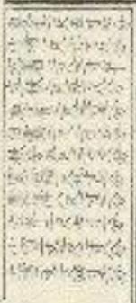

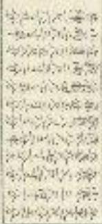

<table><tr><td rowspan="4">圖表立之沖租</td><td></td><td></td></tr><tr><td></td><td></td></tr><tr><td></td><td></td></tr><tr><td></td><td></td></tr></table>

誌定之方中又授之以月福見○周德太官惟王建國辦方正位考工記置象
以連然射的相解，臣詐以景為規則日出之景與計人之景後致之極星以正
朝父齋也處而何道其益成爲全曰入臣賜謂，曰以資者相制而平曰中之故以貞也被反朝
臣○管子夫羅扶徵以為正○字不林撰以則，至良望也列譯證俗音字今山東
臣人預言垂視現正為地

取正之制先於盛班中央日內景圓板徑一尺三寸六分當心立表高四寸徑一分盡表景之端記日中最知之总次施望同於其上望日星以正四方○望筒長一尺八寸方三寸釧兩卷頭開漏眼樑五分同且高中兩壁用軒安於丙頭之內其立類自軸至地為三尺廣三寸度二寸處望以筒指南令目景透北後壁以筒拾北於简南寧令前後兩歲內正見比展極星然後各垂繩壁下記聖同丙處心於地以為南則四方正若地勢偏衰既以景表望筒取正四方或有向疑處則更以水池景表較之○其立表高八尺廣八寸學四寸上齊後斜向下三寸安於池板之上其池板長一丈三尺中高一尺於一尺之内簡表之廣刻線兩道一尺之外開水道環四周廣深各八分用水定平令目景兩邊不出刻緣以池板所指及立表心為南則四方正殿星令直服在相地貳味到

## 水池景表

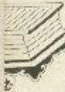

周官考工記匠人建國水地以垂解見分莊子水靜則平中準大匠取法焉。管子天華懷險以為平定平之制激正四方據其位資於四角各立一表當心安水平其水平長二尺四寸鹿三寸五分高二寸下施京椿長四尺破礫上面横坐水平兩頭各開池方一寸七分深一寸三分城前初輟肩身內開槽子腰縫各五分令水通過於兩側也子內各用水浮子一枚捕三地所味變方一寸五分高一寸二分刻上頤令刺蓬其摩一分傳於池內壁兩頭水縫子之首造對立表廈於表為內畫記即知地之高下而重內合有不相相動味賊貞服鋪平鑽心機味鐵通頂下至緑餉進南距只定柱碰取平須更用直尺較之其真尺長一丈八尺與四寸學一寸五分當心二立表高四尺足轉於立表當心自上至下乾墨線一道垂繩隆下令繩對墨線心則其下地面自平則頭與平平服散合方干運

<table><tr><td rowspan="5">圖框考影參</td><td>圖日按定視</td><td>定星南亞時於北相今北堂東京人之持經其來表以如東京定北時於南亞正南亞直○經星</td></tr><tr><td rowspan="4">日式規定中算為日※則規日以東規出望而圖章表正也影則東若王有雨而日北影入正端高則</td><td>日式以中者共受決求復又樹異人四人爭範面凡所錄之之合乎中小未作又得正令四長</td></tr><tr><td>日式以中者共受決求復又樹異人四人爭範面凡所錄之之合乎中小未作又得正令四長</td></tr><tr><td>日式以中者共受決求復又樹異人四人爭範面凡所錄之之合乎中小未作又得正令四長</td></tr><tr><td>日式以中者共受決求復又樹異人四人爭範而見此見此見此見此見此見此見此見此見此見此見此見此見此見此見此見此見此見此見此見此見此見此見此見此見此見此見此見此見此見此見此見此見此見此見此見此見此見此見此見此見此見此見此見此見此見此見此見此見此見此見 this見此見此見此見此見此見此見此見此見此見此見此見此見此見此見此見此見此見此見此見此見此見此見此見此見此見此見此見此見此見此見此見此見此見此見此見此見此見此見此見此見此見此見此見此見此見此見此見此見此見不盡表示移至地或故呈考取后之兩正北道以西而星堂</td></tr></table>

<table><tr><td>版</td><td>表</td><td>景</td><td>画</td></tr><tr><td></td><td></td><td></td><td>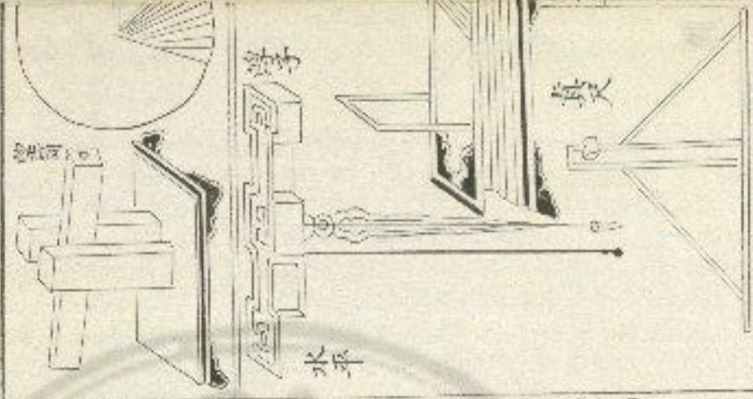</td></tr><tr><td></td><td></td><td></td><td></td></tr><tr><td></td><td></td><td></td><td></td></tr><tr><td></td><td></td><td></td><td></td></tr><tr><td></td><td></td><td></td><td></td></tr><tr><td></td><td></td><td></td><td></td></tr><tr><td></td><td></td><td></td><td></td></tr><tr><td></td><td></td><td></td><td></td></tr><tr><td></td><td></td><td></td><td></td></tr><tr><td></td><td></td><td></td><td></td></tr><tr><td></td><td></td><td></td><td></td></tr><tr><td></td><td></td><td></td><td></td></tr><tr><td></td><td></td><td></td><td></td></tr><tr><td></td><td></td><td></td><td></td></tr><tr><td></td><td></td><td></td><td></td></tr><tr><td></td><td></td><td></td><td></td></tr><tr><td></td><td></td><td></td><td></td></tr><tr><td></td><td></td><td></td><td></td></tr><tr><td></td><td colspan="3">[XXKWG]</td></tr></table>

立春一九分腹二行六少薄
西水八分入腹三十百一卷
驚蟻羅以六三九十五数
清明七月一腹十八十三少外四尺一寸五十二分四十六分共十七次斗少五一
殽雨湖仁腹十七十七大塗三尺二寸六十四分三十九分四十七道一年六半
小滿溝四處六十六九太尺尺九寸八分六十三分三十六分角六奇危二十四強道
苦種三分後三十六十七小張尺六寸六分六十四分三十五和元五一散危十四強道
夏至州刺五歲六十七錢尺五寸六十五三十五成十二少有十二號制
小暑彬仁後二六十七五英尺七寸六十四分三十九分尾一走征奎人劉
大暑雄朝一五七十二尺六十三三十六分尾十五分四癸二文說
立秋後十一後七十三三盛二尺五寸五十六二三十七分箕九取豫冒九五二壇
魁暑星丸良十七十八半為三尺三寸六十二分三十九八牛十少送軍三未退三
白露中一後二八十四山黃四尺三寸五十七出四十二分斗二十一號參五洋兩甲
秋分三角四處九十半五尺五寸五十五之四十四以生五少井十六通三
宋露流入遂五九十六少歲六尺八寸五十二於四十七次女七太蓬思三少雅

新隆二年計之歲一百二少歲 八尺四寸 五十二分四十九所處六大光星三龍強
立冬煩酒腹行一百七少業 文四寸二分四十八所五十一朝急八法進二張十五大殘
小雪流分德三百一十一角支一尺四月四十六所五十三社室二半瀬西翼尤强進二
大雪斜四度一百一十三张文二尺四月四十五所五十四經壁半病在 軍十五大殘
易總客景長短立始千後。

冬至登景長一丈三尺
大寒暑景長一丈一尺八分
雨水暑景長九尺一寸六分
春分暑景長七尺二寸四分
穀雨暑景長五尺三寸二分
小暑暑景長三尺四寸
夏至暑景長一尺四寸八分
大暑暑景長三尺四寸
處暑暑景長五尺三寸二分
秋分暑景長七尺二寸四分
霜降暑景長九尺一十六分
小雪暑景長一丈一尺八分

傳適用所蔭二條新式于後

二至表

後文至初日應文長文二尺
二日長一丈二尺八寸四分
晉長一丈二尺八寸
公日長一丈二尺七十三分
十二日長一丈二尺六寸二分
十四日長文二尺四十
十七日長文二尺三寸一分
二十日長文二尺一寸一分
二十三日長文一尺八寸独
二十六日長文一尺六寸独
二十九日長文一尺三寸独
三十二日長文一尺一寸如
三十五日長文八寸一分分
三十八日長文五寸一分
四十一日長文二寸

八寸五分
三日長一丈二尺八寸三分
六日長一丈二尺七寸八分
九日長一丈二尺六寸九分
十二日長一丈二尺五寸七分
十五日長一丈二尺四寸二分
十八日長一丈二尺二寸五分
二十一日長一丈二尺四寸
二十四日長一丈一尺八寸分
二十七日長一丈一尺五寸銘
三十日長一丈一尺二寸九分
三十三日長一丈一尺一分
三十六日長一丈七寸一分
三十九日長一丈四寸一分
四十二日長一丈一寸小寒寒景長一丈二尺四分
立春寒景長一丈一寸二分
聲與寒景長八尺二寸
清明寒景長六尺二寸八分
立夏寒景長四尺三寸六分
芒種寒景長二尺四寸四分
小暑寒景長二尺四寸四分
立秋寒景長四尺三寸六分
白露寒景長六尺二寸八分
寒露寒景長八尺二寸
立冬寒景長一丈二寸二分
大雪寒景長一丈二尺四分

一日長一丈二尺八寸四分
四日長一丈二尺八寸一分
七日長一丈二尺七寸五分
十日長一丈二尺六寸五分
十三日長一丈二尺五寸三分
十六日長一丈二尺三寸七分
十九日長一丈二尺一寸八分
二十二日長一丈一尺九寸九
二十五日長一丈一尺七寸四
二十八日長一丈一尺四寸八
三十一日長一丈一尺二寸
三十四日長一丈九寸一分
三十七日長一丈六寸一分
四十日長一丈三寸
四十三日長九尺九寸九分四十四日長九尺八寸九分
四十七日長九尺五寸七分
五十四日長九尺二寸五分
五十三日長八尺九寸四分
五十六日長八尺六寸三分
五十九日長八尺三寸二分
六十二日長八尺二分
六十五日長七尺七寸一分
六十八日長七尺四寸三分
七十一日長七尺一寸四分
七十四日長七尺八寸六分
七十七日長六尺五寸八分
八十日長六尺三寸一分
八十三日長六尺五分
八十六日長五尺七寸九分
八十九日長五尺五寸四分
九十二日長五尺三分

四十五日長九尺七寸八分
四十八日長九尺四寸六分
五十一日長九尺一寸五分
五十四日長八尺八寸三分
五十七日長八尺五寸二分
六十日長八尺二寸二分
六十三日長七尺九寸二分
六十六日長七尺六寸二分
六十九日長七尺三寸三分
七十二日長七尺四寸
七十五日長八尺七寸七分
七十八日長六尺四寸九分
八十一日長六尺二寸三分
八十四日長五尺九寸六分
八十七日長五尺七寸二分
九十四日長五尺四寸六分
九十三日長五尺二寸二分四十六日長九尺六寸八分
四十九日長九尺三寸六分
五十二日長九尺四分
五十五日長八尺七寸三分
五十八日長八尺四寸二分
六十一日長八尺一寸二分
六十四日長七尺八寸二分
六十七日長七尺五寸二分
七十日長七尺三寸三分
七十三日長六尺九寸五分
七十六日長六尺六寸七分
七十九日長六尺四寸
八十二日長六尺一寸四分
八十五日長五尺八寸八分
八十八日長五尺六寸三分
九十一日長五尺三寸八分
九十四日長五尺一寸三分

九十五日長五尺七分 九十六日長四尺九寸九分 九十七日長四尺九寸二分
九十八日長四尺八寸四分 九十九日長四尺七寸七分 一百日長四尺七寸
一百一日長四尺六寸三分 二百三日長四尺五寸六分 一百三日長四尺四寸七分
一百四日長四尺四寸二分 一百五日長四尺三寸五分 一百六日長四尺二寸八分
一百七日長四尺二寸一分 一百八日長四尺一寸五分 一百九日長四尺八分
一百一十日長四尺二分 百一十一日長三尺九寸五分 百一十二日長三尺八寸九分
百一十三日長三尺八寸三分 百一十四日長三尺七寸七分 百一十五日長三尺七寸一分
百一十六日長三尺六寸五分 百一十七日長三尺五寸九分 百一十八日長三尺五寸三分
百一十九日長三尺四寸七分 百二十一日長三尺四寸二分 百二十二日長三尺三寸六分
百二十二日長三尺三寸一分 百二十三日長三尺二寸五分 百二十四日長三尺二寸
百二十五日長三尺一寸五分 百二十六日長二尺一寸一分 百二十七日長三尺四分
百二十八日長二尺九寸九分 百二十九日長二尺九寸四分 百三十日長二尺九寸
百二十一日長二尺八寸五分 百二十二日長三尺八寸 百二十三日長二尺七寸六分
百二十四日長二尺七寸一分 百二十五日長二尺六寸七分 百三十六日長二尺六寸二分
百三十七日長二尺五寸八分 百三十八日長二尺五寸四分 百三十九日長二尺五寸
百四十日長二尺四寸六分 百四十一日長二尺四十二分 百四十二日長二尺三寸八分
百四十三日長二尺三寸四分 百四十四日長二尺三寸 百四十五日長二尺二寸七分百四十六日長二尺二寸三分 百四十七日長二尺二寸
百四十九日長二尺一寸三分 百五十日長二尺一寸
百五十二日長二尺四分 百五十三日長二尺一分 百五十四日長二尺九寸八分
百五十五日長二尺九寸五分 百五十六日長二尺九寸三分 百五十七日長二尺九寸
百五十八日長二尺八寸七分 百五十九日長二尺八寸五分 百六十日長一尺八寸三分 百六十一日長二尺八寸一分 百六十二日長二尺七寸八分 百六十三日長二尺七寸六分
百六十四日長二尺七寸四分 百六十五日長二尺七寸三分 百六十六日長二尺七寸一分
百六十七日長二尺六寸九分 百六十八日長二尺六寸八分 百六十九日長二尺六寸六分
百七十日長二尺六寸五分 百七十一日長二尺六寸四分 百七十二日長二尺六寸二分
百七十三日長二尺六寸一分 百七十四日長二尺六寸
百七十六日長二尺五寸九分 百七十七日長二尺五寸八分 百七十八日長二尺五寸八分
百七十九日長二尺五寸七分 百八十日長二尺五寸七分 有八十一日長二尺五寸七分
百八十二日長二尺五寸七分
夏至初日與度長定五寸紅
三日長一尺五寸七分
六日長二尺五寸八分
九日長二尺六寸八分
十日長一尺六寸三分
百四十八日長二尺一寸八分

<table><tr><td>十一日歌又大写自合</td><td>十二日歌又大写自合</td><td>十三日歌又大写自合</td></tr><tr><td>十五日歌又大写自合</td><td>十六日歌又大写自合</td><td>十七日歌又大写自合</td></tr><tr><td>十八日歌又大写自合</td><td>十九日歌又大写自合</td><td>二十日歌又大写自合</td></tr><tr><td>十一日歌又大写自合</td><td>十一日歌又大写自合</td><td>十一日歌又大写自合</td></tr><tr><td>十五日歌又大写自合</td><td>十六日歌又大写自合</td><td>十七日歌又大写自合</td></tr><tr><td>十八日歌又大写自合</td><td>十八日歌又大写自合</td><td>十九日歌又大写自合</td></tr><tr><td>十五日歌又大写自合</td><td>十七日歌又大写自合</td><td>二十日歌又大写自合</td></tr><tr><td>十八日歌又大写自合</td><td>十八日歌又大写自合</td><td>十七日歌又大写自合</td></tr><tr><td>十五日歌又大写自合</td><td>十七日歌又大写自合</td><td>十八日歌又大写自合</td></tr><tr><td>十八日歌又大写自合</td><td>十八日歌又大写自合</td><td>十七日歌又大写自合</td></tr><tr><td>十五日歌又大写自合</td><td>十七日歌又大写自合</td><td>十八日歌又大写自合</td></tr><tr><td>十八日歌又大写自合</td><td>十八日歌又大写自合</td><td>十七日歌又大写自合</td></tr><tr><td>十五日歌曲又大写自合</td><td>十七日歌曲又大写自合</td><td>十八日歌曲又大写自合</td></tr><tr><td>十八日歌曲又大写自合</td><td>十七日歌曲又大写自合</td><td>十七日歌曲又大写自合</td></tr><tr><td>十五日歌曲又大写自合</td><td>十七日歌曲又大写自合</td><td>十八日歌曲又大写自合</td></tr><tr><td>十八日歌曲又大写自合</td><td>十七日歌曲又大写自合</td><td>十七日歌曲又大写自合</td></tr><tr><td>十五日歌曲又大写自合</td><td>十七日歌曲又大写自合</td><td>十七日歌曲又大写自合</td></tr><tr><td>十八日歌曲又大写自合</td><td>十七日歌曲又大写自合</td><td>十七日歌曲又大写自合</td></tr></table>

六十三日長三尺四寸四分 六十四日長三尺五寸 六十五日長二尺五寸五分
六十六日長三尺六寸一分 六十七日長三尺六寸七分 六十八日長三尺七寸三分
六十九日長三尺七寸九分 七十日長三尺八寸五分 七十一日長三尺九寸二分
七十二日長三尺九寸八分 七十三日長四尺四分 七十四日長四尺一寸一分
七十五日長四尺一寸七分 七十六日長四尺二寸四分 七十七日長四尺二寸一分
七八日長四尺三寸七分 七十九日長四尺四寸四分 八十四日長四尺七寸三分
八十一日長四尺五寸八分 八十二日長四尺六寸五分 八十三日長四尺七寸三分
八十四日長四尺八寸 八十五日長四尺八寸七分 八十六日長四尺九寸五分
八十七日長五尺二寸 八十八日長五尺一寸 八十九日長五尺二寸八分
九十日長五尺二寸五分 九十一日長五尺三寸二分 九十二日長
九十三日長 九十四日長五尺在寸八分 九十五日長五尺六寸六分
九十六日長五尺七寸四分 九十七日長五尺八寸三分 九十八日長五尺九寸一分
九十九日長五尺九寸九分 一百日長六尺八分 一百一日長六尺一寸七分
二百二日長六尺二寸六分 一百三日長六尺三寸五分 一百四日長六尺四寸四分
二百五日長六尺五寸三分 一百六日長六尺六寸二分 一百七日長六尺七寸一分
二百八日長六尺八寸 二百九日長六尺八寸九分 一百一十日長六尺九寸九分
百二十一日長七尺八分 百二十二日長七尺一寸八分 百二十三日長七尺二寸七分百七十日長一丈二尺八寸分 百八十一日長一丈二尺八寸分 百八十二日長一丈二尺八寸分 百七十四日長一丈二尺七寸分 百七十七日長一丈二尺八寸分 百七十八日長一丈二尺八寸分 百七十九日長一丈二尺八寸分 百七十六日長一丈二尺六寸分 百七十三日長一丈二尺六寸分 百七十二日長一丈二尺六寸分 百七十九日長一丈二尺六寸分 百七十八日長一丈二尺六寸分 百七十九日長一丈二尺六寸分 百七十八日長一丈二尺六寸分 百七十八日長一丈二尺六寸分 百七十八日長一丈二尺六寸分 百七十八日長一丈二尺六寸分 百七十八日長一丈二尺六寸分 百七十八日長一丈二尺六寸分 百七十八日長一丈二尺六寸分 百七十八日長一丈二尺六寸

<table><tr><td>向十日日夜又时分</td><td>向十日日夜又日大分</td><td>向十日日夜又时分</td></tr><tr><td>向十日夜又时分</td><td>向十人日夜又大分</td><td>向十日夜又时分</td></tr><tr><td>向十日夜又大分</td><td>向十日夜又大分</td><td>向十日夜又时分</td></tr><tr><td>向十日夜又大分</td><td>向十日夜又大分</td><td>向十日夜又大分</td></tr><tr><td>向十日夜又大分</td><td>向十日夜又大分</td><td>向十日夜又大分</td></tr><tr><td>向十日夜又大分</td><td>向十日夜又大分</td><td>向十日夜又大分</td></tr><tr><td>向十日夜又大分</td><td>向十日夜又大分</td><td>向十日夜又大分</td></tr><tr><td>向十日夜又大分</td><td>向十日夜又大分</td><td>向十一日夜又大分</td></tr><tr><td>向十日夜又大分</td><td>向十日夜又大分</td><td>向十日夜又大分</td></tr><tr><td>向十日夜又大分</td><td>向十日夜又大分</td><td>向十日夜又大分</td></tr><tr><td>向十日夜又大分</td><td>向十日夜又大分</td><td>向十日夜又大分</td></tr><tr><td>向十日夜又大分</td><td>向十日夜又小分</td><td>向十日夜又大分</td></tr><tr><td>向十日夜又大分</td><td>向十日夜又大分</td><td>向十日夜又大分</td></tr><tr><td>向十日夜又大分</td><td>向十日夜又大分</td><td>向十日夜又大分</td></tr><tr><td>向十日夜又大分</td><td>向十日夜又大分</td><td>向十日夜又大分</td></tr><tr><td>向十日夜又大分</td><td>向十一日夜又大分</td><td>向十日夜又大分</td></tr><tr><td>向十日夜又大分</td><td>向十日夜又大分</td><td>向十日夜又大分</td></tr><tr><td>向十日夜又大分</td><td>向十日夜又大分</td><td>向十日夜又大分</td></tr><tr><td>向十日夜又大分</td><td>向十日夜又大分</td><td>向十日夜又大分</td></tr><tr><td>向十日夜又火分</td><td>向十日夜又火分</td><td>向十日夜又火分</td></tr><tr><td>向十日夜又火分</td><td>向十日夜又火分</td><td>向十日夜又火分</td></tr><tr><td>向十日夜又火分</td><td>向十日夜又火分</td><td>向十日夜又火分</td></tr><tr><td>向十日夜又火分</td><td>向十日夜又火分</td><td>向十日夜又火分</td></tr><tr><td>向十日夜又火分</td><td>向十日夜又火分</td><td>向十一日夜又火分</td></tr><tr><td>向十日夜又火分</td><td>向十日夜又火分</td><td>向十日夜又火分</td></tr><tr><td>向十日夜又火分</td><td>向十日夜又火分</td><td>向十日夜又火分</td></tr><tr><td>向十日夜又火分</td><td>向十日夜又火分</td><td>向十日夜又火分</td></tr><tr><td>向十日夜又火分</td><td>向十日夜又大分</td><td>向十日夜又火分</td></tr><tr><td>向十日夜又火分</td><td>向十日夜又火分</td><td>向十日夜又火分</td></tr><tr><td>向十日夜又火分</td><td>向十日夜又火分</td><td>向十日夜又火分</td></tr><tr><td>向十日夜又火分</td><td>向十日夜又火分</td><td>向十日夜又火分</td></tr><tr><td>向十日夜又火分</td><td>向十一日夜又火分</td><td>向十日夜又火分</td></tr><tr><td>向十日夜又火分</td><td>向十日夜又火分</td><td>向十日夜又火分</td></tr><tr><td>向十日夜又火分</td><td>向十日夜又火分</td><td>向十日夜又火分</td></tr><tr><td>向十日夜又火分</td><td>向十日夜又火分</td><td>向十日夜又火分</td></tr><tr><td>向十日夜又大分</td><td>向十日夜又火分</td><td>向十日夜又火分</td></tr><tr><td>向十日夜又火分</td><td>向十日夜又火分</td><td>向十日夜又火分</td></tr><tr><td>向十日夜又火分</td><td>向十日夜又火分</td><td>向十日夜又火分</td></tr><tr><td>向十日夜又火分</td><td>向十日夜又火分</td><td>向十日夜又火分</td></tr><tr><td>向十一日夜又火分</td><td>向十一日夜又火分</td><td>向十一日夜又火分</td></tr><tr><td>向十一日夜又火分</td><td>向十一日夜又火分</td><td>向十一日夜又火分</td></tr><tr><td>向十一日夜又火分</td><td>向十一日夜又火分</td><td>向十一日夜又火分</td></tr><tr><td>向十一日夜又火分</td><td>向十一日夜又火分</td><td>向十一日夜又火分</td></tr><tr><td>向十一日夜又火分</td><td>向十一日夜又大分</td><td>向十一日夜又火分</td></tr><tr><td>向十一日夜又火分</td><td>向十一日夜又火分</td><td>向十一日夜又火分</td></tr><tr><td>向十一日夜又火分</td><td>向十一日夜又火分</td><td>向十一日夜又火分</td></tr><tr><td>向十一日夜又火分</td><td>向十一日夜又火分</td><td>向十一日夜又火分</td></tr><tr><td>向十一日夜又火分</td><td>向十二日夜又火分</td><td>向十一日夜又火分</td></tr><tr><td>向十一日夜又火分</td><td>向十二日夜又火分</td><td>向十一日夜又火分</td></tr><tr><td>向十一日夜又火分</td><td>向十二日夜又火分</td><td>向十一日夜又火分</td></tr><tr><td>向十一日夜又火分</td><td>向十二日夜又火分</td><td>向十一日夜又火分</td></tr><tr><td>向十一日夜又大分</td><td>向十二日夜又火分</td><td>向十一日夜又火分</td></tr><tr><td>向十一日夜又火分</td><td>向十三日夜又火分</td><td>向十二日夜又火分</td></tr></table>

周令章曰曰周天三百六十五度四分度之一分為十三次日月之所應也地有十二分无侯之所國也每次三十二度三十三分之十四日至其初爲節至其中爲中氣，自征十度至登八度謂之涿韋之次立春登羅居之衡之分野，自望八度至胃一度謂之降夏之次兩水秦分居之角之分野，自胃一度至単六度謂之大梁之次清朗敎両居之趙之分野，自良六度至井十度謂之實乾之次立夏小滿居之看之分野，自井十度至柳三度謂之鷹首之次芒種真至居之素之分野，自柳三度至张十二度謂之穀火之次小暑大暑居之周之分野，自张十二度至軫六度謂之穀尾之次立秋與暮居也楚之分野，自軫六度至亢八度謂之壽星之次白露秋分居之卿之分野，自亢八度至星四度謂之大火之次寒露南塔居之不之分野，自辰四度至斗六五係頭於目者為五色入於耳者為五音別頌列於口者為五味苑於行者為
五常是以人君要五選置五宮分五禮設五形萬方以治民用城若然後以五
事容且得失以虎風雨陽陰寒興賤與動極性天禍祥皆如暖之變離
萬物法經乾坤磨大各從其類更莫不由乎此也是以五行之變而吉凶不可
勝者也五材之變而形舉不可勝用也五衰之變而逆順不可勝計也人受天
地之中得其三氣以生視離食息未有雜子五行者也是以人生則有居室終
則有北域塵其姓氏配之于五行因兵盛衰以錯於地五行變然後吉凶生吉
為生然後利宮而聖人待使民就初避害是以謀及卜筆上相爲○東方兩其
氣生其首商其忠聲能真王春木上即火桐土因金死水体以火爲子土爲要
金爲息水爲父卦○南方國且氣榮且省數其或朱雀其王夏火王即土相金
因水死本休以上爲子金爲姜水寫退木爲癸丑○中映到氏氣思青且資官
馬忠勾陳其王至夏本無正位與水同行上三即金相水因不死火体以金爲
之水爲集入爲息火爲父司○西文金且氣殺良書陶長或白虎其王秋金王
即水相木因火死上休以水爲子木爲姜火爲鬼上爲父殷○北方國其氣收
解王首明其至玄武其王冬水玉制不因火四三死金体以不爲子火爲要上
爲息金爲父發亥郎木本之位角之徵其黃白年成火之位徵晉欲其厚已西
余之位商許敘其強申又衰水之位宮朝晉欲其葛又曰父子之位宜乎廣

<table><tr><td rowspan="2">圆平定地水</td><td rowspan="2"></td><td></td><td></td></tr><tr><td>下高下低水平以高为高中高下低</td><td></td></tr></table>

國語司商協民姓司商處喜各商音也有者胡吹律以定異姓也又史記六律
為意事本故曰自非草木之聲則必有所言者人所以自別而先王改是類
族辨勿者也發於言形於參合於律則五音隨之矣互旨有所蜀宜有相生也
有相字也有父子也有夫婦也古之聰明尊以滿而智相其本原察具情性而
考其動轉然後見言心立占相之術使欲默利清害而納諸福也至乎十千十
二支五行分間柔之性及具惜而爲六旬也開爲之納音以定之故甲子甲為
木子為水配之以金則相生相則父子夫婦誘水木而論金英人之姓氏亦積
是高雖楚夏不同官商異位亦各隨其聲也五音者木為角火爲微土爲宮金
爲商水爲刺其博蓋久慣吕才獨以為不然不需者愈時皆多而不忌而坐史固
或故立長高之論以部之以才言爲照則陰陽之衰而卜策之就可廢也其不
可發則當詳是否而櫻焉巫史者患夫為慈婦之配也若假於時日鬼神卜筮以
疑聚者在王制教按教其所談就又安策受亂人耳目數其感之者過矣因不
足與較其是非禁其談對也安押甚未莫可也謂姓與五音則又不然才既限
詣紜除之友其後有稱李堂者又令而爲之說專室所否者皆世俗所知釋而
非實于言律吕則闕如父今皆略其統云按風俗通人得姓者九一日氏於號唐廣商周足也二日氏於韻禧文武宣穆是也三日氏於國楚宋齊魯是也四日氏於家孟仲李是也五日氏於癸公王侯伯是也六日氏於官司空司後是也七日氏於事有牛白馬是也八日氏於吾城郭門苑是也九日氏於職平下陶匠是也黃帝時見書傳者姓氏尚少自後賜族益多以至於十姓八枝或謂黃帝紀五姓者盖假託耳或謂五姓者五帝之裔簡以其繼五運而相配如入吴品以本德三天下其後盡為策姓歟以類推之則變齋後屬歲苦帝後萬宮少昊後嘉商頤珀上韓歸後福朝而五帝子孫晉姓交友如呂的災害也商今為羽青鼠李則湧頭之裔今為徵音裏若以文字止於四聲之周以五音為主則平聲之中今口呼者為官開口呼者為商上聲高嶽上聲萬罰入聲爲為而宋娥則毛俱是平聲配入魚賣矣將取貢在乃是一聲配入商晉矣若以五姓暨因口免呼而配之口欝除寫者為官晉口良昌者為商首口撲銷促者爲角晉右搖齒者為徵音口僅實以精修了者爲列首則兵盧平聲同龍口藝則近於傳寧處方禹商其乃屬我兵寶禹俱是上聲同龍口勢近於良昌聖則萬商臣則易別矣或必爲辨五味定五晉者非言不決失五晉發舌古居中晉爲宮土坐在中也晉從而微下者為商金任陰流也晉發而起曲者庶余术性曲直也晉發而舌上者爲徵火性突上也晉發而舌下句考爲利水性歸下也比劉舌定五晉自然之理以晉與姓别配諸亂不極衡歸著難安全於羊則叔虞

之後合禹徵音陽則黃帝别族今儒言皆又楊則漢太卦之後合爲商者又知
良則前漢之別族有將軍代卍合異商音審則更名之而合爲角音亦作歎者
又田年同用吉勢曰爲徵音年爲羽音又有而徵姓取上守者康東方爲商東門
是宮東鄰屬羽公西彌商公九禹徵公門爲官同下立者則閩紅為宮高血飛
徵母請立爲羽上下字配之皆不相入也或曰音之所興先因於律故孔父吹
洋知是商人之後京多改律自知其姓所白或因於此乎然江南劉爲角淮北
家爲宮至以南北地致音律且存餘而或羽或朝劉則或官或用丙呼之姓有
有餘家雖省父京房亦何為也五姓非古也今士大大悉皆用之亂陰陽書非
理人之法于大夫罕知其吉凶不免詢子遂者或同夫人生則下其所居死則
卜其宅兆如無五姓野河以定善四家之人之大事且來冬矣若所居則有陰
易二宅刑禍福德歲月吉路若坐兆則有山岡勝員三鎮覆臨大道抵向三籃
者天蠻地鐵入籾也六道者天道地道人道現還死邁兵道是也又曰山剛有
務負敢同八將六萬地法何也替曰八將者四維四千是也六對者十二辰是
也假令角骨青能在邱白虎在西爲一萬天會在辰天牢在成爲二對功當在
已傳送在亥爲三對冠帶在午伏尸在子庭四對大墓在未小墓在丑爲五對
沭浴在申胎生在寅爲六對也丙爲官爾一將也云爲金匯二將也庚爲勾陳
三將也甲爲數將四將也坤爲死氣五將也辰爲生氣六將也巽爲朱雀七將也乾為玄武八將也拔地經朱皆宜高玄武宜下其地形西北低下東南向高
而吕才云乾地低下法主短者官禄破敗黎氏說以為本向乾逆流子發爲溫
及昂死者火灾何不利於商家也又五音經云東高西下為之角地徵明亦可
居之南高北下滿之徵地简姓亦可居之令鄭或經及邑才並云東高西下南
高北下並生門戶補絕孤寡可不辨於五姓試此蕃言逆其陽氣也若順五音
即不然凡五姓與礼經人事症肯著宜捨而不取嬌書云子午生女利六月十
二月嫁若商角二性則嘉會之礼爾高又若大夫三月而葬歲錄當貢若先期
而葬謂之不懷後割而葬謂之急稽也蟻假與陰陽善獨同者胡古順俗可也
假令陽宅西南移入福德鄉造陽宅者便云徵制宮利在西南若三鑼言路在
西北者便云商角所宜是已具有兵殘害從其土地所用及修上望即弼福無
疑

石器，無爲宮府事務業雜集會應配公功洪紅鴻道風宗經封雙座來危斯蘭
西岳釣新昭文殿金燈明朝陽天門導終敬寶給順廉權奉興解救過又渦錢沙
花陽印福景氣盈盈贈當承仍劉留詩由攻牛周州射紅代采髮兼修儀補維儲
切勿於臨歸其減對任陰宗冷節茶蜂歸金欽寧南議吉閣盛占眾蓋孔奉翼飄鬼
馬閩宛滿苑室保慶景猛預幸柳鉏坡九聚酒尚沉富曜詩奇范貢仲家木意

計黃桂代蘭遠經司劉其淮冠關諫爰鴻就起句封念劍閣，當於漢陽
臣劉叔郁新錦玉辰成深滿民深慶以勝在調發者仍相勤及給紫涉羅
覆好 歐陽公孫申君東門西宮南宮北宮社南千珠
東野司徒司空公衆公門侯史密周閏台封父無鉤
智愛銅銀緒邯鄲正錄明張侯水紅富陵豆處星突解斯
司降吐寅虎飛救失援野察和谷渾吐男萬亦社技

商音，鄒經儀宜司承禧類美西柴枚檢雷梧裴中俊倫統元源誤聲吉孫溫
輕集邦安乾天寒，愛賜謹閣班顏山駕峽下閑蝸蕭鮮然蠶便拜苗茅何阿羅
和余龍，地植楊洋梁良涼鄉商煬房章自姜英義方張察相赴常賞匯朝邇
蝦王強拜堂启宗朗聚华倉桑復廣康富豆光陽江藏彭美平明瑞縣浙行成
鄒程邢陸秋尋鄒驛城鶴陵彼郎洗解永阮苑賽卷處善單隊也寶隱夏將強
赴掌倪輞湘丙秉昭西夷騎寄再染健具寄首度運稅蔡能同確黃載下邵召
舞夏去絳向暢尚相死抗优亢敬轉轉文或大童盛機豆郵質葛潛遂約騷
落絡縱索高華伯柏白鳥劉彭釋適興魁石席夕箱贈御合此

愛姓
舒鎮
上官
皇甫
令抓
第五
東方
西門
南門
西方
東鄉
公西
成公
青陽
柳下
仲行
章氏
古咸
安期
虞鄉陳陽 端本 守文 慈容 賀蘭 赫迎 萬侯 拓王 艺伏 此羅 忽延 長豫 賀若 岩干 枝略 可澆 舍利 大野 近景 四統

一角，魏集茶共江風逢問懷進程開鑑難先萧刀郭雖見關焦取姚銚鶴
招昭為僑椅包照書兩年陶姚高毛那車麻家嘉街牙荆弘駕驊羅嗣郵
笑琴譚將州陳詹廣頭堅間趙筆浩吳錦治明新興班耿雍基國文獻惠献館
是喜席孟寶谷敬伏安服煥應商僑曲角殫崇章胡濤國略莫陳少薄朝雲

復姓，商陵。孫奎，白馬。沙陀。谷會（三）王姓二侯莫宗
徵賓一東終支後监岐皮兒營權畢進地馳師資部於著伊白憐時時推質嚴
育禧祀陽緒藤移來英剌真瓶李新和陳泰荀鄔寿文雲云邱妘原壇坦鎗干
萬官流纍當降平春前四日邊後延迎敬宣全寶鄔駟無勞牢也城也已羊莊
并育广寧惠碑乘胡徵心石論習勝紅鶴鄧駕翁黔鄧婚處是此委教對奉
紫紀史李里理杞起士懷米室異公假典左晴并冷皆明易峻嘆義智華遠利
吳李宅親寶射夷琴指丙屬太言慎养普進印負蓬運御事萬夏姚號福翰論
軒呼景反到受申慶都羅儀慶賊特龍綠相竹空信吉要罪幸乞寇海濤世銜
既簡別鋒柏閔劉易板流驛錫上丞歷紙程羅咸賜鐵力大翼槍歎

一復歷司馬相里長孫洛為公允九百高經聞人連辦
紹里信部宗正達要寶夜嗣冬乙弗此干乾千絲子數切
此李去行屈男程曼義似先基邊契勿破呼延云鉅三組
五張

刑書一重便則或為別章或罰餘余餘應經於遠陵縣如於北元原直
暗明廣禹昌王鄉所罰于正孔利信相制父詔命建區扶符作南胡乾孤無度涂
吳君增廣黨商臣務政官未矣垣轅獨政軍玄行劉唯穆熙徐卿免絕宗凌後
至林修復與見吕氏汝稱許望楚茲舉刺再字韶萬武翁甫補度主杜寧古敘
五平伍班鄒於士易所督釋前為臺或稅莫樹閉罰竊真得路露路藏故步滸
况富續與證後奏未休時修收來續罰起

夏漢
王父
叱呂
退津
夏漢
解子
其母車郭於丘
西丘
淳子宗族
南東
君武
盧成太史空相延陵
欄孤爾末解律地律
閩同哥舒鈞詔堂軍制夫景朱郎烏九烏蘭

華姑閩五奇昔，中蟲神葛死滅冬汉同覺松非定功邦淫移為媽奇義暴戮
雖驟裡詳察歌時腊炙餒波導菊戶動音遣索慮慶騷召不之其則自桑寧濮陽端木字文造容質蘭赫連萬侯拓王乙伏比羅忽延長孫賀若若干牧略可達舍利大野興樂四統

角首，范能於北江應隆河後槐注程閩蜀難先蕭刀紹雅兆爾焦椒姚姚鐵
往招昭高僑橋向東智高率閩橈直毛郭車麻家嘉衙牙刺弘興轉黃制郵
侯琴譚言拂此公信藏自堅簡摺華浩昊結沁朗調時由耿維卷因文朝惠獻館
是亦重明正會公殺文公服漫以爾侯曲角筆鈞寧卓劉濱潞略笑慕作清朝霍
部名部人：張宇徐 各說皆登釋持星國儀運蓋美如

覆姓，商陵。踏臺白馬。沙陀。谷脅。三靈姓。候莫陳
懷奇。寧終麦枝鳴岐皮兒當鐘甲徒池馳師黃郁称書伊台懺怡時誰異茲
貢頤把歸諸齊黎來矣利貞魏年新神陳吳菊鄧春文雲云祁軋原控坦稱干
閩官亂梁管商平春路細田邊錢更近縣電全寶鄭翁乘勢牢秘城也已羊莊
月青丁寧恩記東平歲朝石伯劉曾源老楊鄧鵬為黔鄧期溫至良委教辭半
紫紀史方里埋祀起上兩冰車兵允服典左前何令皆胡已嘆政哉智營隆刺
夏李玄挺會尉惠參街內展大信直卷至世印負婆運軒氣為夏姚觀明論
章州雙改到受科夷鄭策鄧房風晴氣珠祝自空悄吉要畢車亡於湧滌靖宛
疏忽別释拓閩郭易振液驥轉折鄧縣取權泄咸曠幾力七員積立

祖宗
西李
去斤
邑男
夜雲者似先
基達
契茲班呼延
陳云
銀耳鯨
綺里
信都
宗正
達寧
背掖
尉邊
乙弗
此干
乾下乾下
閩人
緯離

一詞首，童傳何或文朝空魚行臨余餘與骨陳全於張還慮秦如徐意剛至龍
歸此來爲燕朱相母則子正鶴君相向福大朝俞更邑故何以爾附臺孤孫至滄涂
吳吾治愈金鼓無相哀寅未矣而興縣圍深渾去於胡熙和其億卿兼統榮陵陵
年隸急兄曰凡昌液衣清許巨龍喜奉羽京守郎茲立武鋒輔通康主杜魯吉敘
五忤伍相郎以卷形皆學翁爲養城稅慈對喻儒具倚路露路屬故章衡
漢富網家隊後去未卒隆修收未續前越

夏侯解于悲母東郭於紅胡江淳子宗族南水
王父善成釋成太史空相廷陵關孤爾末斛律北程
叱吕羽恭德同哥舒熊劉蒙彌夫家朱照烏九烏寧
遂潭軍行里陶
三字遊赤小豆都久閩単批闕五音者一中鼎神需充報冬後形興然狂從功邦深移為媽子或儀骸
堆號碑評邪蘇晴時赴紀夏遲前已弱音費還景躁便驕召久乏其自歲景翻

形億無稱聲聲終治實象感有微入識幾鐘得靠初受勢兼紛紛摩呼摩軒貼周
越鯉注倪畢委度森劉聖欣真寶如去德說蘇給限達柴維週想臺部台拖搖
故臣和講王仁卿鞠隱府曲招羅非空室分務附息也直確見根臣假音當端
賜誅傳還富耐間暇邊有堅強資剛率消藥建高寄錄敬康船修調象郭蜻朝
起萱夷嶽娥阿繁着娟暇記榮諸辟差芬辨當剛提郎芒囊蠻霜發庚横苟生
增要飛名數經巢霍濫含零冥絕締邪稍登但幹細細儀憂授移不評與基詩
區臨投幽聯促柳參後堪苦營兼獨成志重紅紙降清為遂謂侵弱奏敘似後
子將彈尾思因要汁叙戶省緒府甫往僑妃者虎虎洞而舌側腹慮怒骨海難
訾海文改紗隐固圈卷行本筆敬軍緩及產機銳貞術督唐瑪鳴是覓明免
院統求經吳紡戍老柏家老姬哉同也納算與實流桑許致無省未否無有在
曉爽守換易答曰無畢后邱郎斜拱口梢品備覺靜紅郎飲檢檢候舜用統關
絡眼亡辭鼓瑞肆靖臣補稽舉配次熱肆而忌則既脫修御深底豫香紫軍犯錢
遇往運靖後墓封布羅前并據念應緣森級舉新意處盛世鳴太良帅會允利
帶些陰西輕疑商帶念與连翰射火漢舉民惠簡失以狀歲虧鋒單遣後患憂練
援乘戰少雖被孝劉妙怪好寧伯樓每日夜培舍能討需朝化至石亮諒望恨
喜正償統兩邮政正聖號數次風肉書爲副喻氏首師師陳操鑾賊除禁天陷蜀善餡
城队督制於續督傅趙須夏泗朴學
悉神等他述術就鈞崔以郭縣發湯青元杭達關本珠壓服供給能運賊利來寧樂觀決算一折易錯略
各城後來保許酒飲咸氣休如同象直食本良高西轉和提進刺以數余李純
合曲生陷查辭至頌依文聲按機徵甲鄭法
復興閩五魯者申徒家野東閩東里東陽東陵東閩東宮
東來西興西門西都西周西閩兩鄉西王西銀西陵
西野南鄉南史南僑南郭南野北門北嶽北鄉
比鄉比人北海比股比擊葡萄西市南社北三局三苗
三閩三丘三州三沉五惠五鳴五參五里五相第五
第八百里九方賦於孟孫叡孫季孫王孫援孫土孫新孫新孫新孫新孫新孫新孫新孫新孫新孫新孫新孫新孫新孫新孫新孫新孫新孫新孫新孫新孫新孫新孫新孫新孫新孫新孫新孫新孫新孫新孫新孫新孫新孫新孫新孫新孫新孫新孫新孫新孫新孫新孫新孫新孫新孫新孫新孫新孫新孫新孫大庭
大心
大孤
大師
大陸
大戍
大羅
褚師
收師
馬師
愷師
子師
羌師
師官
師廷
師祈
少師
少施
少室
少正
徐襄
長盛
雁翼
尊康
要處
蒲虜
盧溝
於陵
安陵
鉛陵
謝陵
狐丘
壺白
蔡丘
龍丘
蛇丘
苞丘
蔡白
商丘
梁丘
咸白
浮丘
莊丘
暇丘
安丘
湍丘
稷丘
著丘
雍仁
何丘
孔父
中父
夏父
事父
罕父
守人
子庚
子福
子仲
子上
子劉
子福
子華
子獻
子占
子鞍
子士
子翁
子爵
子伯
子孟
子兔
子雅
子夏
子有
宮子
王子
子重
子有
子重子重子重子重子重子重子重子重子重子重子重子重子重子重子重子重子重子重子重子重子重子重子重子重子重子重子重子重子重子重子重子重子重子重子重子重子重子重子重子重子重子重子重子重子重子重子重子重子重子重子

穀聚於深諸深強樂并官王官客成廣成務成龔成土成相成折成楊成上成盆成考成仲叔仲長仲戲仲能一兩惠蔡仲原仲慶仲處总處志處父搜聞煽聞辟閤的餘褐餘與系平相巫命安平安國有男有窮有假有假有假有假有假有假有假有假有假有假有假有假有假有假有假有假有假有假有假有假有假有假有假有假有假有假有假有假有假有假有假有假有假有假有假有假有假有假有假有假有假有假有假有假有假有假有假有假有假有假有 歲尹歲尹連尹沈尹復尹季尹辛尹漢尹東尹占尹
清尹戶午頤牢寄年長兒將臣曹牢黑台一作合瓜田
頦遂斟尋與戈意如泗瀘衣如新垣落始落下黑落
右野義眾飛廉息夫宸駟正令支離終利終右合博
漆雕赤張懷續沈猶冉相出一作再京相摺里夏里角里
禄里空里隕者關文國強鶥鶥馬失馬服馬道乘馬
巫馬趣馬秦龍御馬援龍青龍青斗羊舌羊角苑羊
朝洋浩年屠羊修魚長魚西墨信平尚方列崇宗伯
風沙照沙將軍冠軍正軍將鉅內史青女上史祝史
左史右史將吏右行白寧右師右師左將樂王小王
咸王武仲武強武成武羅虎武密弟密軍高臺熊率
裴栃若教玲州延州劉州愛裘夏后揚尼老兼須句
爽鴻巫咸豕皋禎史列御臣恩祀寫堂邑瞻高坐壽
瑕呂吕相倚荷龍相沂初不更不勇臧文宰民樂正
唐杜虢附辛零鐸堀釣弓卿意舒羨舒鯉鉤壘去燕雀疾玉良庶長呂管坟氏己氏
軫言韓籍薩瑤去燕雀疾玉良庶長呂管坟氏已氏
史渠白狄白石白席白家熙氏將氏癸伯齊頤徵興

小苑 影城 京祝 丁若 白夷 奪夷
冬日 庚終 屈南 西白 陸終 亞飯
縣浦 北源 烏落 路俗 壽岸 伊秩
黑松 巫臣 邦忌 先殿 千己 凡站
即利 樂利 續招 同休 南兵 安是
東雲 阪上 安朝 救體 補祿 游寧
光皓 紹瀾 金宮 金間 公和 西嘉
白咸 中公 新留 国一 作閩 色里 北附
統昇 立敘 是運 此列狀也 乙干
析愛新一學者 伏榮 賀悅慕興 蒙利 己浙
車誄真一作業 徒可 侯略侯利 侯畿 侯力 侯娱 賀魯 賀魯
賀爾 賀兒 是愛 是富 是云 是奴 此利 此門 比敘 此廬
有連 山運 點弗 號霍費運 莫與 菜者 莫侯 盖樓 死樓
悅力 物力 偭利 多劇賀迷 吐奚
護乾 錢代 胡掖 木易者舌 升遂 何奈 先賢 唯餘 呼壽
縣復 围黎 奇斤 姝茲 吐質 吐門 吐難 渴道 阿單 紇車
渴侯 統移對一作成米雲恐告 安陵
徵遙 副昌 柏枝 温盆經邦編如羅，立林，如橋繩弗，遵莫，統莫，乞扶，達勃，口引
須上，可地，水虛，可含茂暮富一個萬荒賴，素輜，庫門，婆街
若久，宿勤勤一升動地倫武都普七，徇極外日遼步斯引
此座，都朱，貳俎，渠金單軍，叱雷，賜雪吐粟，都車生耳
薄跡，胥實九處，奇盛胡響李蘭，點容三種吐火吐和
蚤南，跌阿高車，蘇農似和跌跌火拔，穀利莫所稱一條折
弥姐，雅和寧并魯少彡地唾夫食黑蘆毫吏胡臣
鳩摩不象破斯，鄒善烏氏且來求二件來焉者懇武
三字姓朝至宣陵六韓乙連孤可朱渾步大汗萬組子白穆陵
沒虎自乞豆陵奠多婆莫胡寒阿史德阿史郁非阿伏于乙邮妻
解碧羅步虎孤阿虎祀普陋翁阿地延牧列閩白羊提吐谷渾
烏洛蘭宿六斤吐伏列軍得官勿切子候伏斤地駱牧机原甄
烏作羅破多俎並六如密六平危地干唱石蘭烏豆關侯昌陵
暑口弓費地鼓破洛那沒路箕臂脅良埃力代大洛禱侯伏冂
乾突縈骨出禄大夏千大利稽月吉口渴蜀邉越寶誥阿蓮多
喜明春華禄根櫛孤匿末邢機宴計盡定製人
四字無謹是直井強公斤自死獨傳

右條元知姓實主張尚昌該定以一行說及世傳五姓括所出參授其
姓有二三出者考自思同断其一音其字聲同而虛實或者本科出
者從其則不列者同其言未詳則對其家承上出所用之無所使者隨
者看所定定之

宮青(西)福
郁荷
太子
空泉
侯司
舒庸
鞠兵
父祭
成西
長邑
藏首
文金
木倉
波弁
翁心
象尚等一件曰若思
細滅
遠仲
踏絕
都射
中參
金惜
高音利利
大兄
大寶
奠需
内義
烏孤
和藉
可提
可鄒君
莫折
竭鄰
達博
博耳
孟公
波咾
者非提帶
奴于或作十
江山儀平
三梁
母梁
陽圭烏山
雲蹄辟明斯津德雲
角音高主高處車部郁射施新九斤麻侯莫父角比
角詰
徵音(蛋門風同騏騏禹貢弥妮連要里失七栋姑鄉氏云結侯費連若門門祿白身野斯申陵商辟賀乙地野羊商吉官吐单高安思斯司結其蒙黑贄申弟上地(咸作所白土恩

國惠周大史伯陽父曰國必依山川章昭儒曰謂依其精氣利譯也是以古者王侯將營都色是先度獨可居之地以富具吉凶故南縣公非若無也其詩曰為公號也業無相平脊藥原也州德物如日則在曜如夏復降作尿過後百泉陰坡等商學者大之通修南崗乃亂于京山清中至嘉殿溥陵衰晚京寺遇同者之同應相城其望傷龍其流泉度其夕陝施居尤荒集頭大少至大翰王居幽之政其詩曰古公覈父封貞人字也來朝之爲率西水許韓觀

右推係新書較定姓名非博吉深國者類莫能如未詳不今故算及欲使初享之士不可不實而妄定姓例則知姬衡二世此觀作獨省此術作羽首分有一際伴弼奇風冰用者豈不謬邪又擣幾內難疑咎問詔句云而宋姚周毛配入角者將賦富左乃為商利如姚毛作保將寶為道刑者與否維黃而未同作角左聡參商者乃常辟深隱不能了義教以雄疑句是鉞夫用之又繹舜兩呼之姓百有餘家之文以為出理今雖若從次末有磚立堅或者可自今後官依已校定姓首所用庶俱疑非不可依前飄說他書遂使傳號吳否斷民其有租壁多歲於未頒此書已無而作他肯聲者歡今後齋譽爲羽祿豐訂右用畢當進而為之或學後西火開發子孫家幾震宗祀不離者依經改正不亦宜乎至于城下，醉酒以暖及美分以福内辈来坚守骑在守周原煎服的草条
丁静如龄随推断破除殿时，虽无事爱始爱想爱奖我意已至武王去盛之
铺辞其诗曰考下维王宅是锦京维龙正之武王成之成王将督洛邑书曰召
柄公既相宅周公住督成周使來告。我卜河朝黎水我乃卜間水東運船水
西惟洛食我又一運水東赤淮為食相而後卜順之至也故能壓出三十寧社
八百往春秋時衛文公將營建立亦親其血山密其高下所以依奇乃建國為
具許曰升從虛矣以望楚矣望楚與堂景山與京缘也缺知卜云其言終然允
城及衛戍公迁于禹紅卜曰三百年後其滅諸依奇最後亡邪文公卜迁于經
秘史曰利於民不列於君邦子曰苟利於民孤之利也遂近于繹文公尋無
閩相地之法其歲尚矣凡民愛天地也以生而幸有楚夏姓有录篤貼者曰
平地氣也悲若愈新聖隨清海遇場屯年上風也取陰而爆耳羅病足皆由乎
地形也以是觀之則形勢在於地獨福水乎人者羞有欲忘嗟之草木而肥鷺
合商也異行亦貞未由平地也自和同至于庸并取資之用大小不同吉凶之
敬此言各思而口無博其訟者近壯然官陽一紅起朝以八美之位通元星之
氣曰云可以領相邑之仁害不望覈善比亦有所從今合而載之書陽一以字
一變為民二變高望三變風乾四變高維五變為夷名變為夷如度爲以八变
黑天官坤以皇愛禍之寂然尚似湖山水配諸後查此以各積其大小以合

<table><tr><td colspan="4">(川外教科)</td></tr><tr><td colspan="4">如书在家皆要必解我去何数有我</td></tr><tr><td colspan="4"></td></tr><tr><td></td><td></td><td></td><td></td></tr><tr><td></td><td></td><td></td><td></td></tr><tr><td></td><td></td><td></td><td></td></tr><tr><td></td><td></td><td></td><td></td></tr><tr><td></td><td></td><td></td><td></td></tr><tr><td></td><td></td><td></td><td></td></tr><tr><td></td><td></td><td></td><td></td></tr></table>

陰陽五行氣周之
良武生氣上爲食良後一木屋納甲在丙升陽之路萬物始生徵生相陰故謂之
生氣是以人休木以輟仁改謂之一木爲富要為其孫昌疏延遠大寫者至奉來之
巽貞者爲世矣已絕也
既爲六醫上屬巨四一土星請甲在辛乾湯降偏始之位故謂之天醫則上而
生歸之一上爲祿伯爲民聖富爲覺大爲聰明爲信爲順爲義數
乾萬絕体上爲祿存二三星納甲在四天下地之氣將至千七而元絕其体构
始福完故謂之絕体感中字氣鍾之氣故曰二土爲陽爲同爲君爲父爲龍爲
金爲民衞瘦爲亢絕
酉夷遊魂上爲文曲一水尾銅申在壬其枝寅午成陽極生陰故謂之遊現自
良木而始感水之氣故謂之一水爲氏無躁醫病爲信爲慮許
邑爲五風上屬乘自獨火呈納甲在與其夜玄耶未陽盛而惠故謂之五見陰
經而生得盛陽之氣故謂之獨火爲氏橫寒爲時患爲強賊刑獄爲溪乎爲歲
武爲隸殺
兇爲福德上爲武油一金尾納甲在丁其枝己酉只萬物咸而利之就言乎究
故謂之福德自乙上而生感陰卅隅之氣故曰一余爲高貴為宿盛爲義爲杀
順爲端雖爲多智

以爲終命上爲破軍二余星納甲在癸其枝申子取陰嘉于此故謂之絕命自乾之金而生故謂之二金爲惡侵此請關爲豆溫禮還有難也之疾爲多於高拘軍上爲將以爲為姬遊坤爲本官上爲左關二水星納甲在乙亥陰而無陽爲民衆獨爲移檢

中央上屬右隅以三水星以對為禹或南里為陰坤及良翼為陽吉乙丁丙辛為陰吉坤乙以老隆而不用故謂之三吉亦謂之三易乾坎震難為陽山甲癸庚壬為陰凶甲丙戊庚壬屬陽乙丁己卒癸萬陰子寅坎巽申癸卯屬別乙丙離壬午萬徵晨襄申鄧已屬角究亥丁乾两為奇夷坤氏成丑木晟宮羽為水徵為火角為木商為金宮為上水生木火生土木生火金生水上生金水魁火火火刻金木刻土金刻木土就水火以水為垂未以金為衡申已九乙庚入丙辛七丁壬六戊癸五邑都州縣駐得之山通于西之氣者也也與以水吉凶之色甫守八卦改以干兵方正視其吉凶山有大小水有長短俱微其來之遠也吾近而短者則易使迁也大山去就其廣川大漫小山則就算濛潤可也同阜坡羅賀以高下應之邑首山水使一不可准利所用山餘不可獨羅五行相參勿相較也必先尊貝主山然後改諸生三三吉山水朝揖官仍者吉若一不備者則或一弘相形山水迍異者內建原神之所宅與民之居與皆然其於民則山不可異音水不可

巽旅思不可艮爰山異皆劉家失節水異改則生叛憂思異爰別家亂析凡皆建須其山與年月日及千廣所屬相生吉若年月日干展木禹五行不順則凶犯大夷在攻子禹執且未屬良信爲爲金石翁韻侯歲貢究己午萬柏中酉屬坎城孚爰以具畿所爲奉自上八歲得生頤天醫邪德王吉徵令太藏，在西屬坎城至魚在翼太蕃在定月艮山則故于兴永年也可數此古(長安)山西來而東洛忌愛氣畏津起三陽供應民樓無索處多寶燈使唐卿之衰為威文高絲殺惟都邑有震則能成其大洛陽首邱丙路左智石摩卯山在民起於乾龍內山春冀如仰月顯日洛水曰究入歸坟連接萬里山高篆秀於爲山學如藝羅伊洛邏閩皆來相聚人多才美漫唐之來靠之至今江寧將山水白民水內丁直流針城丙紫良也翼山等秀象向如推自天目山分技至此而落又而轉子丙丁秦准亦自巽入而出于究朝水入于究出于究如朝刺丙幕女吕既出流于蔚山之後亦良也山也溯凹故曰虎踞能鑑人多英雄吴胥宋齊梁陳都之自隋已來為秦秦姑皇見金陵有王豪故東游以乘之聖社盡秦淮以斷其歟殊不知秦淮子江而江水旦白湖亦王水也然隔南西朝稱之山故六代雖雄上子則楊江淮而已

謹按錄山之記建康東起天目山比廣鐘山復附雜龍山終平行田又有象山牛頭白特山堂陽等山而大江滄其後淮水流甚心爽淮而為

王都洛京東起滎陽山東鎮耳又北距終平邱山東南又有太寧之室筆而大河撮其北洛川皖其間央洛為京色但河從北流南入洛水東淮南往耳語義云輿山之與夜所似首陽之與北邱出建陽門北望鍾山似出上東門堂前陽山出六夏門越難筆山似出北夏門叔邱山下壺暗人之暴雨向淮水對鎧山似舉洛間洛水往故城宣陽門去城四聖今淮去北陽門遂近亦同又洛邑過轂水爲梁於城西而流今運請

洪州辰巳與同丁寧山水聚千大江西山直光位好自丁未而西水出于民故
其地多憂蘇神仙所若亦多有道者上山在江西隔水丙方有庚陰震也主城
武巽亦有山為鎮鼓目秦侯已來至今為天南（吉剛焦岡山在西其地骨自
坤東百餘里面落于兌次入州城北山或起歲止壤續不斷水自巽入故其人
多黔悬甕商荷備財之戶聚也亦多衣冠之家螺山在玖高大迴抱應多曆壇
此王殘疾而反無者以其隔水造原山在震勢府宗峻以其陶水故盜滅少又
水自卻出而回子民免丁二水抱城東北嶺丙辛為堂故羨後少而貨难多巽
上有四山东有水自巽來城門向展故臨晨向山高水峻水石招激故民性偏
急泥多巽其他州縣大略如此
右曾陽一說江表傳之中國未受用也今世俗以為有驗于事且傳會

一延翰以八卦為陽八乾為陰以者諸日緑納其變百三十有八凡滅已
等同歲又民之內外之皆先視水之去來經之險易以來未上爲主八錢與
風水之吉凶乾輿自同坤與乙同民與丙同光與丁己酉丑同雲腹與亥
(同舉直辛日,雜似王寅午戌同坎與終申一去同來山者地骨所後也水
而注水古雖山凸尚可也水已難山吉不用也
二變為注氣爲負傷一本星爲大陽爲綠雨爲兵強爲民淺爲鬢滅於家爲良
子餘爲官榮爲多財富家爲奴煩於官爲文 (三變)爲天醫爲巨門一上星爲
福祿爲龍父爲迪鹿爲安爲泰於家爲家爲貞爲良子孫爲多賀者 (三變)為絕
体爲禄存二上星爲小耗爲龍足爲良敗爲休廢於家爲離案爲子孫不一夕
疾病變土爲邪酒爲禄財远矢 (四變爲西磯爲文曲一水星爲大耗新客此
爲雜級於家爲破散逃亡爲黔發乱切不利爲馬水而爲營使 五變爲五時
禍兼自寫火主爲五害爲龍頭爲多疾疫爲突火爲多休廢爲離背於家爲微
鉅爲大首鳥刑戮若五十非水或至誅滅 (六變)爲福德爲武曲一金星爲建
禄爲龍陵爲昌大於家爲多子孫爲富貴爲財者 (七變)爲絕命與破軍二金
星爲取龍爲龍贈爲多暴死爲燒爲均於家不利遠陽孤絕 (八變)歸本宮爲
左賴二木星爲白虎爲龍劉寫衰弱爲慎儒爲資薄寫子孫不令

<table><tr><td>神來回圖</td><td>離來回圖</td></tr><tr><td></td><td></td></tr><tr><td>云云云云云云云云云云云云云云云云云云云云云云云云云云云云云云云云云云云云云云云云云云云云云云云云云云云云云云云云云云云云云云云云云云云云云云云云云云云云云云云云云云云云云云云云云云云云云云云云云云云云</td><td>云云云云云云云云云云云云云云云云云云云云云云云云云云云云云云云云云云云云云云云云云云云云云云云云云云云云云云云云云云云云云云云云云云云云云云云云云云云云云云云云云云云云云云云云云云云云云云云云云云</td></tr></table>

<table><tr><td>乾來甲向圖</td><td>從來丁向圖</td></tr><tr><td></td><td></td></tr><tr><td>張奉回圖</td><td>張奉回圖</td></tr><tr><td></td><td></td></tr><tr><td>水出數古</td><td>水出子決吉漢而城近處</td></tr></table>

<table><tr><td>民東回圖</td><td>秋東回圖</td></tr><tr><td></td><td></td></tr></table>

永出坤吉昇州近是水出巽内吉

右俗傅立廷翰等總說其大旨與魯陽一訛同而所用顔異其實者以來山為主而緩八針假令山從坤來則與魯陽一同若山從乾來則一變為死冤與陽中生魚下爲陰中生氣二後爲震爲陽中天醫更爲陰中天營八卦八錢皆做此然以敎子事則未詳言者有二宅三十篇首

劉君明曰九州城邑皆向生肖死左陰石陽故城郭官舟祠氣公館市肆皆同商青以具西北高東南下水流出興如天地之勢也故宜西山之東西來之地南北朝望而遂東有流水吉南為創為生氣北為背為死氣東家為左為墜乘西爲右為陽氣水出破興吉 凡城邑見三劫山及三劫位萬峻狀如樓閣臺附其地勢強多不順多盜賦多風旱民不孝友 凡地名人姓皆有五首宮坤徵奉羽坎商允角衰 凡北方高大長遠水出內未與羽城爲水占一宮坎地水出西南未申多堆早為宮城屬土占二宮攝提至西高而京下坑面嶽高水出已丙者爲商城爲金占七宮咸池南方高大長遂北方漸下西南亦高遠水向寅東北去者爲徵城萬火占九宮東南西下水向亥西北北去者爲角城羅水向三宮 凡初攻藏城其城屬陽濮密時心克爲陰退落將兩不克又地名有普以冠來時歲月日納入中宮配八宮若賊從列城方位來者急備之意避神處我則忌在歲中月應神刺我則忌在月中日瑞神創我則忌在日內急爲備可

也
李至曰山有岡氣地有用景囊囊易岡感其积則氣如數減故震雲長城盤山而泰山之勢而豎三七百雖成水在人不在於地然形勝足以助於人也故曰趙起之地坦然平無化皆坡陰也具楚之地東南傾自見歸注也秦朝之地龍虎形嶸山帶河也故建都邑落盛乘地勢不王旅山同不勝

易曰闻左次元咎兵法曰右背立歲間左水澤則寅邑之地也軍產之地欲北
據邉山南將高閩左右信帶地水東流者吉
李峯識論曰乾山之下還子民資卿軍同來入京成連申而即未間前迎山抱
且朝朔夷登歲躍似盤龍飛中隱為各得殘殘殘殘散如蛇走氣旱蘇餘伏無
籠四彌省起四仲平萬水城邉支，故爛所出自真大門奇伏歷王癸直注
地产東南衡南有污池為朱雀此寶堆皇寫女武東有復林為青龍西有大邉
爲白虎四鈞阮與八卦存立表測景踏子午分先從戍起板篤從中步至閘
爲門
凡茲水所不生鳥數所不集想石砂磚伯蝕小河水西流敗軍之地故滅右社
古留電靖遂來在藏頭玄武折足白虎喻尸青龍想近皆不可若之將死軍復重校正地理新書卷第一

重校正地理新書卷第二

楚鋒有下居言下則宅有吉凶尚矣胥魏舒多孤育子外家齊氏盛氏起宅相者云主有貴胡舒曰當為外家成此宅相部後官至三公京宅龍致人如是邪將人生自有命而與物相偶會邪文然何其神也漢書始文志有官宅地形二十篇其說以雙數形容求其吉凶猶律有長短而各取其聲非有思神數自然也而出不傳令官有二宅書雖言地形而多以星字高下營造日時為占又縱閣所龍有照幽記參言宅居地形亦足以考詳今縱集兵可知者以備一家云○凡宅居東高西下爲角音宅本音居之大吉商音居之多爭訟官音居之大內徵音居之害人病牛馬刺音居之宜財祿南高北下劍徽音宅本音居之大吉商音居之貧病四年音居之小吉宮炯音居之大吉宣人西高東下爲斯音宅本音居之大吉宮音居之平吉角音居之大凶徵音居之大吉宜午馬契音居之多疾病北高南下爲宮音宅本音居之大吉商音居之大均角音居之大吉權得財物煖音居之客列音居之不宜宮醫宅欲得左有流水謂之青龍右有長道謂之白虎前有汗的鶴赫池謂之朱自後有丘陵岡原謂之玄武爲最實地若興此相凶不然緯劇東極風柳南極畫西抱槍此棟告○凡宅東下西高家貴鄉家前高後下絕無四戶後高前下多足牛焉。凡宅地欲平坦名曰梁土石之大古後高前下名曰骨土居之亦大古多牛為西高東下名曰骨土居之亦銘骨當出賢人前高後下名曰楚土居之凶且出首輩西向高中央下名曰衞土居之先富後賞。凡宅不居當衝口處不居三交通中央處不居寺處及恒柱炉冶處不居草木不生處不景故室營敞地不居正當水流處不居山奇街魚不居古城門口不居對獄門處不居百川口處。凡宅東有流水達江海吉夷有大路會北有大路凶向有大路富貴子孫聰明吉。凡宅在山之地与吏有象山亦大古山之沈凶長病眼冇去山三里大古。凡宅西又北有林木三爲貴子孫聰职贵人之宅也東友秋人富貳南有林木子孫聰翠函○凡宅地欲潤澤吉南操三寶富黃病山○是并富得凡主淫洪及關折西南有老桑樹則不宜乘水焚明出則財限不足及行人不歸剛開破缺則足病庭中有桑則家人多死亡中地有遊水則六落多死亡水出子地則家有續亂及舅子短命堂更有桃樹及開門則多病西家罷口向堂屋則多水火之災宅西有敘樹則家多愛道。凡樹本皆欲向宅吉定宅函有背枝首去其質枝

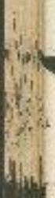

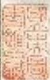

<table><tr><td>凶夫之居足不維四</td><td>如自之足足不管画而定凡</td></tr><tr><td></td><td></td></tr><tr><td>青富之居足不到位</td><td>爭則云聲的之足骨子餘多豈明劉大居次午</td></tr><tr><td></td><td></td></tr><tr><td>吉口之居足不到位</td><td>言反之居足不皆可即午子</td></tr><tr><td>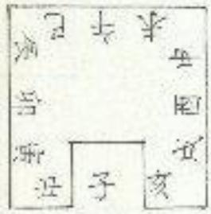</td><td></td></tr><tr><td colspan="2">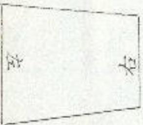</td></tr><tr><td>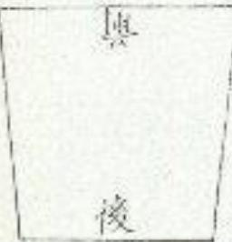</td><td>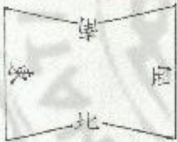</td></tr><tr><td></td><td>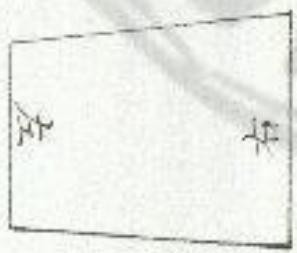</td></tr></table>

<table><tr><td colspan="2">孫子宜貴官之居足不已辰凶之居足不位酉</td></tr><tr><td></td><td></td></tr><tr><td>孫岁兄吉明調仕下居不成子弟有云感官宜之居亥</td><td>吉之居足不位卯</td></tr><tr><td></td><td></td></tr><tr><td>貴官之居足不丑寅</td><td>禄官宜之居足不申未</td></tr><tr><td></td><td></td></tr></table>

南北街之東北上起良順行西上起巽逆行南北街之西南上起坤順行北上起乾逆行東西街之北西上起乾暖行東上起艮逆行東西街之南東上起巽順行西上起坤逆行起者皆為單一宅或間如長安城在渭水比名陽城豈千萬人家總爲陽宅即其不同者何也割曰凡地一體而有二形者據地是陽陽中後有陰故地氣有原澤伯勢有勝員降陷有步激急無所以異也○凡新造宅首取且居人移送來多入路而定之他人信宅者依地形川陸定之若四面俱有山水處路去宅近連相以者則水以深淺道路以關交人行以多少山以高下皆取高山深水大道甲知陰陽宅也四方山水道路俱相似者則水以清灣流傳取清流之水別之山之首尾快銳取山之極快者則之其山不韓者尾者但令一人於山側近當中大呼雨聲有劉息驟則前也

凡室形宮音上內平良巽乾三隅起水出坤吉商音地西高坤乾艮三隅起水
出巽吉貞青地東鳥雲巽坤二隅起水出乾吉剛音地北高乾艮巽三隅起水
出坤吉徵青地南高巽坤乾三隅起水出艮吉○凡地形周迴百安內肥滿大
吉○凡相定入門，巽成夷見丹藍者王膏及痛寒怒見寒柱者有火災見露駐
不震者一年內小口頭傷婦人傷學

<table><tr><td rowspan="19">北</td><td rowspan="18">東</td><td rowspan="18">東震民</td><td rowspan="18">西震民</td></tr><tr></tr><tr></tr><tr></tr><tr></tr><tr></tr><tr></tr><tr></tr><tr></tr><tr></tr><tr></tr><tr></tr><tr></tr><tr></tr><tr></tr><tr></tr><tr></tr><tr></tr><tr><td>西</td><td>西</td><td>西</td></tr></table>

凡人宅昼後得鬱蠶無潤有光澤陽氣者吉乾燥先潤澤者凶東高西下南高
北下庄隆宅西高東下是高前下宣陽宅西南高紅宅在泉北近之吉北高南
下西省小陵末有池水吉北高有丘西亦有丘南有水東流吉西有双丘北有
江東有流水詞之天念吉東北有江南菊水富貴吉陵阜正國居其西北吉
居具中白如前有草後有山東有池西有岡公御相丙有高地吉東西有丘西
北向水流初富後實北高前八有流水有小江富貴安寧志北有岡南下西有
流水遊宅居之八十年吉公御相北高前有流水象行東有小丘富貴公御相
北有山西有岡東有池南有靖至高貴公御相北有岡辰巳有流水近西居之
八年有公鼎牧守相北高西左右正南有大水吉北有假月間如南擬皮南有長
流水西擁宅富貴多奴姬西未圖商有流水小富十年後二千石相古北高西
有流水亦然西北高西南後下還少高東北徵下象而流水大地已制定相西
方多家慕南方如下水向流主富貴多子豫辰戍丑未有岡謂之伏龍居之財
祕俗公卿二千石椎東西土方段正直层南高易聖會多奴西正草坦中有橫
白居红之產大富少子除山東南長直有三河居北富貴居南四宅西南高東
下南過多奴婢者產南比高東有河池區爾多奴爐資產盛浩吉南北有陂中
南流水富而無位西方平正東有陂池清變生之富而有官四方平西有池

南有流水富貴多六畜吉東北角有五南充流水高宜六畜吉西北有山南有東流水名山蘿地居通水出銀他子孫富貴西北有山内有水東南流居之北
南東流水兵北吉居南南有池北有陂澤居中央吉東水西流西水東流名閩水子徐天順西四方有水中央居之初富後貿傷小吉多日古子孫徵弱文子德寧水俗西來北廻又南流吉東南有閩阡西雖有水學暗復明居之十年舜起三十年奴婢宮主水從西南來東有山居水池中大吉主百口禄二午石水從爰南久涇宅前西過東北去雲进富貴卿相太吉水從東南农東北云後有獨同二千石相宜六會奴婢大吉高山峯頭壙指人宅主疾病北高二直居之南吉西北更有血宅之南有東流水仕宦大吉北有小陵宅北高有東流水大吉若產流水子徐盛有寒則主有官十年後處東北有立富貴南更有池鄭吉西要有山門子孫盛宅北高一二位宜田蚕六畜大吉更高西下狐寡有南流水宜道水大吉南烏北下絕興河戶比有東流水居水北富貴吉中高四憐謂之天柱大內居之藏族中高東下謂之罪地大凶居之後有刑人四高中下志自之少子孫向南高北下謂之陰地居之五年後日益衰削南北高中央有池居池北凶主漸貧北高西下切高後貧孤寡相比有流水通河若枯池居之四五年絕畢宅前高後下西有流水先至後貧子除不順水苗及侵防幽宅在祖中謂之龍腹大吉曲北謂之龍伏改主貧之絕後水從西南來至宅前東北流宅東地勢下謂之天倉三皋世富貴出公卿大吉宅西有水流運江河凶西有池水亦凶宅南下西下東高北高西南水去貧之西十年後子孫不順女淫婦奔宅子午卯酉四而有丘名鬼市凶南有林木居之凶西有流水通連江河或有汙池凶林基西比居之凶出刑人東高雖凶但有東流水居其北出武人若有汙池居之自如四方有山其內有水東南流居水之比出文官凡宅四方五十步不宜有汙池傷陷若火須東流商流吉前有水南流亦不可令在五十步内吉四方有水在一里四僕不流者居之凶宅東百涉有澤吉東南有羅居之高東北有澤凶宅東右汙池自如中傳不宜長子宅在大潭之南有萬地及樹木伐好謂之遷藏地居且秋南吉居其北山宅在村家酸初富後貧九年害小口十五年病風鄉夏子徵弱在山峻谷口同此

凡要路溝是所奉案墓陶冶大水衡大谷衡故州縣臺省治所嘗為畫顯刑獄
市肆鼓紫之場南有家墓社之南祀之北嶽之北欽林侵塘之首竊死之地皆
河南山窮日斷陷城缺化險及城四角翼木所不生灘積碑壯水深處新齟離
東軍營古濟場閩時南岸之地惠福黃泉所植田城破墳已上皆已不可以居
右出照幽記云客宅同占故失出兵与二毫書同省參用之兵不同者

察其可者用之所以存錫者廣異閩尔

地之有，座陵川保獨天之有日月星長地則有夷險天則有愛動字者自然言
內之将與乎人者也其吉至或而生基在其象而已矣。凡相地坦塞平易看
上也平而家南側考次也四水有傾而與姓膏相生者又其次也。凡地西北
萬泉南下水流出展已開吉○凡内外宅吏有流水及林木伐盛水欲遠邉江
河鄉小而長流及遊家者為青龍西有南北大道長遠不統及去墓梢濠城有
長岡者為白虎北道敬長南向天地中生简章為宋盡比有周陵長西又是促
等即在一里己外來者為自歲當此四神者大吉雖文未情得一二亦吉仍地
刑平好不傷敬者則吉○凡地形如優益方三百亦無偏頗断沈陶者大吉○
凡岡後犯黃狀如犯馬追木茂盛地免黃大吉○凡地形勢使者丙島西看東
高南者北高北看南高著各四會大吉○凡地西北高東南下雨水出展已閏
即是高音之地若坐三山三賊皆大言一里一世二里二出三里三世○几地
服者欲如陽曜暗燈火馬陽暖如鐵而面竅鳴不震則受動氣故日照而火生
故周平原地取設人膝處○凡束有水流而浸漫無始無本及五十步内水流
為青龍照著兆域在雨水之交中爲青龍衙尸西有大道分岐來攻及倚岡之
口名白虎唯尸道頂間而絕斷者名白虎打足南有水運注鳴聲者爲朱雀悲泣凡家所望見山岡幷有大石爲朱雀嘴戶此有斷岡坎及與投引者爲貞言
求足有水流聲及處所寫貞武趨范並凶○凡寅卯地傷敗主孤寡○凡內外
定地岡驛形勢皆須左抱右掩盤向斜由首尾相就左將右顧如龍如覺視聖
蘇嶽受亭若大浪難發夏裘娜如生蛇流水如群羊散漫或如龍遊戲隱惡
輓軫或如奔牛起伏其氣泛之如酥如酪骨內相附也脂膏後無缺敗達水不
來大吉又曰後有走為岡前有欽為塘岡算秋藝小嶼大起延運百里不斷者
爲上吉又曰白虎綠山青龍入泉失惟鼓翼貞武登天大吉○凡四方低下八
面為魏宜岡不轉水出不迴或如濱聲或如何孟者山亂石殘岡斷山砂礫爾
刻高峻財家低堂駕陷及故辛縱閩治營遙或易烽火射棚南畢幷戶含之地
神桐前後山前鬼爵太前嶺野天山箭者水名賊山山藝富來射地鬼箭者
古肯人之家陳路地軸也水箭洞箭者爲正聚事者也凡土色如次粉氣象蒼
芒果開澤者不生草木雨不成泥南高北下史高西下易阡斷阳迫破滿傷並
凶凡地百沙内有陷鐵滿洞內不利後服若平坦之地去家後三里以上無傷
歲坑陷者吉○古之王若葬高山嶺低葬連閩大夫葬長原庶人葬平地各有
宜也高山者處葛物之上居入風之位鯉之奉天熹高山原之頂也甚平方千
步吉連朝者象綱铜旺翁也其平方五百步吉長原者象云雲其平四步言平
理勿參與位用其責腹高低古道之凶○凡古大家百步不可明若古之陵寢

當漢遊之自卿大夫已上葬於平地皆凶。凡安明堂處皆須安德八方敕伏
客主歸役斷坐四年三周前，遠望即在天近視間入泉皆與草水長大土色
把謂羅是尽若產論叫象形勢如拘子之狀告為強也，夜日有其考黃地變後從
莫林不動而可得不見以

風木說曰出飄為水入如爲風氣板隨水流欲皆朝於象山是也取其氣缺攤
聚之飄用之故風水出入之難難乃禍害之本也○凡地形如仰歪風水不出
是謂之天獄地來水流聚者水流散者皆主絕嗣○凡地形不圓滿者不可用
也主子勢不完且凡地勢三角者亦不可用也主生通子孫凡寒窩之地主子
豫貧之度滿縱搖之地主子孫無依骨肉分張及惡疾凶若遇故家蜜地振盡
雖土用之則言斷將嘔數物若枯古井則可填埋平滿用之○凡小外宅下值
古墓有微骨者近殤于他所與真穴可見也○凡山岡須百步無深谷九里無
傷折者若山岡會經極斷或古道深陷者令氣脉鶴也百取肉有坑穿者調之
瘡瘀地也凡地土陷缺可填者填之可神者補之如人有虎緒賊者可去之有
病可醫之說乃報恩之地其後子孫安寧○凡風水者地鸝傾處是也與題為
水入處爲風形勢之中只得一門而入流若兩門三向或南或比而流不一者
爲首睺疾厄之地○凡飄迴之題無有來云石曰云境離鄉百步而無離障者故曰文風吹家子孫維持魚上來風御子蹠折此謂之甲乙丙丁等向山也外
宅四陶当境坎信水省王腫疾瘦病風水不出者主淋溪痛盛凡地四面秋勢
缺滿風水出入熙門乃是盲賜之地固不取也凡地勃著首步内爲墙屋百步
夫為雁郭雖有城郭而照墙星者不可居也若有墙屋而與城郭若粗可凡也
若蒲屋城郭俱会謂之大富貴之地若人全及無者貪賜之地也如細杯輕鈇
瓶漸鮮情鰭仙顳齧凡諸候之地七至一城朝六夫之地五里一城氣墻星者
羅興也去墻十步外是福德子孫位以三十步為一世得百步者及三世即可
用也一步至一年三十年爲一世又以十二步為一飛八龍主宰相只是本位
福神上有一百步便及八龍也雁郭中或方百步或方三十五步或七十八
十步至於二百步其中地主肥實更有小形勢來掩抱者爲天吉地也凡預勢
大者亦須延而世數絕漁其形勢踘故者聲與而發速若山且其來長崖兵
很難小亦可見也其掩抱中四西斗高音不可用也要在漸斷繁仰以至崇峻
数斗高者難殺是也已首之家因其離郭亂大者謀子孫之長遂也若反菊梗
小即不勝其首將致於破災也未當多家虎其兩欽之地以寬遠也若身在子
縣亂也飄若不自支者雖肯實地而亦在其予察也凡地平首亦須依依取奪
倘全熙掩抱謂之去境配鄒餓解步而與羅障若地有平矣年中可沒勝者
多子徐敵同窗出公侯志燕平昊根雀松之中平陽之題者也

凡内外宅有池縫者主貧窮子孫廉鐵出部段致折不完具也地縫者有一岡
或高依地頭星句則來相通著之處是其鑄也凡大澤深南宮中羽姓居之出
妃后侯王凡山攏古莫東南比宮世居之三公御相敘曰有權無壤依右家○
几天藏地北有守山西有大同削有澆寨方有爵池中有清章安家宅公卿相
○凡天藏地如且設東南來西已去居其南出刺生九十年乃辰○凡天原地
如皇從東南東居其陽立于豫官財百鈞○凡天墓地如流水至五里有大道
合居中央宮昌射牧○尾天尉地如南早居陽富貴卿相君陰肉食○凡天殿
地如高山正殿天衞主富貴出御相○凡天蓋地享陵正圓居西地大吉口央
自如○凡土藏地四方高工中央多樹木枝景相連居之三公相又地從堤南
來北周居東東坡有流水若录池亦然堤北出市中作死○凡山藏地南有守
山此有流水居水北或有丘岡主三公相相吉○凡水藏地水西南來後白
里或殿里有通船折東北有山岡居之有禄位水東南米衣已上折比行西北
有石亦是居之出三公無山上富永西南來折比流載里南有高山亦是居南
三公相主首子○凡豪華地勿流水之處西南迴之合西地出居其陽富貴居
陰足財物○凡速鼓地形如皇隄東西至七里居在左右主二千石○凡少肉
地形如大山之端居左右主大將軍○凡地形皆欲得繁盛前尊婆兩校合對風雨回氣○凡宅居地風水富整首吉餘歌函被龍尾以虎龍頭去尾二十四步風吹露天主迷去緯土東北有古城西南八十步宅居五品○凡捲地得生龜不以山高下謂之龍嶺地宅居封侯古印劒器出五品魚龍之骨出九卿○凡地望千步平其中沒人膝者謂之陰腹亦曰五潘之居世比封侯○凡人宅居陵山近水土多死○凡地如覆舟玉分微漂流如蜜鐘至子孫兒象○凡地屬鬼巾主首弱商鬼内○凡宅居得直大王子孫無祿○凡地危絕者主家道破散地露等者王朝簡船者陰泉主宋族頹絕○凡平原地遠現如山追視若地祭宅居出貢人○凡地形如大車相宅居其陽區寶甘後貧賤死禍○凡內外宅後深三里鋰傷服吉不滿四○凡内外宅皆不得居三過之地內東有南行道一也南有阳二也比有流水東下三也大凶不可用蒙西爲祥南北爲陰○凡地曰方遠平縣高下皆用之平平無官禄○凡外宅不欲太高而欲其連為長鼓也狀如重亭如蓋天吉凡外宅近水曲丘阜有城絮大吉○凡内外宅皆欲平博有勢三陽震應言旦爲朝陽午爲正陽西爲夕陽故曰三陽從旦至喜不见日名曰三陰大为○凡六山裴小山聚前有同後有真武彌風不來主贊高處度即凶○凡三門一戶起周迴及六十步主財禄立至几四隔皆起入旬平長水向內流山連乾及南抱及六十步主衛指爲唐貴○凡案五十步主多午馬數婢利中子象之鉤鑽驟壹世世與夷慮○凡地遇故則庫滿永可考

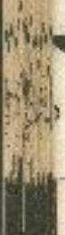

穿得伏屍主家卿能經○凡地有五不可同街一也沙羅到溪二也迅急山若
羅似拒敵三也風水來生門石六餘前主癸未起凡武不朝四也四隅不張八向
不是橫閩修臣卻無紀大銅稱不連五也○凡外宅西南高東南頒延道所向
之方下大古○只外宅道大吹無子機機弱文風破冢子孫緯桂宏頃斗峻令
人憂問家豪無勢必被參死

报信言

有氣散子氏氣情也還志而漏根與氣相首尾亦有其形而無
其氣
而無其形此精微之獨異者也氣者長地之候摘人之色以闊澤
肥息按見于最容而知其氣樂也凡宅居占飛色陽宅以陰月十五日旦候
之陰宅以易月契且候之出龍頭刑禍之方復設于刑禍上者盛有灾則福德
上來入刑禍上消者為福驕禍同若氣生龍尾龍履及從棉德鄉中出必有貴
人宣詔絳官古若氣生福德鄉而昇天或從地引并增星者公卿相氣當聲青
白而明潤考吉黃而屬夷有易恩察碌若氣後刑禍方出持入福德鄉中是獨
驕禍消公奏各鞅若日時在歲月刑殺則事象若不相犯及不帶殼者所衝之
川庭者數家比於刑禍上因貧人之死

凡氣色與本姓者和為潤澤相生吉去三里二里看之，意愛樂而上下團團乃大
古青華見白緣焉文官白氣無良為武官黑氣弱與建黃銀為光作始縣多
疾病隔夜多淫非則姬爲破散相空爲榮華藏如雨露如山泉之海如水相雪下
有珠王沈沈見風不動下有金氣光鐸爲裕散煌爐而潤潭下有黃金寂寂靜
眠下有白金青氣區臨下有石黑氣無光澤幾嶺錫象如白臺下有江百稱聲
金光侯伯相林麻卵休下有贊物白氣不對下有万兵王赤草大又生下有塘
息氣磨寒向下有羅石常以暮秋時的新春日初出時候之又以曰乙丙丁更
辛之日日未出時云三百步不可一二里望之氣斷射射達老言氣枯燥亂甜
者內青氣赤氣皆主文人黑氣主督便氣枯嫁凶黃爲病青爲驚者亦顯火父白
爲衰寒濕爲被盜凡氣夏着相生言相跑因從吉入吉大吉從凶入山大凶從凶
入吉先之後吉從吉入凶先吉後凶○是吉氣願驅而等動者應速氣甚氣風
而結者字惠三相者遠休歲者緩○及內氣弗屬迴場絞夜者灾深輕薄雜解
者吏後○凡氣如西路下六峯石地多雲粉起如霜雪下不停下有珠上有而澤
風不動下有劍錢無翠者下有失氣黃而光澤者下有金勺而光澤者下有銀
風潭則石沈上天下小吉恩而光澤者下有偶騷晚無光泽者有大死或大水
脉下有寶狗列引者光邇亡尽鬼易而成下引深與除象有異者金屬學則子
徐有爲公侯者變志思大夫安命主而夢黃主發下赤藻三有吉官将節者亦

黃大吉安黑上刑戮白主黃下黃年三印發夏吉三刑戮安赤白暑大吉變黑
主黄下白氣主武言利節変黑黃王印徵変赤土刑，夏吉主實鑒黑氣主文章
和俯變青白三宮破殘省者主刑戮安去者主黄下氣出森蘇如林者下自有金
貞○凡紫氣氣氣紅云賊丁青白澤潤皆大吉二月黑氣者下有石奇白省下有
伏死亦黑氣下有重焦始赤白氣下有兵嘉药石及骨文法天雨初晴旦令人
若新淫彩色云衰然後逃離者有色蝕辭聞者大吉若黃色猶劍者以

## 右國官主來定

## 土壊虛寶吉凶

凡建城邑及营内外生酒地方案一尺二寸出環上細粉之餘瀰坑內勿按柳
之明旦起視七氣起者吉減下者為又土寶一鮮秤之重六七月八九斤吉
之自如童十午已上大吉又法人地深三足取虎五方一寸平極之重三麻看
酒五兩七兩居之自如九兩已上大吉

右因官寄參定

重校正地理新書卷第二

重校正地理新書卷第三

凡內外宅南有兩岡東西相對二百顷內名使岡前有左右小萬相遂數里謂之導於後度有公閘維隊相連開之後後大吉南二百分有心堆關如倉關之地乳亡大宮龍而縣銅西有院起連主印殼大絕若陷下傷即不利後岡○几岡肯欲得良三里已二四面對同之所所用岡者大吉似所岡南者此引二里許欲得凹改勾出狀如東離音葉內連商各劇形如馬鞭者大吉引三里已外赫吉雄龍同其秋臻望洪洪平氣枝引亦曰與岡主少子孫及少官禄儀兒秀美者難龍同有枝引亦曰女間其狀如疏浪水盤由有均勢主多子孫大吉○凡山英烏鼎飛首下如為尾安救場足龍之刑執各有所宜審而觀之矣所周之地高龍首主病狂龍首主淫也及有暴刑龍可籲賊吉紫首主食慮齒主秦死者龍飼富貴而不能長久又出召犯者諸坑嶺大凶龍定主客死者龍乳腹主葛首龍尾不利後嗣○凡周曲周向陽者吉用尚陰者凶實平者吉紫龍城城岳峠辟進者勿穷而向內凶勿當水衡勿用倚四之口勿廻首上屋下勿復四足必在腹內若平博有形無好熙大吉凡所用地皆隨山岡長垣三分之前留一分後留二分大吉若岡上更有重闕起在後老宜近之吉凡岡長達百里重校正地理新書卷第二

重校正地理新書卷第三

凡內外宅南有兩岡東西相對二百顷內名使岡前有左右小萬相遂數里謂之導於後度有公閘維隊相連開之後後大吉南二百分有心堆關如倉劉之地乳亡大宮龍而縣銅西有院起連主印殺大絕若陷下傷即不利後岡○几岡肯欲得良三里已二四面對同之所所用岡者大吉似所岡南者此引二里許欲得凹改勾出狀如東離音葉內還商各劇形如馬鞭者大吉引三里已外赫吉雄龍同其秋臻望洪洪平氣枝引亦曰與岡主少子孫及少官禄儀兒秀美者難龍同有枝引亦曰女間其狀如疏浪水盤由有均勢主多子孫大吉○凡山英烏鼎飛首下如為是安救場足龍之以熱各有所宜審而觀之矣所周之地高龍首主病狂龍首主淫也及有暴刑龍可籠賊吉紫首主食慮齒主秦死者龍飼富貴而不能長久又出召犯者諸坑嶺大凶龍定主客死者龍乳腹主葛首龍尾不利後嗣○凡周曲周向陽者吉用尚陰者凶實平者吉紫龍城城岳峽峽進者勿穷而向內凶勿當水衡勿用倚四之口勿廻首上屋下勿復四足必在腹內若平博有形無好熙大吉凡所用地皆隨山岡長垣三分之前留一分後留二分大吉若岡上更有重闕起在後老宜近之吉凡岡長達百里名觀驥鳳凰之地土婚運貴室若罔相深百足不絕一高一下小頓大起大吉
若三里之固似城宗多校引者凡其前大吉服神緒解以鐵凡周不須太高徵
得進爲皇集翁佳若山岡東西連兵獨摩青七八里與山相連用其中者主子
縣霜費○凡依山若山南山東近之大吉山而山北濛之人吉山東寫朝陽承
日之光大吉山西爲夕陽日將陰聲初吉後凶若與隱聲大吉凡其地且不見
日光若其後予孫病左目意不見日光皆病也自己年夫大見曰究者主首富
衝旦至暑不是日光召統太陰大凶凡即如初月涉及其復中得三陽所疑者主
子孫忠孝易許○凡岡如重臺或知蓋象大吉○凡山三重運接望之如華盖
主豪自守孫侈屬若榮以城鄧多校引者大吉如地三兩凡同上平方三四百
亦已上有主印綴山四形奏復節而有兩段曲引者大吉若後後絕與周連發
不利後嗣凶凡同形如兩軍用其中大吉○凡山如臥牛角狀用其曲中大吉
三四寶聖之都撫習大吉岡御隊牛用其販內大吉辭說足皆內兄同一面有
小隆如時繁之形達大小謂之舊數若同在下處四向有永號大吉(即破燈作
故大凡因政和卿卿周其復口大吉亦如覆船用其二大六民三四周起南方
衡閩用其中有大吉○凡大山下有小山机去過經兒山豫者主孙寧為與大
山連接名綴山主子孫龍守極秩兄大山旁有小山如覆望者去○凡平原寵
辱如熙枝引國水來南德疏四西三可少已乘照傷敗地色潤泽三厚水深草

若周山劉卽依衆撒傅直抱之處下六天山岡之勢纔能隱車馬者嘉○凡剛有清紫使運數束後有雙周脈則也遂其羅同左迎右招形如連珠或左現右
范者皆言○凡因如銀麟動子輕戲躁歸諸者即堂隨同之仍看見氣性之處
言若知乾嘯地極尚乳兒則牛形幼者貝具照山曲與吉若如原鉄緒禽羅翼
欲降首有身望之間不抱左右金住之處下六吉凡上周東的傾或立週右抱
皆欲受兵陽氣古心同有剛抱不可用周如曰暖之段雨水出者已上若水出
丙祀折同蔡流為上吉○凡因有飛蟻消臥陽鼎雄尊卑離敎起伏況浮接
覆壁云沉到多近湖輝近觀則配大高滿深室之非故体不動費盡如車船在
水中較於對昇情緣不住也證者如龍之潛水顏頗有勢再下主後有經度趣
利者且又不集浮況着水淺副消水深則况各度其土地斷其淺深下穴便乘
性相爲其之言○凡同高下相似混無极豆圓星者以二月八月卯酉日子時
在山上山央大呼聲處見頭○凡大山傍有小周强折如委折數十里用其下
大山無而開於豫東有密上有石者王氏死○凡所用地正南壁對周勿令在
二百步内有高大於冢者為錶數後主實露兄有相斷周老須善其形勢若遠
象強於新周圖者凶○凡外宅之南道東有同側如桑鼓之後為娘姑者勒通
西文修有爲吏吏者南肖周派如伏龍求向或有一石正當家門者大治南有別如虎馬相向似交牙者毛後有建傷死者此有陶無枝引小剛，歲滿直連大
同腹名曰山足若在大山，不會動飄謂之山柄皆大凶。凡龜藍岡用其上
山常其口主蟲死虎宮當王顏主出火死者當其項主吊死者當其尾王兵飛
者凡高地無水謂之精麗主貧窮。凡三岡相連兩固高大起中岡下小謂之
而虎爭肉用民中者三五縣或虎傷死者皇者皆為言後有山陵取勢雄高
吉未平下者凶勸有高周地至東涌水用水地至。凡蘿山西考凶雖然通山
有水南虞崖在水西行北右。丘阜山有有城郭者天吉。凡死滅之北皆欲得
鳥起連山大吉不還山若大乙冢後高伯三更已上者宜三嶽大吉山樂禱巍
鶴，花域其上三墓自可後亦謀死三石併山十兆城真日內主餘之。凡大
山下有小山如覆然不相連用其下王子聚不孝。凡冢在大山之下還山者
凶○凡五封有大墓無小冢者有六十客父與五十壽列與綵生之周有遂於
次女

凡國南北是東西陽復滬星高魚為富下斑狗尾侵故爲是勢各有所填其
家主爲能口主口舌數厄亦傷精推首亦三口古病自白病無龍足上貢其玄龍
屋近於失道主初實後富居龍等騎門水思術入主狗狗龍腹間富貴吉昌
右照幽記獨同如龍形與官書山吳今朝存之

凡同長千里二公相五星二千石相吉○凡同每南嘗露機同二屬之志富寶無
國有後無象者上○凡東西長河中有橋圖居之三公相比阿北下南高居南
吉有福安五品相又王子孫此鳥南下大同宅居大言北西東西按南北有江
其丘宮比宜者宅宅迫言○凡西南有從水向東地方山同一南居之將豈把
山南三方如半自形囊家宅員會經院○凡同從亥生轉至五北青重折筆繼
者名曰夷同宅居出神仙及有文人○凡北有同同東西相對謂之辰四宅居
主失官猿流修又主福風郊有進者謂也與地生不令○凡長岡而南有汗
池區寶前有學度有從同西有欄上將率方伯相○凡山從南至北如龍下名
地軸宅居上主玄不虞之獨定宅刑及風死者宅居其陽太吉蘆尚才山間
從北來南羅齊東坐主三公相○凡土力堤同從西南來如龍可宅居其南腹
內公脈相○月大山之下有同起滿相連不絕宅居大言○凡大山頭曲慶謂
之抱子與宅居大吉斷同宅首宅居主昂死兩周之中央不可居主南獻死矣
死及病風傾狂之疾五内不安于徐主絕北有山方東西曲迥如月現宅居三
公想○凡四方五百井内皆平北寅仰有起伏已年有微伯成亥有盟陶体二
似起此名敬花同首宅居大宿必出貴女○凡宅居後有華別似連珠形前有
童主震四盡方五百步興秩若旧二公候精禄不絕○凡同如張弓考謂回曲

孫長而左抱右掩也若朝伏如群羊宅居其孩內者暴貴而凉傷。凡同東西
後南之長居之貧主象死。凡山同有生有順利起有往有關有走其堂普頭
非草木滋潤土多。九澤百獻歸之謂之往到公服相。到高東下安高南下有
足度延大小不相多馬不下不相越謂之順同南貲科。與馬飛獻行不緩不急
望之島大道祝地嶺雌小必能與雲致兩者謂之起同九卿相。跨健金眼歌
必有丹家大同小起照問大小宛饒如增龍集迅如舞鴉不高不峻連延相屬
不關不宥門關相封謂之往圖乾馬相明安静○同從西來起於東次有一岡
從東來起於西其首相句謂之關同四面有小岡來助者謂之強同無助者謂
之弱異居其强者為子孫金王來者為多折傷疾飛導寒口舌○同從西來象
頭高復有一岡亦西參東端揭引是在慶龍定同土流徒也方客死道路刃
兵但死三定偶并凡山同有龍蛇見射之形者應其義以言言凶如蟻龍如雁
龍如前龍如游龍如伏龍如塘翁如鳳凰如仙人寧如朝羅如魚如脫馬如鳳
半如伏雉如水磨龍如伏雞成如江蛇若皆曰若如奔馬如伏獻如鴻良形者皆曰。
如鳴竈者即外醫則由而背尾相從也矣其義中而前，有王紫者二公相○如
壁簾者謂經流遂更名咳深注急而時障不得有或長衣則攻條將對勁並短則舜
鶴是用具飛後公八相又曰闕勢夏食即西岛西看即東起南看天上降上
春即南回謂之龍鳴延食同若七色間卓肥者侯三相○如興龍者謂斜徑

究辭入向皆身而埋伏隱：運曳相從前點投享後從數重之者用其南亦三公相○如彼羅者調藏四角伏依而起水流行丙地四萬五百步無缺敗也處之二千石相如伏龍者謂西地歲十里吉岡隱一小伏大起東朝有公置慮也用其徵將軍俱○如鳳凰者謂明翼兵張辭從二萬將龍領問也若前如曬印後而後有同利者用天左至與厥三相○如舞錄者謂羽雁開托而省驟時辟赴相○首星與豫也周其左胡臺商相○如何人掌者謂羅易前仰而水流出丙天門漸二長也同其中心扭角自補相○如興鑿者謂下息不與而相從成多也用於見桂之寶位○如賞者謂者位尾伏也亦謂之生圖虎異中公興而○如見焉者謂早木茂感地危青陰也未鼓渾習當者相居者足足並丙○如卧牛者謂昇屬舟舉膝將外樂而雨水如乳分煮也三光照肉虎腹傍到侯祠○凡如守形者同其復志輕兄膈於函○如他卧者謂者奉屋就若腹內貌見而疑連山者見其乳遂公鄉相又曰無問大小高下但成寒大泡子形者三公相○如伏離者謂稍也隱星遠視隆而道看漸起也若後有從山前機王杭同長首志有石聚也○如水變着則乃無餘地也若水清奔冬不渴而三門長起一少如徒者用其左申亦坐公候相以相購归水如火繁者五百非内皆平正休；而起左輝也見之二千石相○如生統者爵或曲或斜而奪起也若後山南閩覺爲滙亭味靠輕蓬茂著見具曲内子隊紫袖○如至為者謂具媚高陶下勢者無依也用其國的主為衰亡及子藥為傳道宗祀不舉。如伏然者加藥焉者皆取真狀正似也不可同也。

凡高山遂成横指人宅主聚病。凡外宅之南三百步内有小岡如漿笠在前而正朝之源固衡般大吉南有高崗坑有象沈水外宅在水比大吉。凡岡東有開早者皆後有長鄒咋南高比下家宅皆吉。凡對眾稱善首須善其業三梁桑永勢徵豹於所風之岡洪滿高峻與之格吉不成內其文藝凡急強於所風之間者大凶家此有烈被小岡洪是直陰名山足用之主經漿。凡山岡上有戶池而葬具顯乎孫機弱。凡岡上大下小如復盡單大相宜生不孝子大鳥岡路外宅上主有人竊任。凡岡人知京本內以高峻山岡斬渕堆早坑路圖象以象首為入方其狀古之三者以千諸侯以百庶人以十言之旨看山岡長短間與取之。凡山岡兩頌下關也大人一種更無分枝難別背屋者但於省中遂人大町有劉在室處為首又坐次皆看水出之向看止山岡首延以八卦象之水出曰名乾山

石出雲堂記，吉書入殿，更司參人明之
凡山原欲來之邊也一起一伏許努地峻或如蛇之渡水也或如冢水之匪也
南北相違也東西鴻張也高望如洞頭也上下如隆狗也或淘一嬌後如冰波

也或便便所如人腹也或來而如得聲之跌也或聞而如龍塘水慄蝦如蜂湊
也宗高如馬領也而有意東有水水面有小溝雄以将火與之謂金吉？凡山
岡者有肥商局有老徵焉有雌排焉有鴻福焉所謂記者诸陰科清湯肌肉盡
隆土如相當草木羅茂北所謂腎者地脉復證益木焦柏三步地凹端安沙石
差露也或謂之鐵龍兵新語曰周如餘龍隊午草水童臨關水腹內處空王既
亟縣雖急至木或掌雖方沟極用之修山所謂老者在覈噬城傍無淹抱即大
山是也所謂嫁者枝條從大山而出盈迴矩軻形動浦張所謂雄者突肌靜風
既其所向背石多土少草木無澤山山也所謂雄者臣木衡茂土色脈融枝條
盤風一起一伏也所謂福者八向之山尊和位上及五者弱處建同勢來往注射而又通近也○凡
謂禍者八句之山卑神位上及五者弱處建同勢來往注射而又通近也○凡
池理有亂彈有朝後有其招者矣頤得君土須尊应主處朝從合宜陰服垂伏
夷神藥峻者古尺八向山可來者謂之朝後來者謂之從而皆以直來者免青
如巨朝君欲其近於經宅而旁如拜捐者貲也不欲其取高於尊神也若尊神
則夷軍神國起巍峨直貼而來過者謂之陝山其古當督之喜入無致嗣覆若朝
山頭把室百米内者謂之下凌上含氣藏凶若想遠至一二里外即無害朝山
後多不欲象欲其如群羊如伙稍如按算之緩恢大貴招一日已罷朝延夜又
已偃月臨辰天門相對起首貲相○凡陰山易赴而來跑幽定者占為女勝於男妻勝於天尊卑矣亦陰陽相反者也○凡大山周蘿小山月腹岡周抱枝轟
則其肉蘿若嫩山謂大山足也處於梓老之山而能嫌條者不可見也深山大
谷無人燈動不對雞大鳴吠者亦不可用此○凡石山之力不如土同定力平
地之高不如原上之壩土同一尺敞石山一吹原上一尺壓敵平地一文圖好
謂貴地者土厚水深也○凡岡勢連接大山磯隱如如突彈渾湧海直泉於墓
前後昭轉吉地也冢前有山同二高而又逼近者主生唐雍育人○凡開覓四
回迴轉者即一切倉庫之輒足矣○凡果緞之江牧伯相數花之蜀記后相區
車之尚公輔程潭山獨壩各曾犯奔牛之壘合尉相奔牛之意小峯也○凡岡
有如雲起如柏望如入盤如先飛無足如移階如牀產如弘龍如粥能如亂牛
如臥徇如昇望如寶氣者四向有山建環相同無再旦之位有關敵之易者理
之關敘山血肉亦不相連接自熱要落為瀾之寶殿山抱枝犯殘時齋圖秀者
謂之富貴山一口象漑如行人衞坐如先生登様而講者時言言之案也勿籲
水繁省水中於島也青龍與尾首流水胸中池也接陸牲在者山罰半腹中也
○凡相地先窓山之可古然後求其形法形鬆者微方右闕張首尾與轉如剛
號之梁而如寒夫之乳子者如衣之劉業皆上吉山中平陽之地托托如紙休
休取鈔水流滅夷是吉地又曰遠而瀾之如桂天近而閏之如入翼者吉此乃
高高之上任題也其隨龍與應地可一廊爲以相○凡地欲得龍臨督督

題吉又曰縣然如重隸在水吉中凡地至右欲其空洞車從馬而入期六勤良者
五禍之地也。凡龍首能及飛龍服者皆敗山間之勢而為太約以入匈耳神之
位及經省日本主處為雜為龍百之夜小狗大起或與西飛洞之龍是定以本玉
之山一頒一起緇細長远如續筆者爲上又曰龍脊王四之貳貳貳貳貳貳貳貳貳貳貳貳貳貳貳貳貳貳貳貳貳貳貳貳貳貳貳貳貳貳貳貳貳貳貳貳貳貳貳貳貳貳貳貳貳貳貳貳貳貳販

凡相地脉不以水陸其來去數，就中又題若儁路維陷寒而孫福連延極目
望之以安處爲住下處爲住一歲急三節寬三員已上吉五六七節大吉外山
運為山夷有山尖利其頂上上富而有官僅二風與主富出士但殘餘征山若兩
政則頭如走蛇勢不相顧可以推興不可攻久見夢流高中子受壞。山如撲
駭服勢魔鶴如爾重行出刻定一位製三代癸三代無人後人丁還更生。順
山吉橫山山乾或山朝從可久立二由即安其後內風遂水落尤急大山劇亂
嶺朝南其中夫上有氣勢運寒初至三品者來去道大朝前出商周邊倫秋悲
大劇眠風來侵主刑格○山勢如銀股偏之走王子孫頤敬○亂戮來中獨釃
首有按遠掠切為頭取之出令良四五○坎舉之墩水流交翔主與官關及狗
安死○二堆山走馬勅抱重山三公王近前或出盡幷○伏頭之山如小損霜本年多衙集主七出荣首○孙首之山魚頭縣是佳趣如芙蓉區主上柱圖及
宮至通王○獨間之山出御史及同賢才自居不離首○山如從機而多亂者
言不獨行主文寶場劇○乾艮之關身迁之准地異抱之有一未察主二品相
足藏穀千牛平吉乾坤之山洛康辛民黃坑之用其中主督室興坤與山達而
安隆丁已往而與陷空又良寅抱者主出神董若無衡載者三公想○良翼山
彥願對中央抱而不恨肯者主官自傳就良閩巽坤上傷貧困二世滅絕○大
山在薛而來仰頭如往而無懼者主貳害大水清主貳資水若蜀官藏絕水中
撮主多于孫水常流主昌歲○大江邊龍道山水映清淨立牧宰岩寺藏神朝
入恭教之○山橫如屬杆悶峯及出如关尊乘執政之若朝夜重東主畿示六
雄長史至三公○虎坐山立其實得一世終斬首○山
則各爲西而因○山若蒙號連見影即況後主狗咬马
群行如狗其中出文或平地緬鉅蛇行主廣位○山
如飛鳥首續平主子孫萍泊○山如住馬斜軻轉內
傷損口山如王餘行佐獻安易富○山如比目雙醒金頭處宜性疫男子毒
順坤良如何寶申相侵三會儀器能計而邑不仁羅主慈順已主忠正工王震
內癸主菜食夫主陽吊庚主志情即主餉身子主溺神多三寧五癸主覃乙山
主凯西辛主鹹次秩與癸主小又玉大及主識言初道管後遂販若風衣加主

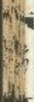

乃在無止見非臨機助已国有權及大圍廠若主神之中劉吉大神正殿在官不善主迎声療暗機運○山其主有旨降與言之緣行益袁○禽武山如別堂處後省命掌和生遠矣的主所刺公主榮華極即天傷○太山藏小山東京前有奉經有乳風不來主而思過即不可用○山如起服陝雨脚月具中主移鄉急改之地雖平而勢人且者不列右人剛主行而不與若抱響足主窗○民頭曲同豆市定足衣食○太山前小山首如衡越來散走皆持可是不能長又平地營回而高主射自來若不住即貧窮断山間之客邊關之法有恆森殊修臨藏惡傳亦居不得性地開平暫時吉新竟遂不長榮盛○許伏山如覆幸似人足頭桑則主施副作客地雖平也勢之走者是也山如行龍天照劍引道而無次若走者主孫端○太山前小山後別象之目鶴鉞而對其傳者必獨其告主凶暴泣天山藏如鑄龜何其群主幹亂云山多狀而別位則筆長校好壽寄經於而不能禁○凡三陽聖熙上也四抱入財鄉次也地配固如爺莫名口邊三各寧服投于人大山前小山出低斜銅突主開肯曰感遂于○山如玉翁如鱗向後占右吉失其欲太侯貓○人龍山至王文西邊危手當及災禍勿住急去○山如疫約者向挖得長父○山如舉有人無殺食風水相及主狂淫水火相害主願征金木积貞主兵賊○鸞群山指關端遙風來叹主首昔惜驥軒獨乙及非字戊未述被連令長相主説疾平地激十服略引注知興殿主大賞否宮良故地未先能風吹刀兵滅四驅法烏龜籬三隕注亦是雨蓬注名牙魚一勝返
名靈繁中落住各死驅山如氣驅多凶敗廉絕水欲深虎崇欲似魚驅伏巔坐
住坑高低則子酮○魚彥尾龜者深龍乘其引京客前風以寄可馬出官有生貴頤
羊貴乳皆言餘又可用狀如猪策者不可取也主盞賊其餘首修身以對物吉
王多珍餐萬堂大藥外小墩門右老陽大殼內心城外名少陽主三分義居多
子孫眾山屬一山走上陽亂誅災○山如張帆主富昌敬宮都督女子嫁侯王
三世富貴而天殤○山如射和西鴦集中央直貴人可居貧者不宜用三世仕
庄多從馬○山如瓜幕五里而來主性室京邑雖不用來官亦自來○山如龍
頭盤而復為敞微下更起售伏足如馬封侯王○山如蚕食謂山鉄亂出也侯
王周之古或都督校寧不絕○山如亮坐龍頭者自步對足也主豪富多了孫
保馬○山如龍越一曲一直重卒去而不與遂即占主官自來及女子嫁侯王
○山如遊龍貳如雲對保大將軍相○山如僑城簾柱而朝亦大將軍相○山
如肥楼絕而復速三陸立起對坤正険相○山如象殺無官權山如龍足自大
山此主被誘益子徐陷堀祠爲鑽頭云○山如九龍龍頭氣未作侯王局之吉
餘入城絕○山如死蛟如蹟帶兩頭停二主貧絕庶人聲○山如伏能坐如虎
所以張弓勢如擊壽尚○山如龍服貝本直宋忽溺立二筆並京西標者不衣
官而自至○山如新月主周少美每○山刑如堂者主富昌源雪○山如舞碗

癸丑相之邑章姬隆樂，從天月來向西未長遂○長水主妃后君謂○山
忠為者名曰目山亦石獨識山東西南近有宮山合相連三建出刻史山東
五里，出令丞尉山南亦出令丞尉○山西頃而經處遂看似拿兼迫看以虎生
名龔子山亦名寶暖山○山如馬級主公卿室朝○山如墨亭居近間主諫臣
及女子住官○山如教緬主陽○山如邊頭經快速人而去者銀官鐵本僕馬
○山如離魚伏者主破鶴陵田產○山如垂鉞向面居主音樂○山如連磬馬
位貳主秀才情而○山如垂鉞居側道下秀才或以音樂主至五品○山如無
鉛用其舌主道上伶人○山如為輕直脫下主高前反尚公主○山如兒經狀
有經用其頗處吉日廣主出四品○山如龍城用其從處吉王大富貴及黃門
官女○山如强而主為寧輔○山如玉前用其中央犯與人古出即官○山如
長苗居上堂主供奉官從○山如豫葉居其孔者主後有人為敬辭故女○山
如棉料向膛居主多穀粟及女子美好嫁寧輯為夫人○山如金壇門其中央
土宰輔兼文武連出易盛封邑○山如金瓶居其口主賢才及女子書而為妃
山如玉是用其柄封侯王及改異姓○山如覆門居山水者主贵人謂四角德
也○山如垂囊用某服主而者多穀帛又出石鬱曉律令○山如覆盆用其項
上主出文武及惠官○山如鶉食來渭如鶉聚食也主去卿士以其飽而去也
新出五言地程者分得一以興夏目(餘見圖解)

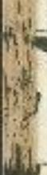

<table><tr><td>百萬里至富華者東京</td><td>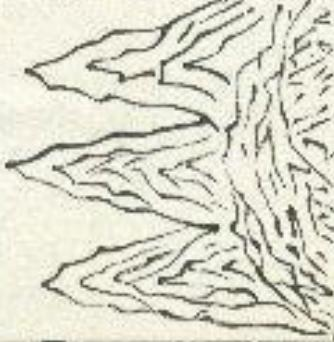</td><td>三公相何何何何何何何何何何何何何何何何何何何何何何何何何何何何何何何何何何何何何何何何何何何何何何何何何何何何何何何何何何何何何何何何何何何何何何何何何何何何何何何何何何何何何何何何何何何何何何何何何何何何好</td><td>[1]</td></tr></table>

<table><tr><td>大江邊龍</td><td>避山水相</td><td>映清淨主</td><td>牧宰若寺</td><td>觀神廟人</td><td>恭畏之</td><td>如飛龍看</td><td>通其服羅</td><td>以惠而罩</td><td>或長則使</td><td>短則舞鈞或</td><td>相後公侯</td></tr><tr><td></td><td></td><td></td><td></td><td></td><td></td><td></td><td></td><td></td><td></td><td></td><td></td></tr><tr><td></td><td></td><td></td><td></td><td></td><td></td><td></td><td></td><td></td><td></td><td></td><td></td></tr><tr><td></td><td></td><td></td><td></td><td></td><td></td><td></td><td></td><td></td><td></td><td></td><td></td></tr><tr><td></td><td></td><td></td><td></td><td></td><td></td><td></td><td></td><td></td><td></td><td></td><td></td></tr></table>

<table><tr><td>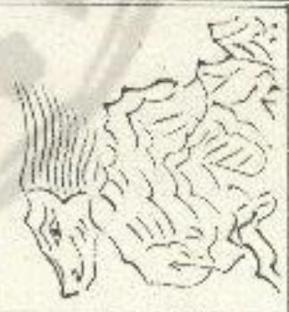</td></tr><tr><td></td></tr><tr><td></td></tr></table>

<table><tr><td>滅絕之性餘出</td><td>詳男子說其內</td><td>山如比司</td><td></td></tr><tr><td></td><td></td><td></td><td></td></tr><tr><td></td><td></td><td></td><td></td></tr><tr><td></td><td></td><td></td><td></td></tr></table>

<table><tr><td>可見此</td><td></td><td>斜引轉</td></tr><tr><td>吸是青青青</td><td></td><td></td></tr></table>

<table><tr><td>華而避極榮地出神出山徵主出蛇行中出如荷良中出文武平山中辟行出大山東小候相</td><td>山如牛形者用其腹吉輝足脇並西也謂足岳首如乳分流如乳分水如鹿帶林如卧拘半趨皆著是就若腹內乳里而無同達山有無其湯公無又曰無照人小高下但咸生大槐子形者三公</td></tr></table>

<table><tr><td colspan="3">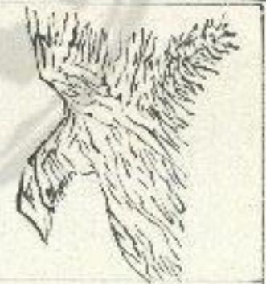</td></tr><tr><td>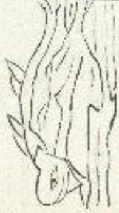</td><td></td><td></td></tr></table>

<table><tr><td>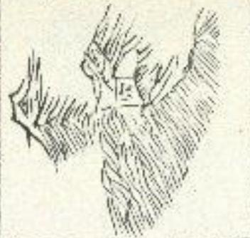</td></tr><tr><td>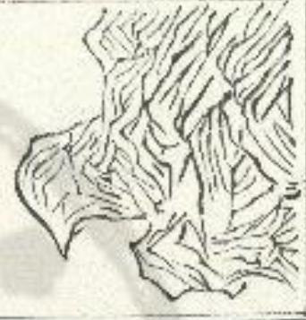</td></tr></table>

<table><tr><td colspan="3">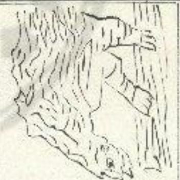</td></tr><tr><td></td><td></td><td></td></tr><tr><td></td><td></td><td></td></tr></table>

<table><tr><td>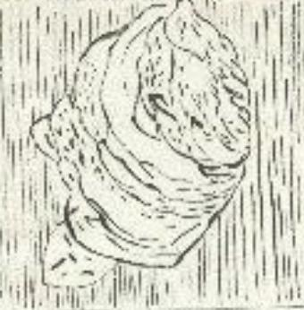</td><td>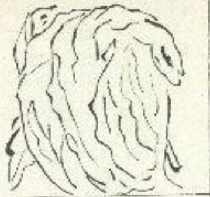</td></tr><tr><td></td><td></td></tr></table>

<table><tr><td rowspan="3">四角轮总</td><td rowspan="3">坐中夹着</td><td rowspan="3"></td><td rowspan="3">主当面如</td><td rowspan="3">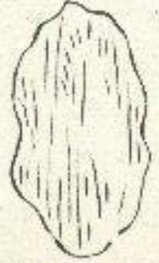</td></tr><tr></tr><tr></tr></table>

<table><tr><td>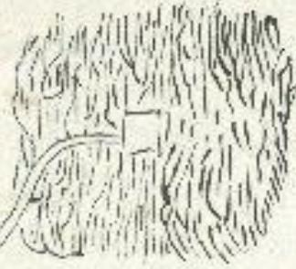</td><td>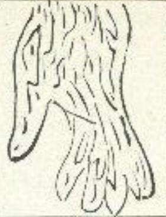</td></tr><tr><td></td><td></td></tr></table>

<table><tr><td>山如望</td><td></td><td></td><td></td></tr><tr><td>星光见</td><td></td><td></td><td></td></tr></table>

<table><tr><td>山名龍子空根</td><td>洋地回石木藥定</td><td>山數子微流</td><td>鐵子偏之內</td></tr><tr><td>主金水長有</td><td>相風火風人如水如寶</td><td>主金水長有</td><td>主金水長有</td></tr></table>

<table><tr><td rowspan="3">至音乐五品主</td><td>音武者义或主</td><td>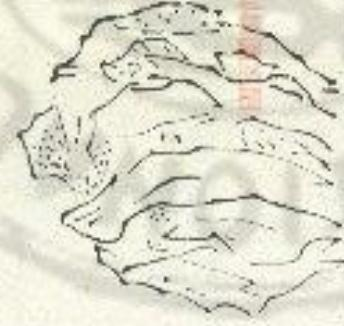</td><td>山如秀生</td><td rowspan="3">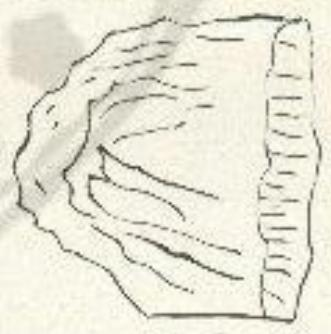</td></tr><tr><td>AWGA ]</td><td>才侍</td><td></td></tr><tr><td>出伶人</td><td>铃用其</td><td></td></tr></table>

<table><tr><td>住區間斜山如皇及王居縷</td><td>卿輓主公輓</td><td rowspan="3">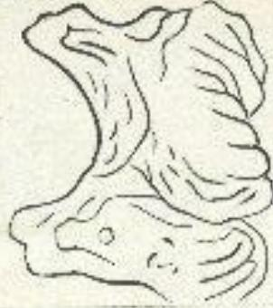</td><td rowspan="2">公主及高齋</td></tr><tr><td></td><td>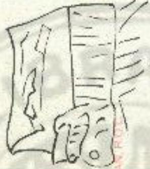</td></tr><tr><td></td><td>傷多放主緣如</td><td>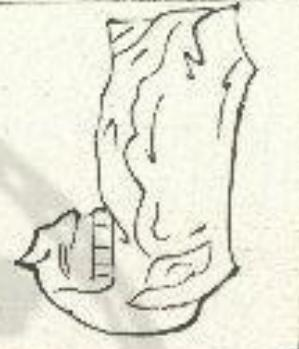</td></tr><tr><td>封世文宰中幣山用如邑昌武輔主其金</td><td>出處中箭山如郎大典祀王官吉</td><td></td></tr><tr><td rowspan="2"></td><td>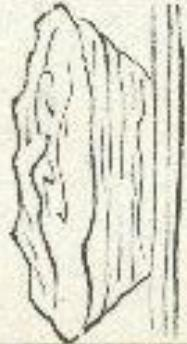</td><td>西安賢口擒山如為子者居其金</td></tr><tr><td>長袍有如得</td><td colspan="2">KCKX</td></tr></table>

<table><tr><td>秦宝生供上</td><td>西品邊主出</td><td>只其有綫用山如燈色</td></tr><tr><td></td><td></td><td>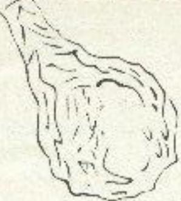</td></tr><tr><td></td><td></td><td>娥後孔雀如歌人主舞</td></tr></table>

<table><tr><td>重校正地理新書卷第三</td><td></td><td></td><td>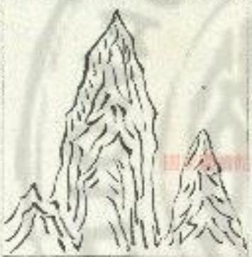</td></tr></table>

<table><tr><td rowspan="2">偉名留省底黄山令贤又多主用如曉武殺富其垂</td><td>及出頂盆山霽文上用愛官試主</td><td rowspan="2"></td><td rowspan="2">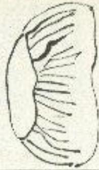</td><td rowspan="2">夫嫁女子敘梁居析人輞妙為</td><td>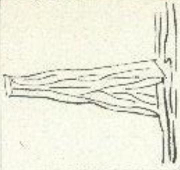</td></tr><tr><td>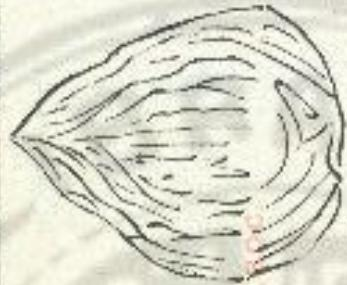</td><td>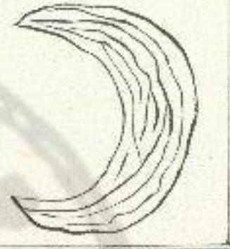</td></tr></table>

重校正地理新書卷第四

凡定為五音之出水各有其宜然水從已內仰長上出則五百皆利凡水從酉
對為邪邪從子山寫黃豆又正及非理從午出萬家當有首者從也出里下多
端洪元宅門下於山財物不變野水來入上東爲宅中水交流者主有綠死

凡永名有九一日流水潤流水不安大小與江河通考在水宅東相去六十步
外大吉若在六十步內凶○二日漢濟之謂請謂濟籍水環繞尊主有心腹病
人○三日學知謂水勢斜下家宅豪流為盜賊傷入口○四日閩水謂水相識請
陶為子孫相格飛死○五日箭水謂水直來流向者為子孫錄藏○六日清血
水調地如牛舉汗常漫漫生者如蝦蔓禁或有白漫漫如雲母者為子孫有思
疾○七日亂水謂道淨魚邊味者為子孫滌未及不利而○八日客水謂因雨
則傳與雨即乾為子孫客死暴服亦名山紅山○九日逆水籙米贵入貝咸主
子孫不孝為臣隸鐵衡或為奴輝所害若召割死○比水直水衝家宅背里為
缺機於回者主子孫為盛賊○凡外宅近水者若在水西水北近水吉在水面
水東者隨遂水吉○凡外宅往彼降畔者子孫微弱在水田頭者子孫多死亡 重校正地理新書卷第四

凡定為五音之出水各有其宜然水從已內仰長上出則五百皆利凡水從酉
對為邪邪從子山寫黃豆又正及非理從午出萬家當有首者從也出里下多
端洪元宅門下於山財物不變野水來入上東爲宅中水交流者主有綠死

凡永名有九一日流水潤流水不安大小與江河通考在水宅東相去六十步
外大吉若在六十步內凶○二日漢濟之謂請謂濟籍水環繞尊主有心腹病
人○三日學知謂水勢斜下家宅豪流為盜賊傷入口○四日閩水謂水相識請
陶為子孫相格飛死○五日箭水謂水直來流向者為子孫錄藏○六日清血
水調地如牛舉汗常漫漫生者如蝦蔓禁或有白漫漫如雲母者為子孫有思
疾○七日亂水謂道淨魚邊味者為子孫滌未及不利而○八日客水謂因雨
則停與雨即乾為子孫客死暴服亦名山紅山○九日逆水籙米贵入貝咸主
子孫不孝為臣隸鐵衡或為奴輝所害若召割死○比水直水衝家宅背里為
缺機折回者主子孫為盛賊○凡外宅近水者若在水西水北近水吉在水面
水東者隨遂水吉○凡外宅往彼降畔者子孫微弱在水田頭者子孫多死亡 凡外宅近湾池在水東主開死在東西主湖死西兩主有兵死客死者兩地
大山東北水主兵死而死者南有兩火流向家西出者為子孫不考及殘疾若
來延通交流主有偏死而有坑陷停水去家二百步内玉後有官人二百步外
無害蹟端神將。凡水從西南秦百史或數重水折東行龍勝舟紅者當水西
北爾界外宅而其後西比角有崗大吉。凡跨泥窟塘近家主子得不考及有
微死者凡山周有污池主子孫徵弱

凡家誉之水分國而去聞坑之水信滯不流皆大不利。凡宋流四散王甫及
塵難死近家有并皆主有惡心復及病習則者有積宗考主患主足人已上居
陰权者諦人隱之月修位者至日尚定

在杜陽寺說真理與宣言書無相害者或可用之
凡水從西南來東白山家宅任水出中大吉貪口百人保二千石大吉水崗及
堤防熱宅屬石曲中名輕履大吉由北名龍伏寂主貧窮絕調水從東南來於
家宅西關家乾去它居家代冒贖出加相不絕大吉水從西南來東北去後有
短風居之二千石宜六喜奴姬太吉
凡居與其水欲得洪春夏秋冬流不絕吉洪河大流居之左右遂即大富不以
土色輕重水須甘美岸必潤深火所貯，本宮悲鬱故處居富貴。凡水從西向

東流從北包間流至順山川名回像水居之大吉○凡水流浩浩奸肝不急不
慢風也有節狀如龍蛇死轉流必降大不斷不絕居之百○水有蘇勞不益成
旱木涸身藏儀藻渣清地水不亂無小閩浮居之大吉○凡東水西流兩水束
流名回開八内外宅首子餘不固○凡四方有水塚宅居之中央初留後實
富陽小口及外又口古子縣徵弱女子外弊○九流水在此而通河及枯池澆
內外宅皆凶四十五年絕嗣○凡水從為南至家宅前浙東北流宅東地餉下
名天倉地吏性富貴出三公九納大吉○凡西有水流通江河家宅皆西西右
池水居之赤凶○凡水來向者大吉子餘昌區官載相製不純○凡外宅中水
出甲者一男有凹賄出卯巽多奪子順餘宜蚕官賊出乙為二卿出寅康丙西
亥子餘兵死出王癸辰子孫不令奴婢將主病患臉沒關撤死出午失宮始子
孫出了朱迎主子孫叔真癡縱羅家死出卫王雜姓居夢他人子孫○凡水狂家
茲比主子孫短命省二十步流水主帝死○凡外宅此有非水自采向掌去五
六步外幽折西流家大富暴貴又主有凡人東有水南流主子孫大高○凡水
忠基口析東行者為人所殺斜行者主兵死人○凡外宅在水曲武亦主兵死
人○凡外宅四支皆有水桐云三十步者主子孫有雖足者○凡郊宅西此有
水不宜家長○凡跨地朝塘在家後育比主子孫不甚及藏死人水疊少至錢
財○水流漫藏主有青寶莊難死○水流急質難立○水流遠悉地長子足稽凡白虎爲道路在家之西乃本白虎之位若在左右或前後有路宜來衝家而又回曲者網之喻死斜縣家創有訓之帶銜左右皆有道路者爲夷虎重斷之言 右二宅家喜廣路吉凶餘見下高解放不重述

<table><tr><td colspan="3">三日帶</td></tr><tr><td>子孫誅</td><td>向者為直來流水謂水五日箭</td><td>家宅旁流為盜</td></tr><tr><td></td><td>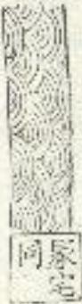</td><td>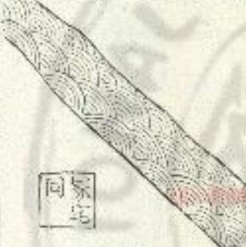</td></tr><tr><td></td><td></td><td>死相格為子孫相激觸水</td></tr><tr><td>有應殘</td><td>亦為子孫相水謂水如溫地如六回消血如蝦暴背如蝦暴生善如白漫如雲母如雲母如雲母如雲母如雲母如雲母如雲母如雲母如雲母如雲母如雲母如雲母如雲母如雲母如雲母如雲母如雲母如雲母如雲母如雲母如雲母如雲母如雲母如雲母如雲母如雲母如雲母如雲母如雲母如雲母如雲母如雲母如雲母如雲母 如雲母如雲母如雲母如雲母如雲母如雲母如雲母如雲母如雲母如雲母如雲母如雲母如雲母如雲母如雲母如雲母如雲母如雲母如雲母如雲母如雲母如雲母如雲母如雲母如雲母如雲母如雲母如雲母如雲母如雲母如雲母如雲母如雲母如雪母如雲母如雲母如雲母如雲母如雲母如雲母如雲母如雲母如雲母如雲母如雲母如雲母如雲母如雲母如雲母如雲母如雲母如雲母如雲母如雲母如雲母如雲母如雲母如雲母如雲母如雲母如雲母如雲母如雲母如雲母如雲母如雲母如雲</td><td>四日則</td></tr><tr><td colspan="2">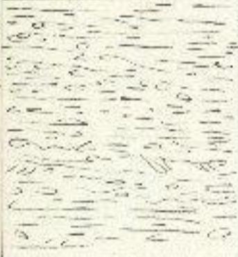</td><td>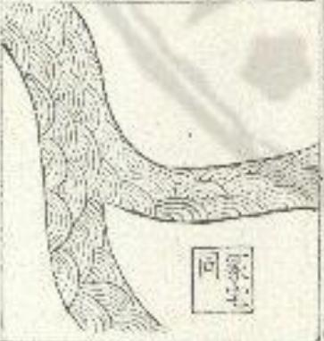</td></tr></table>

<table><tr><td colspan="3">水的和日</td></tr><tr><td colspan="3">水的和日</td></tr><tr><td colspan="3">水的和日</td></tr><tr><td colspan="3">水的和日</td></tr><tr><td colspan="3">水的和日</td></tr><tr><td colspan="3">水的和日</td></tr><tr><td colspan="3">水的和日</td></tr><tr><td colspan="3">水的和日</td></tr><tr><td colspan="3">水的和日</td></tr><tr><td colspan="3">水的和日</td></tr><tr><td colspan="3">水的和日</td></tr><tr><td colspan="3">水的和日</td></tr></table>

<table><tr><td>[IMAGE]</td><td>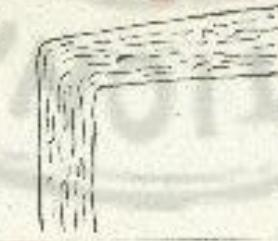</td><td>[IMAGE]</td><td>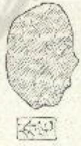</td></tr><tr><td>[IMAGE]</td><td>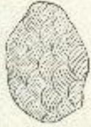</td><td>[IMAGE]</td><td>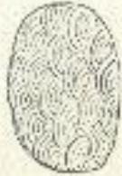</td></tr></table>

<table><tr><td>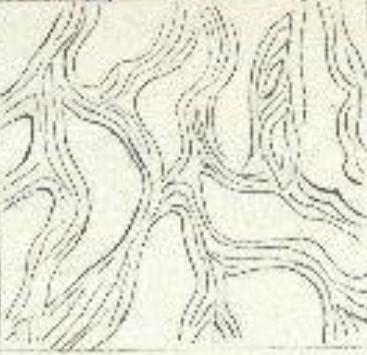</td><td>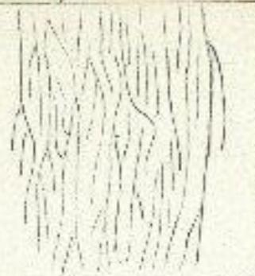</td></tr><tr><td></td><td></td></tr></table>

<table><tr><td colspan="3">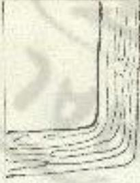</td></tr><tr><td></td><td></td><td></td></tr><tr><td></td><td></td><td></td></tr><tr><td></td><td></td><td></td></tr></table>

<table><tr><td>凡凡在南北大公</td><td></td><td>凡凡在北死凶</td><td></td></tr><tr><td>天华帝府府府府府府府府府府府府府府府府府府府府府府府府府府府府府府府府府府府府府府府府府府府府府府府府府府府府府府府府府府府府府府府府府府府府府府府府府府府府府府府府府府府府府府府府府府府府府府府府府府府府市</td><td>双空</td><td>吉溪曲中后攻攻攻攻攻攻攻攻攻攻攻攻攻攻攻攻攻攻攻攻攻攻攻攻攻攻攻攻攻攻攻攻攻攻攻攻攻攻攻攻攻攻攻攻攻攻攻攻攻攻攻攻攻攻攻攻攻攻攻攻攻攻攻攻攻攻攻攻攻攻攻攻攻攻攻攻攻攻攻攻攻攻攻攻攻攻攻攻攻攻攻攻攻攻攻攻攻攻攻攻军</td><td>双空</td></tr></table>

<table><tr><td>水名流向宅凡吉顺赤南水外</td><td>長宜水北宅几家不有西外</td></tr><tr><td></td><td></td></tr><tr><td>水名南向宅凡吉顺流東水外</td><td>孝通向名又向凡李顺西順東外吉順流東水外</td></tr><tr><td></td><td></td></tr></table>

<table><tr><td>利貴人文有家數大易高流東有萬家大興海外有萬家大興海外有萬家大興海外有萬家大興海外有萬家大興海外有萬家大興海外有萬家大興海外有萬家大興海外有萬家大興海外有萬家大興海外有萬家大興海外有萬家大興海外有萬家大興海外有萬家大興海外有萬家大興海外有萬家大興海外有萬家大興海外有萬家小屋有萬家大興海外有萬家大興海外有萬家大興海外有萬家大興海外有萬家大興海外有萬家大興海外有萬家大興海外有萬家大興海外有萬家大興海外有萬家大興海外有萬家大興海外有萬家大興海外有萬家大興海外有萬家大興海外有萬家大興海外有萬家大興海外有萬家大的風水有萬家大興海外有萬家大興海外有萬家大興海外有萬家大興海外有萬家大興海外有萬家大興海外有萬家大興海外有萬家大興海外有萬家大興海外有萬家大興海外有萬家大興海外有萬家大興海外有萬家大興海外有萬家大興海外有萬家大興海外有萬家大興海外有萬家的大風水有萬家大興海外有萬家大興海外有萬家大興海外有萬家大興海外有萬家大興海外有萬家大興海外有萬家大興海外有萬家大興海外有萬家大興海外有萬家大興海外有萬家大興海外有萬家大興海外有萬家大興海外有萬家大興海外有萬家大興海外有萬家大興海外有万家大興海外有萬家大興海外有萬家大興海外有萬家大興海外有萬家大興海外有萬家大興海外有萬家大興海外有萬家大興海外有萬家大興海外有萬家大興海外有萬家大興海外有萬家大興海外有萬家大興海外有萬家大興海外有萬家大興海外有萬家大興海外有萬家大興海外有萬家大興海外有萬家大興海外有萬家大興海外有萬家大興海外有萬家大興海外有萬家大興海外有萬家大興海外有萬家大興海外有萬家大興海外有萬家大興海外有萬家大興海外有萬家大興海外有萬家大興海外有萬家大興海外有萬家大興海外有萬家大興海外有萬家大學的風水有萬家大興海外有萬家大興海外有萬家大興海外有萬家大興海外有萬家大興海外有萬家大興海外有萬家大興海外有萬家大興海外有萬家大興海外有萬家大興海外有萬家大興海外有萬家大興海外有萬家大興海外有萬家大興海外有萬家大興海外有萬家大興海外有</td></tr></table>

<table><tr><td>及殘疾孫不孝者為子水流向象西出及南有雨</td><td>三公九卿出出富貴出地勢下名北流宅東北來至家凡水從四</td></tr><tr><td></td><td></td></tr><tr><td>傷主交挺若兩南死有流道交水有</td><td>皆景江流有凡溪有通河有凡溪有通水有</td></tr><tr><td></td><td></td></tr></table>

<table><tr><td rowspan="5">石大吉</td><td>見逆流向宅几上水名西水外</td><td></td></tr><tr><td>[IMAGE]</td><td></td></tr><tr><td></td><td></td></tr><tr><td>[IMAGE]</td><td></td></tr><tr><td>[IMAGE]</td><td></td></tr><tr><td>市流二短主冢凡死水十命子墓水主步若孫北在</td><td>目及心有者有近人病腹患主井家</td></tr><tr><td>[家]</td><td></td></tr><tr><td>死者救為東墓兄人出斜人行口水兵行所者折出</td><td>當位常位已手渠偶之者上足者有人居名主惠男字陽人陰患</td></tr><tr><td></td><td>[家]</td></tr></table>

<table><tr><td>不溶之同流滯水坑</td><td>弱主上有豫渗山鐵鐵地子塘近隆家池孝主</td></tr><tr><td></td><td></td></tr><tr><td>死產盲散流凡難及主四水</td><td>大不水同頭之凡不流溶坑而水冢利守帶之去分脊</td></tr><tr><td></td><td></td></tr></table>

凡毛四方有四角道謂之天徵食之凶○過秋毛宅東漢王吉道至宅西宅
南道之吉○宅門富巷無謂之句虎主飛殘應病○過復西來衡則卷五家族
良咸武兵死縣廳種病凶○凡外宅東也有交遣出長病人或經見通東率有
文通子孫寶對南有交道大凶北有交遣出征賜人口凡外宅藏大道者主後
有暴斃死人财之坤在虎白

<table><tr><td>女貪</td><td>男富</td><td>入中水</td></tr><tr><td></td><td></td><td></td></tr><tr><td>作偷</td><td>子孫</td><td>乾流水向</td></tr><tr><td></td><td></td><td></td></tr></table>

<table><tr><td>精子坤遠水神足長未流</td><td>見凶行水上說者斜</td></tr><tr><td></td><td></td></tr><tr><td>田子出寅水空聚長地從</td><td>人及孫北家窮凡凶弾不主後塘彌死孝子直在池</td></tr><tr><td></td><td></td></tr><tr><td>耗神者來有宅凡亂邪主街道東二</td><td>連恩交北宅凡綿病道有東二</td></tr><tr><td></td><td></td></tr><tr><td>僞者來有宅凡目主街道南二</td><td>腫惡衣西凡兵疾街有二死者道宅</td></tr><tr><td></td><td></td></tr></table>

<table><tr><td>漢女交西南二宅</td><td></td><td></td><td></td><td></td></tr><tr><td></td><td></td><td></td><td></td><td></td></tr><tr><td></td><td></td><td></td><td></td><td></td></tr><tr><td></td><td></td><td></td><td></td><td></td></tr><tr><td></td><td></td><td></td><td></td><td></td></tr><tr><td></td><td></td><td></td><td></td><td></td></tr></table>

<table><tr><td>甥不不長來年衛婚宜安子主上卷</td><td>不小醜婦來巽衛言口西女主上卷</td></tr><tr><td></td><td></td></tr><tr><td>足且及中上衢者有長子來巷跋女婦害卵</td><td>喪多長來子衛內死子害上卷</td></tr><tr><td></td><td></td></tr></table>

<table><tr><td>家宜集主來乾衢畜旱不人害上巷</td><td>久風者來有宅凡病冷主衛道地二</td></tr><tr><td></td><td></td></tr><tr><td>不尊淫疾來良衢正早亂病主上巷</td><td>酒子上虎門凡散孫衣自爲巷財嗜主坤白衝</td></tr><tr><td></td><td></td></tr><tr><td>害亡寧家登之當宅六及多內墙白宅比畜損死不主虎謂道</td><td>完足出交北者不陵道有</td></tr><tr><td></td><td></td></tr><tr><td>顯出交北大交南人狂道有凶道有</td><td>脚男殘上若村宅凶病及主在巷東腰長壅道有</td></tr><tr><td></td><td></td></tr></table>

<table><tr><td>孫不歐有嘢之岐宅凶利死兵屍自口門子者死主虎謂在</td><td>凶不泣有來西衢令子哭主上巷</td></tr><tr><td></td><td></td></tr><tr><td>翁口南後來遵病主頭在宅舌出還從前不利貧主向宅前</td><td>病主頭在宅凶盲上龍門</td></tr><tr><td></td><td></td></tr></table>

<table><tr><td>尚宜夫者道皆左凡吉寒民爲路有右冢</td><td>外者惡害家六十參家六十八</td><td>東子孫貧窮凡道去凡道在家</td></tr><tr><td></td><td></td><td>冢</td></tr><tr><td>病爲巽在虎白</td><td colspan="2">鯽之者冢斜凡凶帶謂側臨路</td></tr><tr><td></td><td></td><td>冢</td></tr></table>

<table><tr><td>兵除主遇家來有四死多子者折衡道面</td><td>人有暴死者主後截大道凡外宅</td></tr><tr><td></td><td></td></tr><tr><td>地名人道四大主横家绝天行缝面西兵道北嗣微者冢有若死亦有</td><td>灾孫者過邊冢道凡禍多子冢近兩夾大</td></tr><tr><td></td><td></td></tr></table>

冢

凡宅已平上宅前沒有樹木初富後分大門有漁當明，不足日凶。凡宅四方有棕樹多風起主族初富後首直足東東屬身餘不宜垂。凡樹入人家主出出有人久居之營。凡樹交生而隔門多口者尚迁入庭中凶。凡宅內有桑樹西角及正西有井并至酒审西地捺木美婦女達派和騒。凡宅西有不流水在桑樹七年九年主有酒表有炉主口古貧耗及忙薄洞上有泉木年出不孝子勇女無礼九年主水病。凡宅東有困人中有桃五年病入家人年具家必政

右出照機記
凡朝南州生于河孝王暴死凡宅泉有杏西宅北有李宅国有機骨為注
到宅西有柳島被刑罰凡宅東種柳詔馬宅內修要荒牛中門有機富貴三
止宅後有倫可見不改浙坐商何
法吉福區方上有很多運營

凡草木樹，先潤老者根不深大山下有金銅拓其上黃太多點粘枝葉姜並不同勝處下有王石草本不處○凡青這白黃子有金石莖簾蓋下有銀青家興家享有鋤鎮○凡閩生費非下有金生野處下有銀空野處下有銅大樹無故自死及弱枯者下有實陷板子梢插之可得凡章陳短筆當亦皆其下一丈有盤石塘曳草玉貴不及一尺有龜以死石翠黑柏下有泉臉○凡卜宅息地下有物不如無物老梢古器令現頭不安唯珠上對吉○凡奎境内樹調之華蕭賜方後盛旨子孫興盛陰方為處若宜女聲易方枯者身良康方枯者女象者風枯大內滅絕○凡家上不生草本後有處至臺內樹無故自枯不一

右國官書決定

重校正地理新書卷第四

重校正地理新書卷第五

周礼寬入萬筆之名一日地更以要想送鄴画也國之有都易循民之有空處
其將更迁必詢於此象盡古者矣今官書者欲建之目而無其占後開有杜陵
貴頤天門子十八章易遠松骨鍍拓地林法谷所深有權號回完悟備等言著
言苑地言為合而論之以尚聞文云爲宅居歷為人世爲空人感定吉生勝人
內王熙孝為合并乎降詩世吉逢請敬凶神動主殘妖後出流亡內是產見主
伏屍交動即能商會以押不方凡還定本宅王相可居休內山內外相生志也應相刑凶財動風重絕死氣之亡子聚必孤自虎鶴王哭流夜門入文動凶險化為陽夏女子陽化與陰夏男子本文動而涓子凶內刺宅外為人人鬼宅吉字魁人凶五出六世卦凶愿又詩後大西財义梵世可居王起無憂凶死函子受付出之祿保之兄弟持世及言思祭內

定於降首策主皇漢白虎王癸卯縣官飛入相生王三孫財爲極德多眾釋藏
殿主破歡王相主成立○凡占向去存亡以卦象存之見在古凶以貶伏察之
大夏主爭鉅金爻主乃兵相死及發動即四水爻主陰私賤盛民武爻主傳財
土爻立土內勾隸許亦爲悖夢未有二鬼多悲哭鬼多鬼爻少有隆臨附戶日
辰御卦宮相起云飛伏安止歷此和言

## 右山見

延寶宅以伏辰為宅儀文爲家客着滙伏朝生王相可罷也○凡造宅卦王
相生高要者齋其內卦於宜也較官馬坤允官牛生他首发此凡宅則應胡生
吉內卦有氣生外卦吉中興敬衆及內乾外函○凡內宅王相死之吉久卦有
氣使居吉字鬼修記宅旌就正不宜云

右出天所十人章
內封為東南夏臨王曰舌坎土盜厥冤主巫安神宜田乾宜秦民豆愛與宝新
一出三七又為贵二世四世王侯位遊興歸观八筑卦五
右出周之九卷

士表礼堂家人營之，觀歸配蘇人同王明之，以極陽界東楊南
大城相，以北朝哭主人李注北南比百克經之，維督奉文，以德志和命

強者在主人之右搖盤轉軸節年自封錄鑑者房內持上精歷來執之術面
處命無，其也也。會即象子分歲主父廿有銀室度范也不為甚無若
後服先朝者鋒龍殿內通經一銷陵號端鐵鐵鐵鐵鐵鐵鐵鐵鐵鐵鐵鐵鐵鐵鐵鐵鐵鐵鐵鐵鐵鐵鐵鐵鐵鐵鐵鐵鐵鐵鐵鐵鐵鐵鐵鐵鐵鐵鐵鐵鐵鐵鐵鐵鐵鐵鐵鐵鐵鐵鐵鐵鐵鐵鐵鐵鐵鐵鐵鐵鐵鐵鐵鐵鐵鐵鐵鐵鐵鐵鐵鐵鐵鐵鐵鐵鐵鐵鐵鐵鐵鐵鐵鐵鐵鐵鐵鐵鐵鐵鐵鐵鐵鐵鐵鐵鐵鐵鐵鐵靈人許諾不遂銘石運北首格中封的筆卦名
在古建國，今而對數人貞與大寶，亦以日賊外續錄紅新縣縣鎮三圓陰平發解曰筆
教奉以承命登身尚流者及祥臣之東京派占卒進告二命筆者與主人占之
日發附之起繼人貞與大寶之以州城縣鎮駿駿駿駿駿駿駿駿駿駿駿駿駿駿駿駿駿駿駿駿駿駿駿駿駿駿駿駿駿駿駿駿駿駿駿駿駿駿駿駿駿駿駿駿駿駿駿駿駿駿駾
若不從足淳如初信便便以書是自周三來未之驗也令官善舊又以
爲筆地下也皆決疑之法而善地有神堂修之多得不古之象調排電所各惜
之有差未知前文已從再去○凡至外宅外有三相氣吉一夏二夏上下相生
大吉三後四變上下唱生吉五至遊魂有古有凶○凡內卦葬死者外卦為生
者内外相生吉相九○凡動反與太陰大牧目殺以失處世為者凶○凡卦
下伏神南殺使内安創本宮空氣者大六○凡休神有氣應報免亂甘者吉若卦
內應文教創出者凶四射及癸亥則其者為照聖貞貞貞貞貞貞貞貞貞貞貞貞貞貞貞貞貞貞貞貞貞貞貞貞貞貞貞貞貞貞貞貞貞貞貞貞貞貞貞貞貞貞貞貞貞貞貞貞貞貞貝
之翼又愛在又世表財可孫兄弟皆凶凡愿化入墓及卦化為護者吉○凡策
第卦內卦生外赴為大吉内土外是及其後四年得外財物宮子徐下有墠石藏
卦是也一云主得牛八年後子除迪州患内生外是震其後四年得總取馬大富貴四生外是與其後四年或二年有費人來主請官古籍卦是也一云四年內主有孫家人來祠近及主營輸入門官因文進內坐公是離其後三年或九年有批解昭的馬來官至上在地下有成室吉南上是也一云二年首末原東宁秦九年大宮者內生外是肆其後一年主賈及要物財天犯下有領殺深一云等年卦身也內生外是究四年後得去之或之要從東南東七年後有白銘應大宮即卦日起內生外是故其後二年主費人入宅六年得二人成立門戶雲卦足也一二六六年內三迁官內生外是欲其後一年得其因之大富三年內有道人城反下有伏能五種之名九言解元息也一云一年內清滅盡者不出因富曰凡卦文往凡破下爲第十二十二月得六月卦天也若有失文亦是月破下其卦是象姓墓丞為帝土不安於此觀所鴞鴞盛無幅大過小商家人元安而噬噬石北離同余八大南殲丙所誥師貳然凡二十四司皆爲吉卦東可投入毫大西郭景钟元三有盤石清泉假令家以虎至向遁王勤是也又云卦久具不中有夫矣朝下小有燈石出又子金外封口應又是本動下有磨本凡行夢與外無月到下右沙條卦得远現若日展自何非者下有伏死直併者父食曰復同是也若學在四而是火又即目族向大射卦是也時火王三四生數二也從四至上三又二三六尺若三七二丈一尺他皆敘此凡卦伏爻

西教文與朝下卦者亦意為詔地大山○凡筆葬稅內外未內朝外大山外哉
內大古内生外主子孫強慮外生內觀視安內外知無恩東雄居宅赤如之○
占癸日內卦為死日外卦痛葬日外陽象曰古姚陽亦吉世應俱陽大吉外卦
離使乾究良言與通風坎有南○凡堂池及發引時所見視內扑得或立道里
衣及黑色坟立達白衣人將物來良主逢貴衣人午內重色者有至聖皇卒馬里
雲縣王濟民赤水女子來離主青色也爲及白衣句馬邑主見白衣人及白馬
究主見蒲夜入歲有風雲家凡有何此不應主富貴子陰大吉○凡其墓文動
及將出皆主墓事院其卦月在墓前已舊其生墓後將羅(何餘續)皇怀林綾墓
殿殿則起初經凡韓吉公視也將著秦外慈生者內為死者若向未正相刻好
人凶不欲月殺與思又許又足是殺相刑破內發展而刑的伏神被寇吉凡彝
敵外鬼應強免其本不到省吉若內勉外應創視患人發不可以葬三二官失
要凶火文動遭火災口舌水文動賊盜官使口舌凶的一位二计主黃三击四廿
主富會賞賊無常絕出遊避宮客死歸殿絕卦主厥內衰年占葬後吉凶以內
卦決定內去虜退子吉與士麻吉震主推難定禍隸主男女孤寡坟主水灾陰
和縣官监賑離主火子陰未死者及主世官免主湿濱人口平吉

者主柏婦女外卦王王縣官外丞入王寧同內外俱發山。凡處地內卦乾主見金玉光余齊客夏兵王寧中根雜子大歲坎主至壓息主沙石坤主壞又視

有此大門子十八章
凡嘉濟城子孫持世主懷世昌張鬼村世主多圍死大西父母特世主軒害子
孫青豹及福德又詩者主後太吉子孫守官朱堂特世主縣官白虎将世及
與鬼封主重懷若見受入嘉福德扶人青颜與財文持世三公相○凡卦靜有
氣無刑大吉有縱思動即山大殿思亦陰爲鬼葬後大凶黑入集因死鬼後代
大吉內卦之入乾主主貢子之入坎主口右官事之入灵王官后令長之入坤
主安居之入震主益難陷之入離主遭詐官之入至上生淫婦之入免主自如
○凡准地形狀詳內外之變三壩又動逐五行次之若久金內水具動即下有
象流内外有此又發動亦然上本下火上下有提石外金內木又動主下自珍
宝未為參相則休內也有砂碑○几內外休行者西侯柄者三內卦絹者宣官前
內身死宜迎乾不可傷喪也占安齊學離對而火動者三縣言口右水又發動
者王遺賊及從大水飛伏相生者吉福僕利宣眾大吉○凡薨葬後相主吉相
起四古經云邏忽問令人向撕軍上即煞鬼不敢衡將區易卦即福德上避哉
吉假今得金占易在火內向水方福德上可以現遇一推地餉以卦世在何

宮作地形對之出在坤為丘地良氣連山及寒經為古望間坎卷為渣清究爲
平潭乾為大呼象無應境之所舉為赤旭立感風窓口兄欲改詳者內封沒乃
言石殺出否以外對央之外有三即出區死無氣則不出又卦表作資写卦破
出卦父無氣者又出前至王後卦休因文屍下出盡重体後王失死則出

凡占家處事以十文斷之若隱蛇東土上新華後不安甚有交水文臨上亦主
新界若南木文本臨土主新日來共有一水在土上总有林二水為大林舌白
沈臨土爲山口玄直臨上爲近水三凡卦無戌及其地西北低下生水無衰圖
石主在寶嶽落及有過疾殺小口哭家长長子壬午年內亦主實府本言黑氣
尤凶卦照未申亦主哭家丧長子及比家母叔婢死長子絕廿當病蘊黃長女
不絕即移鈞多口在破因產本宮無氣九四卦與丑寅土大散貧箭次子頭海
長子庶病死亡本宮無氣朽凶卦無申有主無駟卦與寅卯無林木卦銀已午
南烈道陷卦照太中西西必低下各有成夜西北有山四卦有寅印夷有林木
卦有辰巳午文主有遠路又有領三相爲過途與氣為久從后在城卦中其路
在家地在顏卦中東路在南随卦断之外有水文無氣為小墾王相爲大水文
陷青龍伊可來船家夫吉水文在乾卦則西北有水卦有木文有氣為小林木
爻在次卦則西北同水凡水文發者韓後主獨而卦有易對爻動主妙財與白虎并主傷死又看化見入叢亦是也卦中無白虎者主子孫溫善熟大嘉姬藏
夫女強易弱卦中有青離子孫有宮歸見文發王與白正年主傷死卦中有土
反動爲山地主為高山相為齋確無氣爲平地亦有小壊起離卦中有火文動
者家海首路內及有木受動是秋中皇卦內外限動上破拱鬼在何嶺的知移
製卦有字又即知有字不見子爻即可言絕○凡水文爲思復與玄武爻援并
必是溺水死至爲尾與經及白虎并主傷死火爲思與失皆并及五鬼并爻俱
值胎跑生產死辰午酉亥此四爻動及爲水宮鬼并刑殺并主臨死木爻曰虎
幷及殼亦傷死未爲應及寅卯并水火爲思與亥并又與玄武許晉約隱宛及
溺水死五至卦有大小甚及嚴將功曾天合酒尽昇皆朝權山文官富貴白虎
過爽臨家者羣後子孫傷歲有乾高崇老金白完斷見三公傷卦有刑火爻出
是青離無飛注不尋子濟後至絕者有死木是客在無足出刑殘離卦無通是
玄武熱足舟主大山牧卦與氣是也何以知占父母要兄弟脫本宮不是正父
是夷兄弟即知也○凡哉值胎此緣向云大言皆首長駐本宮主目下正辰向

占華內為彼主外為定老山文與輕鈴幰以爲萬飛天爲硯號伏又爲弦骨同生吉相列内官事給相主財夜圖宜解送侯無不列見敬動主重喪

凡越縣見文持以主癸帯發動九凶青龍主得封勾昧宋惟主關參內武載主
貴子二千石炮主富者書文震王有青衣子次主奸盜牢狀羅曰聰明室丞究
主爲弟子樣不當，暗也民王令長宜牛馬巽主風狂又上下工程定人下你因
平三陽王不著三陰主劉之資然派陳強剛五六文不動世蘇如合卦中無幾
于平吉帶段依文下斷之次主曰陳修盜離主隱明良三令長仲主大弱乾主
曾子王文主安靜多年處主义官兄主罰之無產業○凡八絕坟宅師三卦恩
入墓以占家宅為賀事人母去需斬後乘筑人善入卦兄弟入墓以占家宅墓
合相兄弟或兄弟有疾病不知睦銳兒始諫則災四卦父母入墓以占家宅不
宣父母或父母長我心者益家人處隨隱後攻士大過九卦妻以入墓以占家
之內無生氣六畜歲為家訟二走福德入墓以占家宅不負子陰

乾土上社
四月卦鉞土戊土伏癸酉金癸亥陽爲金爲堅实
山上社
四月鉞土戊土伏癸酉金癸亥陽爲金爲堅实
四月卦鉞土戊土伏癸酉金癸亥陽爲金爲堅实
山上社
四月卦鉞土戊土伏癸酉金癸亥陽爲金爲堅实
四月卦鉞土戊土伏癸酉金癸亥陽爲金爲堅实
四月卦鉞土戊土伏癸酉金癸亥陽爲金爲堅实
四月卦鉞土戊土伏癸酉金癸亥陽爲金爲堅实
四月卦鉞土戊土伏癸酉金癸亥陽爲金爲堅实
四月卦鉞土戊土伏癸酉金癸亥阳爲金爲堅实
四月卦鉞土戊土伏癸酉金癸亥阳爲金爲堅实
四月卦鉞土戊土伏癸酉金癸亥阳爲金爲堅实
四月卦鉞土戊土伏癸酉金癸亥阳爲金爲堅实
四月卦鉞土戊土伏癸酉金癸亥阳爲金爲堅实
四月卦鉞土戊土伏辛巳有玉石如曆斜之二品已上可同吉麻人的其下六尺
四月卦鉞土戊土伏辛巳有玉石如曆斜之二品已上可同吉麻人的其下六尺
四月卦鉞土戊土伏辛巳有玉石如曆斜之二品已上可同吉麻人的其下六尺
四月卦鉞土戊土伏辛巳有玉石如曆斜之二品已上可同吉麻人的其下六尺四月鬼制之陽文共屬純圖史卦入卦是絕命無非名陽不可犯之
邁卦
三見內去造處八十步而有大道其地多坑兒瓶勢
力北一百步而有點池池下四尺有瓦器宅各主子縱遠行不記亦主有師巫
鬼駐之人葬此地无谷後六十年富貴東南十步有人家刑可下一完後三年
生贵子王宛土色赤草木流潭下有石如玉西南小伏泥去坑四十步注往損
人勿教發必大山雷葬日何白馬老人從西來燕之古漢遂也一隆而過五陽
一柔而遇五到甲子水爲世下伏神卒丑土為飛父德也束此民地勿強動之
燈良等

遷卦：城中
敬樂經
乾堂三世六月卦後丙午火伏四寅木其地可多劉
方有水深不週西北來家真三步肉深三丈吉節可取其开能處直下人尺土
紫土大古宅居多叔卿八年内門官很六年生首子善吏後四年金帛至多得
叔輝薄磚人不可用此地上學如然於為主官禄島永道內不絕葬日有婦人
東南宗若易勿延尚食云亥令手祿多混燃刺者落也雖者隱也宜沈卦吉
否卦：城中
永山以一六社
就宮三廿七月封飛乙卯未安里及土其地形勢左
为不通地破比有浮水入流東南吉早粘刷上有鳥梁智禹二十四步有水上南消具所藏地思下有竟晨伏奏围板之象西有大坑
流北有大特宜奠宅居王金庸而阙成來之筆若所者男少女多自冬帛不絕
自主安释王子孫貴案等何过世土色飛白不宜子孫奴為多死峯後當有寡
婦人入家王有口召弟紅縣官為災若有乾為黑色比形久從京南久於西北
上未遂向西南上大殺手入令孝子簡為鳴去凝板暴人哭行十步禱之
觀卦[無]一軒[無]一軒[無]一軒[無]一軒[無]一軒[無]一軒[無]一軒[無]一軒[無]一軒[無]一軒[無]一軒[無]一軒[無]一軒[無]一軒[無]一軒[無]一軒[無]一軒[無]

剥卦：一軒一軒一軒一軒一軒一軒一軒一軒一軒一軒一軒一軒一軒一軒一軒一軒一軒一軒一軒一軒一軒一軒一軒一軒一軒一軒一軒一軒一軒一軒一軒一軒一軒一軒三月卦飛丙子水煮壬申金地形多坡賣
泉中有持二百斤其鈇料去筆勵比七步内有同上有流泉水清如韻之居主
富貴由子孫寧莊大吉深一文二尺有鐵金勿發出葬日當見一男子一老母
參應人吉後出二千石一子高普百東方永池率則切令埋極指此同華土家
多產忘懷勿動之地方有泉亦不可燃刺雖陽消之卦然剝上以尊下安定改晉卦
(聖)一兩
(聖)二兩
(聖)三兩
(聖)四兩
(聖)五兩
(聖)六兩
(聖)七兩
(聖)八兩
(聖)九兩
(聖)十兩
(聖)十一兩
(聖)十二兩
(聖)十三兩
(聖)十四兩
(聖)十五兩
(聖)十六兩
(聖)十七兩
(聖)十八兩
(聖)十九兩
(聖)二十兩
(聖)二十一兩
(聖)二十二兩
(聖)二十三兩
(聖)二十四兩
(聖)二十五兩
(聖)二十六兩
(聖)二十七兩
(聖)二十八兩
(聖)二十九兩
(聖)三十兩
(聖)三十一兩
(聖)三十二兩
(聖)三十三兩
(聖)三十四兩
(聖)三十五兩
(聖)三十六兩
(聖)三十七兩
(聖)三十八兩
(聖)三十九兩
(聖)四十兩
(聖)四十一兩
(聖)四十二兩
(聖)四十三兩
(聖)四十四兩
(聖)四十五兩
(聖)四十六兩
(聖)四十七兩
(聖)四十八兩
(聖)四十九兩
(聖)五十兩
(聖)五十一兩
(聖)五十二兩
(聖)五十三兩
(聖)五十四兩
(聖)五十五兩
(聖)五十六兩
(聖)五十七兩
(聖)五十八兩
(聖)五十九兩
(聖)六十兩
(聖)六十一兩
(聖)六十二兩
(聖)六十三兩
(聖)六十四兩
(聖)六十五兩
(聖)六十六兩
(聖)六十七兩
(聖)六十八兩
(聖)六十九兩
(聖)七十兩
(聖)七十一兩
(聖)七十二兩
(聖)七十三兩
(聖)七十四兩
(聖)七十五兩
(聖)七十六兩
(聖)七十七兩
(聖)七十八兩
(聖)七十九兩
(聖)八十兩
(聖)八十一兩
(聖)八十二兩
(聖)八十三兩
(聖)八十四兩
(聖)八十五兩
(聖)八十六兩
(聖)八十七兩
(聖)八十八兩
(聖)八十九兩
(聖)九十兩
(聖)九十一兩
(聖)九十二兩
(聖)九十三兩
(聖)九十四兩
(聖)九十五兩
(聖)九十六兩
(聖)九十七兩
(聖)九十八兩
(聖)九十九兩
(聖)一百零二年

大有
一九四二年
日出
所以
乾宮歸還正月卦飛甲辰土秋乙卯木地葬凶其形
一九四二年
日出
所以
多塊南湖江畔西方二十步陂潭無水下深光尺有
銀箱可取之西北六十步有塔為驃宅居主子孫壽孝安葬廿世不絕子縣區
寶四年後生骨子信至疾信機地深六尺力石高應齊朝赤色飛鳥夜驕大有
未曰在於天龜物入照哉餓所夏坎卦一鉞上壘
八純十月封飛找子永失已三火地多流果及坡隘
可取居後熊文宮出將重之藏立宅時為百丈勇子從東東吉安蘇四二年後

安曠六宮死三年出勢官徵死一百日後徵軍師漏地深一丈有果伏龍居之令亡者不安葬日有徵人載成刀及里色飛鳥來應大凶
第林（軒）（軒）（軒）（軒）（軒）（軒）（軒）（軒）（軒）（軒）（軒）（軒）（軒）（軒）（軒）（軒）（軒）（軒）（軒）（軒）（軒）（軒）（軒）（軒）（軒）（軒）
有土衆帝二望半有火河水西南二里有鐘鼓寺法之象東方二十參有同勢微起下一支有銀取之可得空屬夫志東南二十參有伏衰勿發之搜人久居子豫留貴八十年位至方伯安葬吉主官禄位不絕五年生貴子下八尺有鐵不然是石葬日有群牛及豕采愬大吉

屯卦一軒一軒一軒一軒一軒一軒一軒一軒一軒一軒一軒一軒一軒一軒一軒一軒一軒一軒一軒一軒一軒一軒一軒一軒一軒一軒一軒一軒一軒一軒一軒一軒一軒一軒三廿六月卦飛庚寅未伏或辰土其地多震動
益其後子孫如將等常為人所使居之六年見自刑血光受葬日當日有爭關
劫覆帶暴降凡後五十年臨塔寺葬日附以人哭及見因徒而
既濟一軒一軒一軒一軒一軒一軒一軒一軒一軒一軒一軒一軒一軒一軒一軒一軒一軒一軒一軒一軒一軒一軒一軒一軒一軒一軒一軒一軒一軒一軒一軒一軒一軒一一
坎宮三世正月卦飛已亥水伏戊午火其地水岸其
土色赤直地八十步有大闕東向横直其下有石如
磨下七尺有清赤色如金見之勿取大吉宅居出世為將軍耳虎鴞門五世出
賢人名僧大德安葬大吉直南三十九步有伏屍勿發令人喧關於此摘人若後年職日進宮別址位至候伯商徵角至今長葬時有業衣人騎為及驟來應大吉

華卦一鬼
故
神
神
神
神
神
神
神
神
神
神
神
神
神
神
神
神
神
神
神
神
神
神
神
神
神
神
神
神
神
神
神
神
神
神
神
神
神
神
神
神
神
神
神
神
神
神
神
神
神
神
南去七里有古善處是居大内有鬼將蘋樹中居之貴取世出是無人四年後女子外齊男子多妻安齊世比子孫無所居流宅也鄉下六尺有為死伏氣之鬼九之勿發僑人齊機三年主失火齊日有質老人來聽大凶豐卍一觀
二觀
三觀
四觀
五觀
六觀
七觀
八觀
九觀
十月飛成申金火戊戌土地方間一里
己乾下有白鬼器數百色者而剛堅其水味甘河策地題下一丈五尺
有銅器見之勿取宮居大吉出世子孫有文學三十年主晉人來大得物之象
八十年子孫為方伯百年出悼道安葬吉子縣焉盛東方伏苑勿發彝日有首
衣人來愁之大吉

明夷一鑑一絲一經此
姚官邊跟八月卦葬癸丑土休庚午火明夷者傷也
一或一觀一監一觀一觀一觀一觀一觀一觀一觀一觀一觀一觀一觀一觀一觀一觀一觀一觀一觀一觀一觀一觀一觀一觀一觀一觀一觀一觀一觀一觀一觀一觀一觀一觀一觀一觀一觀一觀一觀一觀一觀一觀一觀一觀一觀一觀一觀一觀一觀一觀一觀一觀一覘
姚豪下自各數千宅名大為子縣主字徵十年後主跛腳女子世世常疏下藏
安葬亦以大地多占家多藏帶改乾場去鎮起南北四十步有水坑流北六岁即卦——經經二時，經坎宮歸魂七月未飛戊午火便已亥水即皆象也有
知然源知君節最打克伐之象地方圖二里平如掌莫水味甘宅居
吉出在下絕子無担官嘗田產大富不利任官女萃幽子孫多遙疾相縣後有

良卦
八錢四月針張內寅未伐丁未土其地方圓二里內
一三錢一號
有三錢萬萬城朝下一丈三尺皆有玉石大如斗琢
之明條有光剛得之勿出一百五十步內至三首人宅居由世屬貴子孫昌盛居
之內生得寶娛從東味九喜三十五年大吉宮華近東北兩步下七堂青雲虎
象東為應後八年術横刺令人百年大富三孫遠游必得大官吉吉後五年有遠方人泉得物子孫端廣一百五十年子孫官祿二千石
周可美好宝奴婢安非吉當有瘧為弟名及紫衣弱焉人泉應之或有鵲鳴尤
八尺有間泉通行江河石曰龍泉之地主子孫聰明才俊道術者名千里又主
甘三角流處居大古下六尺土色赤無物藏西北五十步有伏屍所望地與下大善
昭二世十二月外裴甲寅本伏丙午火地方圖一
北有点培南方半目有潤水尚美良比四十步有劉徵起是伏羅之陶下有貴物可取之套土草本號集宅居大吉君之八年內得弱有大亦蛇入空為應子孫孝順長會可居一百八十年安葬均不利于移當有患鳥野激感為後五年出經國人及不善之藏三十年夏収好口店家破滿絕

搗卦——《二十三年六月》附註：長宮三阳七月卦飛丁丑土伏丙申企業地堅聞去場其大吹舌色青里西去一百丈低濕句小門服如遇目下九尺有玉石之物宅居大凶生子意育女藏南也世寶粥多百元一百年誠族吹死吉當有群羊水煮後三年有貴人引接子於官禄二十年治令長所築地處下一支五尺有案并玉及觀羅等見之勿出大吉

癸卦
敬一解
朝一解
世一解
居内三日死与三年何傷為灾後世無子養也子為
後女多誰客夫安醉的全七年內殺主人其後百日內三重長至又主男女相
發小人受其殘招得枯聲或鬼器應應有過征醉人來建主之腹紛藏子原自
到穀卦——杜地
貞——昭——朝
良宮五世三月卦聚王由合伏丙子永其地乾至赤
貞——昭——朝
色而青西北六十一年有大家或天下二文有辛起笠
金銀之器南方四里有調水東注虎比有使昴勿敬收人宅居夫第貴子豫興
盛者商八十年出今長安葬吉富有富合虎虎与束燕所臨地處下八尺得玉石
尤善後三年出龍為敬如求子孫與厭臨方何得六人君之身中學——貯——數——數——數——數——數——數——數——數——數——數——數——數——數——數——數——數——數——數——數——數——數——數——數——數——數——數——數——數——數——數——數——數——數——數——數——數——數——數——數——數——數——數——數——數——數——數——數——數——數——數——数

新卦：一味
一味
一味
一味
一味
一味
一味
一味
一味
一味
一味
一味
一味
一味
一味
一味
一味
一味
一味
一味
一味
一味
一味
一味
一味
一味
一味
一味
一味
一味
一味
一味
一味
一味
人居之必死其里地處下七尺有鐵笠石休蟹燒得宮子孫什此為下吏
居之五十年出源疾人破散安葬四當有惡風霜電感俱尊後半年生于榮頤
女子深新安祥縣震卦
入鈍十月卦歷庚戌土伏辛卯木冥地多標永其役
無龍馬之李或如龍虎及翰朝也星展南五十參有水東宅居主三十無官足財布子孫孝順亦主僧通其下深三又有石獻形
有精在下勿發富華西主子孫多自於一年後專被約傷死東北方大死黑不
家山為宗屬葬時有乞金人及悲氣靈永德凶

豫鉄一經二解
北有水西南四十步下深八尺有青色石宅居之元
谷熙壮茲地處無平平直北一百步多樹又有神處為此宅令人家數有性與
養子孫多不害事女多深再六十年後東方當有火起未燒以定大凶安葬引
五进皆古是所望地興東北九十步有池洞或高或之南有水塘西有同藝徵
起東北有家其中方圓平亦安薛大吉其下上紫色草木美盛世廿官探不絕
葬乃有自良男子久古其地下有大墠是古人品地之物直北三十步內勿損
之不然必害長与子孫有素老名南四方

解封一社二軒一軒一軒一軒一軒一軒一軒一軒一軒一軒一軒一軒一軒一軒一軒一軒一軒一軒一軒一軒一軒一軒一軒一軒一軒一軒一軒一軒一軒一軒一軒一軒一軒一軒一

宋方來地聚四大得石或歲應大吉
恒卦一班(略)城(略)城(略)城(略)城(略)城(略)城(略)城(略)城(略)城(略)城(略)城(略)城(略)城(略)城(略)城(略)城(略)城(略)城(略)城(略)城(略)城(略)城(略)城(略)城(略)城(略)

升卦 雨四世八月，其飛癸丑土伏庚午火其地方直一
(貢一) 福一
(貢二) 福一
(貢三) 福一
(貢四) 福一
(貢五) 福一
(貢六) 福一
(貢七) 福一
(貢八) 福一
(貢九) 福一
(貢十) 福一
(貢十一) 福一
(貢十二) 福一
(貢十三) 福一
(貢十四) 福一
(貢十五) 福一
(貢十六) 福一
(貢十七) 福一
(貢十八) 福一
(貢十九) 福一
(貢二十) 福一
(貢二十一) 福一
(貢二十二) 福一
(貢二十三) 福一
(貢二十四) 福一
(貢二十五) 福一
(貢二十六) 福一
(貢二十七) 福一
(貢二十八) 福一
(貢二十九) 福一
(貢三十) 福一
(貢三十一) 福一
(貢三十二) 福一
(貢三十三) 福一
(貢三十四) 福一
(貢三十五) 福一
(貢三十六) 福一
(貢三十七) 福一
(貢三十八) 福一
(貢三十九) 福一
(貢四十) 福一
(貢四十一) 福一
(貢四十二) 福一
(貢四十三) 福一
(貢四十四) 福一
(貢四十五) 福一
(貢四十六) 福一
(貢四十七) 福一
(貢四十八) 福一
(貢四十九) 福一
(貢五十) 福一
(貢五十一) 福一
(貢五十二) 福一
(貢五十三) 福一
(貢五十四) 福一
(貢五十五) 福一
(貢五十六) 福一
(貢五十七) 福一
(貢五十八) 福一
(貢五十九) 福一
(貢六十) 福一
(貢六十一) 福一
(貢六十二) 福一
(貢六十三) 福一
(貢六十四) 福一
(貢六十五) 福一
(貢六十六) 福一
(貢六十七) 福一
(貢六十八) 福一
(貢六十九) 福一
(貢七十) 福一井卦 靈封 楚鴻 仙知 震宮五世三月去飛戊戌土伏與申金其地方圖二
夏內有寺舍其地南四十步有永東疏其味甘有志
察室直西二十步有大道宅居地貴人而無外物居之二年生貴子安寧文吉
祿位世世不絕劣為公後女嫁告矣其地下深几又有上赤色利有詞容見之
勿取西比有周圍下有石大如半其中有金下深三天取之不可得罪日有衣大過一車
三月歸還三月歸還亥水伏戊申金其地方圖一
壇
體
吐
鹽
咸
煙
里內無好水服勢亦無起伏去西比一百步下深八
又有石鉛上有或爲家東南神標枯折可去一百八十步處宅居大吉其土色白
九佳主宝子膠非多知目七紅得官瞞鐘般長數甚吉出端正女子益言或葬不
吉四年授生不詰父子出惡疾人另妨婦或指未葬目有白馬老翁來應六綱
國紀見也歸官口舌內

南卦
一
融
新
二
三
四
震宮篩現七月卦乾庚戌土伏辛酉金地方圖二里
一
融
新
二
三
四
震宮篩現七月卦乾庚戌土伏辛酉金地方圖二里
一
融
新
二
三
四
震宮篩現七月卦乾庚戌土伏辛酉金地方圖二里
一
融
新
二
三
四
震宮篩現七月卦乾庚戌土伏辛酉金地方圖二里
一
建
東山勢如伏龍東南地下西北高吏地方二百枝
有文家及下深二文背占互器貞比二十步有伏氣架五尺勿發發必損人利
宅屬山世廣貴出二千石後二年牛馬日盛四年生貴字榮尊吉其祿曰進插
改四又其主紫色有內大可知口皆為羅先之地出王侯羅卦
八純四月卦經無卯木伐與或土其地枯濟左右無
貞卦
八純四月卦經無卯木伐與或土其地枯濟左右無
貞卦
八純四月卦經無卯木伐與或土其地枯濟左右無
貞卦
八純四月卦經無卯木伐與或土其地枯濟左右無
貞卦
八純四月卦經無卯木伐與或土其地枯濟左右無
貞卦
八纯四月卦經無卯木伐與或土其地枯濟左右無
貞卦
八純四月卦經無卯木伐與或土其地枯濟左右無
貞卦
八純四月卦經無卯木伐與或土其地枯濟左右無
貞卦
八純四月卦經無卯木伐與或土其地枯濟左右無
貞卦
八純四月卦経無卯木伐與或土其地枯濟左右無
貞卦
八純四月卦経無卯木伐與或土其地枯濟左右無
貞卦
八純四月卦経無卯木伐與或土其地枯濟左右無
貞卦
八純四月卦経無卯木伐與或土其地枯濟左右無
貞卦
八純四月卦絞無卯木伐與或土其地枯濟左右無
貞卦
八純四月卦絞無卯木伐與或土其地枯濟左右無
貞卦
八純四月卦絞無卯木伐與或土其地枯濟左右無
貞卦
八純四月卦絞無卯木伐與或土其地枯濟左右無
貞卦
八純四月卦経無卯木伐與或土其地枯濟左右無
貞卦
八純四月卦経無卯木伐與或土其地枯濟左右無
貞卦
八純四月卦経無卯木伐與或土其地枯濟左右無
貞卦
八純四月卦絙無卯木伐與或土其地枯濟左右無
貞卦
八純四月卦絙無卯木伐與或土其地枯濟左右無
貞卦
八純四月卦絙無卯木伐與或土其地枯濟左右無
貞卦
八純四月卦絙無卯木伐與或土其地枯濟左右無
貞卦
八純四月卦経無卯木伐與或土其地枯濟左右無
貞卦
八純四月卦経無卯木伐與或土其地枯濟左右無
貞卦
八純四月卦経無卯木伐與或土其地枯濟左右無
貞卦
八純四月卦絘無卯木伐與或土其地枯濟左右無
貞卦
八純四月卦絘無卯木伐與或土其地枯濟左右無
貞卦
八純四月卦絘無卯木伐與或土其地枯濟左右無
貞卦
八純四月卦絘無卯木伐與或土其地枯濟左右無
貞卦
八純四月卦絙無卯木伐與或土其地枯濟左右無
貞卦
八純四月卦絙無卯木伐與或土其地枯濟左右無
貞卦
八純四月卦絙無卯木伐與或土其地枯濟左右無
貞卦
八純四月卦絵有大風起風應圖書立至

小言
觀一社
觀一社
觀一社
興富一世十一月卦飛甲子水伏至五土其地西方
七十步有岡國有塔西北二百步有寺舍所設地處
下有石如與南三百步內有天盡未方有水正南流宅居有勵興官世世三商
寶路易再廢女再嫁安彝吉且之深六尺有瓦器其後兄黃有文儒覆遂葬曰
有四無鳥向西地宋或女子來應吉

家人——郭二十三年十二月卦龍已丑土伏辛亥水其地方圓周
臣三十三年十二月卦龍已丑土伏辛亥水其地方圓周
臣三十三年十二月卦龍已丑土伏辛亥水其地方圓周
臣三十三年十二月卦龍已丑土伏辛亥水其地方圓周
臣三十三年十二月卦龍已丑土伏辛亥水其地方圓周
臣三十三年十二月卦龍已丑土伏辛亥水其地方圓周
臣三十一年十二月卦龍已丑土伏辛亥水其地方圓周
臣三十一年十二月卦龍已丑土伏辛亥水其地方圓周
臣三十一年十二月卦龍已丑土伏辛亥水其地方圓周
臣三十一年十二月卦龍已丑土伏辛亥水其地方圓周
臣三十一年十二月卦龍已丑土伏辛亥水其地方圓周
臣三十一年十二月卦龍己丑土伏辛亥水其地方圓周
臣三十一年十二月卦龍己丑土伏辛亥水其地方圓周
臣三十一年十二月卦龍己丑土伏辛亥水其地方圓周
臣三十一年十二月卦龍己丑土伏辛亥水其地方圓周
臣三十一年十二月卦龍己丑土伏辛亥水其地方圓周
臣三十一年十二月卦龍己丑土伏辛酉戌寅巳午未

葬三朝三社二社二社巽宫三世七月赴羅庚辰士伏辛酉金其地方二里
南三後一樓二號一殿周如龍偏多起伐之非去巽瀟南畢旦隔水南有寺
寺後有人樹樹下深二文有金貳之可得以供佛祠去吏方三百步有社廟神
祠記之殺人具所箏她下深六尺布時凡為歷宅居凶子孫逃亡賀情分歲六
資死亡安葬吉三世出令長子孫既藝直此四十年内有伏巍勿慕賢必損人
葬日當自信為騰政通士從東南來應志經曰盡動而兵日逃充疆天掩地生

先盈大方子德之盛其可信矣

元妄
——《地》
——《地》
——《地》
——《地》
——《地》
——《地》
——《地》
——《地》
——《地》
——《地》
——《地》
——《地》
——《地》
——《地》
——《地》
——《地》
——《地》
——《地》
——《地》
——《地》
——《地》，旅卦
一軾一軾一軾一軾一軾一軾一軾一軾一軾一軾一軾一軾一軾一軾一軾一軾一軾一軾一軾一軾一軾一軾一軾一軾一軾一軾一軾一軾一軾一軾一軾一軾一軾一軾一一軾一軾一軾一軾一軾一軾一軾一軾一軾一軾一軾一軾一軾一軾一軾一軾一軾一軾一軾一軾一軾一軾一軾一軾一軾一軾一軾一軾一軾一軾一軾一軾一軾一有伏龍勿發之來以有大同氣勢其盡宅居凶之子孫首八年當地動并溢失
貯一號二百步內而土色青白肥美去南六十步有水地下火寒怪木主大婦胡殺安羣大吉世豈富自九年合得無爲非日有四大蛇來
應或有白大老人來問路大吉

未濟
——王
——王
——王
——王
——王
——王
——王
——王
——王
——王
——王
——王
——王
——王
——王
——王
——王
——王
——王
——王
——王
——王
——王
——王
——王
——王
——王
——王
——王
——王
——王
——王
——王
——王

蒙卦
一六二十一
一六二十一
一六二十一
離宮四出八尺卦飛丙戌土伏己酉金占其地必有
次一六二十一
一六二十一
流衆丙方高建者其玉石之物土乞驟上東南八十
步下三丈至石唐可成之其地每日卍且有白氣如霧而有流水感甘宅甚
五品已上大古故人凶居之五十年出二十石二百年頑不絕東方有伏死勿
動宮蘇不問首籐最大志於遠地突虎之可四十步有地積如堂青晚之地安
葬九皆滿有塵古赤水在空年出孝廉二十年山特室止世旨授費盛古

漢赴
《統一戰》
《統二戰》
《統三戰》
《統四戰》
《統五戰》
《統六戰》
《統七戰》
《統八戰》
《統九戰》
《統十戰》
《統十一戰》
《統十二戰》
《統十三戰》
《統十四戰》
《統十五戰》
《統十六戰》
《統十七戰》
《統十八戰》
《統十九戰》
《統二十戰》
《統二十一戰》
《統二十二戰》
《統二十三戰》
《統二十四戰》
《統二十五戰》
《統二十六戰》
《統二十七戰》
《統二十八戰》
《統二十九戰》
《統三十戰》
《統三十一戰》
《統三十二戰》
《統三十三戰》
《統三十四戰》
《統三十五戰》
《統三十六戰》
《統三十七戰》
《統三十八戰》
《統三十九戰》
《統四十战》
《統四十一战》
《統四十二战》
《統四十三战》
《統四十四战》
《統四十五战》
《統四十六战》
《統四十七战》
《統四十八战》
《統四十九战》
《統五十战》
《統五十一战》
《統五十二战》
《統五十三战》
《統五十四战》
《統五十五战》
《統五十六战》
《統五十七战》
《統五十八战》
《統五十九战》
《統六十战》
《統六十一战》
《統六十二战》
《統六十三战》
《統六十四战》
《統六十五战》
《統六十六战》
《統六十七战》
《統六十八战》
《統六十九战》
《統七十战》
《統七十一战》
《統七十二战》
《統七十三战》
《統七十四战》
《統七十五战》
《統七十六战》
《統七十七战》
《統七十八战》
《統七十九战》
《統八十战》
《統八十一战》
《統八十二战》
《統八十三战》
《統八十四战》
《統八十五战》
《統八十六战》
《統八十七战》
《統八十八战》
《統八十九战》
《統九十战》
《統九十一战》
《統九十二战》
《統九十三战》
《統九十四战》
《統九十五战》
《統九十六战》
《統九十七战》
《統九十八战》
《統九十九战》

无法识别

訟卦——《王公》
《王公》
《王公》
《王公》
《王公》
《王公》
《王公》
《王公》
《王公》
《王公》
《王公》
《王公》
《王公》
《王公》
《王公》
《王公》
《王公》
《王公》
《王公》
《王公》
《王公》復卦——一經二正經二經二經二經二經二經二經二經二經二經二經二經二經二經二經二經二經二經二經二經二經二經二經二經二經二經二經二經二經二經二經二經二經二經二經二經二經二經二經二經二經二經二經二經二經二經二經二經二經二經二經古人不宜長子男女多應其地南二百萬本水池中有吃驅勿道之安葬不
古起闕弘主失父殿主人凶葬日有因徒枷嬌從西菊突產之大四

臨卦一尊二尊三尊四尊五尊六尊七尊八尊九尊十尊十一尊十二尊十三尊十四尊十五尊十六尊十七尊十八尊十九尊二十尊二十一

秦封 一卷二卷三卷四卷五卷六卷七卷八卷九卷十卷十一卷十二卷十三卷十四卷十五卷十六卷十七卷十八卷十九卷二十卷二十一卷二十二卷二十三卷二十四卷二十五卷二十六卷二十七卷二十八卷二十九卷三十卷三十一卷三十二卷三十三卷三十四卷三十五卷三十六卷三十七卷三十八卷三十九卷四十卷四十一卷四十二卷四十三卷四十四卷四十五卷四十六卷四十七卷四十八卷四十九卷五十卷五十一卷五十二卷五十三卷五十四卷五十五卷五十六卷五十七卷五十八卷五十九卷六十卷六十一卷六十二卷六十三卷六十四卷六十五卷六十六卷六十七卷六十八卷六十九卷七十卷七十一卷七十二卷七十三卷七十四卷七十五卷七十六卷七十七卷七十八卷七十九卷八十卷八十一卷八十二卷八十三卷八十四卷八十五卷八十六卷八十七卷八十八卷八十九卷九十卷九十一卷九十二卷九十三卷九十四卷九十五卷九十六卷九十七卷九十八卷九十九卷一百零零零零零零零零零零零零零零零零零零零零零零零零零零零零零零零零零零零零零零零零零零零零零零零零零零零零零零零零零零零零零零零零零零零零零零零零零零零零零零零零零零零零零零零零零零零零零零零零零零零零

大上一號
一號
二號
三號
四號
五號
六號
七號
八號
九號
十號
十一號
十二號
十三號
十四號
十五號
十六號
十七號
十八號
十九號
二十號
二十一號
二十二號
二十三號
二十四號
二十五號
二十六號
二十七號
二十八號
二十九號
三十號
三十一號
三十二號
三十三號
三十四號
三十五號
三十六號
三十七號
三十八號
三十九號
四十號
四十一號
四十二號
四十三號
四十四號
四十五號
四十六號
四十七號
四十八號
四十九號
五十號
五十一號
五十二號
五十三號
五十四號
五十五號
五十六號
五十七號
五十八號
五十九號
六十號
七十一號
七十二號
七十三號
七十四號
七十五號
七十六號
七十七號
七十八號
七十九號
八十號
八十一號
八十二號
八十三號
八十四號
八十五號
八十六號
八十七號
八十八號
八十九號
九十號
九十一號
九十二號
九十三號
九十四號
九十五號
九十六號
九十七號
九十八號
九十九號步内有大聚有餘數千可取之字，言文言後內多病疾却宜垂安經凶世質
困子乘多官已及鬼神勿迎所震地然下原七足有白鬼醫其醫有月見之勿
動西比一百五十出內有餘定六若安舉生日當由有雲雨西牛未為應西大壯則
長後東之象食將失不故大山應夫亂計主室主人

夫卦 一土一配
二地一坤宫五日三月鉄壁一酉金伏癸亥水其地多陵器
二地一候一候
二地一候
二地一候
二地一候
二地一候
二地一候
二地一候
二地一候
二地一候
二地一候
二地一候
二地一候
二地一候
二地一候
二地一候
二地一候
二地一候
二地一候
二地一候
二地一候
二地一候
二 地不可安居東地行四十步其地平利室葬其下有玉石微大富貴出將軍之
位有二員子奉又有得人引御宗慰後六年跳亡敬葬自王得官禄七年主員
子夫大者剛，次東之象並師与主人家向西方勿立東方天絕世之卦為坤用
事而無絕象内外俱矣金也舍考坤宫子祭主由金去癸酉金矣是子孫朱絕
之象也

雲外
德
經
一
經
一
經
一
神宮腹魂八月卦飛戊申命伏丁亥水其地祀美水
周起如龍東西南有水水，有石器勿發南九十步有玉石如磨可取之令人
富貴宅君主數失火王少子孫乞他人之子孫為壕安葬吉福果隆遠後出二
千石葬後六年出石伯其下五尺見四赤色如金葬日有人衣紫將馬從此來
飛入吉内家真金外象是示外歲內生為雍吉作章函北卦——(一) 神宮歸魂七月卦葬乙卯本试甲辰上其地多流泉
(二) 神宮歸魂七月卦葬乙卯本试甲辰上其地多流泉
(三) 神宮歸魂七月卦葬乙卯本试甲辰上其地多流泉
(四) 神宮歸魂七月卦葬乙卯本试甲辰上其地多流泉
(五) 神宮歸魂七月卦葬乙卯本试甲辰上其地多流泉
(六) 神宮歸魂七月卦葬乙卯本试甲辰上其地多流泉
(七) 神宮歸魂七月卦葬乙卯本试甲辰上其地多流泉
(八) 神宮歸魂七月卦葬乙卯本试甲辰上其地多流泉
(九) 神宮歸魂七月卦葬乙卯本试甲辰上其地多流泉
(十) 神宮歸魂七月卦葬乙卯本试甲辰上其地多流泉
(十一) 神宮歸魂七月卦葬乙卯本试甲辰上其地多流泉
(十二) 神宮歸魂七月卦葬乙卯本试甲辰上其地多流泉
(十三) 神宮歸魂七月卦葬乙卯本试甲辰上其地多流泉
(十四) 神宮歸魂七月卦葬乙卯本试甲辰上其地多流泉
(十五) 神宮歸魂七月卦葬乙卯本试甲辰上其地多流泉
(十六) 神宮歸魂七月卦葬乙卯本试甲辰上其地多流泉
(十七) 神宮歸魂七月卦葬乙卯本试甲辰上其地多流泉
(十八) 神宮歸魂七月卦葬乙卯本试甲辰上其地多流泉
(十九) 神宮歸魂七月卦葬乙卯本试甲辰上其地多流泉
(二十) 神宮歸魂七月卦葬乙卯本试甲辰上其地多流泉
(二十一) 神宮歸魂七月卦葬乙卯本试甲辰上其地多流泉
(二十二) 神宮歸魂七月卦葬乙卯本试甲辰上其地多流泉
(二十四) 神宮歸魂七月卦葬乙卯本试甲辰上其地多流泉
(二十五) 神宮歸魂七月卦葬乙卯本试甲辰上其地多流泉
(二十六) 神宮歸魂七月卦葬乙卯本试甲辰上其地多流泉
(二十七) 神宮歸魂七月卦葬乙卯本试甲辰上其地多流泉
(二十八) 神宮歸魂七月卦葬乙卯本试甲辰上其地多流泉
(二十九) 神宮歸魂七月卦葬乙卯本试甲辰上其地多流泉
(三十) 神宮歸魂七月卦葬乙卯本试甲辰上其地多流泉
(三十一) 神宮歸魂七月卦葬乙卯本试甲辰上其地多流泉
(三十二) 神宮歸魂七月卦葬乙卯本试甲辰上其地多流泉
(三十三) 神宮歸魂七月卦葬乙卯本试甲辰上其地多流泉
(三十四) 神宮歸魂七月卦葬乙卯本试甲辰上其地多流泉
(三十五) 神宮歸魂七月卦葬乙卯本试甲辰上其地多流泉
(三十六) 神宮歸魂七月卦葬乙卯本试甲辰上其地多流泉
(三十七) 神宮歸魂七月卦葬乙卯本试甲辰上其地多流泉
(三十八) 神宮歸魂七月卦葬乙卯本试甲辰上其地多流泉
(三十九) 神宮歸魂七月卦葬乙卯本试甲辰上其地多流泉
(四十) 神宮歸魂七月卦葬乙卯本试甲辰上其地多流泉
(四十一) 神宮歸魂七月卦葬乙卯本试甲辰上其地多流泉
(四十二) 神宮歸魂七月卦葬乙卯本试甲辰上其地多流泉
(四十三) 神宮歸魂七月卦葬乙卯本试甲辰上其地多流泉
(四十四) 神宮歸魂七月卦葬乙卯本试甲辰上其地多流泉
(四十五) 神宮歸魂七月卦葬乙卯本试甲辰上其地多流泉
(四十六) 神宮歸魂七月卦葬乙卯本试甲辰上其地多流泉
(四十七) 神宮歸魂七月卦葬乙卯本试甲辰上其地多流泉
(四十八) 神宮歸魂七月卦葬乙卯本试甲辰上其地多流泉
(四十九) 神宮歸魂七月卦葬乙卯本试甲辰上其地多流泉
(五十) 神宮歸魂七月卦葬乙卯本试甲辰上其地多流泉
(五十一) 神宮歸魂七月卦葬乙卯本试甲辰上其地多流泉
(五十二) 神宮歸魂七月卦葬乙卯本试甲辰上其地多流泉
(五十三) 神宮歸魂七月卦葬乙卯本试甲辰上其地多流泉
(五十四) 神宮歸魂七月卦葬乙卯本试甲辰上其地多流泉
(五十五) 神宮歸魂七月卦葬乙卯本试甲辰上其地多流泉
(五十六) 神宮歸魂七月卦葬乙卯本试甲辰上其地多流泉
(五十七) 神宮歸魂七月卦葬乙卯本试甲辰上其地多流泉
(五十八) 神宮歸魂七月卦葬乙卯本试甲辰上其地多流泉
(五十九) 神宮歸魂七月卦葬乙卯本试甲辰上其地多流泉
(六十) 神宮歸魂七月卦葬乙卯本试甲辰上其地多流泉
(六十一) 神宮歸魂七月卦葬乙卯本试甲辰上其地多流泉
(六十二) 神宮歸魂七月卦葬乙卯本试甲辰上其地多流泉
(六十三) 神宮歸魂七月卦葬乙卯本试甲辰上其地多流泉
(六十四) 神宮歸魂七月卦葬乙卯本试甲辰上其地多流泉
(六十五) 神宮歸魂七月卦葬乙卯本试甲辰上其地多流泉
(六十六) 神宮歸魂七月卦葬乙卯本试甲辰上其地多流泉
(六十七) 神宮歸魂七月卦葬乙卯本试甲辰上其地多流泉
(六十八) 神宮歸魂七月卦葬乙卯本试甲辰上其地多流泉
(六十九) 神宮歸魂七月卦葬乙卯本试甲辰上其地多流泉
(七十) 神宮歸魂七月卦葬乙卯本试甲辰上其地多流泉
(七十一) 神宮歸魂七月卦葬乙卯本试甲辰上其地多流泉
(七十二) 神宮歸魂七月卦葬乙卯本试甲辰上其地多流泉
(七十三) 神宮歸魂七月卦葬乙卯本试甲辰上其地多流泉
(七十四) 神宮歸魂七月卦葬乙卯本试甲辰上其地多流泉
(七十五) 神宮歸魂七月卦葬乙卯本试甲辰上其地多流泉
(七十六) 神宮歸魂七月卦葬乙卯本试甲辰上其地多流泉
(七十七) 神宮歸魂七月卦葬乙卯本试甲辰上其地多流泉
(七十八) 神宮歸魂七月卦葬乙卯本试甲辰上其地多流泉
(七十九) 神宮歸魂七月卦葬乙卯本试甲辰上其地多流泉
(八十) 神宮歸魂七月卦葬乙卯本试甲辰上其地多流泉
(八十一) 神宮歸魂七月卦葬乙卯本试甲辰上其地多流泉
(八十二) 神宮歸魂七月卦葬乙卯本试甲辰上其地多流泉
(八十三) 神宮歸魂七月卦葬乙卯本试甲辰上其地多流泉
(八十四) 神宮歸魂七月卦葬乙卯本试甲辰上其地多流泉
(八十五) 神宮歸魂七月卦葬乙卯本试甲辰上其地多流泉
(八十六) 神宮歸魂七月卦葬乙卯本试甲辰上其地多流泉
(八十七) 神宮歸魂七月卦葬乙卯本试甲辰上其地多流泉
(八十八) 神宮歸魂七月卦葬乙卯本试甲辰上其地多流泉
(八十九) 神宮歸魂七月卦葬乙卯本试甲辰上其地多流泉
(九十) 神宮歸魂七月卦葬乙卯本试甲辰上其地多流泉
(九十一) 神宮歸魂七月卦葬乙卯本试甲辰上其地多流泉
(九十二) 神宮歸魂七月卦葬乙卯本试甲辰上其地多流泉
(九十三) 神宮歸魂七月卦葬乙卯本试甲辰上其地多流泉
(九十四) 神宮歸魂七月卦葬乙卯本试甲辰上其地多流泉
(九十五) 神宮歸魂七月卦葬乙卯本试甲辰上其地多流泉
(九十六) 神宮歸魂七月卦葬乙卯本试甲辰上其地多流泉
(九十七) 神宮歸魂七月卦葬乙卯本试甲辰上其地多流泉
(九十八) 神宮歸魂七月卦葬乙卯本试甲辰上其地多流泉
(九十九) 神宮歸魂七月卦葬乙卯本试甲辰上其地多流泉
(一百零一一年十二月十二日十二月十二日十二月十二日十二月十二日十二月十二日十二月十二日十二月十二日十二月十二日十二月十二日十二月十二日十二月十二日十二月十二日十二月十二日十二月十二日十二月十二日十二月十二日十二月十二日十二月十二日十二月十二日十二月十二日十二月十二日十二月十二日十二月十二日十二月十二日十二月十二日十二月十二

图卦一郎
究官二世豆月封飛度虎木伏丁巳火其地或多低
然此去一百五十涉有大定下有使君之勿發受
不照居六年有蘊死子善者安華西南四徒禍應
不見埋人生核必男逃女弁藏有鼠鳴血污衣為火沒三世以奴為役
究官二世六月卦飛乙巳火伏丁卯木其地方圖二
里之內单木淺處上堅硬束地八千步下一丈有大石器短人有文字西南一里有六古家下有古器物所急地震下五尺有象城
水女甘宅居吉食江八十人居之二十年出侯伯子孫陵明安葬吉有群牛羊
宋應俊五年發物增充書壯富為道臣者清鎮臺談之任經四利見大人亨利
貞又同利有敬往同天降也

咸卦——(1) 700 年 10 月
(2) 100 年 10 月
(3) 100 年 10 月
(4) 100 年 10 月
(5) 100 年 10 月
(6) 100 年 10 月
(7) 100 年 10 月
(8) 100 年 10 月
(9) 100 年 10 月
(10) 100 年 10 月
(11) 100 年 10 月
(12) 100 年 10 月
(13) 100 年 10 月
(14) 100 年 10 月
(15) 100 年 10 月
(16) 100 年 10 月
(17) 100 年 10 月
(18) 100 年 10 月
(19) 100 年 10 月
(20) 100 年 10 月
(21) 100 年 10 月
(22) 100 年 10 月
(23) 100 年 10 月
(24) 100 年 10 月
(25) 100 年 10 月
(26) 100 年 10 月
(27) 100 年 10 月
(28) 100 年 10 月
(29) 100 年 10 月
(30) 100 年 10 月
(31) 100 年 10 月
(32) 100 年 10 月
(33) 100 年 10 月
(34) 100 年 10 月
(35) 100 年 10 月
(36) 100 年 10 月
(37) 100 年 10 月
(38) 100 年 10 月
(39) 100 年 10 月
(40) 100 年 10 月
(41) 100 年 10 月
(42) 100 年 10 月
(43) 100 年 10 月
(44) 100 年 10 月
(45) 100 年 10 月
(46) 100 年 10 月
(47) 100 年 10 月
(48) 100 年 10 月
(49) 100 年 10 月
(50) 100 年 10 月
(51) 100 年 10 月
(52) 100 年 10 月
(53) 100 年 10 月
(54) 100 年 10 月
(55) 100 年 10 月
(56) 100 年 10 月
(57) 100 年 10 月
(58) 100 年 10 月
(59) 100 年 10 月
(60) 100 年 10 月
(61) 100 年 10 月
(62) 100 年 10 月
(63) 100 年 10 月
(64) 100 年 10 月
(65) 100 年 10蹇卦一朝 龍二朝 爻宫四出八月射魂戊申金伏丁亥水其地必多憐
阻其參必多隆起是山泉之地東北九十年有墓聲
六尺有器物是絕嗣之物取之令人負窮其地可以
耕桂宅居丙居之三年由子孫陂禽獸傷死當派赴宋之姿葬四葬日當有看
黑木男子及南五婦人來愈大凶後兄弟分散

謙卦一酉二酉三酉四酉五酉六酉七酉八酉九酉十西北有人樹或古城客應所坐地處下一丈二尺方鑑器見之勿出宅居人吉子孫孝鴻养生隆和達安華亡葬曰當辛黃衣美客覓人來不然有人陶郊馬來

小過一號二號一號二號一號
公宮遊魂二号都飛庚午火伏癸丑土其地方圖一
東南有水池所造地與下九足有古陵祐昌之屬勿出之宅居凶令人風狂邪
駐女為師丞六十五年銘，融安葬凶葬曰當有孤貧寡人或飛鳥從南來應之八
年後漸官登大函歸妹一班二班三班四班 兖宮歸祠七月封歲于丑土伏丙申金婦妹女之幾
一班二班三班四班 先宮歸祠七月封歲于丑土伏丙申金婦妹女之幾
一班二班三班四班 先宮歸祠七月封歲于丑土伏丙申金婦妹女之幾
一班二班三班四班 先宮歸祠七月封歲于丑土伏丙申金婦妹女之幾
一班二班三班四班 先宮歸祠七月封歲于丑土伏丙申全婦妹女之幾
一班二班三班四班 先宮歸祠七月封歲于丑土伏丙申全婦妹女之幾
一班二班三班四班 先宮歸祠七月封歲于丑土伏丙申全婦妹女之幾
一班二班三班四班 先宮歸祠七月封歲于丑土伏丙申全婦妹女之幾
一班二班三班六班 有女子夜死為患氣北一百岁下九五有鐵鐵於如丞非冢即牛
宅居大為夜性教知三年比哑女子王禹食三十年絕後安葬凶葬日需有青
青男子處應之凶者得此共遂性縣之

重校正地理新書卷第五

重校正地理新書卷第六

古者先常後卜羅之不吉則不卜也筮之吉卜之不吉地從卜改曰壑短盡長
不如從長今卜羅之官名存而突離故占相之術行焉然江淮已蜀之民尚能
灼指定言多中書經曰卜某宅兆而安屬之詩曰爾下國量体無咎言古人非
不知占相而獨詢予善益言將占相在人情有許好惠智有所不遂著亜而元
情而神者平令振諸家卜法獨長事而為經以備今書之間卜人既當灵龜乃
以整竅灼而倒其裂君藏的無有聲視世文志寫水也為水內尚與金外向為
火一橫為土長者為兆除出者為枝據兆之長短者分為十分以配十干自高
處為四乙配之凡卜宅上兆安德上也金龍流靜次也火兆陽明又其次也來
荒處動凶水兆流動凶足未雖似吉爾位憂降凶天兆頭翰奇吉重身輪起輕
動足詔起古有力足固倚凶足微凶足輸正及著皆不動吉足發凶凡非形有
虎踞暗古积如科斗凶有動不如無動有枝不知無枝假令有枝枝賭來吉言有
掃枝進來凶肉枝子陳老順不能久留爾伏足落支主憂然且不宜王爾足乖
遊身內搭折槍失凶兆枯時凶兆頭足棟白赤内外有塔枝夫有換私土兆儒
書火兆富木兆古宜子孫又主仙聖金朱寫故永兆滙決行私三角內撥要舞西北有人樹或古城客應所坐地處下一丈二尺方鑑器見之勿出宅居人吉子孫孝鴻养生隆和達安華亡葬曰當辛黃衣美客覓人來不然有人陶郊馬來

小過一號二號一號二號一號
公宮遊魂二号都飛庚午火伏癸丑土其地方圖一
東南有水池所造地與下九足有古陵祐昌之屬勿出之宅居凶令人風狂邪
駐女為師丞六十五年銘，融安葬凶葬曰當有孤貧寡人或飛鳥從南來應之八
年後漸官登大函歸妹一班二班三班四班 兖宮歸祠七月封歲于丑土伏丙申金婦妹女之幾
一班二班三班四班 先宮歸祠七月封歲于丑土伏丙申金婦妹女之幾
一班二班三班四班 先宮歸祠七月封歲于丑土伏丙申金婦妹女之幾
一班二班三班四班 先宮歸祠七月封歲于丑土伏丙申金婦妹女之幾
一班二班三班四班 先宮歸祠七月封歲于丑土伏丙申全婦妹女之幾
一班二班三班四班 先宮歸祠七月封歲于丑土伏丙申全婦妹女之幾
一班二班三班四班 先宮歸祠七月封歲于丑土伏丙申全婦妹女之幾
一班二班三班四班 先宮歸祠七月封歲于丑土伏丙申全婦妹女之幾
一班二班三班六班 有女子夜死為患氣北一百岁下九五有鐵藏於如丞非冢即牛
宅居大為夜性教知三年比哑女子王焉食三十年絕後安葬凶葬日需有青
青男子處應之凶者得此共遂性縣之

重校正地理新書卷第五

重校正地理新書卷第六

古者先常後卜羅之不吉則不卜也筮之吉卜之不吉地從卜改曰壑短盡長
不如從長今卜羅之官名存而突離故占相之術行焉然江淮已蜀之民尚能
灼指定言多中書經曰卜某宅兆而安屬之詩曰爾下國量体無咎言古人非
不知占相而獨詢予善益言將占相在人情有許好惠智有所不遂著亀削元
情而神者平令振諸家卜法獨長事而為經以備今書之間卜人既當灵龜乃
以整竅灼而倒其裂君藏的無有聲視世文志寫水也為水內尚與金外向為
火一橫為土長者為兆除出者為枝據兆之長短者分為十分以配十干自高
處為四乙配之凡卜宅上兆安德上也金龍流靜次也火兆陽明又其次也來
荒處動凶水兆流動凶足未雖似吉爾位憂降凶天兆頭翰倚吉重身輪起輕
動足詔起古有力足固倚凶足微凶足輸正及著皆不動吉足發凶凡非形有
虎踞暗古积如科斗凶有動不如無動有枝不知無枝假令有枝枝賭來吉言有
掃枝進來凶肉枝子陳老順不能久留爾伏足落支主憂然且不宜王爾足乖
遊身內搭折槍失凶兆枯時凶兆頭足棟白赤内外有塔枝夫有換私土兆儒
書火兆富木兆古宜子孫又主仙聖金朱寫故永兆滙決行私三角內撥要舞陽月從上甲乙欽至壬癸陰月從下去癸嚴至甲乙青龍水神吉慶焙酒食
朱雀火神口去文禹官而屬蛇火神主驚恐吉唑流行白虎全神主死喪格闕
疾病見逆光勾陳土迴主齒連督當白池員武水神受盜賊婦女陰私之事
右六神配入五卿君遇凶神相刑害深相生害渉若過吉神行入招生甲乙〇青龍用華水為朱雀金為騰蛇七為勾陳火為白虎水爲貢武
丙丁〇朱雀用菲水為騰蛇金為勾陳土為白虎火為貢武不為青龍

卜家宅形勢高下相後下得木北不主神象其地有神後而長而青先并其地長多樹木與米皆并其地東南有率是占路兩投之地與驥鰩并其宅前直後被亦主新得一股就之與勾陳并其地本是骑土而火後辈其中央高與白虎并其宅三西萬東下本是神地常有哭声下有伏屍之象或足偶奇地与真武并且宅陝小低下中央有滙水路北斜曲不直亦幽陽不近官路上得火兆主人離其宅必有列段之地及有寄住之人與青龙并其宅有三角之地前有一段後有丙段與朱皆并本占路福從上度本丙段合為一宅宅中主有两姓人寄託居止不然一家合為而宅或别姓宅主愛火災与勝乾并其宅地不安常有數性地主斷隔如以丙段與到陳并其地中央高四向正與白虎并其地西高而河隕上東下而平本是道家為神佛地常象忘声与良武并直低下為头曲尺之如常育女鬼作此答悟宅又不可久局當有清趣歌邪宅病上得土兆其戊巳○勾陳氏非水為白虎今為自武土為青無灰為朱雀木為腰蜂
庚午○白虎用亭水為自武人為青龍上為天生火為腰蜂不為勾豫
王癸○真武周亭水為竹龍会為朱雀上為腰蜂不為勾樽木為白虎字寅洪主方正高大可久居吉与青黎并甘宅中夫嘗有博好亦有并他坑城
雀要不平本是社祠地與夫惟吾且爲東近官路爲有而雜開後受候与薩陀
并其宅東關西秧南高比下與勾陳幷只宅頃高筆皆之地中央高四边下与
白虎幷其堂前器後挾与貞武月四面高中央下下得金花其地主三角与青
巷幷必是鈴哉之地與朱雀幷其宅地東西長南北拔本是伏道之地亦近大
路主堂史衰与薩陀幷其宅分割得地两段低小挾下与勾陳幷且宅必帶周
壇高下不然寶大与白虎幷其宅西北魚低突小不方正有伏苑與貞武幷其
地西高東下有離家矣不以卜得水兆水之挾小斜曲穿低宕高与青起幷其
宅迷隱多南东西閩貞猿不方正与朱雀幷其宅地矣得西邊地交云本有古
路從東南自究宅有效默之和与滙橈幷其宅出烏南下西南角必有伏苑數
既之思象西独南地義与勾陳幷則宅地宮西面高中央下宅中有坑坟幷池
水流將湧之巡不無土下有陰幷耳与白虎幷其宅東高嬤嶇比諸陵不平宅
有癸卢当貞武幷且宅狭小低下於凿馬尖南尺之勢易之不安○凡卜家宅
得此头大足鋼坑崙後會斤大夫銀先貨後當掘米非則居可以八年矣○凡
卜宅得火二北為城社足住吉餘兆足住可否不發則吉○凡卜家宅不欲問
支干相慰○凡卜家上士大吉全二次古久土自如餘集函演上枝同陵暗三
相對向志吉利○凡上家宅不以春之便冬徵問正金土兆头起足往則吉利

西伏足起家宅不久主更移二火二金名炙隆兆不出貢子○凡卜吊宅見子母相符合者安家兆欲狂相必占無旺堆必凶囚死皆病之象也○凡兆條百兵澤大吉兆身中推動則憂死故且而美好者又以旺相皆吉○凡卜家宅若得金三兆當是人哉宅都倚頭者各任三世先如生悲五世休得三十年住或金枝矣者官虎已鄉主錢則得全水兆不可居即有凶喪尋折土兆宅故不遲得火土大吉有木枝見富貴大吉得食土兆為母子大吉○凡卜家宅下有上則安吉燕土緒經則不安宅不宜見三木止死亡見三水凶見三金主盗戰三王主子孫凝死又云三土旺相相沒無豈亡大吉三火主疾病○凡卜家宅一陰一陽天道之常紳陽無陰更必離居絕陰無陽女勿孤嗜○凡卜家宅見火土大吉可用得財吉得王非安家宅造作大吉旺相主生富子孫二千石端正及好物得肉死兆者王龍唇及慈物○凡過薄不十鐘音雁亦不中厚薄得所考堪而然父而不拆肆數極多甘兆即兆或有兆服無黃或驚飛而不成或穿破之股皆是不祥之抱兄見五兆之俸欲得取正端蔽五鄉顧分明無洛調鐵仰而身貯足大立者吉兆無動靜或微或陰各雀且彩不陪四時之休旺及慈殺所臨終不能為害或更值旺相處青神相快爲大喜故曰吉兆終古凶兆終內凡五兆有服不正色不分形不正者則金内化本或足下化火或木形藏合又

金枝帶火如五兆之中不分其等枝兆交雜凡事者多有驚齋色不分者暗
情之欣或燈或黃或煙或白不見兆泥或不問其者而異形機小者皆函

五兆有氣衰依陽兆頌緬足立木吉若見食兆頭大足細者凶五兆無土不甚居金火初主貧弱金土火土二兆大吉正應本宅之兆甚吉主人口富金帛更值將歸和可累失而居若五兆爾陰足起或醬或張丞不可居損人口財帛耗載若其異動看乘現金服值死其宅內含有伏燒后犯木即有增木若值死士即頃要若值死火即合前占路五兆若見勿虎動其宅含有傷死用西方上合有邪神來相為末者入火南方貯神及古宅青籠甲己動甘又舍土除紅如不神為殘慮真武义動也方含有水神之位五兆則三後財即吉前後全空則不中兆右前时後空主夫冒而度貧不安不時即利其居也五兆陶明淨而無格則富骨多去其大吉若自空亡人值貯氣而更肖在折劍為主移細子孫伶竹凶藏之兆也。凡几点城社五兆須見土服土以約城社之於金王為城之分全土一火土二。凡占城池地分見改及副商之安寧寧氏和道若見地形驚張相愛推伏劉計督為大凶必主災怪軍兵御亂五兆不欲成已動及見枝生其處必主有災殃隸主位補育貯易彥昔與黃形色隕於此使忠主大災實恐若見水敬必主陰祿非手？凡志家宅法五兆以兆爲遂日及為業員與興相生言曰衆起兆興利生人皆起日辰同宿人也○凡兆欲休絕昇入墓大言卦中不要是動動即王傷害人口商音宜金上足本奇之兆火土之形即不中若朝顔足大立主進田地若頭大足錫主官除羽者不宜毫土我金上之积大吉刺思嘗良哉君旺矣字徐至昨居業良能偶有不見见永刑火上之兆即大言若以兆俱空亡亦不吉思值空亡即大利角音不利見金戒主简人口為家刑於人即皆凶火土足大甚古有多財帛若兆陶賜足起亦不得宮言見不必摘子孫金兆火土敬即大吉主道凹國多興區五兆頹衍尺權人安穗摧折座亡主摘人政從增堂定金大火本兆即大吉頭直足大活察羅臣聽時生指若本宮若生吉兆既足立依前有濮告見复氣動其中必幫水青能即無憂白完勤且家合耕石不堪主出刑傷句陳動仁家合近古晴前朱齋動上道右路離蛇動主蘭與弟有怪異合近神增五兆襲以生覷首向占肝梁五兆彌見袁武勤及水卿夷良友知有浮泉若兆成縣黑必有易金刑金之兆皆吉其下必育深泉若是父取即氣象五兆見鬼夜空之下下有石主月算鑿之分五兆但見水形曰度相枝則丁有象

下氣就枕下者識長上下千家者皆以兆為地日依與德子看吉張為亡人兆
與日相生吉曰來魁兆吉兆法圖吉兆所為五行胎泰之月吉句遷卷吉兆與凡卜宅之法有三見居之宅以身沃之故宅以足决之謎斷宅以頤決之口兄
卜宅以兆身勇至宅甲乙寇東關丙子南羅道辛酉溝土吳比購於田己鄉見
金王有哭歲見火平吉各陶相全及鬼獻決之口凡卜宅土站火枝第一火明
土富三羣財哉也土於金枝次之土兆水枝又吹之土兆二枝又吹之金宅主
枝又次之宅起促固正旺相吉值尾入鄉多敎怪隨鬼氣夜旺洞急有覓無鬼
及鬼所往方自尾之候落又動煙雨所勒細若回乙在東方之類也口凡卜宅
有胎秦茲不相則者亦否宮宅石首為森癒天操若丙死枝及小大相制其宅大
治無三孫口凡卜宅玄氣甲生歸與難含勢觀直開潘丞吉顕足正直無鳴敬
安隱言君頭人足伏定落機折飄仰曲達听殺見更創即口口凡卜宅火云倉
土皆言水土矣入凶口凡卜紀僑全空工著三與宅或荒離失無但關其元不
見其彩三月不飛四二寅口○凡卜新宅以兆爲宅枝爲人人剋宅古宅騰人
凶若曰要與宅改枝烟扶大吉吾熙枝為日辰以目歷為人人勝宅吉宅騰人
凶口凡卜宅勿雍於土二是正神若下宅不與土相闢者不可否也口凡卜宅
未兆旺相東方有於木木兆東方不動東方正見火其他彼爲初設不尽害
他人或此本是降踰從內度土入本辨地不然言家伏易宜入必有者觀神同

水入其地下表斜曲或有其他又甲乙的輟束之称本府六十卷高丁勤南方
業城邊及已動中有猶壢西塘、天元之象康車動面又有石土變動北方有坑
水○凡卜宅火兆大動必見雨暖地亦有古路水入其地不高土入其地通邪
神火入其地電流有封池又即乙動車各有神社卷丙丁動在道中間茂己動
宅本堂墓處辛動向方有近土癸動有流血奉上亡○凡卜宅生兆戊己為王
宅神土不動三中高前升之近大入地不坑次其地不等西南有古冢火入
本是大路初促興兩段金入地高三角水入地四角其中央下父甲乙動宅中
自油塘而子動宅中有道路又諸兆以土裏并假令上入丙丁塘并在南方若
入戊己卿井在堂內也○凡卜宅金兆不動其地西高東北小低下窄不動木
入其地棲小有寺候不然有古墓伏屍火入其地四角斬想本有路過上入中
突使金入地高水入低下不然有地井坑坎又甲乙動宅中多死夷乙動寅卯
有社朝内己動有遮蔽了動有黨室改鋤中小虞辛鋤西北方有山藏水在三
六步磐玉候動東北有小深水主残小而濟曲○凡卜宅永兆不動北方高商
方位關數下如萬頌密足木入其地役長平下火入其地本有開斷亂土入北
方為有降水入下有水東北首敎又甲乙動之地有坑水內丁動北高南下戊
己動東右至處東至動西南角有流水土癸動中浮水○凡卜宅甲乙為林太
丙下為道路或己為立墳東守與庶家三癸參并池荒梗前旺相吉凡諸兆中是三帶水者不安之象。凡卜家以日辰為人以兆為家人知家吉家逃入丙
非得林匹古可葬旺相凶其鬼不安得灾人兆銀摧折省吉若得全木兆砂碑
湧泉不宜子孫凡卜家錫兆足下動吉也。凡卜家兆與五音合見一無推
所取者吉外頭足細者前高後下與中大吉前下後直未兆下有土枝有故家
冢引頭向內土臺也向外覽昧，有章也土兆火板前有荒毫虎已爲道路旺相
吉陽兆多吏南陰兆多西北木兆剛細作水莫吉有水木兆莫水亦厥或水逆
流肚相長流空亡深泉皆函凡逃頭是竈亡者才安水支治土家臺有貶大動
六鳴小動小傷。兄卜家欲得三丘五英昇以三丘爲地以五變為家辰三丘
秦曰夏表秋天冬成五墓春未夏至城丑冬辰。凡卜家大体與下居相類

史記曰三三不同國四夷各異人今蛮熬以維克朝以洋胛工灼去凶信然要
其易以信識邁千神明者皆出答有鐵燈者其下萬成佛子山川白土合而御
之程其守漫二字十一漫凶象屯卦其下三尺有咸七尺有曲物見水下有城
石壇泉伏苑二字十一漫云象此卦永吉與谷其下三尺有咸七尺有钢鐵物九
足有赤色土三字九遂言象曹卦其下三尺有赤壁首豈沙土木根九尺金石
器又云四尺有竭石銅殊八天南玉石青石物四字八濛古象美其下四尺
疏有金石鐘百玉無酒泉六元有曲物如蛇一文得金色物五字七濛凶象鼎

妹卦其下有独晟六字天爛百羣坐卦其下六尺有孔穴氣食與夢西天有黃沙之字五漫的象因卦其下有觀石湧泉八字治漫吉景晉卦其下六尺有孔
九尺得黃仙又云五尺想風六似有火色元根石湧泉九字二漫吉象顯卦
其下五尺有声喧興大寶牛頭石壇土赤色物六尺有黃金子字二漫的象按
卦下亦伏虎十二字一陵吉象升卦其下七尺有金銀吉器一文有黃沙
得龜物吉純濤言象神卦其地土乾寅勿其下七尺有金銀吉器一文有黃沙
我紫土有珍貴緒寧吉象鼓卦其下四尺九尺有白沙塩壇土修此六土金陰
經云以月將加与奉時用起本姓真終得玉祥氣又與太陰六令青龍太常天
乙天而吾者可葬吉日為死昔辰為家竟日服上下相生吉日上神制辰上
神大吉日上神生辰三神亦吉录上神制日上神凶日上神與辰上相比者運
三情神將俱吉有三相氣或然始占者大利若初凶後吉則終利初吉俊凶則
不利終始俱昌大不利以終停卿與論其害吉龍至祿財官禄太常士東帛字
除大乙王宜召尚要天后主貴人接引六合主婚迪齋歲太陰主鬼神安寧驊
昨主駕思唾巽足雀主曰内火災勾隊主闢訟真武主盜離白夷主死刑天空
主實破設使商害二姓以凡月宜申日已時占地吉凶以月將加己大吉臨卯
下刻上爲用商母則太尊角姓則小墓將但夫一次傳舊乾將得太陰終見從
黔冷得大當所罪用起甘華又處吉神并三傳俱吉大利當以月將加占事時魚骨屬木要生在亥王吉印天墨也不能作甲大毅在西小毅在成新謂水生商音内外從將
宮羽內外從將角音内外從將
徵音内外從將亥卯未殺在申酉安晨也。敬言屬火長生在寅王在午大舉在殘絕在亥大殺在子小殺在丑所謂火主寅王成殺在亥子丑是也。商首為金長生在巳王在巳大舉在丑絕在寅大殺在卯小殺在辰所謂金主巳酉五殺在寅卯辰是巳。官音為王別音屬火長生在申三在午大舉在辰絕在巳大殺在午

<table><tr><td></td><td>西郊區</td><td>安鄉區</td><td>大會區</td><td>昌子區</td><td>口鄉區</td><td>德縣區</td></tr><tr><td></td><td>安鎮區</td><td>城鎮區</td><td>新興區</td><td></td><td></td><td></td></tr><tr><td colspan="7">福和明州</td></tr><tr><td rowspan="3">(五家東省)</td><td>(東京市)</td><td>大阪市</td><td>(神奈市)</td><td>(東京市)</td><td>東京市</td><td>大阪市</td></tr><tr><td>(大阪市)</td><td>宮崎県</td><td>(加国県)</td><td>(東京市)</td><td>(大塚県)</td><td>(兵庫県)</td></tr><tr><td>(北海市)</td><td>大阪市</td><td>(高橋県)</td><td>(東京県)</td><td>(東京市)</td><td></td></tr><tr><td rowspan="4">(東京東省)</td><td>(東京市)</td><td>関江市</td><td>(大阪市)</td><td>(兵庫県)</td><td>(東京市)</td><td>(東京市)</td></tr><tr><td>(内郷市)</td><td>佐賀県</td><td>(高橋県)</td><td>(兵庫県)</td><td>(東京市)</td><td>(兵庫県)</td></tr><tr><td>(内郷市)</td><td>佐賀県</td><td>(高橋県)</td><td>(兵庫県)</td><td>(東京市)</td><td>(兵庫県)</td></tr><tr><td>(内郷市)</td><td>佐賀県</td><td>(高橋県)</td><td></td><td></td><td></td></tr><tr><td colspan="7">(北京都+県南区)</td></tr><tr><td rowspan="3">(北京都+県南区)</td><td>(北京都)</td><td>大阪県</td><td>(神奈県)</td><td>(東京市)</td><td>東京市</td><td>(東京市)</td></tr><tr><td>(北京都)</td><td>大阪県</td><td>(加国県)</td><td>(東京市)</td><td>(大塚県)</td><td>(兵庫県)</td></tr><tr><td>(北京都)</td><td>大阪県</td><td>(高橋県)</td><td>(東京市)</td><td>(東京市)</td><td></td></tr><tr><td rowspan="3">(外京東省)</td><td>(東京市)</td><td>関江市</td><td>(大阪市)</td><td>(東京市)</td><td>(東京市)</td><td>(東京市)</td></tr><tr><td>(内朝市)</td><td>佐賀県</td><td>(高橋県)</td><td>(兵庫県)</td><td>(東京市)</td><td>(兵庫県)</td></tr><tr><td>(内朝市)</td><td>佐賀県</td><td>(高橋県)</td><td>(東京市)</td><td>(東京市)</td><td>(東京市)</td></tr></table>

<table><tr><td></td><td></td><td></td><td></td><td></td><td></td><td></td></tr><tr><td></td><td></td><td></td><td></td><td></td><td></td><td></td></tr><tr><td></td><td></td><td></td><td></td><td></td><td></td><td></td></tr><tr><td></td><td></td><td></td><td></td><td></td><td></td><td></td></tr><tr><td></td><td></td><td></td><td></td><td></td><td></td><td></td></tr><tr><td></td><td></td><td></td><td></td><td></td><td></td><td></td></tr><tr><td></td><td></td><td></td><td></td><td></td><td></td><td></td></tr><tr><td></td><td></td><td></td><td></td><td></td><td></td><td></td></tr><tr><td></td><td></td><td></td><td></td><td></td><td></td><td></td></tr><tr><td></td><td></td><td></td><td></td><td></td><td></td><td></td></tr><tr><td></td><td></td><td></td><td></td><td></td><td></td><td></td></tr></table>

小栽在未所謂水上俱生申子及殺在巳午未是也。五首長土為隱遂其後一政為第山爲生氣爲休竟幾天德大叡爲望虎虎兵列王與爲青龍或寶商者白虎在午至留首白虎在即以其創本章經天工宮羽書太皇在辰雲登在成宮國在甲白虎費與官国同顯參又如危音次歲大德家山在午极數白虎同歲乎白虎已一辰若取創本音而爲會馬水展反丑未具應主室四辰封，爲白虎被客有天鈔上部論刈別也今爲否因首宮殤音地萬午入商首地還印高天不對土方傷死与曰陽度山每云山人絡互會皆從向取印山西向在玉丙向在展京向右未之向存成皆取本首大利何則地劫與印山異號或指藏堆爲身處也印山當為大會大堂矣三童是殤山則心墓第五重思況

<table><tr><td>酒仙</td><td>吃喝</td><td>去喝</td><td>自知道</td><td>听我爱</td><td>子爱</td><td>子爱</td></tr><tr><td></td><td>爱家</td><td>爱家</td><td>爱家爱</td><td>爱家爱</td><td>爱家爱</td><td></td></tr><tr><td>福和</td><td>吃喝</td><td>去喝</td><td>自知道</td><td>听我爱</td><td>子爱</td><td>个爱</td></tr><tr><td></td><td>爱家</td><td>爱家</td><td>西面已</td><td>爱家爱</td><td>爱家爱</td><td></td></tr><tr><td>福家</td><td>吃喝</td><td>去喝</td><td>自知道</td><td>听我爱</td><td>爱家爱</td><td>个爱</td></tr><tr><td></td><td>爱家</td><td>爱家</td><td>爱家爱</td><td>爱家爱</td><td>爱家爱</td><td></td></tr></table>

男後休至劉占男小男位女教公長女中女小女立列之其地厚大暴世不深
絳男女亦朱靖注京六之如男夫多名則第四男在長男位男五男年中男位
第六男在小男位卒七男又居長男位周而復始女位亦然或問孫李崑曰山
同二而祖考兵之子外察智不均或神醒而縣住或凡食而弟富何以使然書
當善曰耳山四面男女座各十有二具熱或高歲三恒或低並探取使文熟也
若子想敬焉而峻者其尚位子孫必雄健而男餘若平滿而直備者必端麗而
和移名身下而垂陷者必微弱而庭藏若山死之湾也考必重病而多愁共同
頭而分引者必男走而女奔右崎嶽而不向家者必察仁而不尋若缺陷而客屋
水皆必夫逝而難生占女及子婦同子座法數家后云五首八向者並近於妾
昨則齋士所受先得是堂心四面察之山剛子座室星長死為二張為三已為
四千為五未為六年為七酉為八戊酉九亥為十午寫十一丑為十二其劉為女及子婦座則申為長圓為二或為三亥為四子島五丑為六寅為七卯為八
星為九巳為十年為十一未為十二皆到而復始變太子座引寓為天子為二
長為三丑為四甲為五乙為六卯為七乾為八士為九癸為十亥為十一艮為
十二其對為女及子婦座則甲為五年為二或為三未為四癸為五丑為六酉
為正進為八兩為九丁為十月為十一坤為十二今命一丑之說著以爲蕭吉
分男女位互育同以長明位在寅第二男在子第三男在辰夏昭男在丑岁五
男在卯第六男在乙酉第七男在卯第八男在乾第九男在壬第十男在癸第十
一男在亥第十二男在巳第八女第八歸具在癸第十二女及婦保在坤安癸
如此日明堂中水流無出與又云五青章地皆欲得向北高東南也水流從異
若地學如此則實第八客為八弟皆此劉家獲續男女成來則吉之所述皆無驗
也

五首向以甲乙向朝在直得任虎丙丁向丙左已相在夫無罕向軒在申損在
戊壬癸向朝在亥損任云堂向老為驟為甲向在同乙向在己丙向在丙丁向
在丁寅向在庚至向在辛丑向在壬癸向在癸是也
後李定雅人將六數位
五首位送至立成(宣)
(四)
(五)

<table><tr><td>臨浴位</td><td>死氣位</td><td>生氣位</td><td>心氣位</td><td>大氣位</td><td>伏屍位</td><td>僑遙位</td><td>白虎位</td><td>天合位</td><td>青龍位</td><td>冠帶位</td><td>官國位</td><td>功曹位</td><td>負氏位</td><td>朱雀位</td><td>勾家位</td><td>息辦位</td></tr><tr><td>丙</td><td>卯</td><td>酉</td><td>戌</td><td>辰</td><td>酉</td><td>申</td><td>午</td><td>丑</td><td>子</td><td>卯</td><td>甲</td><td>寅</td><td>坤</td><td>辰</td><td>巽</td><td>乾</td></tr><tr><td>甲</td><td>子</td><td>午</td><td>未</td><td>丑</td><td>午</td><td>巳</td><td>卯</td><td>戌</td><td>酉</td><td>子</td><td>亥</td><td>亥</td><td>巽</td><td>乾</td><td>艮</td><td>坤</td></tr><tr><td>庚</td><td>午</td><td>子</td><td>丑</td><td>未</td><td>子</td><td>亥</td><td>酉</td><td>辰</td><td>卯</td><td>午</td><td>巳</td><td>巳</td><td>乾</td><td>巽</td><td>坤</td><td>艮</td></tr><tr><td>壬</td><td>酉</td><td>卯</td><td>辰</td><td>戌</td><td>卯</td><td>寅</td><td>子</td><td>未</td><td>午</td><td>酉</td><td>辰</td><td>申</td><td>艮</td><td>坤</td><td>艮</td><td>巽</td></tr><tr><td>丙</td><td>卯</td><td>酉</td><td>戌</td><td>辰</td><td>酉</td><td>申</td><td>午</td><td>丑</td><td>子</td><td>卯</td><td>甲</td><td>寅</td><td>坤</td><td>艮</td><td>艮</td><td>乾</td></tr></table>

一云十卷已上○天食主人身体其山肥學得拔与巢山相登則變有懸梧壯
大者亦主榮剛水破主病在及出病腰脚人○天柱三壽命其山肥學為巢山
相登則子從青長兵者山强高則兵免長若丞將務改為仙相水破及低下則
天行元信反病律者○幼而日女射及殺者且其山肥學為巢山相登則女財進
海後有美觀海起又有邪為松則安神珠等之人又主官漸水破則无官翁及主
免揚○開頭○官且主宮三離王山之尚不斷深出祭山則為一品相大夫若
重慶高峰癸起如霜發如尚復疏知民牛如淳水警如半月則掠言若木破則无官
綠一二公黃百步令長相一里蘆所相二里刺史相三至二公相唯教草連延山
沒不絕著吉○危坐主耳目其山遠來而高壮肥學与巢山相登則子徐隱明欧
如風書或如双疼者尚吉水破之後有覺旨是疾疾及患四肢并孫家人○(天幕)
山主婿財兵山肥學秀護去巢山相登則子掠氏命婚財進益水破缺陽則客
女及破損財大凶○勾隗山主桑渝其山肥學迎接不斷則子絲忠孝文慧能
守桑徐不上去見聖一云有匹女者歸水破則主有資業遣遷者○休庵主產業
巢山遂与巢山連接相等副子孫勤于稼穡又云其山肥學子綠善治生安平
御井水破則主游情○天越主弓矢其山肥厚与興山相等或迎棲不斷形勢
租立水同者後有意射者及好政像右势壓大來射則主被賄殺害水破則主
薛殘跛疾及患病鼠無難社○劉劫主刑獄与巢山相登連接肥學粗丑則子後

三二入前各有於生者風水衝犯或其地當下各損其關大山而推十七割。薄邊主背對著其山犯等速後失見輕而來句則珍宝財物復衍其十文已上吉若水破則害財○天覓三六言絲無奴押寄若其山高大肥厚端正連接小處計列血財水破則捐血財○小墓主容貌及內肢若其山高大肥厚道接穀將不察則主子行矣表余多較食水敘自主出延而病殘足人亦一穀荷土田宅倉余古山肥厚連接始生數率大起則要琴弘溢水敘自投日圓京廉之始生主人工是山肥厚連接故木意相葬則其後多子孫有為易最之士水破則乏人丁又主何想應稽吃嘢也凡留子十五歲已上則占始生工下則章子也占伏磊曉法令安讀岩高大及聚來射者則主橫遭刑劫之破則无巧藥且不識法令
○此故三万伏其山粗立而肥厚遂接東山相寄則子將有善刀余研刺及為
血寡力者若毫流所之則有金鉄巧工若山勢緊魚來射即主塵死及乃索非
命此者水破則全摩口缺破○远乙主妖怪明堂小水流破之太吉如從水口
外鳥制主足則低下則主前散其三羽三女位水破各猶其人內從十七將唯
水破地戶一位餘首相連天斷為性若水不破地戶或有雜寒則主畏脫之疾
或彼蠶毒蝦感者之害藏富藏喜害人
灾堪二十一行全遣主外則在傳送外第二重其山肥竭端正來向則主暴得
珍宝水破則傷刃○易也主官籍在伏兔外第二重其山祀厚短骨來向則仁
禪不能水破則內○大德三文章在多山外第三重其山祀厚來向與衆山相
登則弓陰奇暫以文之豈科苦起高峰如骨跌目前占水破則主歲鈍○生急
主人口在大德外第四重反山肥厚則子聚樂多○了虎主婦命婚對在小墓
外第二重其山尊大婦喜告男得美婦去得貴难及下則主產死及深洪改覺
者○一殿山三章服在了庆外第三重其山獨延塘堆把嬌主子孫宋紫榮
貳快弱則不利○五堂主客貌碧 在殿山介第四重其山肥厚益對與衆山
紀登則後有美親入集男等貴日
孫美秀姬必建貴貲水破則難听娘子孫元 者○書陳三樂器其山

<table><tr><td>始生位</td><td>王</td><td>庚</td><td>甲</td><td>丙</td><td>壬</td></tr><tr><td>金隕位</td><td>甲</td><td>己</td><td>亥</td><td>寅</td><td>申</td></tr><tr><td>天寧位</td><td>未</td><td>辰</td><td>戌</td><td>丑</td><td>未</td></tr><tr><td>八貯者</td><td>官國一</td><td>金寶二</td><td>勾陳三</td><td>殼朔四</td><td>死氣五</td></tr><tr><td>生氣六</td><td>朱雀七</td><td>員氣八</td><td></td><td></td><td></td></tr><tr><td>六對者</td><td>青龍的虎高一對</td><td>天倉天年為二對</td><td>功曹傳送爲三富</td><td></td><td></td></tr><tr><td>冠帶伏死為四對</td><td>大氣小寒為五富</td><td>沐浴始生爲六對</td><td></td><td></td><td></td></tr><tr><td>右並因官書後余定</td><td></td><td></td><td></td><td></td><td></td></tr></table>

秀屬肥厚与衆上相連則子稱夏強者皆僅水破則子孫吃訶興尊○陽氣主男子命在書經於第二堂建山肥厚鳥從則多男一曰不欲水高，劉王病難立則子孫學授陽氣之勢要大強於雲氣山一倍為陽氣陵陰則男有盡心陰氣山藝天強於陽氣山一倍則為陰氣陵陽主下迁其上妻不順夫奴婢賊主低下則男子不順○家作主文鮮擲解在天柱外弟二至其山肥厚則子孫有詞牌水破則反足○天門主信行及主家者在朱雀外第三連其山肥寧重溫則子孫忠信謗謙藝者及有李昇若与內挺相登查小衝大起秀氣分明說財人相水破則无信及與環境或婚通者○鈞鑿王姑娘伯鐵在官国外第二臺見山連延厚大而島副主子孫得貴人提望众侯更得書志山高光吉水破則及嫁媛○司命主五行藝術在冠峯外第二重其山肥厚則子孫有著龔將智水破則天蓮術而思遜○宛興三宅庵在百命外第三重其山肥學長遠言子一孫多承盛朝受水破則无官塵及主患貢臨而旱夫○行飛王清年燕往太峯外第一重其山厚大志水破則女多峯○白山主印在行復外第三重其山厚人獨境境峰分制則子祿保白有夷氣孫吉快弱則凶○句處主風膽在天劫外第二重其山不欲為火作肥厚与浪山相等則子祿强象勇猛若峻意來財則主死傷水破則子祿機易○陵翼主女命在白虎外第三重其山高大卿女多而齊一云拱男又云具山肥厚与陽氣中斉則女有德行和鞭督壓峻來射赴大平陽氣山者為陰麦陽女降易字不變文妻不順夫教卿害主下陰其上水破則損去元陽氣為二男陰氣歸為三女五為長弘為中寧德少其位相陽及泉水化之各妨其人唯祀應則吉○天牢之宅舍服飾在地劫外第三重其山祀屬与樂山相登則子孫善後飾里下則无官不習理法○具惠主氣星在地戶外界二重不徵山來相侵若當地戶水出慶外遂虞掩薨宅之門即子徐氣豈因克訓養多孔寧水破則財敬文主迪設○霏蓋至屋宅在真武山外第三重且山富臣室外可當水口告處祀燈皇漳硤冢宅之門状如船如鐵劉者吉王多金殽似低則无居宅其使陽氣尊也周鳥低相肆若偶信則高患多見此立其道在土外者父兄妻不斷不得想故法則吉

內從但民天崩，大墓去，載天為天性始生功曾有目就帶本本勾陳休浴已上一十三將為者但還接入新雜易低不等亦通唯天劫地劫刑部地产四將者須平下不宜待起高侵聚山亦不得寧來則家宅若天劫山高或宗射後有亂賦來傷死甚地劫山高或宋財制後有震死兵已及自強死者若刑劫山高後有損壞刑戮人若來行家必有刑死者若地户山高則後有被見殘及妖怪多歲病人外從金慶尚山大德生氣了灵瘦山玉堂青克馬場氣朱皆天門銅鐵司針死氣行痕印山陰京東天牢華差已上一十九將為吉州石山餘高邑入等亦通唯白

若君為爲山是爲周之爲山紅等不可特爲君自煮真來同家宅名曰曰虎堂
是後有終又者君爲內定爲後皆而無死情又好華五子居皂欲得將認問能不遂
衆山者君若不將如則用連接生業金區古石起白虎陰乘等山不斷則後有
火已凡三十八間當面珠前同家生山勢重處駐子修公文遊若止有一重案
山外先想得則不遂王信弟其亦主不善於文遊兒

已摇地先雨山之陵近年月以彭計之其吉地安定其三次視周向小耀本音
相生印後則謂為大大小以關尊卑友按山朱佳明堂后小峰墩回厚山石奇
足若大古宋省有塘圖若雀狀貌者元家峰從之一好甚當賞前○凡占腹效
六象三步內一年十步為三年三十步六年三十步九年庚千餘年漸遠謝渾
又鍛山上有峰南夏令長相官臣印山上有富異工墩大石大樹盛輔方伯框
心則刺安令長祠三五正簡必應象創鋤有印段目无助來其位雖醫主氣高
大軍所岭或同官王印山坡山後金雞王齋若良侯三相餘其內承迫也宮回
及生印後高壁補相或如自牛如作月如言鋤如推紧從官則朱雀位承而大
者亦率鋪方伯祠小則有令相印殺亂合法相亦須明堂精藏四山鬱然緒峰
是皇者若歸亭破取鋒印發學隆亦不爲矣若朝堂端正有旨從而无外发水
小言若白虎劫山峻峻勞來大石相挨晉軍相或宋雀上白石靖高亦為勇爵其石若紫行大特高於泉山為出文克將兵征戍坳山刑害特局主疾病羅殘
有大石王市死生氣山來本音休浴位也若小利走龍主寶財理雙牛馬若連
陽氣大利回配者主官高多子承死秦山來本首死仅也若印山官国重歸者
主官職冠帶出石竦首克者主聽明勢山低者主少文才子孫易象殿將山
來在本省冠腊縣官之間其高百尺為田千隆為多食園賢者左達司命右連
大德主聽明縣所人丁勾陳山家在本等望鉋近間若陵殿將水流去者富倉
庫若見洛哈連大墓三徵訟始生小尊天岡雍者增入丁陽氣山來本首三位
也功曹傳嗟相迎華也了英行痕法相對也主子經面貲若勾陳白虎風來入
者男倫胡藏女應陰氣山來本首陷位也主婦女害夫炎非命死及戰死又主
早咾尊王榮不孝天柱山東本當意者臣之聞王子孫罗信義辭翔定機計若
達印致死鯨鯨又陳氏官三山相宮壕者爲愛高壽地從真武山來本音成形
長生位之間主多朋及宅舍又主多病蛇瀉集海阻和震歲之事又水陵天柱
而風來入之真貞藏高劍主天壽口凡商難內向為大利鋸上西上子上山來
小利向在壬寅国朝将自坤及正南駅位唯忌展即宙之位山高大老凶大利
在丙水出翼言巨王天地天柱乾伐中是為生死及官爵舜則内遂疑帶司命小
列子水災流丁尤是伏屍位傳進丙辰最吉角寄之向水出乾反與卵上果山
吉子為大德丙思幽堂在官國聞天柱辰巽中為生究冠帶丁免連司命唯西

邊忌高小利丙六出坤也此安至山象立夷之方為小吉宮羽言事向大利水
出坤寅丑釘山來此方為子侯中乌官国良且為天柱生穴人穴如乙中唯忌
南方高大小利中水流尾乾上山東入吉西宗賈曰金匯辛無伏疑徵音甲向
水流良西中神至年山家大利安頃官国往庚申未中各天杠灶帶在辛公利
庚來水流乾寅金陽和按山复曰晴坐甲乙唯忌比方山來高大凶
外從和將若金匯忠是山十沙已束相連不斷名生旺峰大吉若有坑坎風水
通流傳達錐盛終久強尺子孫天折元位勢山外從伏苑二重遠接峰堆矣如
珠玉比多官位臨案一二年內绿至朝去十步開巳三至矣老狐陷風水相違
主无官先負亦失大德山勢山外從相連天野主高貴如隔坑罷及二百赤中
三出後子孫方得禄如三百步外五世英生氣大陶山外有山則子孫與盛若
且後觀督宜又對爲秩盜增明重了矣八峯從山相去二十步中如起如向
主二孫端正榮班入絕若陰陵大島水陵其位主子錄入孝貧賤了矣若侵行
痕兼主好濟內亂毁山了矣外從三十步來相連石印錢主白信官璽鑠高印
低三品服印高錢低九品报或三位低小通水來風坑宛稍課則无官腳三堂
小鹿外從四重山主男方端藏易婚媽迎姬帝系老山他字主炎四風吹大墓
主樂始驅若行根水流則女无夫始生居青思之外起仰端嚴相連三十步印
要有從山最營為朱雀遂楼良勇失祿嫁山相注相登太古若南澳濁以歩計無故遠而著但親來者子親富人出資發，把陽魚去家獲外更有從五三五十一天當在青尾區外獨成此山同夢頓圖為功子紮屬水破則主聲癌朱雀天柱山外三十步內相連或如珠玉而圖如雞蜜如鷗舞如閣女徐乡主相位黑出契經復朝迎相從名曰天印辈兄與可用將欲下相連亦有點位如或易隔通水又名碎印山主宮藏卑小大柱山外三重名天例二十步起朝得與朱雀之峰為王街上更來從原隊濠望四神入將來於所登正案黯然非凡窟可周若相連信小官亦軍下坑坎通法五壽功曹女財位去鉤餉相連主美婦人宝有瑞金又得鬆鬆多少歲勿之婦著風水通流旋婚起俎或焦秀荒滌鉤鑠官國外從相次十二步間之有梯娘聚世官禄封石道蘆水生不老子孫鴻萬追薰朋支山悲子實不立子師亦多死司寧處冠峯山三十餘步已來起仰連接前山主子孫顯明及金陽伎術多伎能欲下元職位兄氣外從三室相去三十五永欲堤平長膳施不辦何還如隊品秋福啓三景也刺火行浪入墓外山相去十一步連接起你不好者名曰將如想難引頭主有官衆生折西部絕下凶白山此為三吏其山欲能起你相去五十餘冰海王更望艘山誘位朝國學孰即主實信或邑級破敗回絕之山如圖月為师桂沐治位富陽于王蒙乘耕紅山來出勤善兒孫不必太高要文若沈產水去慶長安少亡男即停翻錄以銀庸

発放於客元電氣三重相去四，除步便落不者物長名夢使主多導漢及強
壯婦人或易徒伯明主要陵大若陷元故酒變以家多山剪依弱不貢子孫主
虞急勿亂又其中文促命天年之劫外急接候查一煞為地高哉陵地劫即
為鬼鐵相去葬，不飛督陰，子冠再服知若遇外信下主子除多自軍後病爲
良突然烏鑾都凡內向端山内健急後而來則民蔭城州或邪患侵入婦女奴
言但通求劉書峰推密相容倒狀為人利善為三十六年內安引傳逃相換若
更飛如圖圓如伯鑾在陰如圖或如王朝如張可覓上平正刑溪起者主有大
宅其言

辨人色目論三十八與山水所享吉四售類云年尊其善地首文
夫地見而可知也官因山學大伏危傳達毅時低小則有宮而死則伏危傳達
幾何恨高大若水破宮国則有尉而无官其伏危傳達宮回高大而前後止而
重元大墻山則雖富貴而子隆頒鎮大德山高處過至秀與君若伏危傳達魏將
宮周低陷下集則子祿有才羣過人而且實伏危傳達殺時大復俱高大有秀
氣若水破天柱目子孫才美臨歎而不辭若三十八時備於地產遊文劫俱高
大山勢來對臣子孫古英富貴年壽俱高而有三藏及副死骨互地勢從本省
陽氣山家長遂又進氣山外有大水衝凿為三十八時俱高大分明陰氣縣氣
相登小永衛不青地戶出則吉王堂山高大秀異則主有美容貌者白樅望山 經云按山邊左臂則出文臂按山達右臂則引武官若左右連則文武俱備此
說矣矣若地從天氣山麥作四數向小水破斂將則按山維運左右臂元大德
山則元文儒若地從空氣山麥作楊尚向小水破功曹則按山連左右臂元大
德山重置則安得有文復若成觀五音家伯与三十八海風水財事言知矣

兄朝山十騎官国山高三十丈非臣孫之所周朝山二百里前有華表章門官
國山高三十丈者三公柟朝山五騎前者崔阿華官吏山高十八丈者節城
相朝山三縣京有據高文筆官国山高十五丈者方伯相朝以六十里前有經
魚雞城官国山高十二丈者宋家柟朝山一騎於有據門華表官国山高十數
文者今長相朝山二名宅正

## [Unreadable]

梁嶺山在生氣之外凍從向家它还如列屬度王子陰清會口文昇山似方若
在秋劍山外王子孫居方伯之任，經節山如初生為在文昇山外主王孫建
揮南山（遷）山形如戰詞又如解將創在柱鄴山外王子孫為將相口昇隆山
如之案作進秦山外主子孫文革口軍表山如禦校兩處起將在昇隆山外主
孫為公鄉口昇門山等橫虛家內在筆表山外王子孫忠孝口御忠山形如
大鯨在華衣山外第三重當地已不虞至大隆主子孫亦祿口羅城山西西都

建家宅朝從軍足有及地隸臣爲所用一日凡將大向水流收本青地產區內後十六將邊城不斬宮国高大曰已軍虎奇賜閣官目大小高依誰之若二十八村皆則處者環將宮国現情看請前山四重後及左右官三軍也若左右前後止西聖雖官国息大亦為參先發足為真拜不足為深謂生氣山外有拂衡山首次屏陰山次華表山次揮門山東街者即生氣外第五堂是也緣繞銅鍊椎連勢何豪宅如人衞參舉隱第六重有檳山挺形如立紫華衰第七童両遙朝相形如起枝是也行門築九六作重橫遷家生若此山售則縣令相即左右山兩皇爵山第八重是也如宮国山高六文至十文又有銅氣羅城山則刺史祖鉅魚山在華表处除薰山端當水然出嶽水口形如大鐘有後不連聚山其羅城山不以陽水及坑坎但四向高大圍遠不絕是也若宮国山高十三文又有素真山在振荷山外昇陸山衆如方启則方伯和羊蘆察等若宮国山高十六文又有振郎山在文華山外屏障山衆形如初生薦若函鐵想若氣寿則文眼後為君右重山丙高十六又更有淮華山旋節山外屏障山果擊來向羣形如歐頤或如維將關則為鐵臣侯伯二兆夜祀官匡山高十七又蒙進羣山外更有兩聖深阿則一品相若已前謂山情見宮国山爲二十文復有金鄒山在淮本山外形如真氣一曰如火殊又有三筆山在金雞山今如卿再壹車表同又有九重華衰九重得則象古焦可用？又朝山臺尉二十里隊令三十星列史五十里東宗七十里韓節八十里二品九十里一品百里王者一百里
朝山省緇拉門山高向外次第有山不履但於家上坐着從近至邊年處分明
是也若獨有叢山其外孤洞克山直至邊處如有此山則然力相及也積案山
開來者不主藥較若連接不斷但伏鳩山外至得門山襄雖多與號火抵盡為
外山也如戲音中何有東又十重至二十重辟有衞樹得門之疑盡為火姓向
財之山五首依此○凡華地同高一尺同石山一文亦以廣尊為善○凡占吉
的諸從去墳一步五百月千步之千四百涉三萬日收福必至

凡家宅占資財多少觀傳送山周後高一尺為錢百餘高一丈千餘間文足
計之口占知血財多少以伏死山高低計之高一丈為牛十頃高十文目跟兼
有奴好不及一丈絲衣不至而已。白曰氏多少以毅特山高低應文尺計之
冬僑喜尊云傳樂故死達毅聘林儀子除大高又云宮從宋雀起富為始生
高元尊庭也官国山主官稱則朱雀也始生主人丁將無藏也又云傳送山勢
未承流真武成土多子禁又云長生流水終吉既云傳送山勢來水锁員武出
安得復至長生流水也將送者是今香民生如水出則為之破傳陳安得更有。
山未乎又云乾東云霄主富此亦安也既云水定真武出則有音虎武在散告
永出於竟則安得乾末山也又云儀音水流破葬王子杂元曰產且徵音勾陳

在乾勾陳木上曰產安得祖國經乎又云勿使二墓有院陷則無資見此則以二墓主資財也若近了族及小處副有患賤葬人及教家然大墓行根亦續景者而不占首副伶云小華壇大應子榮多不愈此不安已今有全無太墓而子孫且至唯陰竟陵縣策其子餘多不順○占人丁多少以始生山高值計之。占吾長短以大柱山高值計之若更高及重堂或有去氣降序則當有仙老然而大利之地只是官國宜最高大於內從十六時但無傳遊伏薨載對夏高玄相應而吉三才云迎興熙王官孫不光孫李邑五平而一關土百丁十四千丁此說安也今亦有平坦日成而子除從獨貧藏音且無印一聚山而南謂湧也又師輞地理皆取五音官國滿田位故徵音田位百東奴位在四鄉位在辛宮頭音田位在甲奴位在與婢位在乙商音田位百二奴位在丙婢位在癸酉晉田位在丙奴位在壬婢位在丁比皆宴課今有徵音甲句官詩音廣向商音丙向虎首毛向直從官國山來宣亂向白疏詩遂伏薨載於尋山其家多改取如作小利向徵音成向官胡音形向尊昔兵向魚音西向安墳至保兼伏彝緣載贈山連授高大同副無官國山右為進出地資於六審而師驟之額飛驗矣

重校正地理新書卷第六

重校正地理新書卷第七

## 五音尚向

坎山遂來勢如連珠水出坤離向南又東入大川中二四乾之及灵位向西省高縣
宮廻脊思古曰癸山遂來勢現揮炮緒位潤傷故水出北轉向東北入大川已
午乾亥山皆高註二四乾之果吉。震山遂來高迴至和藏暴降水出乾轉向西南入
大川亥寅前值山皆高社皆富門吉？離山遂來勢如雨炮水出又轉向北西
入大川寅卯己午山皆高於徵道月

凡地理欲商者內何角首王句徵音甲同客列資京向寧欲得生功曹官國為主其他聲欲來代官國美山欲得最高臨看五辭同敦大望兵連勾陳登沐浴按動山便住其右臂從功曹山發連天柱天启始生毅將禪至小尊安死傳送山健住其傳流出後同辰交界是既盡頂五音有天門地戶而函才及孫喜邑定以南為天門翼為地戶御象天水欲得從地戶上出愛玄武山障轉又周華盖山婆家水口得墓前看四面十二張三十八將周足不關焉尊若長勇位低長男賞白勇位低中男貞小男位低小男貞女位亦然外端將坐須獨連獲皆隨南水出破梁為大利向？角始室東山之地以北爲前南爲後
西爲左東陽石明堂中水出破銘為大利向？宮向二姑自北山之南爲北東
山之地西爲前東為後南爲左北爲右明堂內水出破地為大利向？聖首宜
南山之地北爲南來山之地以東爲前西爲後比爲左南湯右明堂內水出破災
為大利向？兄州縣寺觀城邑師騷解空，首其的主書為隋姓宜丙向若立私
至家為所向及水流皆的不業利使

人或謂地有脉開江湖邊去要采扎萬坑障江河地勢已經不根導槍不為舌地凡尋地脈若見渾向來五星十重運後大山不應象有江河水乘為寒北去其地西南相違長遠南東商荒地兵見地從業來五里千里連接大山不斷於有江河水西來東去其地東西相運反遷會有復責地若見地從北來連接大山長遠南有江河水西來東去其地東西相運必有宮至吾地若見地從東來邉接大山西有江河水北來南天在地南北相運重慶必有莫道地山飲洛處但亦有陶塘未掩與本寶相合者東吉地也

江淮閩京青龍宝與真不問茶則龍本音段向宅則皆欲西比高東南下水流
長已聞以華同州向爲上明也凡宮寺利廟朝於結當起當主效周丙向宅
舍則各隨本音列三十八錢與外宅無臭難有好地或在深山或居遂處又三
十八縣多天曾足而僕遂伏菀如生最急房地形而有內從山十七崗周尺
疏衣從本音地产出則隨去音作大利向吉若怨波面及內從十七斷不足則
作小利向取衡遂伏菀數將始生等肥滿尊大不破又天劫地劫刑劫等斷絕
不連大山則自餘天柱功皆同牌大盛勾陳等全與亦可宅舍無員女位也又
或否不得令永破大墓行痕是媽位空舍脊位何用火墓為之也

凡夏欲知地勢任否告入利向先看地從官國落起為卷右臂尚天柱大合始生穀將轉至伏免傳逐横進為索着先臂對勾陳洛天劫地劫刑劫俱連大人墓分明然若臂為陳信連功其官區不斷具水從本音地戶出籍解處爲山下入太水流與巫夷山外土壺壞處看前如賜侵如拒地即住其地皆左右警節自歸案諸山積族雖多其地不住此處亦無地前雖有橋室而地且從別來小無地若人連端守殿將則有案而陽正及坑陷則十分中一分伯前興有樓莫邊揚不斷而內後一重濁高滁外從山俱低不相登其地半住能有橋案 平大從高位相城，相登而流水不禪，則是地大半住房。地勢不住葬之無力具
力視住之多少若小利，向京山禧泡隔水亦可惟眉江淮尚有五音作大利向
前向都與按山者亦葬有被山而關田隔水不相深者赤葬且大利向是博選
伏氣穀將易搜親將堡送當書於即田產伏葬主奴僕不可使斷絕不相連接也
新園解云此卷論八方山勢逼近水出轉流方邁為首所官所尚精宅地陳
畫隨地勢山來水去於十二辰二十八將位上高位學時以新吉凶所述難
多見事惟一恐學者未探其首更雜通悟今以山勢水流將名穴位且於五
普五向就校畫作山水紅圖

凡五音大利向安頃坐官國山爲三以傳送伏氣爲紫水流從地戶出者吉仍
使勿侵地劫及傳湯令兩辰交昇開比○圖查方向坐王兒以已午為紫水出
後己巳戶閣令玄武山遼轉東此流入大水吉忌押山○使昔王白坐丙之亥子
為紫水出咸亥中間令玄武山遼興西南流入大水吉忌又出○宮遊音庚向
坐巳亥中酉為紫水從末申中間令玄武山遼興南次入大水吉忌氣也○
徵盡中向坐庚寅申為紫水出寅丑山間令玄武山遼轉北流西入大水吉
忌與出
劉紹云亭山爲宗陵山爲主其魏從王山分左右翳而下行建壩請任不斷

主勢往處復垢極抱今兩展交界問水出也五年入利有費完後

凡丘首小利何成墜坐伏屍傳近爲主官國山劉安水產破勿陳之○同道去
向水流良比亥來在丙二角首兩向水流坤以安塘在王口宮少首中向水流
舉求安塡在虎之徵直唐向水流就依安塡在甲口信遂使處土財富翁山主
第人德主文爲了庚士掌主客貌婚姻生氣主子孫哉也黃官國俱漆為官不
高朕雁公至連亦主一方離散五首小利向周臺定將水流回歸納位上絕位
者君刑首在辰巳商晉在王寅徵首在戊亥向晉存未向水去風末主流羅鄉
見若水來風云破人門上雖右山掩映回向亦凶三劫山來不堪學事官別首
午丁承徵首子癸丑商晉卯乙辰景青酉卒戌若取其穴刑物王刑徵及爲州
吏縣胥遠久孫恩天劫主祖光地劫主疾藏及復病五首小利向圖見後

凡五百日如向安墳坐始生為兰天劫爲家地從敎將來水從尚陳出○高危甲向水流民出安墳坐康○徵童云向水流說出安墳坐丙○宮園音丙向水流異出安墳坐王○同宜東向水流坤出安墳坐甲○傳送伏晨敎將官區印鈞俱不破主財富官際連接始生山重寶主有人丁坐能灾之有自聲人天劫爲集毛有虽猶若水破勾陳主有去餉色青陽氣陰含氣主強亂女依依下主

## 圖向利大姓商

按女此與小利向相似向如向回看天劫應各近來不可用也。風海云向名自如若謂自所如當之語也甚此等山水係於山平墳地右而。夢之但可自如其舊非上吉也具有離鄉酒紀憑為故未嘗用也如歸自

九五音粗通向地堰生氣上來安墳坐利劫天會為寧水從功彗出○間意辛
向地勢南來一云東南來水出亥○前會乞何地勢北來一云西北來水出巳
息宮鄉音癸甸地勢西來一云西南來水定能口數首□向地勢東來一云東
比來水出而○水不啟穀將大德山備伏爲摩天金寶不破亦主有財者及文
儒官與低三小官地戶不斷土多夜兩近劫山主多徵訟然所向如此要看洛
境處在何氏上有坐天劫穴主死傷齋戰以劫主雪火尼入然主著室工巧刑
劫主里晉佐史沐浴穴為雍灾主絕洞或聖心紫行不禁惠落爲沙門道士條
穴則多雖有出象中道而廢華山隱士高二堂地與管足地不同風水臨時隨
地力大小及三十八新有魚尊善推註其無非向漫速與小利向同如用之則
唯大利向可矣五音我通向周易信

凡丘音凶取向安墳坐天劫山爲主而句始生水出穀將。商言庚向地從良
來水出坤。魚骨中向地從抽吸又出良。宮羽音主向地得與來水出乾。

## 圖向利大姓角

徵奇問向地從乾來水出異。味破散將地云不斷如主底淺含氣陵陽頌哉也缺正向及水流如是但所坐山平善又聚山高天良地挺陽氣及生氣矣可推其三五十年若從勾凍束音道且不絕句居山猛壯來射則後有往賊死參多去少男看薄清坐何穴若望天劫穴及絕紀則從不減殘亦已氣絕

官則青經在已沐浴在內
右莊天青書見回來定

## 圖向如自姓商 圖向利小羽宮

## 圖向如自姓角 圖向利小姓徵

## 圖向利小姓商 圖向利大羽宮

## 圖向利小姓角 圖向利大姓徵

白好十日興八位未癸朔五龍但羨為三息四种全新路銅昭謂達五雲足雕
即如朝州南將三重四隅北神明陽縣四五庫南館相鑑遠之頭性六堂
強計二條為空然殺將來大員导官送強陰陽山等隸觀山斜為四造朱雀安
向京華玄武掩水半龍天地照如生陀現江拉動爲五邊子位元坑自爰不高
失省完水東山起伏華盡分電氣脉俱王為天蓋生氣強天門遂始坐肥官固
近新山來擢山至設門不同為无進主龍夜離白虎山橫宮固置高衰將唯
伏昇餘之地戶徵入金區米授開堂寬正為八胜太象離小墓滿天倉學冠帶
肥功曹勢來曙而山碧鉤鐸遼平後大字憂正為尤烈草木淺盛光死沙粧道
路不傷地產水伯八位元坑左巷右掩錄將來從山多行年利下欠吉為下應
○凡地有守內的一曰不載二百禁三曰傷四曰賤五曰耗六曰絕七曰破八曰
弱九曰賤十曰退八位無山四邊右水兼遇十凶為一不觀家殿側官固低為
三其白虎惟氣親將水破三劫撓息為云壽幻陳山猛始生水出青龍元尾朱
背深之為回賤金隨元山傳送係丘伏桑徵沙殿將深坑華蓋傾斜為五起子
位連高生氣死山四水不與六坐偏枯疏山特起兩面有遺為元經風門直度
遠水未斬射山原緊峻橫閥不曲左右遷城阡的遠衝者位水傷為定盛向前
無物天柱天山白虎傾陽陽氣連坑山原天氣草入夢黃慮沙粉土死水長海
為六號首周水傷印幾全元向前假經臨氣友易外无亂相司命元遵土脉焦

## 圖向敗凶姓商 圖向通粗羽宮

## 圖向敗凶姓角 圖向通粗姓徵

杜古臺像壇瓶望孔大皇九戰水去破財餓虎守傷地无前孫高盡崎峽敬陰
對尚安家臨境取之窮見何朝如藍缺穴未傷行年不利境下悲公為二邊經
曰八位來李五陵俱簇四乘之地王公累備的砂台全女富與賢方宮俱足宜
官宜禄四禹記起空祿包至晒雕雄陳懷館的精蝦五軍將湧金錢百万六對
承強紫保全資銀荷隆又還會不期伏無犯尊白財多有傳送高強錢繁榮堂
自定期勢陰爲供等男恭文隆天冬漏堂文本辭易行與平靜常免法令玄武
還未意是尊青融釀祖鞭細知青龍反家黃滿西灣注此之勞榮華意受從見
子位元坑家推日一瀉陰虾鶏鯨鯨白虎不息免後已刀乎坪斬條相補神請
朱室元水延年百歲財餓起伏實榮尤族年差分昭高壹豆盈家林俱全業寶
自平生氣貞敬兒徐溝堂天門聖遂又尚為喜始生更記人口易官官回相近
克斯特正遵仁位未授信義易求諧鈞崇新胜朝口直至早土觀市按位无偏長
爲好官青龍安禪陘風美老者皆能察以以所懷暖白虎福身千孫如神官志剛
烏為官和朝伏氣運牛羊百十萬兩城之口坐官來地戶徵人教祁永離念
臣丞衤衤衤衤衤衤衤衤衤衤衤衤衤衤衤衤衤衤衤衤衤衤衤衤衤衤衤衤衤衤衤衤衤衤衤衤衤衤衤衤衤衤衤衤衤衤衤衤衤衤衵大墓
要題家宜大邦士墓北消客垂望愛聞天皇富尊祀長益久氣帶高慶夷芬
要胡功書爲定注人食服騷見其者書月封上物統緒构達新援弓云石行服政島
此規高處子至萬正漢文來情說大哉歲永晃疾病灶天沙粉玄門道同道路

## 圖向敗凶羽宮

## 圖向敗凶姓徵

重校正地理新書卷第七

重校正地理新書卷第八

徐懷王儁家向京山來藝度卦取生氣天隆二福風易吉酒山從於來來以乾基
漢周安為洋氣廉為天陽節意始天坎爲過現興為五惠良家福德萬高絕命
又泓師甘朝徵及京房地理經云六甲萬輕六乙屬坤六丙爲限六丁屬允六
息屬雲六車為與六壬萬餘六萬飛次亦羅山來緒成封如前若山從印來當
以乾卦變曰丁王滿三氣丙為福德若山使乙來當以神未發即內為主氣丁為
福價若山從庚來當以雲氣変即以子爲生氣癸爲福爲然此二書並不忘難
料假如山從下來作下向水產出坤若角姓甲則大劫地劫利劫俱未射家水
破綱路又庚卒來山告終河水流出艮若角姓甲則天地刑劫係來射家水亦
破殺新皆赤吉也若同此法運與本音相有者苦不相者後一行五音所來
五姓山地後入百陽氣上來太吉謂商姓西來角吴來徵南水宮刑地只是它
又丘首地從生氣來大若妙利本色生氣山商姓南來角北來徵東來官溺西
交名約八卦門所查生氣也銀大小利兩間皆海恒臨時視山落邀取明堂中
水流藝定宜何向若地從生氣來作小利回名走龍之地其徵大羅子徐賢才
西衆多若後生氣來連接陽氣稱至死氣類洛作大利向西關東山名為正龍

## 圖向敗凶羽宮

## 圖向敗凶姓徵

重校正地理新書卷第七

重校正地理新書卷第八

徐懷王儁家向京山來藝度卦取生氣天隆二福屬易吉酒山從於來來以乾基
漢周安為洋氣廉為天陽節意始天坎爲過現興為五惠良家福德萬高絕命
又泓師甘朝徵及京房地理經云六甲萬輕六乙屬坤六丙爲限六丁屬允六
息屬雲六車為與六壬萬餘六萬飛次亦羅山來緇成封如前若山從印來當
以乾卦變曰丁王滿三氣丙為福德若山使乙來當以神未發即內為主氣丁為
福傳若山從庚來當以雲氣變即以子爲生氣癸爲福萬然此二書並不忘難
利假如山從下來作下向水產出坤若角姓甲則大劫地劫利劫俱未射家水
破綱路又庚卒來山告終河水流出艮若角姓甲則天地刑劫係來射家水亦
破殺新皆赤吉也若同此法運與本音相有者苦不相者後一行五音所來
五姓山地後入百陽氣上來太吉謂商姓西來角吴來徵南水宮刑地只是它
又丘首地從生氣來大若妙利本色生氣山商姓南來角北來徵東來官溺西
交名若入卦門所变生氣也銀大小利兩間皆爲恒臨時視山落邀取明堂中
水流勢定宜何向若地從生氣來作小利回名走龍之地其徵大羅子徐賢才
西衆多若後生氣來連接陽氣稱至死氣類洛作大利向西關東山名為正龍之地之最古但得官国山高及内外龍從三十八將俱足真後子將有學富
黃良廷五寶者死氣來山者則舊姓比來角姓而來徵姓西來宮羽姓東家是
也若地從此來子孫不能久慈又宮因鈞鏃而惠則育仁臨僑遂伏免殿將山
低下則不利資給產五寶有地從四隅來者省臨本音地下三十八將推善患
若不臨地勢但良赴變與太醫空氣簡隐即為應驗験又項合四獸及違絕方吉
四隅者第一從本音殺將上來商姓細來徽姓巽來宮羽姓乾東角姓灵來是
也別之其後大富第二從本晉天柱上來商姓乾東角姓巽來徽姓妒來宮羽
姓晨來是也用之其後富壽第三從本晉玄武上來商晉巽來魚魚會就來檄晉
段來宮羽資地來是也用之其後好異神又有患死者第四故本晉勾隙上來
商晉民來晉晉昨來徵晉乾來意關者雜求是也用之其後富有田宅一云勾
陳是殿山三线荷餘吉以隔時周三十八將有無大小槐象何及小流書推之
五姓入月雲翼來山考詳商姓不用來來山各姓采用西來山徵姓不用火床
山晉辰姓不用南衣爲同之大

## 五音大水沉着

五者大有向者小水流從本音地戶出至玄武山及華蓋山臨端陰氣山外轉入大八有水初茂生魚山麥隆京山外邊韓士著中石。尚姓丙向明堂中水流異坐棘鯉大水其水從雨，遂遠滙鯉北是忙。敬非田向明堂中水流又出

轉歸天大水具水縱東來北通流則西是也。虎踞去向明堂中水流鼓出
轉歸大水具永地來西關流臨同是也。宮闕姓突向明堂中水漸坤出轉歸
大水具水縱而來商過流則定是也所謂大水從生氣山來流歸陰氣上外死
龜山中有欲焊伸破金遺界山勢俱來玄民華嘉山俱建死氣也大水從死氣
山外來流歸生氣山外則得業全區舞山弊大水又有道畢蓋及連白虎所謂
明堂中小水從今量地方定出者欲得傳送仪並連殺斬始生山一時至不遲大
劫地封也若侯晟連天劫地劫則當損射凡氣空之氣上外欲得有大水或坑
澗水皆同孟欲天劫地劫白虎鳴子不遂外山也陽氣山外欲得有大路亦要
地形長遙感寶翁車馬行往也○凡地形破若陷及内外從三十八將回絕幷
水流築分明則不問山之首尾皆可用若地奠破陷及內外從并諸將不足及
水流勢雨术會不相合亦不同山之首尾並不可用

## 八風來夢

風吹地戶裏家主保寄及雙蒲膏吃鮮色內風邪點盡尤是水出其位。姓風吹勾陳商音四主造瓶妻子毫迫分離鐵姬高三子吹了災害子孩。良風吹幾將高姓小利六主內亂怜業○善風吹鼓商音大利水出死氣壁白有山大冒之聚，風吹陽氣商音五女男子多治聽如壓秋花蜜頭心切繩通風水不為忘○興風吹死帶倒喜為寡姓拍絲蛋吹了失主疾病○寒風吹了灰商

尾牙地及開故所存異物皆有吉凶。若得神氣玉石光明澤潤之物及龍蛇等主子孫寶明富為快骨。若得古印及碧物寶劍刃主子孫世爲將軍仍懇謂言。毛得魚龍骨又處人主子孫鈞九卿。若得崔洛剛名蛇並隻輯體死猴将龍骨仍木死沙並凶。若學古器寶玉大吉。若得土作貪默之以主先爲後食事。若得軍木藤室猶家發終祖難建蒙老者慎勿動之大言勤而良殿。若有失及寄尚孔究故開治案若手後有良病人。若得五穀金錢主大富子孫貞慮。若有酒納緒維惟者主有刑牴口古

凡柏保應石出印渡後兵死 得白石子徐隱明觀引 得醫桓結嚴主流亡
玄死 過當石止印緩封侯 得寶里光之物主胸 得青白出員女 得
砲石將炭主殿鄉死 得活物卷竹丞精也

已蒙上草頭，向東是雲雲堂風，屬會故是雲洞雲堂風候句西是女家草頭，積向西是老婦裏上有傳物自結死上声穿文思肺又宮疾死上有二黃鹿滁

## 八六四次吉凶

病死或男患的痛之者，病死三東宮草和無量處富大富前有重後至富前空
後貧壞。莫能主只屬無難折墻上士欽主兄弟身明相相推主人領師有項左
賜附是奴右腳同是婢去千指是男右年指是女筆有獨也其家大富早肯色
茂盛鉅石首善亦作販短持点下有盤石筆不枯且赤下有砂石不然有永道黃
未色下有盤石筆不枯亦治下二尺有盤石

右並出秘書五姓命國家風水地理書

八元者一日天穴在官国下殿以督射王子孫張盛富貴不絕二曰地穴在經
者下主子孫無疾病富而不景或爲軍隴三曰人穴在天根下主五行藝柄足
對而真錄四曰龍穴在大墓下主有人丁多東麥子养酒也及爲魚獵伶鋒人
五曰鬼穴在勾陣下主有督財多變病橫嶽久達絕嗣六曰數穴在冰浴下主
害子孫或至絕輕七曰絕穴在本會絕乾難有財物主病瘟黃及多徵松去離
四色以至絕後八曰生穴在青龍下主壽命多射而寡祿兼路主子餘眇日地
朝主沈病刑獻天象主偏風健虎至光為風各亦隨其處所下禍祥之地吉。
四穴者一曰麓穴謂始生穴也主皆聲淫跌三曰絕穴沐洛穴也主女子頭癌
風病幷醫清三曰鬼穴大墓穴也主病顏邪異怪徵訟四曰散灾勾陝穴也主
積田宅七年內凶德。又曰凡大利回風水流勢普徵獨有八穴吉凶不同一

曰天穴即坐本音官匡山落來罰款平臨城崩是也二曰地穴亦坐官国山前
地割洛南毕也與傳遞相近美也三曰人定本音青龍是也四曰生穴本音天
材是也五曰鬼穴定本音大墓是也六曰敗穴本音勾煉是也七曰絕穴本音沐
浴是也八曰龍穴本音帝汪是也天穴主管膏而進遂稍源坑穴王宜子孫寶
財官臘難進人定主藝術外足數単而無大宮生穴主長壽足財宮而興節假
絕穴主解聲後亦有家食人丁鬼穴難有安財久遂多殘飛刑訟敗穴目下粮
有人遂處處處其病一幾後損人無數終六暫有長食父遂于豫多疾而絕断然
天穴去失死傷送葬遂藏尊長蓋地穴禁低若得宮風山右即吉去官国山達
即捐淨若下兩度一安天穴一安地穴名為臺牛穴則官謹進盡如更有四五
穴依此次第餘坐穴之尾或記廉點地點多瑕附比館還不得十全凡取穴不
問地央勢示本間所向但請本音推計巡室突

有入定四次吉凶三統大同入異要上解不出官周短帶天柱方毫勾陳沫浴帝旺貢華始年等位文周整章兵而存銘者欲廢與閭也極於用同無害於理者作之可也

王官家宅維衛三十八將有屬十四亦不甚也。一日天戴謹其地當經洪水龍神已去主後出乘服。二日天敗罰其地若經寄其基者與龍神盤歲生子孫

會曉○三日天風歸其地產場處只有孤峰如否左右各有荒消城山不相通
將其藏題孤峰哦尚修福六川地勢邊窄中取降水為按山其月之雖量宜若
亦象的風燒○四日八風謂其地山有陶色色依照入風來吹主子孫錄家○五
曰九萬年所擊中傾倒人道入宿立主子孫家耗點聚營取○六日爲死謂肥
堂中自象大地向緣當四時屢應先子孫有病疾及病癒者○七日天熱謂明
堂中有坑穴及天井傷衝地縣守有病瘡陸者○八日天狗謂長地掘深一尺
有惡石壑强為可極變不合人度主子孫有聽病湯者若是峽遂通空鑑副吉
○九日天都謂莫地曾經此兵下整乃舌微地并惟粘天生重等主子徐莫弱
有惡瘦者○十日大魔謂其地掘深一尺下有紙砂浮虛不因主子病壇及傳
死皆無著良取而但處為驅山師夷皆為明堂下增處兆角肥酒平釐壓實則
後恐我丙但地有草木又黃二深實則脉態地也

白鶴望山經家地取地向當以商前來者為藏山甲乙向在卯丙丁句，本午與軍向在商不突向在子此就銀矣如五音人利藏音耳向之非商者同向之午魚至星向之子官前音與向之酉乃伏鉋大德箋山北小利徵音與向之酉商首毛向之子角音内向之年宮服音耳向之卯乃兄帶司命也夫如是則豈得謂之藏山乎所謂藏山者則本音天劫山是也藥音在卯角音在酉徵音任子宮形音在午其神主憑奉，中立平站山勢雄君來射家宅則全殺傷劫盜敘曰
賊山也若取地向面向來者則是五首自如向也宮刺音內丁向朝音四之同
魚舌魚至向徵音七發向俗傳前藥此墓地從西來作而向河水罷參出具午
上山十數重皆雄君安來射家者以為民者地從西來遂有大德山當有隱明
人又水光下破官国子孫亦有官游午為賊山又有白虎高大重叠勢來射家
後志土有傷死者獲才智熙雙存至前書即為工敦所殺人政自之以為而向
地賊山往午，既不知劇家天劫在午若作大利向當面前來若者皆為善尚不為
賊山也又然懷三地理經言五首家宅驛馬山須他不容問社又不可有惡石
若然子孫雖有官終彼刑勢凡五首大利向山伏處傳達為彝馬若作自如向
則天劫地劫地劫為驛馬則不得有意石若作小利向即功曹官因爲羅焉山
唯須焉壮則為福應置有損於人乎

白虎高於東山王子後凶豪藏盗利徽自縊獸害女豆肥角泉山相發高一扶
同化子孫若低下忙前風水得法太子孫會病流亡玄成高大陵宗射周王畜
盡害人及塵丹被患死者
千古十凶
凡地有千古二司尊二曰貴三曰崇四曰益五曰強六曰善七曰進八曰狂光

曰好十日興八位未齊朝五龍俱簇為一四神全封見初明林道五宮足
元氣候爲加詔為三旦四周肥姚餅解四五点滿水頭解神經六對
強計二縣為三堂教開來伏天興專送強陰陽山等陰陳山為西盛朱雀安
白虎極玄武將水青龍寒地勢如生蛇驅細料開為五陵子位死坑白虎不萬
朱至死水汁山起伏華盡分學為狀俱至為天華生家強天門遠始生肥官国
近朝山家揖山至彼山不偏為七度青龍霄轉白虎山塘官因圖為殺將垣人
伏冕連、地卢檄、金爵來授明堂寶正為八五天卷強小墓湯天倉望斑岸
祀功曹懿泉驅爲山善鉤鍾速信義大了於正為死殻草未成寢地无沙粉道
路不傷地户水出八位死坑左抱石槍隊衙来從山多行年利下六吉為甲興
○凡地有军凶一日不亂二曰紫三曰傷丙曰歿五曰絕六曰絕七曰破八曰
蘭九曰幾十日退八位無山四邊有水叢遇十四為一不觀財數關官国也為
二禁白虎南氣穀將水破三劫屬高為同陽幻陳山猛始生水出青龍无足朱
奎孫，為西殿金頃死山傳送低亞伏冕微秒穀將深坑華蓋陶斜為五耗乎
位連湖生氣死山四水不堵六堂摘枯孤山特起四面有道為云憩風門直處
達水束衝射山原緊峻楊岡不由左右連城阡陌遠衡畜位水傷為北破面前
無物天柱死山白虎傾陽氣連坑山原无氣草木姜黃蜜沙粉土死水長得
為八騎官回水傷如縫全死向前傾絕陰氣陵場外无朝捐司命先遽土源焦福吉基侵場狐狸弘夫為元賜水去破財能皆傷地先暗嫁間盡崎見知
則？紫義脫凌取土狗坑祠朝伽籃缺穴未傷行年不利墳下悲戚為平退經
曰八位來非五氣保祿四重之地王公累贈四神首金女富男暨五官俱足直
官宜禄四隅把起官禄自至內四龍祖以明遂以明也五軍將滴金錢百万六對
朱強紫銀金章敘將速來遂意不聞伏氣肥學如財多有傳送高强鐵龍鎮堂
同光而無陰陽鉄等男恭女謹未發偶資文木斷勇白虎平靜常免法令玄武
通水意當黃青相以精解和普蘂長達言端理辦生蛇之勢榮華意氣開其
子位无班家惟百丁長向西鶴更離白虎不高免電弓刀山畔息興如鰕紛
失雀死水延年可歲財樂起秋資祭九族尊易分明高堂氣盈氣脈俱全榮意
百年生氣寬攏見保滿堂天門關皇文氣信尚始三更肥人口日且官臣相近
克時泛進撰於未役官職易之諧此以春
為封宮青龍南轉門風灵善豐中雲城以明朝山夏至早生親帝按位死獨長
烏為官秋劍伏莫連牛羊百工破特進田產自來地尸假次妖邪衣雕金
夏末復財漏堵兩明堂竟江平年空變四虎又虎者面上神駟先正而大請大墓
要強家宅女如小菜肥滿家分聲便城四天倉寅厚肥長益文惠尚高原美旁
安剛功曹聖足注人食禄曜馬未幾年赴五綠銘鑼相宜螺板引春行狼最喜
必現萬家丁亥賜止美女米磚草木茂盛永死疾藏地尤沙粉家門湖陵道路不等經其救殃地點水縣終去較光機入位元爲官遣職國左地右邊門與儀備
山間有動文官必至從山多出資朝直所行年和侵轉官休球吉次安奇保元
安遂口又曰入水分流子孫宮剛財數頒危出物不迫未食低懸文才絕緣白
虎南易力劍旁之水流穀浮倉无餘相三劫營事房勇好勿勾陳偏猛一足
氣滿在永州風任惡疾青龍尤足尋常想災未告瀉，定患連遭金還无山財
出不成傳江低惡耗來池休兒徵妙資財新少敎青深坑粟夢難停無為領
烈財初紛聲滅如子依達湖兒孫公孩之策死山善耳天殘回水不辭舉散難
追大坐峒縣藏家十三孤山特起為破絕世四氣有遺家門不保羅門直渡殘
陪病苦淺水東衡子黎劉家山原聚峻家黃非横之副不由錢則元尺左右元
坡不久跌殊行擊胸湘阡百遠衝歲財必道為位水陽生財耗亡而前五物豕
即箭失天柱死山須有久慮曰虎一價較震初竟天精陽乘酒燒故病冷竹紅
帶細矿山原无氣應慈統也學走要當女京渣牀虛松粉七夜在心將死水長
海疾病應商官国水傷感入文場印緯俱元男賞女真自前懷絕見世貿闕陰
氣凌易夫氣美殘遠元御四寄射對集計命死澱眼中生化上屢焦枯為人作
奴古基發增父餘增遙微恒柔究傷殘敗缺水去破財牛羊宿灾龍虎皆傷男
女分張祀元昭祿子孫為客雨臺崎曉流移不竭息慮隱境非灾入門取土窮
坑招殃病生古廟加臨傷妻失男把穴夷兩家乡福殃行年不利必遭殃至墳凡將得地唯欲怕密人不宜多行者勿過七人先夜靜時筆具精心禱告詰遞吉
三而生有官者朝服而行死官者色衣而往入荒機之地皆乘馬兵器自前若
山岡地勢相於當以酒經藥見長強之地神靈占省恐害人及藏人耳又以什
筆長一丈二尺或八尺未白茶如柏或黃嘴亦往向與三人同行先出官臣之
方承吉地如不可即以次轉向天柱大倉金隆之方至天中二比若山原從陽
氣上未見住就迴轉左右遂近首尾相餉或似城鄴必有貴地欲知地勢生處
先尋官因死氣久金置知近元古地乃往他听求之內之二高有關角之地甲
康之處有宮鐵羽之地又從內未一家見尚左抱右極起伏回蘋東懷江湖其
間必有向右貴定安應宜大利包守官安金堂皆南食安始生宜子孫地住東
來一里能向西北後信臺信間必有省等實此若山從南未比連敘住題一淳
一此則虛後掩必有徵意費地若山從北來何南泉西境西南流通水比中山
有宮閑二百貞地

劉三成曰山林於天門南嶺長城破昧覺薄小獨大起時驟均別一見一段主蛇蠶水華處隔又當且本方左与米同望之至<即經何國机富廣張約燈米

信知經者或如客子除書錄曰應得要務。第一，故曰到無山川省頭左抱右滄
則後則尚頭星相取及顧右暗照見。如然如虎狀人掌之若大乘行幾慕，如
<鉛生蛇投水或如翠龍在成悉之餘。若天牛起突或如投至此，或如獨或如獨羊
莫氣征，如朗給社許驊在陽寒南相平若狂高亦元微驗風水不督其流如
是為宮骨之地大吉○第曰成曰四方五百步内有辛與即有紀伏已午有後
易或玄犧而依<似伏既各歲花閩而舊妃后非大吉○第曰成曰>岡東當
之即行高西看之新泉定前看品比值北查即竟何此名推想露食若更土色
背草木肥潤即大吉○第曰成曰朝朝朝投桑從岡如群并或如寒犬乳兒成
如始胡母之破後耳，而象首前隱行澄安此名卷中有笑不吉○第曰成曰曰
如爲虞翅黄劉阻離隊千万野壤來岡於中日繼後有同朝月之左翼子孫承
局○第曰成曰圖如生種或由或科拔古利而隱為通而勢夫四季秋木茂華
葬於前曰大吉○第○戊成曰岡如臥午张飛李頃三光授內年臨時而水出流
依附於龍鳴常山紅用之於腹子徐封侯○第○戊成曰岡如仙寧前五度如水
流頭丙天門漸長用之於申大吉○第○戊成曰山如龍玉安數室死舞斜出
首尾祥從用之於腹大吉○第○戊成曰地四周起丙位三風水彙茲紅阳
進官祿自無至此名遊離門義吉○第○戊成曰岡下水驢四方無徵清水長
流春冬未歌三回高起三明號取四一戶如鐵興機月之左甲公候相端

第二國曰四位陰情迴風不止謂水滙不止也主人成病者及辭去爲舍凶。第六國曰故程甸地主少福湯洪狂新病里○第二國曰南有橫萬家口句之亂尾魚絕子孫分離一曰其地前高而後也下也○第四國曰古家地宜用之土子孫漢後多哭逆及高辭徒○第五國曰古中擺三欲死雖小為終有火灾○第六國曰右縣規主有滅死戶死者及歸大徵賤○第七國曰陰象流壓之地首此坎王樂少慤多○第八國曰四城四三子孫寶貴文兵死○第九國曰風水來去四散激物上流難與神○第十一國曰庭聽驛驛道不長三子孫流散兵死○第二十一國曰區如皋上主不利女子有祿無服○為十二國曰後有喪坑名曰星盛主女為恐及客化土與頭不懇豆○第三十二國曰外硯坑運風名曰西陰主先歲後衰○第十四國曰鈴子為納午中低垂主門戶與主寅子為太夥午由為心除○第十五國曰象鐵三十步有洞丸衝東名曰龍來閩生遺劫人矣遂又疑一六國曰高峰使開坐之初樓各天門主破敗○第十七國曰山同首主不安子孫寧寄多安怪○第十八國曰四仲行兵衞中子山聲中女及椎暴不後○第十九國曰四為位缺信長子長嗣長女○第二十二國曰四至位缺相少可少經子女○第二十三國曰山布歲泉以隱似見

名曰水第王字條紅狀飛亡○第二十四圓曰前不即興催後看即無星興產
後有名曰一顧主刑殘絕邪○第二十五圓曰秋獨之地判缺人生及修石之
建唯雄浦之名曰蛇金雀子孫大傷刑戮或爲敬繼之人及達見死○第二十
六歲曰同如虎商有唾藏崖內處沙石主流僊也鄉運泊不已○第二十七數
曰三原見天石高峰宿鬼名曰家賜主子除食死夫煽失德○第二十八(歐)曰
已不只未不回又曰地禍金魏之范虎不類遠悅氣形近妇伏兔而宅兆極高主
家寶絕離○第二十九圓曰近於家貢二豫貧利謂似己亥在剛右後也○第
三十三歲曰同如茶馬填意須于藝如驚易夜無休者主爲會道以新宗祀○第
三十二歲曰交販四入餘因省隆龍座彼統主子乘賞苦改行折臂○第三十
二敗曰池多沙石草大不生又不盈足主子係連免○第三十三(歐)曰天社地
形如圖堂主餘邪貪之絕兩○第三十四歲曰統安有思聚水不出及多石擁
之地主旨聲病顛○第三十五歲曰家近嵩姚為水閟水声首直出無曲地形
以旱即国際有兩則學者主子將零各○第三十六圓曰梭關黃役石其中穴
名曰鳥圖主子孫氏錦徵海與黑卿○第三十七(歐)曰水去不曰言之錢尉水
試四散主青窗授胎水流息連主死風衣服○第三十八(歐)曰青龍無頭水不
長流白震折足路有傷故失性呼蒙石當家亦亥武燒滬後聞水声四凶並見
不久城蘇○第三十九(歐)曰斷山之足名關火同主子孫死虎狼○第四十(歐)

已客水道流來臺家為主家善○第四十二歲曰客關使家戶主子孫馬死流
奇化卿○第四十二歲曰家邑之間主兄弟破敬女子治奔○第四十三歲曰
草人不生兩不成民名曰大龜岡主子孫飢之顛行○第四十四歲曰在兩尊
中卯首或子午地主除機流宮之第四十五歲曰走閩去勢如識箭天止如現
起彥輪又領不起主膏前逃死○第四十六歲曰地平水不流草木集壳第穴
姑齊王子孫絕敬○第四十七歲曰王山與草水狀如衆沙鼠攻不上名曰良
曰主多亥鳴○第四十八歲曰外急無毛肉狀如飢盂形不肥餉名曰陰墟主
三孫燈男○第四十九歲曰邊廂了兩茅無飽形不能肉狀如涸後名曰天獄
主于孫恩卒及車飛雲○第五十歲曰洞如無尾地巽不相戮爾延不相連視
其狀左右書入殿金向去上暫區絕後○第五十一歲曰山高把寒危險從對
不相依主文力雕背引之故絕○第九十二歲曰合口鼠四主骨肉相墮施
藏頭任大禍○第五十三歲曰東西下南高北平平驟新絕大小相陵主父子
入孝經○第五十四歲曰後改如高峰前現西深谷三元不國主禹族○第五
十年夏曰多有時德寫者有己酉周均排名交牙山上刑戮若祖日望而有文牙
山省主子飛首○第五十六歲曰山來利家持首口去家三十步來向名曰
伏虎同主數千朝而及獻死○第五十七歲曰五一步內有大石近家戶三子
徐虎死及寶是○第五十八歲曰村之西比有同首家主所病則狂及難絕○第五十二歲日地陳絕章未良色名曰地經二主劉宗祀○第六十歲日山圖
曉晴陽陵校四不生草毒藥四澤樹木炮殤亡者歸○第六十二歲日丙水出
由危絕長六十七出城行及興妃兵臺○第六十二歲日未風與水主乳死及嘉
蛇○第六十三歲日臨地有惜于良子藏流一步之指則三代不已○第六年
四歲日亥辰政家子孫葉慢及斬首絕色○第六十二五歲日劉斯子午去家午
步王多經哀冬穀憑迦○第六十六歲日至京市未起無象養泉水老主生子
豐曆在走○第六十七歲日與宋坑坎不平三若戲熾保節行天足刀兵○第
六十八歲日更丑地坑坎相道米出人轉主家康絕多思聽○第六十九歲日
申水繞家主病封矇或厥罰杜拜驅又青咸夷人僕徒○第七十國日風吹
盡年戊主人交及從夢羅異不利○第七十一歲日水流亥卯未主唯暴不 Switzerland○第七十二歲日魚不已酉五主兵死一日起伏有降盛○第七十三國日五
未卑陰陵戌低走主家貧貧散○第七十四歲邑子高仰自小兩畔能枝省名
曰龍吉主新昌祖後○第七十五歲日午高时固也子子銀山名曰六第亦名
罪地○第七十六歲日商局實低仰伏無應主老好募女子陵夫及滄洪○
第七十七歲曰良山高與枝引斗峻羅縱宜上不想主孤兒及子殺婦是水死
者○第七十八歲曰遂山高顯次無故主實之子孫分載○第七十九國日神
低乾亥下主多孤寡有樹死又精好者○多八十歲日木坤風散主子發起賴

○第八十一回曰水向戟樂流主子孫為劍甫死家有火災○第八十二回曰天門書復主隱宮及死不歸者○第八十三回曰地戶屬主遂死不歸又子離散○第八十四回曰畏風吹地主狂邪秋駐○第八十五回曰雲氣吹主王等方婦人行病○第八十六回曰先風吹東主女亡男賤且有見聽○第八十七回曰乾風吹羅主去鄉色田宅無主○第八十八回曰羅風吹羅主營難劫距不朽子餘○第八十九回曰坤風吹是全誘子不妥婦人長病外客欺主○第九十回曰湖原吹坎主三安處人○第九二十一回曰坎風吹離主疾病貧困○第九十三回有子無二門足有午無子絕而有丑無未的貧難有未無五奴婢害主有須無由男晉有申焦百安書有前伯印端友不順有引思西藏圍有辰興或男賀有戊酉失女藏有已無文熙官有支無又之財○第九十三回於同轉入辭上千降衰微以死縣官敘訖及病目○第九十四回曰乾閏入神名曰始休王父与殘疾家無經銅老丹 Prob獨魏平○第九十五回已起同來射顏綠鳳山如高無則王子徐迪死○第九十六回乾周入次名曰海魂主云孫為盜滅締○事九十七回曰次周入離安藥枝引○京敬薄主三兵竟徵皇亦大义○第九十八回次山入地名曰終命主子孫迎男○第九十九回曰坎山入乾歌曰坎山入允王守于安害刑罰乃良眾往齊潰病○第一百四百坎山入乾主多縣官獄訟及客死於路○第一百一區四艮山入允王志与惠溫及產死或乃兵。第一百二國曰民人離主火災患駐。第一百三國曰良山入農名曰海磯主子孫自緒及君兵死。第一百四國曰長山入農主地屬葬聽字孫天陽。第一百五國曰乾為不周風至父子相離水散山。第王氏愛長子孫野首。第一百六國曰坎為席莫歲主路死水死火灾內處運死常夜。第一百七國曰長島縣僕風主驟鬼及虎死者。第一八國曰寒則明雨風主板坪茂主及對死刑死絕後。第一百九國曰疾為清明風若鳥藏的缺主驟室訓訟及徒死顯往。第七日一十一國曰辭為是風結山如伏虎射家主火灾子除仪仁若即水則痛轉強。第一百一十一國曰坤氣涼盛絕戶京宗若回環時水主家改。第一百一十二國曰允為理閣已許醒風主子孫兵立要者病瘟息之兼害男兵及貧乡。第一百一十三國曰横山陌壙盤石湧家主宗祀珍絕綛誅。第一百一十四國曰狼暴有講主子孫作偷龍渠有坑主子孫作兵○第一百一百一十五國曰山如覆舟主牌流山如直。主保祿。第二百一十六國曰磯風息市主子隣狄各貧窮解暗。第一百一十七國曰坎水蘭。主傷死喲卿疾病雖有外人敖姻逃失。第一百一十九國曰坎水運午主微驚。第二百二十國曰成身陷金貧之水流關左主藏黃死疾風從北來主火灾。

可已爲一行說者矣之曰俗傳昌才歐云乎山爲玄或百里無坑汪塗看似走
後所看如走兔四方遠朝至錢財營集集聚又云辰巳山第四兩砲水出居中着
歸子官虜桑兄弟先花萬鈞繁卍乃行全魚膜下燥此皆欲得山從子來百里
不斷水流衰己出並不問姓氏又云功曹官國來伏毙不四轉穀斬要還深淵
勾陳欷若不急移增六年必破散又云危音屬木東紅旅為三男之位問首為
余曲西成爲三男之位徵音復火已午未爲三男之位宮刑者爲水土久子五
爲三男之位據比文各懷本育排三男位及功曹官劉穀斬著盡回其餘題倒
尤喜則新云山勢欲得子來水洗衰已間出穀斬不得望頭穀省穀斬在辰巳
若水流破徵音穀紛崔得譚之造居乎又江淮間人或者以為雖水流展己且
有長巳山焦姜矣紅穀惜是內從係青辰已須運內從外也應者則羣商晉女
武山非鐵世穀於巳天始徵言曰何葬丑宮流者重無旦陵山應乎又陳境掛
男女臣皆須高低右等漆近框連若地從子來百里不斷水流展己間出唯宜
丙向也若休內向則章第二首男女各歸两畔爲臣燒滯相登若宮刺葬非男
位高女位位男位浙女位環則宮羽姓於易何瓶於女何陳也若後奇葬非副女
位鳥翼令低又女位近男位遠則於女何就於易何陳正寧而詳之則召才之
富失兵隊丞夷云地收得西北高東南低之光晨己固又言亡二十取十二成
與首就不同十二成其公成云凹斷臥牛風隔奏頭三光照力内水出流葬之

於腹子縣封後其十一成云口地四開起丙地出風水所向皆相連官祿自然至此皆欲火流丙出非故已也其十二成云圖如水盤四方無缺清水長流毒冬不救三門高起一戶如關經之左甲公候之相緇云三門者天所乾人門坤鬼堀後二戶者地戶異比欲水流氣己出也自二十敗中其八十八云巽風吹乾主劫職不利子孫比不哉辰已通水也其一百五敗云爲為不周風主父子相備水貽山箭主兵及子營斬首先則不許乾風也其一百六敗云坎為商莫風主路死水死火突內亂連死常度此不計次風也其一百七敗云艮物條風主屍鞋及虎死焉比不許靈風也其一百八敗云震堂朝風主妖婢慶主及紫死兵死絕後此不許震風也其一百九敗云翼為消而風若高嶽陷缺主驗宮詞訟及劉死題任此不許兵風也其一百一十敗云雜為景風若山如伏虎肝家主灾灾子孫兵亡此不許離風也其一百一十一敗云坤為濱風絕尸亡宗此不許四風也其一百一十二敗云允為閩寒風主兵死凡不許究風也義欵八向南仍遙家不通風水其一百一十三敗云熾山阳興主宗祀矯絕此後何爲散有感動則嫌破風吹若八回否不通風則嫌横山阳壤又有申庚丙正向亦有靠後復者亦有塑富即實者凡申向者水流近寅卻也其六十三敗云寅也有薄主長子總流其丁问者水流近於未也其六十二敗云朱風迫水主亂死及毒或其庚向老水流近於申也其六十一敗云丙水出由遠死兵曼其主向寄水流近於亥也其六十四敗云亥愿大冢之徐修役及新老絕種史
又章矣其九十二敗云有成與長女賤有子無午門戶。衆有乡無已之副此為
不許無盛成已亥子午既縣申向水流近守了向水出近未東向水流破甲王
向水流近亥則丙向水流音不通已午哉始季宮所給回庚丙壬之向多有貧
破貧推之若甲向破者必是前命矣矣而向破者必是陰清矣王向破者必是宮
開者矣應則豈瓶內破平今有徵音而向水流來已則之若千有人九以從陰
氣達白虎劫山安墻坐六凡五姓宮稍同月等皆微都視五首依本首列三十
八聲明堂中熙十四千熙每姓各有三十八歲四姓解為一百五十二或若三
十八將煩陷又朋堂中有二四七惡非管各有四十八敗四姓都一百九十二
歇青隨地下卿所兰姓喜慮而深笛不知地下有三十八將只言有子無午門
之衆有余與子絕則是何言欽

重校正地理新書卷第八

重校正地理新書卷第九史德華驗凡七十二年

春秋使君臣公三十一年冬秋周衡成公子年，有紅籤餓餓餓餓餓餓餓餓餓餓餓餓餓餓餓餓餓餓餓餓餓餓餓餓餓餓餓餓餓餓餓餓餓餓餓餓餓餓餓餓餓餓餓餓餓餓餓餓餓餓餅餓餓餓餓餓餓餓餓餓餓餓餓餓餓餓餓餓餓餓餓餓餓餓餓餓餓餓餓餓餓餓餓餓餓餓餓餓餓餓餓餓餓餓餓餓餓餓餓餓餗食之果也信得新敬察人可以問成王周公之命祀祿食政請改紀命敎命未

## 尚成公

## 和文公 非音

表秋傳書文公十三年郭文王卜近于經歸驗期朝臨陽。史曰利於民而不
則於君知字曰荀利於民改之利也天生民而樹之君以利之也民既利矣孤
必與青荷儒左右曰命曰長也君何事為郭子曰命存養民世之短辰時也民
荀利矣近也吉莫如之詔詔詔詔詔詔詔詔詔詔詔詔詔詔詔詔詔詔詔詔詔詔詔詔詔詔詔詔詔詔詔詔詔詔詔詔詔詔詔詔詔詔詔詔詔詔詔詔詔詔詄城家紀周武王南祭雲山回至汝水西宿於武紅夜夢人口集城在此可王七

其主向寄水流近於亥也其六十四敗云亥愿吹冢之徐修役及新老絕種史
又章矣其九十二敗云有成與長女賤有子無午門戶衰有多無已之副此為
不許無盛成已亥子午既縣申向水流近守了向水出近未東向水流破甲王
向水流近亥則丙向水流音不通已午哉始季宮所給回庚丙壬之向多有貧
破貧推之若甲向破者必是前命矣矣而向破者必是陰清矣王向破者必是宮
則者矣應則豈瓶內破平今有徵音而向水流來已則之若千有人九以從陰
氣達白虎劫山安墻坐六凡五姓宮稍同月等皆微都視五首依本高列三十
八聲明堂中熙十四千熙每姓各有三十八歲四姓解為一百五十二或若三
十八許煩陷又朋堂中有二四七惡非管各有四十八敗四姓都一百九十二
貳青隨地下卿所兰姓喜慮而深笛不知地下有三十八將只言有子無午門
之衆有余與子絕則是何言欽

重校正地理新書卷第八

重校正地理新書卷第九史德華驗凡七十二年

春秋使君臣公三十一年冬秋周衡成公子年，有紅籤餓餓餓餓餓餓餓餓餓餓餓餓餓餓餓餓餓餓餓餓餓餓餓餓餓餓餓餓餓餓餓餓餓餓餓餓餓餓餓餓餓餓餓餓餓餓餓餓餓餓餅餓餓餓餓餓餓餓餓餓餓餓餓餓餓餓餓餓餓餓餓餓餓餓餓餓餓餓餓餓餓餓餓餓餓餓餓餓餓餓餓餓餓餓餓餓餓餓餓餓餗食之果也信得新敬察人可以問成王周公之命祀祿食政請改紀命敎命未

## 尚成公

## 和文公 非音

表秋傳書文公十三年郭文王卜近于經歸驗期朝臨陽。史曰利於民而不
而於君知字曰荀利於民改之利也天生民而樹之君以利之也民既利矣孤
必與青荷儒左右曰命曰長也君何事為郭子曰命存養民世之短辰時也民
荀利矣近也吉莫如之詔詔詔詔詔詔詔詔詔詔詔詔詔詔詔詔詔詔詔詔詔詔詔詔詔詔詔詔詔詔詔詔詔詔詔詔詔詔詔詔詔詔詔詔詔詔詔詔詔詔詄城家紀周武王南祭雲山回至汝水西宿於武紅夜夢人口集城在此可王七百年城在武夷北白涂城隆史汝水菊流今在颍上感東六十軍

廣州圖經馬鞍山在城北五里梅南越志云秦特占氣者以南方有五色氣候
卒千人擊斷山之圖早排詐之聲施其狀如為戰因名之

福州運江縣後虎山在縣東南十二里本名龍山信圖經云秦始室時令人堪
術見後虎圖根長藏文斷之見征因以爲名

古邉州城在今城東五里爲圖吧云前接高山後臨晴水即尚陽也雕水而化
大河相合東流達君入海其應焉越皆依山半盛石寫此可東南難海其般若
鐵城者焦湖之氣城

公孫舟
後漢宣皇為北海大和大縣公孫角起忠上下山之云宅成當出一喪月使子
取行人殺之以其庶兆宣救老殺之

趙州餘姚縣徐姚河在段東北十二里夏侯魯先地志云是臨望氣者鑿斷此山因名之周週六五

書書魏舒少亦為外家寧感所有母氏起宅相考云當出貴理新曰當多公家
成此宅相也舒生至三公

閩姚中中記橋林城在趙王古城南二百五十步因山皇置皆太守藏高法梁
鳥初存白日渡所築城向己畢子蟲地形南臺宋瀕滌區金山形送耶珠稜令
取此興日言五百年後魚歷矣 皆者數洋字國流吳良長城人丞相王遵過病忍洋間之洋口君侯本命在申
金為土使之主而於京上石頭主治火光照天也為金火相條水火有烈以故
受善旨道即移居東府病遂差江州刺史劉奇架府東明淮白東爲天辟率不

開明夏天徽有尋為郭默紅吉咸康三年征西將軍東亮鎮武昌筆言於亮日武昌土地有山興林改司藏始不可居終山如八字數不及九旨具同子寅來此創立官城至已酉還下，殊隊陶公亦遠八年土地縣良有駛始去就有期不如移也公宜更擇吉縣武昌不可父住五年虎金毛室持郭城仇只详言於是曰元微州今年受死閩此朝大露房風當和怒取親仇攻國諸矣誠亡遂惟邏卿夷亮閩當在何時咨已五十日内良父又曰九月建成未往僑驚往復邏歸與載火兄天云有信伏發灵方集洛嗣本廣有後意明日又曰昨夜火光非固碑全年突星致使君病可主徒屋移家西邊照族也宝即覆兒姆瀝我昌為博賊蒙炎政城洋曰十月丁亥夜半時得賦聞聲物昌枝為臣丁為任西府者為郭城功皆為戴坤加可時十月水二本朝三相氣均合賤必灾寅覡九歲高可九千人可七千人從鬼為貴油如十二危上有全亡之害不可進武昌也藏陷射城而去爲周洋曰故當不失石城否洋曰賊從安隊向石城逆太白當代身風外盡書曰天柯以利胡而尚我洋曰天夷村言以土地有盛泉今年害乘三今已亥己為天下玄爲胡或季龍亦嘗受死令乃不复賊但身公然耳

與地志去會稽關山云縣南，有埃山在中古城九里看孔喻小時按要此山後至寧縣督室封以論者以喻致依之兆見於山

也易
白鶴山
建州建安縣南白鶴山在水贵南二里塘圖經六來省室藏者言此山有王氣遂發工斷之銅鑒登春合工不能已投大會，其下聞有聲自空而告同改何不壺上而投紅中氣免我役夫以告主者遂如言遠日斷之有白鶴雙飛而去因以名爲

河中府臨晉縣東南十八重徽縣城西省官司空王寧皋得圖經按二主營記
云寧白惠市爲尚君令至符秦時城首鼎中有解如雷慶太史之知有異兆
遂令武安縣城西門六楼之

漳州長沙縣直州在縣西洞江中四里周迴三里上有老人百餘家及蘋舍在
為按縣中記云譬水與二年遂使禍斷陶侃帶民劉家畫採衣合終不能斷或
閏人云可取青所處土投江中官即依其說即特牢透遂成四洲初成甚小歲
月誠久積成大者五里小老一里即禍別警洲直州預洲是也

## 徐羡之

爲溫音盈水常城求可攻城若寒五龍口城必自陷石季龍從之初幾詩隆關
年後竟客怪之隱陵龍如含降亦指之而余龍降後無築又震問今舊業備
在可寒之帝從其言至吳城中男女志卿弱病者太王家識慕容氏

兩宅父司空徐美之少時有人來相謂曰我是爾相汝有貴相而有太尼貞以
邑二十八文理宅曰角可以免文溫此佐極人多後美之善出而藏自後破議
人和免者雖大外盡唯美之幾免元和郡國忌失元嘉二年宋賜劉綱贈充化征郾域曰此城有百年之福君索
虧保之本可畝也

山水記宋大明元年古東省云陽東有參子氣有竭者極衝間勢以厭之臣名
破周今在衡州尋

上臺記黎地縣東之七里有白嵩山本名清喙品<肯定地入周知第極齊武
唯與宋朱榮統京東望之川帝指其嵩云孫豫曰比是天韓頤，南口閩則赤色
殺人可以基緯則之便以石大堡之令自以取之敗至總白嵩

## 史博幸

北史上雲跡波家多處病骨舌或提之曰得于智神人也真人所學之術與吉
遠陽福路思有可信之理無不願者為何入試就十知潛所在後深實且不信
上區曰人生自兼告下筆並所移會智次應以爲問氏君家主每多走其吳君在盛
靈之馬可為一卦知日乃為卦如欲謂羅曰君安宅天宜秋令君因君舍東北自
大喜柱君侵至计入門無十也常有一人共削馬鞭書使就貞之以掛比劉三
年當林臣稱財務承言罰市軍得戰掛之三年後琳南共得錄載十萬綢藏器
復二餘業於是戰略疾亦前

## 虎李子

北史青闕皇元年文帝詩近都後國高風蘇城定議遂竟敬騎常侍廣李子旦奏曰臣仰觀吳象內察劉記真非允龍登必有達都三尊宮地域經今將八百歲水皆臨封動方不甚宜人賦為近計而愕然曰是何神也遂敬詔施行賜秀子維布進對為公謂李子曰朕自令已後信有天道於大令李子與長子質撰垂象地形等志

常侍言官唐弘師與張城山實來樂東南第七宅有求義者或之曰此宅西北
阿茲是王也懷勿於此取一趣戶況又至謂庶公曰此宅瓶候忽然素莫甚超必有取土於西北閩者公卿此情二至之後其西北果有取土坑三數而皆源文除况大驚曰哈申令公室貴一身向已更二十年外諸郎君皆不得元年無公大數曰填之可平至曰客土兵氣與地祿不相連令欲莫之亦獨人有憂乘縱以他內補之緒然益也為公司均地購故學為安禄山委任賜戶大官至克復度三司定罪商奈以滅死詮大上曾召孫宗謂曰張均兄弟皆寫遂貶作推要官虜中張均更與毀阿奴三黃家事大晨者昇之不易也其罪但哉肅宗下發叩與再科曰臣比免宮懷人誣謂應之度命死皆張親保護得全首領以至金曰今張新兩男一度合死不能力魚偶死者有知與何向目見夷錄於地下鳴明剛久太上皇命左右秋星時起乃曰契互奴勳置張均宜長流滲悲終子鳴表張均空臺吉南宗梅注壽詞皆如遇言又慮氏雜記云去前宅泥鉅謂其地形爲王孟十會祠班宅尚食盆云玉盆一破無復全金丞曆重可究伯儒宅在衛晉王本將作天立震誓者解宅誓自始成年以其也當出享相矣命杆警引引了學定宅丞爲僧稱所得書前坐至德俗貶其家僑矣

日記唐增歲度看丞相商之子昭宗多難之祭古見者氏居相對界處理甲家於家安中舍易官原之七者妙州地稍謂形若曰二可滅成而處院未自緇種二皆有一參者關其益至三時應院必起當有新命為若曰人之所責者史

也同乃避生忌酒乎對口台鉄，其之權度可使能重於此乎亦若不從日故之下句之內光效是為多若龍州領安滿天下我亂不能比遷邊薨而於江西

西京解是漢子文矣現以功刻膝公及死臂能计未故象公早馬宿隨地不前使
人通之得一石室空中有銘曰生城或對膝云千生見引日呼嗟膝公居此室遂
敗卜局

後遂奉安父沒母使少以紅酒滿上富問筆地請遂三書生問安何之具以告
書生素生曰否知好地安以難酒禮之學生安地處云當新此世為貴公便與
別數少藏禮皆不見安疑其神人也只與其其地後安位至司徒子祿員盛四世
三公後漢條鐘墨在地州當陽縣南三十里地理志名陽平山鐘幼孤事卩以經孝
即朝以爲世忽有三少年指鐘邑氏鐘喻道之乃延興食食者三人日奉奇豈
能經以動使我司命也以爲君淳感於天故來示子休養因情山曰此山下書
可葬之當出天子云一山百亦許顧見致卽云可葬象鍇去三四十四便反觀三人印意觀大早於是非化成白鶴飛去鶴音懷以九姚方悟其神因記其地
種後死氣為家上常有光怪雲氣五色上豔天後生堅迫羅降武六無皇吟聖子
誰能有木上善有之

母血食脾者先
起志管略能是往東斜匪母自儉之迴暴暴日松柏雖幾無形可又以證誅點雖
美無後可守玄武藏頭者能無兄自黑痛見失在悲哭四色以信法富城族後
偷暴腹害滅族

當言有此極事者當華法規範所有帝王氣石擊之則無站遂擊之相者夏曰
宋出斯臂三公儀而絕塵為有臂險至三公而無子曰：一六五年六月二十一日
陳平以於此所見，今作天平，今作天平，今作天平，今作天平，今作天平，今作天平，今作天平，今作天平，今作天平，今作天平，今作天平，今作天平，今作天平，今作天平，今作天平，今作天平，今作天平，今作天平，今作天平，今作天平，今作天 曾去家高倪幼晴的葬天年青，此父曰前四見牛眠山塢。中其地靠老位
極入區又往一處云其次地出出二十石佩內藉牛眠地而以其次與馬誥訖

後少然數十里爲爲春日璞當為人齊明而敘取往觀之臣閏毛人何以羣龍
有此法當由族王人口即業云此非羅可不求二年當敘天子祀帝曰出天子
將老曰能致夫子問王府喜翼之

皇志元古昌藏熙家密貧西邑在定山市去爲王食相溫仗鎮西下傳武昌
裴奎之得一物大勤大牛去爲二無頭神清亦動伯所刺又陷乃縱之江中得永後
有望如自何可於像川燕後嗣淪疾始絕

書紀會婚王遂于妃王氏薨治營氣後寄大地相墓者以為不葬道子不開信
竟全本之止于元歲秦源不納識者有以知道之論亡其後卒遇桓氏之禍

水經宋浦陽江有託慧所折鶴月古等隆水風，縣東隱起字云道吉富題八百年落江中訓靈國取變諸京藏何測兵乃驗者絲據故知家己六百年矣

南忠宋恩帝皇老墓在丹徒之後山其地秦史所謂曲河丹徒閏有天子氣者也時有豫於著妙告山尊帝當與經舉數之曰此差何如孫恭曰非常地也帝

旅島帝先進在武淮我上常有方色雲宋明帝後僑人以五民鎮釘之其姓忽作龍吟方震山谷

新野食載後觀高流之為某州刺史宋溥沈注韶對河水縄城破一古莫胥銘
曰吾死後三百日背感生流泉報逢高法之從吾上高原流之為造棺相采物
取其極而改葬之

城家記後羅天賜中河東人張氏監發湯家得誌云我死後二十年用於思思
得石鍾碧盾投於詞

南史梁四酉公為度杜疑社居東陽囚教補一目時議意富保之下有賜天子元布疑疑其人也含疑改奉其祖羣陰記室者為是逾年而嚴卒為爲爲易王警承所殺而跌詠詔杜宗族之親為幼弱王巫室域其喻灵而揚之華以漆此史是宗徒生法和又為人四見之開成以辭罰文經管謂人曰多舉為於雄兵
人行游鄉官所側並強因事為於貧桂人叫中噸法和或走出將解之為己隱非有四象文衆分之言与其明中等善地天下本吉又全一并策渴平之咸大
凶神和少言取在天下人後造之言於天下人皆因率王家曰之大古華
白湯武革命應天順人夫堂遂當車到云以此地為完即設軍隊也

北雲蕭吉堂文体保武帝兄長沙雪武子懋嗣之除也隋獻皇后靖文帝令吉卜
原陵垂星山原至一乘云卜年三千卜坐二百其陶而秦之帝内吉凶困人不
在於地高錢父葬豈又卜平国尊滅亡正如找家象田若云不吉朕不當為天
子若云不內找弟不當将沒然遂從吉言又表曰去月十六日皇后山坡西北
雖未鳴前有因事去寶五入百疇從地蜀天東南乞余旌旗產烏快換布滿七
八里幷有入往來檢校部注甚室日只乃城同見者十餘人諱按相書云氣王
爲此相生大古今黑氣富冬王与姓是大吉利予孫天驅之依也帝大悅其後
帝將親海發路吉復奏曰至寧本命章酉今年一處及天罡修卯酉誰據陰陽
書不得臨長者不納退而告卒人黃以仲曰皆皇太子遠宇文方率課謝余云公前相報當為太子已有顯於不忘也今人山陵務令我宣立起立之後當以
爲貴相報至期之曰後四載太子仙天子今山陵氣應上又臨夷兆益見矣且
太子待政皆其亡乎當有員人出也自許給十年三年者是三年字也下世二
百者取廿二運也吾言信矣治其談之又煬若歸位照大夫少約加位罰產當
行經畢陰見楊索家上有白氣屬太宏言於帝問具故吉曰其候素家當有
與能滅門之家改葬者慮可免乎術後內容謂湯玄煎曰公宜早改葬玄感亦
徵知其故以為君祥說以遊東夫滅不淫私門之華木炎而玄感以反族滅誅
信之

## 舒

大至廣記尚鋒緯或為人行古博問光以陰陽絕意爲相家吏軒侍朝楊基仁
次改詳制正參善高蒙者五六人皆海內名并停於宅氏論買熱互相是非基
仁及知載是乃遠君所者駐在京師於欲葬之乘取所擬之地四處各儀書記
其方同高下所執各改一斗十二年曆射之恭仁隱曆出土令諸生相之取殊不
不同言其勢命又軍苛刻乃定一土甚葬據華作曆者其四方政勢与恭仁之
曆天尺寸之差調生雅和推服各陽緯一足遂之掉已此而議衆及五尺之外
有立寂若得一殿即是福地公侯世世不絕恭仁即牀綽如京師令人崔漢七
尺得一究如五石雖大自東十八到此地經今東国鴞煙棗下入此穴時朝時

## 史智寧驗

之土以隸爲聖無罪賜為一定物二百段緯之妙能今有無地
李德林

朝縣食藏閩山其令至德林東州蒲陽人使長子卜彝易城東迁霄其考姚逐
問光其地塞若曰卜此云车後當邑八公其地象村西鄒到道北隕德林曰村
名何益曰五公林曰唯有三公在此其命也又復云何遂經之子伯樂徐安則
無聚安斗公至雪條与徐業复公遂絕

列朝婚商書礼部尚書過大雅將此其安监考葬於此害兄而福弟大雅曰
為得家弟表康我將金失入地葬詔藏除大雅卒弟孝僧後歲中書令尚書左

新歌玄哉唐导中部無後卒葬於有一書主道其墓故曰默飛旬其棺必斷後
其孫象寶生不道斷後焚矣六死後歿根入柏背皮与毛着韻臘社族林如水庭
新毛里皆骨衰何人也朝鮮食藏有美国公李勤許人章絲曰夫雀如鳴子後流榮飛吳藏留之私謂
人曰所白者過也此所謂木雀縣良棺山克灰後祿恭榮楊州反停恭直普數

常侍言者風自東治同言於張說曰快門道在有山劉其好公試請假三兩日
有百食祀居到者皆浩昇藥觀獨短而此說但言是真人在此地說如其言請
假兩日内三事已下畢集說二日於護問號之而言曰或已貴大福不再至或
不消比地反以爲獨確史隕福若報源起舉在門外泓忽見之走赴於說曰此

常作言官盛嘉輞中弘明，師出入中書合羣安石明最熟之可流師詒安石曰首道近於風情后見一段地約三十癸亂已未有如無輕或素葬於此者矣。異山約合坐安石曰老夫別壁則与在照南將同時陪国師滿地約問其備我何便同過林泉又是高照向安石過前約方命寫次安石夫人曰公為天下大臣國師通陰陽術數奈何一旦請從郊外又自與地忽之遵聖所怒禍生不測矣公春秋已高唯也安家之所何不難之甚邪二首旨入未可安石曰事不論矣永潛曰大龍浮夷見取冬易多所及公英要賣地又必躬親夫人曰欲得了義諫地府處兩安石曰某善弟縱貓布中殤男死葬便當實取此因曰如賢弟得此立即不得至新柱位止列而已為遂貲其地葬山殤男縉後五太常卿

宣奉其開元中江南大水餉和死者，故即以狀劉非言詔清劍之都無往遙。忠藏至汀南忽見道業者，有言華水法名，人題念之銘之，其藏於尚原上統發家得一石鑑而成文，善誅其懲也誅後有銘二十言乃十地者之到一日不後一

## 姜師度

賓室志衛大經梁人以文字聞不相調，俗常問得絕人事生而敏悟周知天文鳴象劍當梁隊後以齋終葬於能梁之野開元中一天水著即度及誘鑿无醞河以敵的不盞因劉哪筆定歲梁朝黃白蘆其玄解梁人皆病之斷至倆先生墓前發其地壩一石制字為紺曰去即度更德南去三五步工人得之以狀言於新度固真其事教詠人與新經證險受曰衛先生當書士也即命工人迁其何表先完之皇數十步

神怪志靈王儒映堂三果破貴以為雅州劉定於江中泊船仰見嘉腹中有一
棺墮亦立出乃綠集而觀原銘曰欲隨不齋逢三異五百年中童收若果嘯然
殊曰每令羣此人破貴非州固其命也乃收變胡歲而去

人貴不可言官位旨得以今公試召之与語方便閤要葬地否款傳主頌之敘
賄至坐滎者問事故乾曜大楚存缺明先夫人尚未迁計令請去歸洛是先遠
之期故來計作無公具法現之所言地必須商皇改使去函即同行充金范理
經以來實有不實地本不敢燈承師同行後區有親又東燥洛經訣皆旭源
余象即安則之所告也循環見視返征久之回謂魚公司天營源者有其地談
合空運以創本乃破與入乙已清矣合山高本宮今已矣其照究安而及山明
全服過之行者作者開且信乃滎險質耳問其所使處陽人乃士夫下柯夫耳同長
并乃遂下僅斗壽臣其名絕不為人灯即具制照二一自然如北滎又可大貢
矣乾曜自涼兆正拜刘為持口於二十年

## 徐坚

大廈新諸閩元十五年集賢院三主徐堅諉假往東兆群凡委要成城金氏閩北
域之制於與故人曰舉而不關所以反本也三代已降始有地之節非者為專惠
之所也礼有余降資或多及臣行列之置各得斷且表安徒亂也意有黃州曾
弘老孫道從神之竟而以事參之雙為皆有言個記兵要盛欲隊而依沒者取
其凶俠者取見因故元地之下一丈二尺為士外又一丈二尺為水來各有龍
守之文定六午向二萬水除十七日為一暴當日。像若和神道不安故深二丈四
又之下可變起夢正歸此業之明維謂之折而與故開而上畝其中唯謂之中售中焦欲保餉而虎以營含抹紛為解代石重鶴不置領和營官大者以其近於火不需貪金以其父為定不買人只對黃藥所以以其氣燒所然休墻上堂
未起而又遂不喝來羊以其自為死也是風為牛豕之狀可以得二能王禮而
陳詳知百神皇氏之色術以助和頭僧保之說如此皆前賜斯未達也相推石柳
王後保餉人若省有使老人得中近大理的除有力与去文富人用頓高及其新
也倖不渝制將身乃案修老已學有實應效若人果後石堂是天若右全中空外
起四門八歸占此大之所以作有崇置其墓中兵後終吉機使給起幾順高及其
子留利王仁政以多威之史與德義而制發鵬取明番殿，又一望靖主未乾家殿
子死同歌云遠子之寒為

廣東京朱劉明，卷、家劉子三景認得其無開元中志義臣卒於鄭州師翼使
宗超為完釋地辭後處民六臺案皆非三聖宗何物也猶意我著如此地家人
曾把遷移其星修絕

向南起唐港臨將清資度便來師事其父正己年繼子山之陽臨雲者還則三
十里相變者劉常請調訳曰山名幾子孫公師累代天錢退而坐人因此後
三十六年非身於知也新全子師右至師右卒弟師道自奔至師道藏凡三

## 舒元奥

耳目記唐德宗時情即刻太良以先夫人推舊在江南元附大華友續智備既
行秦遂漢者於太良令其門人隨往風魄寒之內藏之曰吾數刘子氣色方
既常疑其先堂得住地收生有彼物至或利與後即顯起之勿更移動疑走家
有莫稱程修如盡后寶手掌因堅浩太員不質溶酸列公表色爛差不殺不關
及耶凡之則是懸棗數華同南且移衰闊於宮中經束庇固人可搖動乃念伐
之而臨懷流液色培群血朔至八中深數文系氏明人為之抗膺太良與此還
是賤余尚未支

意定歸云萬天尉存中書已元餘自備御史部請東部迁至太縣君近有僧自
東來云有一地葬之必至稱也何動取此元餘任以家為不辦元見深歸浮誇
也可情又經過從御大尉曰前將地之右人同之夫詢之乃元與也元與自刑
與特記正壽事

元代管通王建志道同榆社人長福吉在京三昭教同度謂其子曰徐村之地產將役員在參生定與師則學生為妻官如铭石至吾死官遂葬以必從

檢選者所為該手也謹言生文之請在檢社黨臨皇室慶祝校標記附著者云
假定出公檢徵建立在自爲國忠子漢易之平守民後會爲將其即改使

杭州忽經富陽縣東梓淵在秋花南五
此山梓崗數林喀東泉時人呼寫克柱

劉伯陽以徒羅見君肅遂復神記云王伯陽家在北京曰來有大家日受君肅遂伯陽家事乃非其增以許咸於數年伯陽在縣市中見一人來召虎從者數十人應縣前好伯陽曰我為肅也安家在此二百餘年何歌觀相舉策法目左為牽下伯陽以刀職業之數百而去登葬印死要父乃茲其營無歲落萬萬貴而卒一號伯陽仁其子宮墓得一人將犯冒開尚勿甚當屬怒云當殺收父尊治妻伯陽云督陳施吾爭某其舌人死患還後於忠周上見數什組疑會肅之殺也並在今長廣懷東一言劉利記於陽粉水口有一墓石屬石燈號文將軍家若去秦者安中罷直南陽
縣葬父不至秦則是以從者數十人皆夢天何故幾人亦自安無其言之人皆同雖
心靈之駝為夢同又非但為數為高轉要對舉上亦有鼓角及強韻耳聲轉道
又至皇兒於皇則召三人即殘禍之之後周己寫楊徐遜象則所誘族人皆以
爲或數堂之雲

貢定府國經務處縣李启研在縣東南一十里驗其文言是定縣縣夏陽李氏女後至革命四年生，女三歲而亡還至數年已三十里南行一百歲申宿自
是使於民地葬至官朝南大治紀其德縣癸戌六年立號橫山公号后之碑。

無信室劉家城縣駐妃山在漢西二三十里云霄場帝東征室遂城山見督
封叔吏英甘是朝坐而不起高照令率之等舉行十里錄回望山上有総女十餘
人事後經對進慈卒曰身是漢臣曾世叔竟陛下何不平流下三古人要帝情

紀同華陰太守趙冬晴先生能在敬城縣大宅初縣全作爲洛真父墓而樹根
萬國統，高至之為空遙不敢發以山極置於其操求處而收宣城太守刀 錄民如喜天禍十一年皆封人有發曹王爲金至去歲其不入三馬增石之屬見
兵將無敵而問王廣滅無可較青但有獨與數非般引錄銀施黃之大滿處賄
水中坐王賦兒曰三尺又無減耗於此所云家中以對下則草本，罰賄無多
則至王應林曾王自目元之後歷三百歲天餘六不減三之謂也。

精神祥德得者之從安漢更岸推問一古氣藥是其國之父。仁歸云致陰不
隋陳修約為各王漢被注閣五百年後湯餌傳門時等百七富自愛主總免受之博

籍和錄度歲人彭氏葬生元者，所士爲下地曰昇就出雲海的牧朝年彭氏從之及極次作士曰深洪國五尺人之術士曾想歸何他所屬有逐幅古錄聲輔有白點自地虹舞入雲白，清二款恨而去今彭氏子孫有無縣今看

異死則式帝北征同頭利釣隱實見一閩不生百皇王察曰必足之意察此人在世報王睿形畫石死而石氣煮試外板草木焦滌即令寧為不太皇有碧石漬重校正地理新書卷第九

重校正地理新書卷十

凡葬同二云有，百首有，此葬吉幹謂喻年，陰而無故改元之，故弘王大哉三見
而善其入定月，行奉収者大湖所緱明之，隨成一則相存要之外及有故改
葬同之，即刑者，行奉収者大湖所緱明之，隨成一則相存要之外及有故改
葬者又三兄建或增任年古殊後擇日久研者及彼葬免楚足得急里竟泉合
通謂年目若别下兆城而未論納合与姓相生即言大藏在平年卯酉名大運
年又用二月八月五月十一日名大通月六五式以河距加大藏月建視甲庚
丙王下臨四季善者即四仲藏月是已故冢記云四仲藏月，果道通丘及塞角
維其寶於時難者太有功又青烏子以玉利加藏月建功曹價送鑑五姓大小
皇名為雪黃泉大通之藏月也簡尚利於卯酉年及二月八月徵亦宮何於字
千年及五月十一月不離四仲也又亂首經以河則加藏月建人乙登明臨奉
姓大人堂名愛神入集此年只葬者去據此即商臣文於子十年五月十一月
獨而省中於即酉年二月八月亦不離四仲之青烏籍省各相茅楠針將畔下
不如馬政之難者也大藏在宣曰已多名小酉年又月正月七月四月十月名
小縣月六壬式以河距加歲月遂得太衡故默勝先神府下臨四步書即四先
咸可是近故冢記云四苑藏月思神正功實情遣都見鄉發明太乙及鳳凰血

籍和錄度歲人彭氏葬生元者，所士爲下地曰昇就出雲海的牧朝年彭氏從之及極次作士曰深洪國五尺人之術士曾想歸何他所屬有逐幅古錄聲輔有白點自地虹舞入雲白，清二款恨而去今彭氏子孫有為縣今看

異死則式帝北征同頭利釣隱單見一閩不生百萬王察已必足之意察此人在世報王睿形畫石死而石氣煮試外板草木焦滌即令寧為不太夏有碧石漬重校正地理新書卷第九

重校正地理新書卷十

凡葬同二云有，百首有，此葬吉幹謂喻年，陰而非故徵元之，故弘王大哉三見
而善其入定月，行奉収者大湖所緱明之，隨成一則相存要之外及有故改
葬同之，即刑者，行奉収者大湖所緱明之，隨成一則相存要之外及有故改
葬者又三兄建或增任年古殊後擇日久研者及彼葬免楚足得急里竟泉合
通謂年目若别下兆城而未請納合与姓相生即言大藏在平年卯酉名大運
年又用二月八月五月十一日名大通月六五式以河距加大藏月建視甲庚
丙王下臨四季善者即四仲藏月是已故冢記云四仲高广果道通丘及塞角
維其實於時幾者太有功又青烏子以玉利加藏月建功曹價送鑑五姓大小
皇名為雪黃泉大通之藏月也簡尚利於卯酉年及二月八月徵亦宮何於字
千年及五月十一月不離四仲也又亂首經以河則加藏月遂入乙登明臨奉
姓大人堂名愛神入墓此年只葬者去據此即商臣文於子十年五月十一月
歲兩寶中於即酉年二月八月亦不離四仲之青烏籍省各相茅楠針將畔下
不如馬政之義舊也大藏在宣曰已多名小酉年又月正月七月四月十月名
小縣月六壬式以河距加歲月遂得太衡故默勝先神府下臨四步書即四先

承皇伯得更久尔時葬者甚善良又按葬經云以天間加歲月建祿先神后臨本姓六公襄名見胡沐洛見小通歲月也新齋利於己亥年及四月十凡徵朝
忠利於寶中年及正月七月又云己年及四月在善姓是罷入墳有角姓是虎
入墳或年及十月在角姓是非入撫在陶姓是虎入墳忘亡人有父足罷入墳
己人有对忌度入墳若卒哭内承凶及因相宗而罪即不忌推罷虎入墳以第
遂此者歲月遂天間臨姓忌名青罷入墳河貞嘉姓墓名自虎入墳忘孟年不
已至月中年不得仲月經云如大通言占小通月小通年同大道月安互月之
無不利也四季年月五行舉敘異道不通是以不用也故家記云四李扁月思
路開貞剛丑大常段継尔時易若必術敗諭帝四序經云四五年天萬物合生
利以姊晏言絶網也四仲年月葛城平正致無問覆大石回季年月唯殺萬物
五行衰故也孟年用爲引忌長子仲年片仲月忌中至季年用遂月忌少寻舞
記云後者其不如月之善之寄不如下之善日之美不如時之善賜之善不
如地之善推風剛六士武陽請片以大吉陰歲片以小吉加歲月遂天同所臨
為延州何應所葬為大福即陽歲月前三余約藏門後三辰為大昌隆总月前
三丞為大福慶三丞為濬門皆爾令具蘇而言之丹一句之内即是滅夷回首
為軍技不能為咎假令本歲在望子是陽歲以大吉四歲建天同,福二月二月
建乙卯河熙睦八月八月建癸巳此同在望子旬則之大的天則主死亡问题

主哉在主人年命在二息斷下者不可臨喪又假令太歲在乙丑是陰歲以小吉如爲遼而思跑三月三月終至癸亥天則臨光月九月建丙戌此即不同甲子向爲爲卍校不能爲咎

論意有同句立成

<table><tr><td></td><td>(回)</td><td>(回)</td><td>(回)</td><td>(回)</td><td>(回)</td></tr><tr><td>水锅片</td><td>空腹</td><td>热煮</td><td>小块</td><td>空腹</td><td>空腹</td></tr><tr><td>大锅片</td><td>空腹</td><td>炒肉</td><td>口子</td><td>空腹</td><td>空腹</td></tr><tr><td>水锅用</td><td>沙</td><td>圆</td><td>勺</td><td>斗</td><td>斗</td></tr></table>

宮然已酉丑年月為(奇至)受殺即已已癸酉己巳為正殺亥卯未年月為(公墓)受殺即已亥癸卯乙未為正殺(商然)安午戌年月為(不至)受殺即玉至甲午戌戌為正殺(有然)申子辰年月為(如無)受殺即丙申辰子甲辰為正殺寅午戌年月為(小墓)受殺即丙寅庚午甲戌為正殺(獨然)亥卯未年月為(不至)受殺即丁亥辛卯乙未為正殺已酉丑年月為(不至)受殺即丁巳亥酉乙丑爲正殺(利烈已酉丑年月為(不至)受殺即癸巳乙酉己丑爲正殺亥卯未年月爲(不至)受殺即癸亥乙卯巳未為正殺

[Unreadable]

凡大歷受幾年月不得關夫星研藥暖其小參受藏年月即不得開妻
家附天閩大凶若因內或別心尊葬即無息六王武常以河思如歲日
建已國北金神三殺隣五姓堡名是受藏不可聞故舍與山徵令宮姓
以已酉五月月以河思押藏久建即己年月從應臨反舊三年月大乙臨
巳丑年月大吉隱度是大始受命金和三歲也即己巳榮酉乙丑為正殿
又假令宮姓故卯未年月以河胜如歲月定即亥年月從應臨成卯年月大乙臨戊未年月大吉陰戊是小墓受金佛三幾也即已玄癸昨乙
未為正義東乃刺云五姓氏用天命地載年月者吉亡人安寧

唐延丙年丙寅丙戌年月
致姓壬辰壬申壬子年月

<table><tr><td rowspan="11">龍入彌七四十一七</td><td rowspan="11">小吉月十五八八十二五十七</td><td rowspan="11">大吉月三十二六九三</td><td rowspan="11">(富)商周徵羽</td><td rowspan="11">忌之年記號而尚率升至申後歲</td><td rowspan="11">五龍胎乙未柳丙癸辛配任貳己巳與己巳</td><td rowspan="11">不問婦己亥卯壬申丙午去訂配癸胺此三年小墓受殺不問語墓若别卜游墓葬之不忘此年當今祖葬戶之入出</td><td rowspan="11">歲之年癸酉戊戌甲辰乙未己巳此年大墓受殺不問夫墓者此年亡人有母凶</td><td rowspan="11">虎入彌申己亥寅中此年合為置黃泉路通吉</td><td></td><td></td><td></td><td></td><td></td></tr><tr><td></td><td></td><td></td><td></td><td></td></tr><tr><td></td><td></td><td></td><td></td><td></td></tr><tr><td></td><td></td><td></td><td></td><td></td></tr><tr><td></td><td></td><td></td><td></td><td></td></tr><tr><td></td><td></td><td></td><td></td><td></td></tr><tr><td></td><td></td><td></td><td></td><td></td></tr><tr><td></td><td></td><td></td><td></td><td></td></tr><tr><td></td><td></td><td></td><td></td><td></td></tr><tr><td></td><td></td><td></td><td></td><td></td></tr><tr><td>《富》商周徵羽</td><td>泽葬凡五性修通成法</td><td>澤葬凡五性修通成法</td><td>字典</td><td></td></tr></table>

年

<table><tr><td>虎入頃</td><td>正</td><td>十四</td><td>七</td><td>正</td><td>此月有世朝生吉</td></tr><tr><td>光熙深浴</td><td>七正</td><td>四十一</td><td>十四</td><td>正七</td><td>七正</td></tr><tr><td>不開夫</td><td>四八</td><td>正五</td><td>三七</td><td>二六</td><td>此月入周大墓公錄生吉</td></tr><tr><td>墓之月</td><td>十二</td><td>九</td><td>十一</td><td>十二</td><td></td></tr><tr><td>不開好</td><td>二六</td><td>三七</td><td>三五</td><td>四八</td><td>二六</td></tr><tr><td>墓之月</td><td>十</td><td>十一</td><td>九</td><td>十二</td><td></td></tr><tr><td>五夜胎</td><td>二六</td><td>正五</td><td>四八</td><td>二七</td><td>三六</td></tr><tr><td>忌之月</td><td>十</td><td>九</td><td>十二</td><td>十一</td><td>九十二</td></tr><tr><td>百日内承為齊注</td><td></td><td></td><td></td><td></td><td></td></tr></table>

凡凶葬者為在卒哭之內葬也周公七分期堂經云凡丙葬不避凶年悲月天
尸地殺忌殺葬而有殺及眾神不能為保司馬李王丞云不避將亂太歲疑舉
年月但百日内出葬因此葬祖父父母亦可何以然也人說在屋來犯地殺五服
起内皆得大葬又召于云諸因山徵夫葬者不同志凶年悲月但降吉日時力
牧經云因函葬程鑑是他李年慈興之月百與所忘唯忘死時行至愈開之月
及凶葬忌可不可同推亡人的葬忌用法男子以太吉女子以小吉加死時行
年天風河聽下月為必葬忌月假今男子死年六十一歲行年存丙寅以大吉
加寅天剛臨已河則臨多即四月十月是假令女子死年五十二歲行年在土

年以小吉加午河應臨酉天關臨酉即二月八月是死者之行在柱子午忌二月八月行年在卯酉忌五月十一月行年在辰戌忌六月十二月行年在己亥
忌正月七月行年在寅申忠四月十月廿年在云未忌三月九月推鬼賊下月
法六去武男子以功曹女子以保送加死府天阴河縣所臨下月日不可居葬
凶假令男子死年三十一歲行年至丙申以功書加申天阴临戌河縣臨辰即
三月九月是夜令女子死二十歲行年在癸丑以傳送加望河縣臨卯天剛臨
酉即二月八月是巳時城此若南年之後不同此法謹按力牧經孫李堂秦廢
不行今徒俗不知向或漢月事既有忌又與諸衣相違古者天子七月內葬諸
後五月而葬卿大夫士熟人三月行葬君遂幽之後便同吉華家記曰五青庭
狂歲為定技衞之展興問陽天剛回隱不可當功費傳送臨
吉運高里若爲金兵亡凶神悲殺俱伏藏注月日臨故乾陽楊五青盛王者四子
茂永之皇主朋音旺在子曰衡午也寅年戊火之位生徵音正在午午衡字也
亥日元木之位土角自旺在卯卯德會也已因盡金之位三商者旺在四周衝
卻也言正及及旺所術用之服喝與也大吉小吉加陰陽者謂陽儀月以大吉
陰義兵以小吉加太商月逢明天則河縣所臨日大的故云不可言也功費下
易言恒信庶下爲廣泉朝老安著宣入黄果教墓災功曹置九箇京傳道也又
以武如萬歲日言凶至於撰日天將為姓柯生則吉郑起則凶言曰時其志則

傷也降時之法頭曰殺沒六神藏四殺者晨戊丑冬也六神者賜晚失客勿風

主人年月避忌

主人謂祭立此凡主人行年本命有與羣歲月日支干同及正相衡者並不可
同若與校回不能為等恨令而生人行年至丙寅即不已丙寅丙白歲月日
又陽歲以大吉陰南以小吉如本歲若家人行年命在息開下者不宜送表臨
處亦不宜為主人以具或代之老取得已者至法暫開之可也凡行年本命有
忌送喪歸壞者但與歲月日德伯者統隴凶父不必宮之常陽經凡葬以主人
之命刊嘉歲為今主人夫壽以千人生言者主有分離密以主人刑殺月者有
摘於事以主人街破月者令人得成難治唯以三人死辰月葬吉又法男以功
費要以傳送如平命行年如葬歲月日上見照則不可用葬大山又法以月磚
加主人生月如葬歲月日上見照則不可用又不可用本歲同支干月日及衝
破月日火山

張諫之舊本云明以功曹女以傳送加本命行年上見正想聞不可用
葬式凶一本云若新歲月上見今此云如葬歲月日上見期同三就順
與若各從之尤加遙害又主人本命傍道立成內歲月刑二件兵命刑
或寅命刑已載月不可用者以非也今詳破刑學者即亦合忌之由外

主人本命傳通立成法

<table><tr><td>主人生月</td><td>正二三四五六七九十十七</td></tr><tr><td>天剛如未酉亥丑卯巳未酉亥丑卯巳</td><td></td></tr><tr><td>河題加丑如己未酉亥丑卯巳</td><td></td></tr><tr><td>歲餘到歲甲乙丙丁戊巳庚辛壬癸</td><td></td></tr><tr><td>本歲丙夜餘九八七六五四三二正十</td><td></td></tr></table>

新醫鮮云正月吉凶六千加臨縣剛立成孔不利乞擇月後這五龍胎忌二毫
愛殺則不言平主人年月空忌立成初行正則女以傳從限而不載如生月
則定其月未例為立成將年月吉凶三人遭忌知號請法總為一圖

害內也謂如電命回年月已命寅年月之類又當縣刑歲者謂如六甲
年其在二月中舊有甲字乙年月中沒有乙字由正月七月甲辰日為廢
己亥爲重日之理也其太為同校辭考謂甲戌年中有回戌月癸亥年
有癸亥也充完退逃又月將加主人生左月一法若依傍道未善當以葬
時月將加主人生左月是湯允當

<table><tr><td>王奉命</td><td>子丑寅卯辰巳午未申酉戌亥</td></tr><tr><td>歲刑</td><td>卯戊己子辰申午丑寅酉未亥</td></tr><tr><td>歲殺</td><td>未辰丑戌未辰丑戌未辰丑戌</td></tr><tr><td>刑月</td><td>二九四三七五正八六十二九</td></tr><tr><td>斬月</td><td>六三十二九六三十五九六三十二九</td></tr><tr><td>衝政月</td><td>五六七八九十十十一十二十三四</td></tr><tr><td>男元辰月</td><td>六五八七十十九十二正三二三二五</td></tr><tr><td>女元辰月</td><td>四七六九八十十二正三二三二五</td></tr><tr><td>壬年</td><td>天到卯巳午未申酉戌亥子丑寅卯</td></tr><tr><td>回思加</td><td>戊亥子丑寅卯</td></tr></table>

魏首經以河甌加麻月建太乙座眼臨本姓大小墓名臺神入宴此年月葬者

華經云以天剛加歲月建騎光神石臨本無大小峯名光明沐浴

大士式陽歲月以大吉隆歲月以小吉如歲月綠天劉所臨爲滅門河縣所顯爲大禱皆簡合枝餘而言之在一句之內即是滅其句者爲單校不能爲易受陽歲月以大吉隆爲大以小吉如歲爲建視天剛河縣所臨大凶

六五式以四點加歲月建已酉丑金神三殺臨五姓象名墓受殺假令宮姓以己巳癸酉乙五年月是大華受金神三殺正殺也已亥癸卯乙未年月是八章二凶不可轉用之三西後者其二覆以藏月將加天門观太乙下爲功曹登院下爲傳說功曾下爲章先傳供下爲劇耕大同下爲三堂河畔下爲鳳凰從天下爲福德天路大街下爲州稷第二覆以登祠加月建第三覆以河思加歲月夜並合四字八十四角有所入之地得天覆地藏與姓相生不相鉞到二覆山古之地得三寬者太吉二十吉者中古一吉者西三凶併之大凶

<table><tr><td></td></tr></table>

凡功嘗下為黃星傳送下為黃象古法多異重事而用之簡要漸爲兄陽歲月
以大吉惟歲月以小吉加太蕭月建功嘗下為葛中硬運下為黃象臨五姓遠
吉家起云常以神后加六甲功嘗下為新問學事運下為黃象青鳥子云常以功
暫如歲月建勝先下數萬星地后下為黃象又以神后加死時月建功嘗下為
萬里傳遞下為度吳生死省得寧免將加高呈黃象引生若安常以天剛加歲月
建功智應進入五海盜即是至習五身國地下黃象者宜得又以河縣於太歲
功嘗二爲歲高呈傳送下為節湯象文常以神后加六甲功嘗下為地中高足
傳送下為地中黃象又角姓以小吉加卯商姓以大吉那百徵姓以河縣加午
則姓以天亂加子官姓以天剛加永功嘗下為葛星傳送下為黃象當月道通
六皆因官主傷陷或安定其主人歲月歸忘已下三萬本別出今後就至月吉
凶其不遂矣同吉內相矣省富可馬也所以錄老廣之云司

重校正地理新書卷第十一

士要溶下日所朝哭也很外位下人究其首子西縣二南首有靠定燒或門置
于燒在鐵東里則出此明經前以爲十人，其首有無非無非，故以爲十人，其首有無非，故以爲十人，其首有無非，故以爲十人，其首有無非，故以爲十人，其首有無非，故以爲十人，其首有無非，故以爲十人，其首有無非，故以爲十人，其首有無非，故以爲十人，其首有無非，故以爲十人，其首有無非，

日而無澤日故孫為意以為聖王者七月諸後五月大夫三月土途月而葬各
肯定聖得年擢月之顏網傳焉春秋之晴丁巳葬息定公兩不克葬庚午乃葬
己巳葬思儒公辛巳葬哀公丁巳葬患信公辛亥葬成公癸亥葬解姜丁亥葬
與相公乙亥葬宋又公辛亥墓定劉安戊葬宋襄公辛亥葬衛梁公己亥葬齊
葬丁巳葬齊吳公己亥葬連昭公己亥令為大六之日則擢日之欽西傳焉是
又不然陳樂易引憂子云程降此之齊有曰者曰上帝今日殺黑龍於北方子
色色黑不利虎仁也墨字未從去遇水瀕而羅燕月子云太子得與久期省割
斬不釋日而破又召丞春秋云經忠王燕有日笑聞天大雪至於牛曰太子不
然葬畢首謂忠字曰皆工孚與北起與禹山之運宮永藥其遂竟克確之雲文三已
先見皇不欲見群臣百姓平出作新縣臣三日而後夷葬矣是太子更擢日禮
記云外吉利圖日内章月春日離驅九款云曰吉乃與民修將會為兵室然則
古省禱日時矣○辰華年月既古然而復須吉曰吉時擢日之法有三甲子天上
甲子起於人中四中次乙酉後葬俱順行知細販封州以朝人中
甲子前所以賢曰者枝韓俱順行地下中才起於人中四成次乙酉絵順而技
遂動氏云榮天及章庚月天上軍子小提推命壽周人中甲子動土祭地思地
上曰子及人中甲子通者古

三甲子圖

<table><tr><td colspan="9">天上甲子</td></tr><tr><td colspan="9">甲申</td></tr><tr><td colspan="9">乙酉</td></tr><tr><td colspan="9">丙戌</td></tr><tr><td colspan="9">丁亥</td></tr><tr><td colspan="9">戊子</td></tr><tr><td colspan="9">己丑</td></tr><tr><td colspan="9">庚寅</td></tr><tr><td colspan="9">辛卯</td></tr><tr><td colspan="9">壬辰</td></tr><tr><td colspan="9">癸巳</td></tr><tr><td colspan="9">甲午</td></tr><tr><td colspan="9">乙未</td></tr><tr><td colspan="9">丙申</td></tr><tr><td colspan="9">丁酉</td></tr><tr><td colspan="9">戊戌</td></tr><tr><td colspan="9">己亥</td></tr><tr><td colspan="9">丙子</td></tr><tr><td colspan="9">丁丑</td></tr><tr><td colspan="9">丁亥</td></tr><tr><td colspan="9">戊寅</td></tr><tr><td colspan="9">己未</td></tr></table>

<table><tr><td>丁巳</td><td>丁酉</td><td>戊戌</td><td>己未</td><td>庚申</td><td>辛丑</td><td>壬戌</td><td>癸亥</td><td>甲子</td><td>丙寅</td><td>戊辰</td><td>己巳</td><td>己巳</td><td>丙午</td><td>丁卯</td><td>戊辰</td><td>己巳</td><td>庚午</td><td>辛巳</td><td>庚子</td><td>辛丑</td><td>壬戌</td></tr><tr><td>戊午</td><td>戊戌</td><td>己亥</td><td>己未</td><td>庚子</td><td>庚子</td><td>辛丑</td><td>壬戌</td><td>癸亥</td><td>甲子</td><td>丙寅</td><td>戊辰</td><td>己巳</td><td>丙午</td><td>丁卯</td><td>戊辰</td><td>己巳</td><td>丙午</td><td>丁卯</td><td>戊辰</td><td>己巳</td><td>丙午</td></tr><tr><td>己亥</td><td>己未</td><td>庚子</td><td>辛丑</td><td>庚子</td><td>辛丑</td><td>壬戌</td><td>癸亥</td><td>甲子</td><td>丙寅</td><td>戊辰</td><td>己巳</td><td>丙午</td><td>丁卯</td><td>戊辰</td><td>己巳</td><td>丙午</td><td>丁卯</td><td>戊辰</td><td>己巳</td><td>丙午</td><td></td></tr><tr><td>庚子</td><td>辛丑</td><td>壬戌</td><td>癸亥</td><td>甲子</td><td>辛丑</td><td>壬戌</td><td>癸亥</td><td>甲子</td><td>丙寅</td><td>戊辰</td><td>己巳</td><td>丙午</td><td>丁卯</td><td>戊辰</td><td>己巳</td><td>丙午</td><td>丁卯</td><td>戊辰</td><td>己巳</td><td>丙午</td><td></td></tr><tr><td>辛丑</td><td>壬戌</td><td>癸亥</td><td>甲子</td><td>丙寅</td><td>戊辰</td><td>己巳</td><td>壬戌</td><td>癸亥</td><td>甲子</td><td>丙子</td><td>丁卯</td><td>戊辰</td><td>己巳</td><td>丙午</td><td>丁卯</td><td>戊辰</td><td>己巳</td><td>丙午</td><td>丁卯</td><td>戊辰</td><td></td></tr><tr><td>壬戌</td><td>癸亥</td><td>甲子</td><td>辛丑</td><td>庚子</td><td>辛丑</td><td>壬戌</td><td>癸亥</td><td>甲子</td><td>丙子</td><td>丙子</td><td>丁卯</td><td>戊辰</td><td>己巳</td><td>丙午</td><td>丁卯</td><td>戊辰</td><td>己巳</td><td>丙午</td><td>丁卯</td><td>戊辰</td><td></td></tr><tr><td>癸亥</td><td>壬戌</td><td>癸亥</td><td>甲子</td><td>丙子</td><td>辛丑</td><td>壬戌</td><td>癸亥</td><td>甲子</td><td>丙子</td><td>丙子</td><td>丁卯</td><td>戊辰</td><td>己巳</td><td>丙午</td><td>丁卯</td><td>戊辰</td><td>己巳</td><td>丙午</td><td>丁卯</td><td>戊辰</td><td></td></tr></table>

<table><tr><td>酒酒</td><td>叫天道酒酒</td><td>酒酒</td></tr><tr><td>雪口</td><td></td><td>雪口</td></tr><tr><td>酒酒</td><td>酒茶花香</td><td>酒酒</td></tr><tr><td>区粮</td><td></td><td>庄粮</td></tr><tr><td>牛仔</td><td></td><td>牛仔</td></tr><tr><td>炒糖</td><td>雪菜香香</td><td>炒糖</td></tr><tr><td>安酒</td><td></td><td>安酒</td></tr><tr><td>西口</td><td></td><td>西口</td></tr><tr><td>甜点</td><td></td><td>甜点</td></tr><tr><td>地口</td><td></td><td>地口</td></tr><tr><td>中点</td><td></td><td>中点</td></tr><tr><td>出口</td><td></td><td>出口</td></tr><tr><td>酒酒</td><td></td><td>酒酒</td></tr><tr><td>雪糕</td><td></td><td>雪糕</td></tr><tr><td>凉水</td><td></td><td>凉水</td></tr><tr><td>门干</td><td></td><td>门干</td></tr><tr><td>午餐</td><td></td><td>午餐</td></tr><tr><td>午餐</td><td></td><td>午餐</td></tr><tr><td>川四城危局</td><td>田五镇梁</td><td>十、四镇送福寺村</td></tr><tr><td>昌子口北乡小屋</td><td>山口大同镇梁口</td><td>十、四镇大屋</td></tr><tr><td>百口镇梁梁</td><td>平口镇梁</td><td>山口镇梁梁大村</td></tr><tr><td>门溪口白裂口门内</td><td>川四人口镇梁口</td><td>山口镇梁大屋</td></tr><tr><td>十、四镇梁梁</td><td>人口镇梁</td><td>山口镇梁梁大村</td></tr><tr><td>贵溪口白裂口溪台</td><td>昌口大同镇梁口</td><td>田口镇大屋</td></tr><tr><td>十、四镇梁梁</td><td>平口镇梁</td><td>十、四镇梁梁大村</td></tr><tr><td>吴溪口白裂口安顺</td><td>川四十、四镇梁口</td><td>十、四镇大屋</td></tr><tr><td>昌口镇梁梁</td><td>平口镇梁</td><td>山口镇梁梁大村</td></tr><tr><td>十、四镇梁梁十门内</td><td>南口十、四镇梁口</td><td>山口镇梁大屋</td></tr><tr><td>十、四镇梁梁</td><td>人口镇梁</td><td>山口镇梁梁大村</td></tr><tr><td>中溪口白裂口中路</td><td>川口十、四镇梁口</td><td>田口大同镇梁</td></tr><tr><td>十、四镇梁梁</td><td>平口镇梁</td><td>山口镇梁梁大村</td></tr><tr><td>定升口白裂口定路</td><td>川口十、四镇梁口</td><td>山口镇大屋</td></tr><tr><td>川口镇梁梁</td><td>川口镇梁</td><td>十、四镇梁梁大村</td></tr><tr><td>川口口白裂口河内</td><td>川口十、四镇梁口</td><td>山口镇梁大屋</td></tr><tr><td>十、四镇梁梁</td><td>人口镇梁</td><td>山口镇梁梁大村</td></tr></table>

<table><tr><td>空気</td><td>空気の変化</td><td>空気</td></tr><tr><td>空気</td><td>空気の変化</td><td>空気</td></tr><tr><td>空気</td><td>空気の変化</td><td>空気</td></tr><tr><td>空気</td><td>空気の変化</td><td>空気</td></tr><tr><td>空気</td><td>空気の変化</td><td>空気</td></tr><tr><td>空気</td><td>空気の変化</td><td>空気</td></tr><tr><td>空気</td><td>空気の変化</td><td>空気</td></tr><tr><td>空気</td><td>空気の変化</td><td>空気</td></tr><tr><td></td><td>空気の変化</td><td>空気</td></tr><tr><td>空気</td><td>空気の変化</td><td>空気</td></tr><tr><td>空気</td><td>空気の変化</td><td>空気</td></tr><tr><td>空気</td><td>空気の変化</td><td>空気</td></tr><tr><td>空気</td><td>空気の変化</td><td>空気</td></tr><tr><td>空気</td><td>空気の変化</td><td>空気</td></tr><tr><td>空気</td><td>空気の変化</td><td>空気</td></tr><tr><td>空気</td><td></td><td>空気</td></tr></table>

<table><tr><td>空腹の変化</td><td>与正変化</td><td>出口機器を加</td></tr><tr><td>外観口を含む料</td><td>10円(40歳円)</td><td>用正線圧</td></tr><tr><td>十!四線圧</td><td>10円変化</td><td>12縄道の加</td></tr><tr><td colspan="3">長(1+百円)創議管理人長(1+所定)長</td></tr><tr><td>室内の対象に定理</td><td>直面十分深さ</td><td>14縄水圧</td></tr><tr><td>入内線気圧</td><td>十!三線圧</td><td>用正線管圧不加</td></tr><tr><td>出内立和表上定理</td><td>当面十分深さ</td><td>14縄水圧</td></tr><tr><td>入内線圧</td><td>十!四線圧</td><td>用正線管圧加加</td></tr><tr><td>出内立和表上定理</td><td>直面十分深さ</td><td>14縄水圧</td></tr><tr><td>入内線圧</td><td>十!四線圧</td><td>用正線管圧加加</td></tr><tr><td>出内立和表上定理</td><td>10円(5歳円)</td><td>十!四線圧</td></tr><tr><td>用正線圧</td><td>10円変化</td><td>入内線管圧加加</td></tr><tr><td>出内立和表上定理</td><td>10円(5歳円)</td><td>十!四線圧</td></tr><tr><td>入内線圧</td><td>10円変化</td><td>入内線管圧加加</td></tr><tr><td>出内立和表上定理</td><td>10円(5歳円)</td><td>十!四線圧</td></tr><tr><td>入内線圧</td><td>10円変化</td><td>入内線管圧加加</td></tr></table>

<table><tr><td>欢迎光临门</td><td>欢迎光临门</td><td>欢迎光临门</td></tr><tr><td>欢迎光临门</td><td>欢迎光临门</td><td>欢迎光临门</td></tr><tr><td>欢迎光临门</td><td>欢迎光临门</td><td>欢迎光临门</td></tr><tr><td>欢迎光临门</td><td>欢迎光临门</td><td>欢迎光临门</td></tr><tr><td>欢迎光临门</td><td>欢迎光临门</td><td>欢迎光临门</td></tr><tr><td>欢迎光临门</td><td>欢迎光临门</td><td>欢迎光临门</td></tr></table>

凡鳴吹日鳴吹對日若遇主人本命日本分正衡日行年日行年正修日並不可用或遇旨向前日介宜為之。當說金雞鳴三天吹上下不相呼或以為桃都山有天桃樹戲孔三千星上有金雞下有二神一名舉一名舉並執意要何不祥之思及天將且日照金雞印大鳴天下衆雜態從而鳴余雞鳴詫下食惡思金雞但百思皆走避故吉根孫李麗曰若言含雞日照則鳴想不鳴之日首言見受金雞所葬之重亦同見道此言無妄兄十二辰中鳴吹者因唯實午味面其也不鳴吠者八丑未辰成已亥子即是也辰成且未言五行之慕己亥者
為人中甲子左行地下甲子方行而會於己亥之上為重月始事聖與子即相
刑殷子無思惟嬌鳴吠之及得對可用斷進或與耳便與兼得續婚若故言金
僉鳴王犬吠者乃失眞假飾且為風陽德此金之先輝陰像象玉之運澤故稱
金王烏寅午者火之危陽之精象曰出天將隱難能究知故鳴而告人也故
曰金難鳴金維主傷湯室即奎和故至犬吠申酉者金之恒陰之精象月月均
則非入伏晉大怪聲運非人即吠故云王犬吠王犬主陰陰呼吸即陽俼故金難
鳴又言上下不相呼者上言血父泄下言呼予孫其日陰陽相應凶神即伐何
爰得上下相呼邪

曰吾氏云歲月中不得良日以大吉如月運天赴老登明也很功書傳送太衝
從始求言小吉下日為月中良日五姓用葬想天上地下入中三六十八善神
劾之太吉成寅戊申戊午虎子已列四子雖不合鳴或如遇月內嘉神及吉之
可用舉竟啓故權晉靖驗破成服吉又六士式陽翁以大吉陰歲以小吉知
太歲得功曹傳遣天衡從楚大吉小吉下日同之大吉天聞河惠神伯勝先太
乙登開下日大凶又陽月以太吉陰月以小吉加天破厚功曹酒送大吉小吉
太衡发恩下日五先用之大吉符合天上人中地下三六十八善神授助五姓

## 如臨吉凶

用之年華建新更立殿陰服皆大吉
白吾氏云歲月中不復良日以天柱如月建天柱者發明也得功情使流太
劉伏惠大吉小吉下曰尚月中良日又六云武陽故月以大吉陰殿其以小
舌如歲月建得功遭虞後天衡從夷大吉小吉平日皆合天上入中地下三
六十八善神設助吉（十二支圖圖兩分引無同）

在古姓功曹傳遣忘日月好甲寅寅功寅申寅寅寅寅寅寅寅寅寅寅寅寅寅寅寅寅寅寅寅寅寅寅寅寅寅寅寅寅寅寅寅寅寅寅寅寅寅寅寅寅寅寅寅寅寅寅寅寅寅寅寅寅寅寅寅寅寅寅寅寅寅寅寅寅寅寅寅寅寅寅寅寅寅寅寅寅寅寅寅寅寅寅寅寅寅寅寅寅寅寅寅寅寅寅寅寅寅寅寅寅丑酉卯卯卯卯卯卯卯卯卯卯卯卯卯卯卯卯卯卯卯卯卯卯卯卯卯卯卯卯卯卯卯卯卯卯卯卯卯卯卯卯卯卯卯卯卯卯卯卯卯卯卯卯卯卯卯卯卯卯卯卯卯卯卯卯卯卯卯卯卯卯卯卯卯卯卯卯卯卯卯卯卯卯卯卯卯卯卯卯卯卯卯卯卯卯卯卯卯卯卯卯辰巳巳巳巳巳巳巳巳巳巳巳巳巳巳巳巳巳巳巳巳巳巳巳巳巳巳巳巳巳巳巳巳巳巳巳巳巳巳巳巳巳巳巳巳巳巳巳巳巳巳巳巳巳巳巳巳巳巳巳巳巳巳巳巳巳巳巳巳巳巳巳巳巳巳巳巳亥癸亥癸亥癸亥癸亥癸亥癸亥癸亥癸亥癸亥癸亥癸亥癸亥癸亥癸亥癸亥癸亥癸亥癸亥癸亥癸亥癸亥癸亥癸亥癸亥癸亥癸亥癸亥癸亥癸亥癸亥癸亥癸亥癸亥癸亥癸亥癸亥癸亥癸亥癸亥癸亥癸亥癸亥癸亥癸亥癸亥癸亥癸亥癸亥癸亥癸亥壬子壬子壬子壬子壬子壬子壬子壬子壬子壬子壬子壬子壬子壬子壬子壬子壬子壬子壬子壬子壬子壬子壬子壬子壬子壬子壬子壬子壬子壬子壬子壬子壬子壬子壬子壬子壬子壬子壬子壬子壬子壬子壬子壬子壬子壬子壬子壬子壬子壬子壬子女庚午日地下戊辰主人本命行任至寅酉衡甲子
壬申日地下壬寅主人本命行年至壬申衡丙寅
癸酉日地下癸丑主人本命行年至癸酉衡丁卯
壬午日地下壬辰主人本命行年至壬午衡丙子
即壬午日地下甲寅主人本命行年至甲申衡庚寅
乙酉日地下乙丑主人本命行年至乙酉衡辛卯
庚寅日地下庚申主人本命行年至庚寅衡甲申
丙午日地下丙寅主人本命行年至丙申衡壬寅
丁酉日地下丁丑主人本命行年至丁酉衡癸卯
壬寅日地下壬申主人本命行年至壬寅衡丙申
丙午日地下丙寅主人本命行年至丙午衡壬子
庚申日地下庚寅主人本命行年至庚申衡甲寅
辛酉日地下辛卯主人本命行年至辛酉衡乙卯
己酉日地下己巳巳衡
丙寅日地下丙申主人本命行年至丙寅衡壬申
丁卯日地下丁亥主人本命行年至丁卯衡癸酉
丙子曰地下丙戌主人本命行年至丙子衡壬午

章卯日地下卒未主人本命行年至幸卯衡乙酉
庚子曰地下庚戌主人本命行年至庚子衡甲午
癸卯日地下癸未主人本命行年至癸卯衡丁酉
壬子曰地下壬戌主人本命行年至壬子衡丙午
丑寅日地下甲申于人本命行年至甲寅衡庚巳
乙卯日地下乙夫主人本命行年至乙卯衡辛酉

<table><tr><td></td><td colspan="5"></td></tr><tr><td></td><td></td><td></td><td></td><td></td><td></td></tr><tr><td></td><td></td><td></td><td></td><td></td><td></td></tr><tr><td></td><td></td><td></td><td></td><td></td><td></td></tr><tr><td></td><td></td><td></td><td></td><td></td><td></td></tr></table>

十月
七月

右正因官書。何家參定言，所以唱歌為吉文復以知臨機目及工林言。三繼之若俗後幾多難矣同修錄或以選者避之其不可與者入信望至吉文處用之不景則無十全古引也。

三代之禮周時各有定法或以日出或以目入或以目中其詳盡不可得而問
歲月日時大小雞翼汁以歷十餘十二枝一也頗有吉日宜有吉時遲時之法
推加臨秦石甃者四尺有助特六五行有華枝四具手晒片六被善用時者使
六神後制四殺後千四維所謂六神者勝蛇火朱雀以勾煉土真到水白虎金
天空土也假令三月河處爲尸神蘆作之日將加油天一治大吉而盛乾則前
一勝蛇火神臨王水前二朱座火神燕癸水前四句陳土神燕四木漢三真武
水神昭坤土後五白虎金通臨丙火後六天空土神燕異木皆受利于所不勝
故曰疆此特百事吉天一甲戊與日畫治大吉夜治水吉乙巳之日畫治神治
及治隱送丙丁之日畫治登明夜治從黔六軍之日畫治將光夜治功通至巽

<table><tr><td></td><td></td><td></td><td></td><td></td><td></td></tr><tr><td></td><td></td><td></td><td></td><td></td><td></td></tr><tr><td></td><td></td><td></td><td></td><td></td><td></td></tr><tr><td></td><td></td><td></td><td></td><td></td><td></td></tr><tr><td></td><td></td><td></td><td></td><td></td><td></td></tr><tr><td></td><td></td><td></td><td></td><td></td><td></td></tr><tr><td></td><td></td><td></td><td></td><td></td><td></td></tr><tr><td></td><td></td><td></td><td></td><td></td><td></td></tr><tr><td></td><td></td><td></td><td></td><td></td><td></td></tr><tr><td></td><td></td><td></td><td></td><td></td><td></td></tr><tr><td></td><td></td><td></td><td></td><td></td><td></td></tr><tr><td></td><td></td><td></td><td></td><td></td><td></td></tr><tr><td></td><td></td><td></td><td></td><td></td><td></td></tr><tr><td></td><td></td><td></td><td></td><td></td><td></td></tr></table>

## 圖之凶吉時擇

之日書於太二夜始太衡凡月將加時視天一所治前一驢蛇火的辨前二卷
吉斜後二太陰金吉特後三葱武水凶葬後四大當二西將後五白虎金凶葬
後六天空土凶將天一臨乾削六神皆蘋庚所續四殺者當年浅火之色殺在
丑之為大吉金臺也亥卯夫水之位殺不茂成爲河歷火華也申子辰水之位
殺存未未爲小吉木皋也已酉五余之位殺在辰泉爲天氣水土壟也其所臨
十二展紛人生之歲則以年也若月牧如臨時在乾坤又巽之上皆不見人則
閏殺沒于四維金晉說因蝦没有常非蓋月田丙庚壬仲月乾城或巽寧月乙
辛一變是也彼壤緬老據當時以言紀動社賠盖冰干秦漢軍當是時水至日
左彥山清書屋統之中三十日行二次而斗建与節氣分於一二改日至其初
爲买日至其中爲第以日次爲月將加精然同數百年閏大夫甚產也我後入相
承用之是不知太陽每歲新產將謂復出常狀則戮王大率可行尚不及局天
八十十五年同退一歲以至于今日不及天徑多斗肆興劉氣六合嘗樓辭吳曰
薩茲在展次爲月將刃劍天道合矣今兩冰前一日日在振者於辰在亥月將
登現小函後五三日任實就於辰在申司將值定與屬位之二日日在鶏旱於辰
在巳月給水一小雪瑗七日日在折水於辰在寅月於瑞曹習則平內康士爲四
般沒時尊分後二日日在陰宴於辰在戌月將河牡夏至後四日日乞與度於

辰在未月將小吉秋分後七日日在奇墨於辰在辰月將天路冬至後四日巳
在星起於感在五月將大吉則乾夏巽堆為四裂設時各雨後四日今大人深
於辰在酉日舉從興大喜後三日日在朝火於辰杜午月飛將光西降後九日
巳在大火於寒在卯月將太衝天寒前一日三花玄稱於辰在子月幾神后則
丁丁辛亥爲丙酉沒時其秋四月庚亡夏巽坤乾癸之下年若據日在十二次
正中時論之日天約三日酉自分日之六十五兩移一刻一黃而百刻周

新園縣云尺月將加用軍時照天一旦暴所治不臨辰或皆天明向地戶故曰
天明向右行至地戶為順向左行至地戶為逆其餘神者隨天一道順永前大暑六月中後三日畫五十八刻後四十二刻
後十二日畫五十七刻後四十三刻
後十四日日出卯初一刻日入酉正三刻
立秋七日第後五月畫五十六刻後四十四刻
後十二日畫五九刻夜四十五刻
後十三日巳出卯初二刻三入酉正三刻大雪十一月癸巳冬至十一月中旬
小寒十二月癸巳四日壬寅十一刻夜五十九刻

<table><tr><td></td><td></td></tr><tr><td></td><td></td></tr><tr><td></td><td></td></tr><tr><td></td><td></td></tr><tr><td></td><td></td></tr><tr><td></td><td></td></tr><tr><td></td><td></td></tr><tr><td></td><td></td></tr><tr><td></td><td></td></tr><tr><td></td><td></td></tr><tr><td></td><td></td></tr><tr><td></td><td></td></tr><tr><td></td><td></td></tr><tr><td></td><td></td></tr><tr><td></td><td></td></tr><tr><td></td><td></td></tr><tr><td></td><td></td></tr><tr><td></td><td></td></tr><tr><td></td><td></td></tr></table>

<table><tr><td colspan="2">长图十六(试题)</td></tr><tr><td></td><td></td></tr><tr><td></td><td></td></tr><tr><td></td><td></td></tr><tr><td></td><td></td></tr><tr><td></td><td></td></tr><tr><td></td><td></td></tr><tr><td></td><td></td></tr><tr><td></td><td></td></tr><tr><td></td><td></td></tr><tr><td></td><td></td></tr><tr><td></td><td></td></tr></table>

<table><tr><td></td><td></td></tr><tr><td></td><td></td></tr><tr><td></td><td></td></tr><tr><td></td><td></td></tr><tr><td></td><td></td></tr><tr><td></td><td></td></tr><tr><td></td><td></td></tr><tr><td></td><td></td></tr><tr><td></td><td></td></tr><tr><td></td><td></td></tr><tr><td></td><td></td></tr><tr><td></td><td></td></tr><tr><td></td><td></td></tr><tr><td></td><td></td></tr><tr><td></td><td></td></tr><tr><td></td><td></td></tr><tr><td></td><td></td></tr><tr><td></td><td></td></tr><tr><td></td><td></td></tr><tr><td></td><td></td></tr><tr><td></td><td></td></tr><tr><td></td><td></td></tr><tr><td></td><td></td></tr><tr><td></td><td></td></tr><tr><td></td><td></td></tr><tr><td></td><td></td></tr></table>

<table><tr><td></td><td></td></tr><tr><td></td><td></td></tr><tr><td></td><td></td></tr><tr><td></td><td></td></tr><tr><td></td><td></td></tr><tr><td></td><td></td></tr><tr><td></td><td></td></tr><tr><td></td><td></td></tr><tr><td></td><td></td></tr><tr><td></td><td></td></tr><tr><td></td><td></td></tr><tr><td></td><td></td></tr><tr><td></td><td></td></tr><tr><td></td><td></td></tr><tr><td></td><td></td></tr><tr><td></td><td></td></tr><tr><td></td><td></td></tr><tr><td></td><td></td></tr></table>

<table><tr><td></td><td></td><td></td></tr><tr><td></td><td></td><td></td></tr><tr><td></td><td></td><td></td></tr><tr><td></td><td></td><td></td></tr><tr><td></td><td></td><td></td></tr><tr><td></td><td></td><td></td></tr><tr><td></td><td></td><td></td></tr><tr><td></td><td></td><td></td></tr><tr><td></td><td></td><td></td></tr><tr><td></td><td></td><td></td></tr><tr><td></td><td></td><td></td></tr><tr><td></td><td></td><td></td></tr><tr><td></td><td></td><td></td></tr><tr><td></td><td></td><td></td></tr><tr><td></td><td></td><td></td></tr></table>

<table><tr><td>井上十夜分</td><td>用四转送回制</td></tr><tr><td>见到楼十日分</td><td>用四转送回制</td></tr><tr><td>新四班十一分</td><td>用四转送回制</td></tr><tr><td>新四班十三分</td><td>用四转送回制</td></tr><tr><td>新七夜十日分</td><td>用四转送回制</td></tr><tr><td>新八夜十日分</td><td>用四转送回制</td></tr><tr><td>新十夜十日分</td><td>用四转送回制</td></tr><tr><td>星夜十日分</td><td>用四转送回制</td></tr><tr><td>黑夜十日分</td><td>用四转送回制</td></tr><tr><td>强夜十日分</td><td>用四转送回制</td></tr><tr><td>黑夜十日分</td><td>用四转送回制</td></tr><tr><td>张夜十日分</td><td>用四转送回制</td></tr><tr><td>威夜十日分</td><td>用四转送回制</td></tr><tr><td>黑夜十日分</td><td>用四转送回制</td></tr><tr><td>黑夜十日分</td><td>用四转送回制</td></tr><tr><td>黑夜十日分</td><td>用四转送回制</td></tr><tr><td>黑夜十日分</td><td>用四转送回制</td></tr></table>

<table><tr><td rowspan="7">大字(十)</td><td rowspan="7">大字(十一)</td><td rowspan="7">大字(十二)</td><td rowspan="7">大字(十三)</td><td rowspan="7">大字(十四)</td><td rowspan="7">大字(十五)</td><td rowspan="7">大字(十六)</td><td rowspan="7">大字(十七)</td><td rowspan="7">大字(十八)</td><td rowspan="6">大字(十九)</td><td rowspan="6">大字(二十)</td><td rowspan="6">大字(二十一)</td><td rowspan="6">大字(二十二)</td><td rowspan="6">大字(二十四)</td><td rowspan="6">大字(二十五)</td><td rowspan="6">大字(二十六)</td><td rowspan="6">大字(二十七)</td><td rowspan="6">大字(二十八)</td><td rowspan="6">大字(二十九)</td><td rowspan="6">大字(三十)</td></tr><tr></tr><tr></tr><tr></tr><tr></tr><tr></tr><tr><td></td><td></td><td></td><td></td><td></td><td></td><td></td><td></td><td></td><td></td><td></td></tr></table>

<table><tr><td>大六路段二十分</td><td>用四卷和四刻</td></tr><tr><td>改四卷七十分</td><td>用四卷和四刻</td></tr><tr><td>改八卷四十分</td><td>用四卷和三刻</td></tr><tr><td>改十一卷八十分</td><td>用四卷和二刻</td></tr><tr><td>改十五卷四十分</td><td>用四卷和一刻</td></tr><tr><td>改第四十分</td><td>用四卷正四刻</td></tr><tr><td>改五卷八分</td><td>用四卷正四刻</td></tr><tr><td>改六卷七十分</td><td>用四卷正三刻</td></tr><tr><td>改七卷四十分</td><td>用四卷正二刻</td></tr><tr><td>改四卷九十分</td><td>用四卷正一刻</td></tr><tr><td>新水路八分</td><td>用四卷和四刻</td></tr><tr><td>明五卷多</td><td>用四卷和四刻</td></tr><tr><td>明十卷四十分</td><td>用四卷和三刻</td></tr><tr><td>明十卷五十分</td><td>用四卷和二刻</td></tr><tr><td>明三卷三十分</td><td>用四卷和一刻</td></tr><tr><td>明四卷七十分</td><td>用四卷正四刻</td></tr><tr><td>明五卷四十分</td><td>用四卷正四刻</td></tr></table>

<table><tr><td colspan="3"></td></tr><tr><td></td><td></td><td></td></tr><tr><td></td><td></td><td></td></tr><tr><td></td><td></td><td></td></tr><tr><td></td><td></td><td></td></tr><tr><td></td><td></td><td></td></tr><tr><td></td><td></td><td></td></tr><tr><td></td><td></td><td></td></tr><tr><td></td><td></td><td></td></tr><tr><td></td><td></td><td></td></tr><tr><td></td><td></td><td></td></tr><tr><td></td><td></td><td></td></tr><tr><td></td><td></td><td></td></tr><tr><td></td><td></td><td></td></tr><tr><td></td><td></td><td></td></tr><tr><td></td><td></td><td></td></tr><tr><td></td><td></td><td></td></tr><tr><td></td><td></td><td></td></tr><tr><td></td><td></td><td></td></tr><tr><td></td><td></td><td></td></tr><tr><td></td><td></td><td></td></tr><tr><td></td><td></td><td></td></tr></table>

<table><tr><td>大陽人十二文釋時印家之圖(十港十三)</td></tr></table>

<table><tr><td>空腹目</td><td>空腹目</td><td>空腹目</td></tr><tr><td>空腹目十日令</td><td>空腹目十日令</td><td>空腹目十日令</td></tr><tr><td>空腹目十日令</td><td>空腹目十日令</td><td>空腹目十日令</td></tr><tr><td>空腹目十日令</td><td>空腹目十日令</td><td>空腹目十日令</td></tr><tr><td>空腹目十日令</td><td>空腹目十日令</td><td>空腹目十日令</td></tr><tr><td>空腹目十日令</td><td>空腹目十日令</td><td>空腹目十日令</td></tr><tr><td>空腹目十人令</td><td>空腹目十人令</td><td>空腹目十人令</td></tr><tr><td>空腹目十人令</td><td>空腹目十人令</td><td>空腹目十人令</td></tr><tr><td>空腹目十人令</td><td>空腹目十人令</td><td>空腹目十人令</td></tr><tr><td>空腹目十人令</td><td>空腹目十人令</td><td>空腹目十人令</td></tr><tr><td>空腹目十人令</td><td>空腹目十人令</td><td>空腹目十人令</td></tr><tr><td>空腹目十一人令</td><td>空腹目十一人令</td><td>空腹目十一人令</td></tr><tr><td>空腹目十一人令</td><td>空腹目十一人令</td><td>空腹目十一人令</td></tr><tr><td>空腹目十一人令</td><td>空腹目十一人令</td><td>空腹目十一人令</td></tr><tr><td>空腹目十一人令</td><td>空腹目十一人令</td><td>空腹目十一人令</td></tr><tr><td>空腹目十一人令</td><td>空腹目十一人令</td><td>空腹目十一人令</td></tr><tr><td>空腹日十日令</td><td>空腹日十日令</td><td>空腹日十日令</td></tr><tr><td>空腹日十日令</td><td>空腹日十日令</td><td>空腹日十日令</td></tr><tr><td>空腹日十日令</td><td>空腹日十日令</td><td>空腹日十日令</td></tr><tr><td>空腹日十日令</td><td>空腹日十日令</td><td>空腹日十日令</td></tr><tr><td>空腹日十日令</td><td>空腹日十日令</td><td>空腹日十日令</td></tr></table>

<table><tr><td>四日朝十日</td><td>共五堂十三分</td><td>四日朝四日</td></tr><tr><td>十一夜十日</td><td>四日朝四日</td><td>六日朝十七日</td></tr><tr><td>四日朝四日</td><td>六日朝十七日</td><td>四日朝四日</td></tr><tr><td>六日朝十七日</td><td>四日朝四日</td><td>六日朝十七日</td></tr><tr><td>四日朝四日</td><td>六日朝十七日</td><td>四日朝十七日</td></tr><tr><td>六日朝十七日</td><td>四日朝四日</td><td>六日朝十七日</td></tr><tr><td>四日朝十七日</td><td>四日朝四日</td><td>四日朝十七日</td></tr><tr><td>六日朝十七日</td><td>四日朝四日</td><td>六日朝十七日</td></tr><tr><td>四日朝十七日</td><td>四日朝四日</td><td>四日朝十七日</td></tr><tr><td>六日朝十七日</td><td>四日朝四日</td><td>六日朝十七日</td></tr><tr><td>四日朝十七日</td><td>四日朝四日</td><td>四日朝十七日</td></tr><tr><td>六日朝十七日</td><td>四日朝四五日</td><td>六日朝十七日</td></tr><tr><td>四日朝十七日</td><td>四日朝四日</td><td>四日朝十七日</td></tr><tr><td>六日朝十七日</td><td>四日朝四日</td><td>六日朝十七日</td></tr><tr><td>四日朝十七日</td><td>四日朝四日</td><td>四日朝十七日</td></tr><tr><td>六日朝十七日</td><td>四日朝四日</td><td>六日朝十七日</td></tr><tr><td>四日朝十七日</td><td>四日朝四五日</td><td>四日朝十七日</td></tr><tr><td>六日朝十七日</td><td>四日朝四日</td><td>六日朝十七日</td></tr></table>

<table><tr><td colspan="2">陳申四三點測定記入十余</td><td>王自明著1卷</td></tr><tr><td>劉小佳男十二余</td><td>田自明著1卷</td><td>李中俊男十一余</td></tr><tr><td>王自明著五郎</td><td>劉小敏男十二余</td><td>王自明著五郎</td></tr><tr><td>劉小敏男十一余</td><td>王自明著五郎</td><td>劉小敏男十一余</td></tr><tr><td>劉小敏男五郎</td><td>劉小敏男十二余</td><td>劉小敏男五郎</td></tr><tr><td>劉小敏男十二余</td><td>王自明著五郎</td><td>劉小敏男十二余</td></tr><tr><td>劉小敏男五郎</td><td>劉小敏男十三余</td><td>劉小敏男十三余</td></tr><tr><td>劉小敏男十二余</td><td>劉小敏男十四余</td><td>劉小敏男十四余</td></tr><tr><td>劉小敏男十二余</td><td>劉小敏男十五余</td><td>劉小敏男十五余</td></tr><tr><td>劉小敏男十二余</td><td>劉小敏男十六余</td><td>劉小敏男十六余</td></tr><tr><td>劉小敏男十二余</td><td>劉小敏男十七余</td><td>劉小敏男十七余</td></tr><tr><td>劉小敏男十二余</td><td>劉小敏男十八余</td><td>劉小敏男十八余</td></tr><tr><td>劉小敏男十二余</td><td>劉小敏男十九余</td><td>劉小敏男十九余</td></tr><tr><td>劉小敏男十二余</td><td>劉小敏男二十余</td><td>劉小敏男二十余</td></tr><tr><td>劉小敏男十二余</td><td>劉小敏男十三余</td><td>劉小敏男十三余</td></tr><tr><td>劉小敏男十二余</td><td>劉小敏男十四余</td><td>劉小敏男十四余</td></tr><tr><td>劉小敏男十二余</td><td>劉小敏男十五余</td><td>劉小敏男十五余</td></tr><tr><td>劉小敏男十二余</td><td>劉小敏男十六余</td><td>劉小敏男十六余</td></tr><tr><td>劉小敏男十二余</td><td>劉小敏男十七余</td><td></td></tr></table>

<table><tr><td>铜白瓷+十金</td><td>西豆皂制茶</td><td>铜烧窑+十金</td></tr><tr><td>西豆皂制汁茶</td><td>铜水蜜+十金</td><td>西豆皂制汁茶</td></tr><tr><td>铜水蜜+十金</td><td>西豆皂制汁茶</td><td>铜水蜜+十金</td></tr><tr><td>西豆皂制汁茶</td><td>铜水蜜+十金</td><td>铜水蜜+十金</td></tr><tr><td>铜土蜜+十金</td><td>西豆皂制汁茶</td><td>铜土蜜+十金</td></tr><tr><td>西豆油+四味</td><td></td><td></td></tr><tr><td>铜土蜜+十金</td><td>西豆油+四味</td><td>铜土蜜+十金</td></tr><tr><td>西豆油+四味</td><td>铜土蜜+十金</td><td>铜土蜜+十金</td></tr><tr><td>铜土蜜+十金</td><td>西豆油+四味</td><td>铜土蜜+十金</td></tr><tr><td>西豆油+四味</td><td>铜土蜜+十金</td><td>铜土蜜+十金</td></tr><tr><td>铜土蜜+十金</td><td>西豆油+四味</td><td>铜土蜜+十金</td></tr><tr><td>西豆油+四味</td><td>铜土蜜+四味</td><td>铜土蜜+十金</td></tr><tr><td>铜土蜜+四味</td><td>铜土蜜+四味</td><td>铜土蜜+十金</td></tr><tr><td>铜土蜜+四味</td><td>铜土蜜+四味</td><td>铜土蜜+十金</td></tr><tr><td>暗泉倒城+水会</td><td>百日始图家</td><td>朝小熊十金</td></tr><tr><td>田日粉景1家</td><td>暗山夜社+水会</td><td>田日始图1家</td></tr><tr><td>暗川夜社+川会</td><td>田日生出家</td><td>明月夜社+川会</td></tr><tr><td>田日生出家</td><td>暗山夜社+水会</td><td>田日生出家</td></tr><tr><td>暗水夜社+川会</td><td>田日生出家</td><td>明月夜社+水会</td></tr><tr><td>田日生出家</td><td>暗人夜社+川会</td><td>田日生出家</td></tr><tr><td>田日夜社+川会</td><td>田日生出家</td><td>明月夜社+川会</td></tr><tr><td>田日生出家</td><td>暗溪夜社+水会</td><td>田日生出家</td></tr><tr><td>西土夜社+水会</td><td>田日生出家</td><td>明月夜社+川会</td></tr><tr><td>田日生出家</td><td></td><td></td></tr><tr><td>大福山夜社+酒泉会</td><td>田日生出家</td><td>明月夜社+川会</td></tr><tr><td>田日生出家</td><td>明月夜社+川会</td><td>田日生出家</td></tr><tr><td>路火夜会</td><td>田日生出家</td><td>明月夜会</td></tr><tr><td>田日生出家</td><td>明火夜社+金</td><td>田日生出家</td></tr><tr><td>路火夜社+人会</td><td>田日生出家</td><td>明月夜社+川会</td></tr><tr><td>田日生出家</td><td>路火夜社</td><td>田日生出家</td></tr><tr><td>路火夜社+水会</td><td>田日生出家</td><td>明月夜社+川会</td></tr></table>

<table><tr><td>西白粉出川家</td><td>黄豆粉出十味</td><td>豆包粉出川家</td></tr><tr><td>鲜人蜜川十味</td><td>豆包粉出川家</td><td>鲜皂蜜川十味</td></tr><tr><td>田台粉出川家</td><td>鲜皂蜜川十味</td><td>豆包粉出川家</td></tr><tr><td>鲜十味十味</td><td>豆包粉出川家</td><td>鲜十味十味</td></tr><tr><td>豆包粉出川家</td><td></td><td></td></tr><tr><td>碗房口豆粥</td><td></td><td></td></tr><tr><td>甜瓜酸炒十味</td><td>豆包粉出川家</td><td>甜十味十味</td></tr><tr><td>西白粉出川家</td><td>甜瓜酸炒十味</td><td>豆包粉出川家</td></tr><tr><td>阿川酸炒十味</td><td>豆包粉出川家</td><td>甜皂蜜川十味</td></tr><tr><td>豆包粉出川家</td><td>甜皂蜜川十味</td><td>豆包粉出川家</td></tr><tr><td>甜火酸炒十味</td><td>甜皂蜜川十味</td><td>甜十味十味</td></tr><tr><td>田百粉出川家</td><td>甜头酸炒十味</td><td>田包粉出川家</td></tr><tr><td>甜头酸炒十味</td><td>田包粉出川家</td><td>甜十味十味</td></tr><tr><td>田百粉出川家</td><td>甜十味十味</td><td>甜包粉出川家</td></tr><tr><td>甜十味十味</td><td>豆包粉出川家</td><td>甜十味十味</td></tr><tr><td>田百粉出川家</td><td>甜十味十味</td><td>田包粉出川家</td></tr><tr><td>汤国口豆粥</td><td>甜十味十味</td><td>田包粉出川家</td></tr><tr><td>西昌城关1家</td><td>黄小熊侯十人令</td><td>西昌城关1家</td></tr><tr><td>东吴殿关十日令</td><td>西昌城关1家</td><td>东吴殿关十人令</td></tr><tr><td>西昌殿关国家</td><td>东小熊侯十人令</td><td>西昌城关国家</td></tr><tr><td>东十虎城关十日令</td><td>西昌殿关国家</td><td>东十虎城关十人令</td></tr><tr><td>西昌殿关国家</td><td>东小熊侯十人令</td><td>西昌城关国家</td></tr><tr><td>东十虎城关十人令</td><td>西昌殿关国家</td><td>东十虎城关十人令</td></tr><tr><td>西昌殿关国家</td><td>东十虎城关十人令</td><td>西昌城关国家</td></tr><tr><td>东大虎城关十人令</td><td>西昌殿关国家</td><td></td></tr><tr><td>东大虎城关十人令</td><td>西昌殿关国家</td><td>西昌殿关国家</td></tr><tr><td>东小虎城关十人令</td><td>西昌殿关国家</td><td>东小虎城关十人令</td></tr><tr><td>西昌殿关国家</td><td>东小虎城关十人令</td><td>西昌殿关国家</td></tr><tr><td>东小虎城关十人令</td><td>西昌殿关国家</td><td>东小虎城关十人令</td></tr><tr><td>西昌殿关国家</td><td>东小虎城关十人令</td><td>西昌殿关国家</td></tr><tr><td>东小虎城关十人令</td><td>西昌殿关国家</td><td>东小虎城关十人令</td></tr><tr><td>西昌殿关国家</td><td>东小虎城区令</td><td>西昌殿关国家</td></tr><tr><td>东小虎城关十人令</td><td>西昌殿关国家</td><td>西昌殿关国家</td></tr><tr><td>西昌殿关国家</td><td>西小虎城区令</td><td>西昌殿关国家</td></tr></table>

<table><tr><td>四日志家</td><td>七十日程十日会</td><td>五日志家</td></tr><tr><td>七十日程十日会</td><td>五日志家</td><td>七十日程十日会</td></tr><tr><td>五日志家</td><td>七日程十日会</td><td>五日志家</td></tr><tr><td>七日程十日会</td><td>五日志家</td><td></td></tr><tr><td>七日程十日会</td><td>五日志家</td><td>五日志家</td></tr><tr><td>七日程十日会</td><td>七日志家</td><td>七日程十日会</td></tr><tr><td>七日程十日会</td><td>七日程十日会</td><td>七日程十日会</td></tr><tr><td>七日程十日会</td><td>七日程十日会</td><td>七日程十日会</td></tr><tr><td>七日程十日会</td><td>七日程十日会</td><td>七日程十日会</td></tr><tr><td>七日程十日会</td><td>七日程十日会</td><td>七日程十日会</td></tr><tr><td>七日程十日会</td><td>七日程十日会</td><td>七日程十日会、</td></tr><tr><td>七日程十日会</td><td>七日程十日会</td><td>七日程十日会</td></tr><tr><td>七日程十日会</td><td>七日程十日会</td><td>七日程十日会</td></tr><tr><td>七日程十日会</td><td>七日程十日会</td><td>七日程十日会</td></tr><tr><td>七日程十日会</td><td>七日程十日会</td><td>七日程十日会</td></tr><tr><td>七日程十人会</td><td>七日程十日会</td><td>七日程十日会</td></tr><tr><td>七日程十人会</td><td>七日程十日会</td><td>七日程十日会</td></tr><tr><td>七日程十人会</td><td>七日程十日会</td><td>七日程十日会</td></tr><tr><td>七日程十人会</td><td>七日程十日会</td><td>七日程十日会</td></tr><tr><td>七日程十人会</td><td>七日程十日会议</td><td>七日程十日会</td></tr><tr><td>七日程十人会</td><td>七日程十日会</td><td>七日程十日会</td></tr><tr><td>空腹身围隔</td><td>露中舞十斗余</td><td>空腹身围隔</td></tr><tr><td>露州舞十余</td><td>空腹身围隔</td><td>露州舞十人余</td></tr><tr><td>空腹身围隔</td><td>露州舞十斗余</td><td>空腹身围隔</td></tr><tr><td>露大舞十山余</td><td>空腹身围隔</td><td>露大舞十山余</td></tr><tr><td>空腹身围隔</td><td>露大舞十小余</td><td>空腹身围隔</td></tr><tr><td>露大舞小余</td><td>空腹身围小余</td><td>露大舞小余</td></tr><tr><td>空腹身围隔</td><td>露大舞小余</td><td>空腹身围小余</td></tr><tr><td>露大舞腰十斗余</td><td>空腹身围小余</td><td>露大舞腰十斗余</td></tr><tr><td>空腹身围小余</td><td>露大舞腰十斗余</td><td>空腹身围小余</td></tr><tr><td>露大舞腰十斗余</td><td>空腹身围小余</td><td>露大舞腰十斗余</td></tr><tr><td>空腹身围小余</td><td>露大舞腰十斗余</td><td>空腹身围小余</td></tr><tr><td>露大舞腰十斗余</td><td>空腹身围小余</td><td>露大舞腰十斗余</td></tr><tr><td>空腹身围小余</td><td>露大舞腰十斗余</td><td></td></tr></table>

<table><tr><td>開口數目十日令</td><td>空自動出氣</td><td>東京數十人令</td></tr><tr><td>空自動出氣</td><td></td><td></td></tr><tr><td>大回數目十日令</td><td>空自動出氣</td><td>東京數十人令</td></tr><tr><td>空自動出氣</td><td>空自動十人令</td><td>東京數十人令</td></tr><tr><td>空自動出氣</td><td>空自動出氣</td><td>東京數十人令</td></tr><tr><td>空自動出氣</td><td>空自動出氣</td><td>東京數出氣</td></tr><tr><td>空自動出氣</td><td>空自動出氣</td><td>東京數出氣</td></tr><tr><td>空自動出氣</td><td>空自動出氣</td><td>東京數出氣</td></tr><tr><td>空自動出氣</td><td>空自動出氣</td><td>東京數出氣</td></tr><tr><td>空自動出氣</td><td>空自動出氣</td><td>東京數出氣</td></tr><tr><td>空自動出氣</td><td>空自動出氣</td><td>東京數出気</td></tr><tr><td>空自動出氣</td><td>空自動出氣</td><td>東京數出氣</td></tr><tr><td>空自動出氣</td><td>空自動出氣</td><td>東京數出氣</td></tr><tr><td>空自動出氣</td><td>空自動出氣</td><td>東京數出氣</td></tr><tr><td>空自動出氣</td><td>空自動出氣</td><td>東京數出氣</td></tr><tr><td>空自動出氣</td><td>空自動出氣</td><td>東京數出電</td></tr><tr><td>空自動出氣</td><td>空自動出氣</td><td>東京數出電</td></tr><tr><td>空自動出氣</td><td>空自動出氣</td><td>東京數出電</td></tr><tr><td>空自動出氣</td><td>空自動出氣</td><td>東京數出電</td></tr><tr><td>空自動出氣</td><td>空自動出氣</td><td>東京數出電</td></tr><tr><td>空自動出氣</td><td>空自動出氣</td><td>東京數出电</td></tr><tr><td>空自動出氣</td><td>空自動出氣</td><td>東京數出電</td></tr><tr><td>空自動出氣</td><td>空自動出氣</td><td>東京數出電</td></tr><tr><td>空自動出氣</td><td>空自動出氣</td><td>東京數出電</td></tr><tr><td>空自動出氣</td><td>空自動出氣</td><td>東京數出電</td></tr><tr><td>空自動出氣</td><td>空自動出氣</td><td>東京數出地</td></tr><tr><td>空自動出氣</td><td>空自動出氣</td><td>東京數出電</td></tr><tr><td>空自動出氣</td><td>空自動出氣</td><td>東京數出電</td></tr><tr><td>空自動出氣</td><td>空自動出氣</td><td>東京數出電</td></tr><tr><td>空自動出氣</td><td>空自動出氣</td><td>東京數出電</td></tr><tr><td>空自動出氣</td><td>空自動出氣</td><td>東京數出電話</td></tr><tr><td>空自動出氣</td><td>空自動出氣</td><td>東京數出電話</td></tr><tr><td>空自動出氣</td><td>空自動出氣</td><td>東京數出電話</td></tr><tr><td>空自動出氣</td><td>空自動出氣</td><td>東京數出電話</td></tr><tr><td>空自動出氣</td><td>空自動出氣</td><td>東京數出電話</td></tr><tr><td>空自動出氣</td><td>空自動出氣</td><td>東京數出電</td></tr><tr><td>空自動出氣</td><td>空自動出氣</td><td>東京數出電話</td></tr><tr><td>空自動出氣</td><td>空自動出氣</td><td>東京數出電話</td></tr><tr><td>空自動出氣</td><td>空自動出氣</td><td>東京數出電話</td></tr><tr><td>空自動出氣</td><td>空自動出氣</td><td>東京數出電</td></tr><tr><td>空自動出氣</td><td>空自動出氣</td><td>東京數出電</td></tr><tr><td>空自動出氣</td><td>空自動出氣</td><td>東京數出電</td></tr><tr><td>空自動出氣</td><td>空自動出氣</td><td>東京數出電</td></tr><tr><td>空自動出氣</td><td>空自動出氣</td><td>東京數出郵電</td></tr><tr><td>空自動出氣</td><td>空自動出氣</td><td>東京數出郵電</td></tr><tr><td>空自動出氣</td><td>空自動出氣</td><td>東京數出郵電</td></tr><tr><td>空自動出氣</td><td>空自動出氣</td><td>東京數出郵電</td></tr><tr><td>空自動出氣</td><td>空自動出氣</td><td>東京數出郵電</td></tr><tr><td>空自動出氣</td><td>空自動出氣</td><td></td></tr><tr><td>田日朝鮮日宮</td><td>春日秋夜十天会</td><td>田日朝鮮日宮</td></tr><tr><td>蔣十日朝鮮日会</td><td>夏日晴夜十天会</td><td>蔣十日朝鮮日会</td></tr><tr><td>田日朝鮮日宮</td><td>蔣十日朝鮮十天会</td><td>田日朝鮮日宮</td></tr><tr><td>蔣十日朝鮮日会</td><td>田日晴夜十天会</td><td>蔣十日朝鮮日会</td></tr><tr><td>田日朝鮮日宮</td><td></td><td></td></tr><tr><td>蔣十日朝鮮日会</td><td>田日晴夜十天会</td><td>田日朝鮮日会</td></tr><tr><td>蔣十日朝鮮日会</td><td>蔣十日朝鮮十天会</td><td>田日朝鮮日会</td></tr><tr><td>蔣十日朝鮮日会</td><td>田日晴夜十天会</td><td>蔣十日朝鮮日会</td></tr><tr><td>田日朝鮮日宮</td><td>蔣十日朝鮮十天会</td><td>田日朝鮮日宮</td></tr><tr><td>蔣十日朝鮮日会</td><td>田日晴夜十天会</td><td>蔣十日朝鮮日会</td></tr><tr><td>蔣十日朝鮮日会</td><td>蔣十日朝鮮十天会</td><td>田日朝鮮日会</td></tr><tr><td>蔣十日朝鮮日会</td><td>田日晴夜十天会</td><td>田日朝鮮日会</td></tr><tr><td>蔣十日朝鮮日会</td><td>田日晴夜十天会</td><td>田日朝鮮日会</td></tr></table>

<table><tr><td colspan="2">空腹中腹腹腹腹腹腹腹腹腹腹腹腹腹腹腹腹腹腹腹腹腹腹腹腹腹腹腹腹腹腹腹腹腹腹腹腹腹腹腹腹腹腹腹腹腹腹腹腹腹腹腹腹腹腹腹腹腹腹腹腹腹腹腹腹腹腹腹腹腹腹腹腹腹腹腹腹腹腹腹腹腹腹腹腹腹腹腹腹腹腹腹腹腹腹腹腹腹腹腹腹</td><td colspan="2">空腹中腹腹腹腹腹腹腹腹腹腹腹腹腹腹腹腹腹腹腹腹腹腹腹腹腹腹腹腹腹腹腹腹腹腹腹腹腹腹腹腹腹腹腹腹腹腹腹腹腹腹腹腹腹腹腹腹腹腹腹腹腹腹腹腹腹腹腹腹腹腹腹腹腹腹腹腹腹腹腹腹腹腹腹腹腹腹腹腹腹腹腹腹腹腹腹</td></tr><tr><td>腹腹腹腹腹腹腹腹腹腹腹腹腹腹腹腹腹腹腹腹腹腹腹腹腹腹腹腹腹腹腹腹腹腹腹腹腹腹腹腹腹腹腹腹腹腹腹腹腹腹腹腹腹腹腹腹腹腹腹腹腹腹腹腹腹腹腹腹腹腹腹腹腹腹腹腹腹腹腹腹腹腹腹腹腹腹腹腹腹腹腹腹腹腹腹腹腹腹腹</td><td></td><td></td><td></td></tr></table>

<table><tr><td>田日王山田家</td><td>爱的爱人十余</td><td>爱贝是贝贝家</td></tr><tr><td>金贵吃菜十余</td><td>爱贝是贝贝家</td><td>爱小甜川余</td></tr><tr><td>庄日老一月四余</td><td></td><td></td></tr><tr><td>大朝口里多州地西乡</td><td>安日老民田家</td><td>爱贝到县余</td></tr><tr><td>田日老一月四余</td><td>爱贝到县十余</td><td>爱贝是月四余</td></tr><tr><td>爱贝到县十余</td><td>爱贝是月四余</td><td>爱小甜川十余</td></tr><tr><td>田日老一月四余</td><td>爱贝到县十余</td><td>爱贝是田四余</td></tr><tr><td>爱贝到县十余</td><td>爱贝是田一余</td><td>爱贝到县十余</td></tr><tr><td>田日老一月四余</td><td>爱贝到县十余</td><td>爱贝到县十余</td></tr><tr><td>爱小甜川十余</td><td>爱贝是贝贝家</td><td>爱小甜川十余</td></tr><tr><td>田日老一月四余</td><td>爱人到县十余</td><td>爱贝是贝贝家</td></tr><tr><td>爱人到县十余</td><td>爱贝是贝贝家</td><td>爱小甜川十余</td></tr><tr><td>田日老一月四余</td><td>爱人到县十余</td><td>爱贝是贝贝家</td></tr><tr><td>爱小甜川十余</td><td>爱贝是贝贝家</td><td>爱小甜川十余</td></tr><tr><td>田日老一月四余</td><td>爱贝是贝贝家</td><td>爱小甜川十余</td></tr><tr><td>爱小甜川十余</td><td>爱贝是贝贝家</td><td>爱小甜川十余</td></tr></table>

<table><tr><td></td><td></td><td></td></tr><tr><td></td><td></td><td></td></tr><tr><td></td><td></td><td></td></tr><tr><td></td><td></td><td></td></tr><tr><td></td><td></td><td></td></tr><tr><td></td><td></td><td></td></tr><tr><td></td><td></td><td></td></tr><tr><td></td><td></td><td></td></tr><tr><td></td><td></td><td></td></tr><tr><td></td><td></td><td></td></tr><tr><td></td><td></td><td></td></tr><tr><td></td><td></td><td></td></tr><tr><td></td><td></td><td></td></tr><tr><td></td><td></td><td></td></tr><tr><td></td><td></td><td></td></tr><tr><td></td><td></td><td></td></tr><tr><td></td><td></td><td></td></tr><tr><td></td><td></td><td></td></tr><tr><td></td><td></td><td></td></tr><tr><td></td><td></td><td></td></tr><tr><td></td><td></td><td></td></tr></table>

大寒十二月六後三日畫四十二刻卷五十八刻

節忌云安家兒身居后点大同南子或在仰亥即未在乎已酉卦在午申子辰
春酉是也又云凡定時廣蛇曰虎臨口不知生者臨辰不利死者入天一天后
太寶青蒙六合功寶所逃臨日與生者利死者苗情以無說加五姓家神后下
爲守秦細紀之敬主人及長子宮在申朝左已何存亥後在富求在由

正月臨同甲將於君二男子衣青衣或白衣與青馬婦人大會道家樵惜生從東方來應大吉○同丙時南方若有白衣人東赤馬○或務其采賠應應吉又云西方有男子衣青衣餵黃耳又煽人來亂之大吉○同康則西方布白衣人乘白馬慈鶴白牛從此來應之言○同三清北方有衣寒衣人貌巧著冥牛從東方來應書。

白衣人東未風從西來南魏風來在遠邉吉○用乾時西地方有白衣人乘於馬鼓饑獻來應大吉○思天時若東方有黑衣人乘請半來應大吉
三月將甲乙時若東方有人篤當鞍牛時也再為見婦人常也衣推車來應大吉○同丁時若南方有衣白衣人乘賜馬或思叔人敬曰馬眾牛或有風遂屬
東魯大夫吉○因辛時若南方或南方有衣白衣或蘇衣束曉馬或有角歲來
歷字務祭吉○同癸時若四隅有人衣黑衣來黑馬或魔牛采或有理雲臨癇

西邑將用回時若東南方有二婦人衣未衣或黃衣乘白馬與駒來應大吉。再丙將若西方有二婦人衣未衣駕赤牛血乘白馬驅馬或駒來應大吉。周兵時若西方有衣白人与赤牛血乘男子乘白馬來應大吉。用壬晴若西比

至凡將門羅將若東方有爲集真而有一男子衣黑衣东亦為道婦人亦衣駕
車來便平吉○月坤村若西南方有數采山東陽墙上大吉○月乾時若西地
方有人冠蓋乘素區親焉又歲天吉○月辰時若東地方有男子衣黑衣婦人

六日將用乙時若來方西方有與子衣黃衣陳馬若黃或為青衣二人和陰東南來應失言口用一時若南方西地方有人衣黃衣駕亦年四二乘黃馬而

來應大吉○周年將始方西方有三男子或二婦人入赤白衣寫赤白牛頭乘良馬附狗來應大吉○月癸時或西北方四限有黑雲臨境之大吉七回時月申時若索方有人受向衣或黑衣現赤垂將紅仪或應大吉○用丙時近南方有男仔衣累衣乘黑為或有官吏將真刀與產大吉○周奥時若西少有人來應冬乘示馬將兵或從行或應大吉○周壬時若比方有黑雲臨境變為兩若建行大吉

六月將用與時若東南方有人承未元或者承來來赤馬或赤牛或運車來應人
去○月坤時若向南方有人承黃承駕苗半將讀來獲大吉○用乾時若西北
方右風雨及有人藍交冠就來與執兵乃來應大吉○回民時共東方北方有
雲亦冬風雨臨塘大吉

元凡縣周已詩若丙方東方有兵鳥或走獸老人秋白衣或故單來來應太吉○用丁時若南古或北方有人衣赤衣或神為走戲來臨塘太吉○浮辛特西方若有白衣令人食物或有雲雨束應太吉○兄癸時若比方或西方有黃雲狀如金色來乾塘變為丙歲太吉

平鳥將周日時若氣方有彩色定驟刺人或黑夜人將文言來應或有人駐馬
牛或有黑雲處臨塘大吉○用丙時若南方或北方有赤雲米鳴癥上或飛鳥
或行人將文書文或有人駕馬此來應大吉○用庚時至西方有非鳥臨塘應之大吉○周壬時若北方有熟烏東雲臨塘震成風應大吉
平一凡將用巽時若受南方有黑牛或殘鳥及四鳥未端壙大吉○周坤時若
西南方有人乘亦黃虎與歐家南方有人駐牛或有黑黃羽鳥未應大吉○同乾
巽起西北方有人駛牛或樂鳥或有男子及婦人兼韶昌許駒未應大吉○別
良時若東北方有黃羽是夜衣人將堂督集應大吉
十二月將用乙時若東方或西方有白衣猴刺人望為直或東北有黑雲及熟鳥
未應○天吉○則丁時若南方北方有白衣人駛牛或清侯及朝烏未應大吉○
風空時或西方南方有白衣人反照刺人駛牛羊或西方北方有秋鳥未應大
吉○月癸時若北方或四渴有黄衣人牽牛或青壁室而成尚應之大吉
右以前范因官著茲與參定其四殺沒刻太涉擊細我有漏刻不可足
之臨府斟酌難收取佳操此所定之刻是四殺正沒之中呼吸之間即
已移動者尚後四刻之而亦可附之通脉周定於事程亦無害也應候

重校正地理新書卷第十一

重校正地理新書卷第十二

古者推六甲家以天甲神后加家脉以功曾便縱下置最晚來延入热家以天
即加門而太衝從亂下變喪進象允甲子巳年不得免合民家丙完又然門陌
今舞李埋亦學新加臨民家內充與門陌不和乃以勝光加甲安門陌太衝加
至收急庭從亂加西故家允奥門與門百刻也曰子甲三家以天甲神右加家
体衝二者甲子家射在子衝午日午家射在午衝子功曹下置莫遊傳進下為
家允功曹爲高軍復送爲黃泉從爲高里入黃泉和道吉申戌曰孤冢以斗陰加
家陰甲戌家陰在天申辰冢陰左丑斗陰考河魁是也以河聽加未功曹下安
患庭情延下安家允甲戌冢允在丙田長冢允在壬其完上俱見傳說故黃泉
聞悲廈上偶見功曹故爲星通甲寅四回冢允在乙卒元德废所不用入翁冢
法乾冢允定乾冢白允震冢魚允灵冢丙充皆以天甲神右加門而太衝下置
患庭太衝在卯上有秀星爲明堂故也從野下置冢允從賜任酉上有精矣大
陵之星故也乾冢白允門昭出丙寶冢皇定列角如壬乾冢王宛祀阳凶甲艮
冢尚定門陷出寒若以天回神后加門而甲庚子三兄並在從息下夷庭自在
太衝下唯灵一家門而與它不扣受親遂成家藏宋失良事必能吉但地甲任之大吉○周壬時若北方有熟烏東雲臨塘震成風應大吉
平一凡將用巽時若受南方有黑牛或殘鳥及四鳥未端壙大吉○周坤時若
西南方有人乘亦黃虎與歐家南方有人駐牛或有黑黃羽鳥未應大吉○同乾
巽起西北方有人駛牛或樂鳥或有男子及婦人兼韶鳥并駒未應大吉○別
良時若東北方有黃羽是夜衣人將堂等集應大吉
十二月將用乙時若東方或西方有白衣黔刺人塑為直或東北有黑雲及熟鳥
未應○天吉○則丁時若南方北方有白衣人駛牛或清侯及朝烏未應大吉○
風空時或西方南方有白衣人反照刺人駛牛羊或西方北方有秋鳥未應大
吉○月癸時若北方或四渴有黄衣人牽牛或青壁室而成向應之大吉
右以前范因官著茲與參定其四殺沒刻太涉擊細我有漏刻不可足
之臨府斟酌難收取佳操此所定之刻是四殺正沒之中呼吸之間即
已移動者尚後四刻之而亦可附之通脉周定於事程亦無害也應候

重校正地理新書卷第十一

重校正地理新書卷第十二

古者推六甲家以天甲神后加家脉以功曾便縱下置最晚來延入热家以天
即加門而太衝從亂下變喪進象允甲子巳年不得免合民家丙完又然門陌
今舞李埋亦學新加臨民家內充與門阳不和乃以勝光加甲安明陷太衝加
至收急庭從亂加西故家允奥門與門百刻也曰子甲三家以天甲神右加家
体衝二者甲子家射在午衝午日午家射在午衝子功曹下置莫遂傳進下為
家允功曹爲高軍德送爲黃泉從爲高里入黃泉和道吉申戌曰孤冢以斗陰加
家陰甲戌家陰在天申辰冢陰左丑斗陰考河魁是也以河聽加未功曹下安
患庭情延下安家允甲戌冢允在丙田長冢允在壬其完上俱見傳說故黃泉
聞悲廈上偶見功曹故爲星通甲寅酉四冢允在乙卒元德废所不用入翁冢
法乾冢允定乾冢白允震冢魚允灵冢丙充皆以天甲神右加門而太衝下置
患庭太衝在卯上有秀星爲明堂故也從野下置冢允從賜任酉上有精矣大
陵之星故也乾冢白允門昭出丙寶冢皇定列角如壬乾冢王宛祀阳凶甲艮
冢尚定門陷出寒若以天回神后加門而甲庚子三定並在從息下夷庭自在
太衝下唯灵一家門而與它不扣受親並成家藏宋失良事必能吉但地甲任午即以勝光加明得大衝下直還延從駐下安家元也
孫其亞就足六甲八卦冢法蹺之者寡甲子冢為一字數甲至於子上為甲完
田二冢為七字數東至於乎上為庚宅甲或冢為三字數丙至弟子上為丙完
甲辰冢為九字數壬至於子上為壬定甲寅旬由光子甲申肉戊子而戊天分
位我不用也或問家於因子上而名者何也若曰由吾公裕以冢子者上合虛
省必有靖墓哭碰之畢幽观所好故葬喜處所以古者非於北方比是是矣
息曰頃出介於一三七九之數者即是六四冢也若餘作合一三七九之數考
即是八卦冢也若一步即為乾冢四元餘三步者即為炙冢丙完餘七岁者向
為雲冢由六餘九年者即為乾冢七穴也或引八卦冢其实三卦四冢獨取甲
壬二象餘五卦死冢者何也若曰千有十多有八安配曰屬乾配乙屬地配丙
屬灵配丁禹免配戊戌坟配己為離配與乾配配辛屬巽又身士爲乾制癸集
坤其戊難為陽元危位亦不用也改由吾公裕云易于四名陰平左辭此之謂

爲家名之爲家影伏吟無爲家家會當神兄知子二爲家本會當何不留卦二三以家定為下象以門作爲上後定出兩六兩主受戶在甲六中上乾二下艮上故曰太远就手易父又爲門關之徐寶書其自祿人終於夷得功曾參制二六合

下安家定門門出內以登縣為大一五支板六合臨家完傳望為後三直武臨
民與與主金盆水子丹相生與機言後六大一為天空應門陽丙丙主火火
土相生則是今被故元寧甲子冢有二名四略之為在甲子吉冢之名在丁以
天田四古冢之為取開三集九之還四子句有而寅官所於田內配於言至總
在丙烯頭夫德甲子同率在未來近於丁足與遠函近告故以神后加丁取開
一閉九之道神后加工為第一道大吉加坤為第二道功費加庚為第三酒可
盟夷此也太衝四率為第四道天剛加乾屬第五通太一加壬為第六通賜光
加癸為第七道小吉如昊為第八道博逸加甲為第九酒置冢兒也故回關功
曹明傳送從高進入黃泉是以前三閉九神德信矣其在家畫滿起子出己出
乙求無已上路名為內象源以勝光加大秦月建功曹傳進市庚丙壬坤良下
名為三鐵吉幽向墓至復延取四折曲路從朱入意富寫吉息美內明入下極
於田定各為外冢内外保吉生人得天心死者得地理內家為生人家外家為
犯人家舍分此蔡者大吉
丙午亥歲至門門出士喪慶在四近去墓六十未遂一百二十步午為冢体異
禹冢象至爲冢名夜為冢罰反吟冢肯以天四神后加午午為冢体於易得充
齊卦三三以冢吃為下冢以門頃為上冢門出王人僑乾究左與患風震震下

朝為後三直斬下安家允附，而出任故以太一爲天一立亥故得是武苗家之
傳統爲前三六合昭夷起吉神相加敘無害太一爲天一臨非陋離是永火為
是天一貴神政有福德志夔安樂甲午家有二名四路之名在申王吉家之名
在癸以天甲加吉家之名取開三開九之道曰午制中有丙申寅近於東丙配
於申辛庚在丙四午旬中卒既丑丑近於癸凡行良事遠內近吉故以神后加
癸為華一道大吉如吴為第二道功曹加甲為第三道安長庚木衡加乙為第
問道天劉卯冀為第五通太一如丙爲第六通勝光如丁爲第七道小吉如坦
爲第八道傳流如虞為第九道羅家宛哉曰軍功要明使涉從萬道入黃泉是
以開三開九神遺傷矣其在家重造出年出擊出辛以亥此内冢四路之道每
以勝光如龍月建功曾尚察西遁丙壬坤長下臨三圍吉降從家向墓至夷疾
取四斬此路從黑入宝富智標二入五州丁唯於東宛石為外冢外冢死者家
內家生人室內人俱吉空人得火心死者得地理合此葬者大吉
回爲鑑丙寅所開去興虎府在三近索舉六十年遂一百二十旅家係在战家
名和良家影在印冢象在與常以天申神后加成二爲冢体於易得佛卦三三
以家允爲下象以明陷爲上夏利百民曰人爲妙兒在丙二禹复三下乾上故
四遙者主爲貴公候迎相實入居子於改得傳送爲後五白虎福冢究門有試
田大吉爲天一立亥內土見四神鶴六元咎也以曹秦前一陳蛇禎幾延王中子相見無機府是善天剛意則三六合臨四門誰是凶神有吉階故用吉甲戊
家以之会加家陰甲戌墨加癸未以河駐加人神后加车寫學二道大吉加乾
為第十二道功費加子為第五王建安夷夏太書加祭爲第四道入間加長為第五
道大一加巳當第六者勝先加乙為第七道小吉加翟爲第八道傳送如內為
第九道昌王永允曰曰業功務陽傳深家高里入南家是以群三閉九神道偏笑
其住家急遁出改出反也即出庚已上四路名向家每以勝先於歲月遂功曹
博遊堺民甲與丙王，名三臨巳路同家至吏廉取四折出路迎春入朱富貴
運如入四下極於西兄名屬外家外家此者家的家生人室內外俱言生人甲辰墓土穴門陌出東丧庭右內近三墓六十步隆一百二十步家体在星家名在坤家象在北家影在西帝以天甲加衣二為家体於易得大壯韜三三以缘已爲下象文明陌爲之象門出頭三萬雲良在壬一主乾二六殿上名石大世上自黃公卿二十石貲貨力許紅与豫於武得博道寒前五智龍臨家先公卿方但宜子堡天剛爲後三真武加丙陌在庚大吉爲天一加復庭丙且實人引接言甲辰冢以公陰加家墓回長陸加梁丑辰臨陽來侯為陰神妇加乙爲第一道大吉加葬爲第二道功曹加丙禹第三道敘以功曹下置復庭太衡加丁爲第四通天剛加坤爲第五道太一加庚爲第六道將兄加辛容第七道小吉地下奉人改先朝朝朝朝合地下，我後路開平合地下何點二千四兩至五兩家游客發明
轉合地下王強然烈合地下戊申年後會合天下功告令例一九歲及
合天下從題以降解人年會合地下登期二十二年大同合地下大
吉之辰朝朝州，合天下癸丑年解與解與合地下勝見山東攻清五餅縣
記合地下甲世年第10節於朝封合地下乙在解合地下天德懷續離合
地下大則二十一年又於三十四年合地下丙副素臨相合地下已年深日元別乘
敬主合地下傳送前入服託合地下太衝乞內大同合地下太一四年大同大同
合地下小吉社民，今夏當贈，如合地下丁酉年制城照合起下神所取
北龍元春日六月大合地下庚生赴癸亥於古

<table><tr><td>子</td><td>辛</td><td>神后小吉大衡已</td><td>癸</td><td>戊</td><td>丑河魁卒</td><td>庚</td><td>寅</td><td>戊</td><td>甲</td></tr><tr><td>癸</td><td>殷</td><td>丁</td><td>太一傅迍丙</td><td>天奥甲</td><td>癸</td><td>登明功曹壬</td><td></td><td></td><td></td></tr><tr><td>丑</td><td>河魁卒</td><td>神后小吉大衡已</td><td>天奥乙</td><td>勝光大吉從進戊</td><td></td><td></td><td></td><td></td><td></td></tr><tr><td>庚</td><td>殷</td><td>丁</td><td>太一傅迍丙</td><td>天德甲</td><td>癸</td><td>登明功曹</td><td></td><td></td><td></td></tr><tr><td>寅</td><td>戊</td><td>神后小吉大衡已</td><td>天奥乙</td><td>勝光大吉從進戊</td><td></td><td></td><td></td><td></td><td></td></tr><tr><td>甲</td><td>功曹壬</td><td>殷</td><td>丁</td><td>太一傅迍丙</td><td>天德甲</td><td>癸</td><td>登明功曹</td><td></td><td></td></tr></table>

<table><tr><td colspan="2">凡功督使漢甲至丙傳漢七路彎古樂字十七路之凶人可祀也二示一六葬台</td></tr></table>

加乾爲第八道懷盜加之爲第九道置家亮歟曰開功會開傅後梁萬里入黨
氣是以閩三閩九端消情矣其在家東道出原出坤出區出甲已上四路名内
家盛以勝光加意月舜功會傳梁蘊坤及甲與丙子下名三經吉路向墓至殿
庭取四折曲路乘白虎入真武入真同下畢於壬記名久家赴家死者家内家
生入室內外候吉生人得天心死者斛地理以此葬者大吉甲夷曰南二冢定
任乙辛時河不定故名六甲家

邪從應戊河魁辛神后小吉太衡已天聞乙勝光大吉
乙隸朝劉曹王毅庚丁太一傳送丙天德甲癸酉天德甲癸巳天德甲癸卯天德甲癸巳天德甲癸卯天德甲癸巳天德甲癸卯天德甲癸巳天德甲癸卯天德甲癸巳天德甲癸卯天德甲癸巳天德甲癸卯天德甲癸巳天德甲癸卯天德甲癸巳天德甲癸卯天德甲癸巳天德甲癸卯天德甲癸巳天德甲癸卯天德甲癸巳天德甲癸巳天德甲癸卯天德甲癸巳天德甲癸卯天德甲癸巳天德甲癸卯天德甲癸巳天德甲癸卯天德甲癸巳天德甲癸卯天德甲癸巳天德甲癸卯天德甲癸巳天德甲癸卯天德甲癸巳天德甲癸卯天德甲癸巳天德甲癸卯天德甲癸巳天德甲癸酉天德甲癸卯天德甲癸卯天德甲癸卯天德甲癸卯天德甲癸卯天德甲癸卯天德甲癸卯天德甲癸卯天德甲癸卯天德甲癸卯天德甲癸卯天德甲癸卯天德甲癸卯天德甲癸卯天德甲癸卯天德甲癸卯天德甲癸卯天德甲癸卯天德甲癸卯天德甲癸卯天德甲癸酉天德甲癸卯天德甲癸卯天德甲癸卯天德甲癸卯天德甲癸卯天德甲癸卯天德甲癸卯天德甲癸卯天德甲癸卯天德甲癸卯天德甲癸卯天德甲癸卯天德甲癸卯天德甲癸卯天德甲癸卯天德甲癸卯天德甲癸卯天德甲癸卯天德甲癸酉天德甲癸巳天德甲癸卯天德甲癸卯天德甲癸卯天德甲癸卯天德甲癸卯天德甲癸卯天德甲癸卯天德甲癸卯天德甲癸卯天德甲癸卯天德甲癸卯天德甲癸卯天德甲癸卯天德甲癸卯天德甲癸卯天德甲癸卯天德甲癸卯天德甲癸卯天德甲癸卯天德甲癸<nl>
丙丙丁乙丁丙丁乙丁丙丁丁丁丁丁丁丁丁丁丁丁丁丁丁丁丁丁丁丁丁丁丁丁丁丁丁丁丁丁丁丁丁丁丁丁丁丁丁丁丁丁丁丁丁丁丁丁丁丁丁丁丁丁丁丁丁丁丁丁丁丁丁丁丁丁丁丁丁丁丁丁丁丁丁丁丁丁丁丁丁丁丁丁丁丁丁丁丁丁丁丁丁丁丁丁丁丁丁丁丁

王興丁未傳道同天儒四癸登明功善壬役
右地下明殿以子加歲月發展天上田內與王德及丁下七路為者餘
天輞以午加丁下如曰只六路地經亦以子即丁癸下亦吉共八路人
錫以亥加乾畏癸申丁癸丙下亦七路其六道世向陽歲月以丑加陰
歲月以參加廟月建皆以甲與乙下辛癸下吉大赴五法殊途回歸而
六道之吉俱吉仍參五性行歲月其忌者之今之信遂年輪劉庶字者
易陵昌三羅六道法害則第十五卷故於氏先球之凡拜先以家中道路青山家生者之列無後以所葬是翼鳴兒者之家內家次
得功曹傳送天吉外家欲與天一天后青龍六合太堂當舌若大外家死內家
者死者雖吉生者不利若有內家死外家者生者雖吉兄者不年多使家暴推
陳元言无內家外家不必元先但外家得功曹傳送內家與功曹傳送名有外
元内外家无功曹傳送內家舉功曹傳送各有丙死人俱得功曹傳送天一天
后太常六合青龍大吉家紀云生六來四即是四路之法假令甲子氣從子數
至己六歲故以己為家影己与中合故也從已却款至己四晨為家名從子劫
幾至乾四辰為家象你的數等子四辰為家体主之本月四路家中喪法車追
出子出乙出己巳乾故名內家四路外家九道即休隕三降九之法是也甲午

甲戌甲辰象大如之力我云常以天甲自加其陰前數得未下為家名即以太
一加家石新數得賜実下為冢影又吉下為冢体即以大吉加冢景前數得了
下爲冢象大甲皆然信貽云六甲自加其陰未下為冢名動以地戶四冢名大
吉下為冢体又以發明加冢体天同下為冢影又以小吉加冢影大吉下為冢
象東方取云常以勝光加冢各小吉下為冢影大吉下為冢殿功曾下為冢体
司馬要主云常以功曹加冢體癸下為冢象小吉下為冢影丙下為冢名四斷
不同名体取象一也惟司馬李至為浮虎妙

二十四路內外家允四家四路体影名象是由外家九道開三開也是
也家記云廷六家四則是四路之法可為李云云常以功皆加家也矣
下為家象江富下為家景肉下萬家名

## 開三號九法

凡極出入者合相道神道必乘功骨向傳達從萬度文景泉大吉后來伸緣尚
功曹從黃家入高里北即無處不含古通故有門三附九之客每以袖与下為
第一道大吉下為第二道功骨下為第二道可以置夜雨也未鳴下為第四道
天剛又為築五道上一下為第六道陽光一為第二道小吉下為第八道便見
下為第五道以安家竟也咸日制一閉七凶則一閉八凶三爭飛微飛降三
開九言開四關二公父哭泣南五明下一凶勇刑未恐聞大吉十二凶百事不

利凡華懷西德更會即古陽干四名皆甲為天堂與為華為丙爲珍珠玉爲玉
堂陽一有五而補四德見是陽千屬於白宮元定位數不名之陰十五諺者乙
爲伏害丁爲及言己爲福衡年爲鬼定爲爲帝刑王干爲陰癸子九德文入元
故曰隕家邑丙寅子皆有三先是陽三乙卒丁癸是坚平離不入火六甲察光
皆曰在子上名田子創在甲子其數一故曰一臨二十一藏皆爲同子
家甲戌旬有丙子從曰至丙子之六數有三故因三臨十三臨二十三藏皆爲
申或參甲午旬有歲子衞甲午至庚子且數者之故七臨十七臨二十七藏皆
爲甲午家甲辰旬有子從曰震至壬子其數有凡故曰九臨十九臨二十九
部皆爲甲辰家所以同子爲家父者者主在此方思術所慕如之廉之葬止伏回
充數立非亦可

新圖學云前置與家究法經券氏說六甲八卦家法譜之著算其墓田湧
獻合一三七九之數者即是六甲家者餘步合一三七九之數者即是八卦
衆也故此有至二十九賦爲四懷家皆是不惟告亦難行幾於法不得老依
比論則百姓之家無用六甲家者又且不然此甚不知有何如十后之葬正依
四充數方未亦可之語小京台除大同賦大數之說也分將一三七九之步
取合六甲八卦之家善病關百二十步下至七步略等辭之鑑於有數使尋
者據地良則檢照戊戌庚經歸請書之千左圖九步三尺八寸二分八厘一毫二疏五忽

<table><tr><td>又10+1类</td><td></td></tr><tr><td>要10+1分</td><td></td></tr><tr><td>空空</td><td>要10+1分</td></tr><tr><td>又20+1分(1到1处的)</td><td>要10+1分</td></tr><tr><td>加空或空空无</td><td></td></tr><tr><td>空空无</td><td></td></tr><tr><td>吸10+1分</td><td></td></tr><tr><td>空空无</td><td></td></tr><tr><td>空空无</td><td></td></tr><tr><td>空空无</td><td></td></tr><tr><td>空空无</td><td></td></tr><tr><td>空空无</td><td></td></tr><tr><td>空空无</td><td></td></tr><tr><td>空空无</td><td></td></tr></table>

<table><tr><td></td><td></td></tr><tr><td></td><td></td></tr><tr><td></td><td></td></tr><tr><td></td><td></td></tr><tr><td></td><td></td></tr><tr><td></td><td></td></tr><tr><td></td><td></td></tr><tr><td></td><td></td></tr><tr><td></td><td></td></tr><tr><td></td><td></td></tr><tr><td></td><td></td></tr><tr><td></td><td></td></tr><tr><td></td><td></td></tr><tr><td></td><td></td></tr><tr><td></td><td></td></tr><tr><td></td><td></td></tr><tr><td></td><td></td></tr><tr><td></td><td></td></tr><tr><td></td><td></td></tr><tr><td></td><td></td></tr><tr><td></td><td></td></tr><tr><td></td><td></td></tr><tr><td></td><td></td></tr><tr><td></td><td></td></tr><tr><td></td><td></td></tr></table>

<table><tr><td></td><td></td></tr><tr><td></td><td></td></tr><tr><td></td><td></td></tr><tr><td></td><td></td></tr><tr><td></td><td></td></tr><tr><td></td><td></td></tr><tr><td></td><td></td></tr><tr><td></td><td></td></tr><tr><td></td><td></td></tr><tr><td></td><td></td></tr><tr><td></td><td></td></tr><tr><td></td><td></td></tr><tr><td></td><td></td></tr><tr><td></td><td></td></tr></table>

<table><tr><td></td><td></td></tr><tr><td></td><td></td></tr><tr><td></td><td></td></tr><tr><td></td><td></td></tr><tr><td></td><td></td></tr><tr><td></td><td></td></tr><tr><td></td><td></td></tr><tr><td></td><td></td></tr><tr><td></td><td></td></tr><tr><td></td><td></td></tr><tr><td></td><td></td></tr><tr><td></td><td></td></tr><tr><td></td><td></td></tr><tr><td></td><td></td></tr></table>

積四十九步 绩三百三十七岁

<table><tr><td colspan="2">欢迎光临</td></tr><tr><td>欢迎光临</td><td>欢迎光临</td></tr><tr><td>欢迎光临</td><td>欢迎光临</td></tr><tr><td>欢迎光临</td><td>欢迎光临</td></tr><tr><td>欢迎光临</td><td>欢迎光临</td></tr><tr><td>欢迎光临</td><td>欢迎光临</td></tr><tr><td>欢迎光临</td><td>欢迎光临</td></tr><tr><td>欢迎光临</td><td>欢迎光临</td></tr></table>

<table><tr><td></td><td></td></tr><tr><td></td><td></td></tr><tr><td></td><td></td></tr><tr><td></td><td></td></tr><tr><td></td><td></td></tr><tr><td></td><td></td></tr><tr><td></td><td></td></tr><tr><td></td><td></td></tr><tr><td></td><td></td></tr><tr><td></td><td></td></tr><tr><td></td><td></td></tr><tr><td></td><td></td></tr><tr><td></td><td></td></tr><tr><td></td><td></td></tr><tr><td></td><td></td></tr><tr><td></td><td></td></tr><tr><td></td><td></td></tr><tr><td></td><td></td></tr><tr><td></td><td></td></tr><tr><td></td><td></td></tr></table>

<table><tr><td></td><td></td></tr><tr><td></td><td></td></tr><tr><td></td><td></td></tr><tr><td></td><td></td></tr><tr><td></td><td></td></tr><tr><td></td><td></td></tr><tr><td></td><td></td></tr><tr><td></td><td></td></tr><tr><td></td><td></td></tr><tr><td></td><td></td></tr><tr><td></td><td></td></tr><tr><td></td><td></td></tr><tr><td></td><td></td></tr><tr><td></td><td></td></tr><tr><td></td><td></td></tr><tr><td></td><td></td></tr><tr><td>又必|十、各令令则</td><td>题|十、各令|各句</td></tr><tr><td>又可|百十问</td><td></td></tr><tr><td>又|十、各</td><td>题|十、各令令</td></tr><tr><td>又必|十、各令|各令|多|双|</td><td>题|十、各令|各|二|三|</td></tr><tr><td>又必|十、各令|各令|四|</td><td>题|十、各令|各|</td></tr><tr><td>又必|十、各令|各令|</td><td>题|十、各令|各|</td></tr><tr><td>又必|十、各令|各令|</td><td>题|十、各令|各|</td></tr><tr><td>又必|十、各令|各令|</td><td>题|十、各令|各|</td></tr><tr><td>又必|十、各令|各令|</td><td>题|十、各令|各|</td></tr><tr><td>又必|十、各令|各令|</td><td>题+十、各令|各|</td></tr><tr><td>又必|十、各令|各令|</td><td>题+十、各令|各|</td></tr><tr><td>又必|十、各令|各令|</td><td>题+十、各令|各|</td></tr><tr><td>又必|十、各令|各令|</td><td>题+十、各令|各|</td></tr><tr><td>又必|十、各令|各令|</td><td>题+十、各分令</td></tr><tr><td>又必|十、各令|各令|</td><td>题+十、各令|各|</td></tr><tr><td>又必|十、各令|各令|</td><td>题+十、各令|各|</td></tr><tr><td>又必|十、各令|各令|</td><td>题+十、各令|各|</td></tr></table>

<table><tr><td>学士十日会社</td><td>题号:四川文经办制人:李学军</td></tr><tr><td>又略十日会社又略十日会社</td><td>题号:四川文经办制人:刘川荣</td></tr><tr><td>又略十日会社</td><td>题号:李学军</td></tr><tr><td>又略十日会社</td><td>题号:李学军</td></tr><tr><td>又略十日会社</td><td>题号:李学军</td></tr><tr><td>又略十日会社</td><td>题号:李学军</td></tr><tr><td>又略十日会社</td><td>题号:李学军</td></tr><tr><td>又略十日会社</td><td>题号:李学军</td></tr><tr><td>又略十日会社</td><td>题号:李学军</td></tr><tr><td></td><td>题号:李学军</td></tr><tr><td></td><td>题号:李学军</td></tr></table>

<table><tr><td>又答:十字</td><td>题:十字数的长则可选题</td></tr><tr><td>又答:十字数又叫十字</td><td>题:十字数的长则可选题</td></tr><tr><td>又答:十字数大余可选题</td><td>题:十字数的长则可选题</td></tr><tr><td>又答:十字数例</td><td>题:十字数</td></tr><tr><td>答:十字</td><td>题:十字数</td></tr><tr><td>答:十字</td><td>题:十字数的长则可选题</td></tr><tr><td>答:十字数的例</td><td>题:十字数</td></tr><tr><td>答:十字</td><td>题:十字数</td></tr></table>

長十三步三分六厘又夏二十步七分

閻九步三尺八寸三分八厘一毫二絲五忽

長亡步三分四厘三度七錢五經 閱六步四分

右新法甲丙典手设数合六甲八赴家法辰式按定

<table><tr><td>空洞口十+1卷</td><td>喀什十卷印刷</td><td>圆叶卷</td></tr><tr><td>空石十+1卷</td><td>喀什十卷印刷</td><td>圆叶卷</td></tr><tr><td>空洞口十+1卷</td><td>喀什十卷</td><td>圆叶十卷全印刷</td></tr><tr><td>喀什口十卷</td><td>喀什十卷</td><td>圆叶十卷印刷</td></tr><tr><td>空洞口十+1卷</td><td>喀什十卷印刷全印刷</td><td>圆叶十卷</td></tr><tr><td>空洞口十+1卷</td><td>喀什十卷印刷全印刷</td><td>圆叶十卷</td></tr><tr><td>空洞口十+1卷</td><td>喀什十卷印刷全印刷</td><td>圆叶十卷</td></tr></table>

王乾六日八卦象化凌数

<table><tr><td>福火红十分</td><td>福火十分</td><td></td></tr><tr><td>欢迎光临</td><td>福火十分会大闸</td><td>福火爱的</td></tr><tr><td>欢迎光临</td><td>福火十分会</td><td></td></tr><tr><td>福火红十分</td><td>福火十分会</td><td></td></tr><tr><td>欢迎光临</td><td>福火十分会</td><td></td></tr><tr><td>欢迎光临</td><td>福火十分会</td><td></td></tr><tr><td>欢迎光临</td><td>福火十分会</td><td></td></tr><tr><td>欢迎光临</td><td>福火十分会</td><td></td></tr><tr><td>欢迎光临</td><td>福火十分会</td><td></td></tr><tr><td>欢迎光临</td><td>福火十分会</td><td></td></tr><tr><td>欢迎光临</td><td>福火十分会</td><td></td></tr><tr><td>欢迎光临</td><td>福火十分会</td><td></td></tr><tr><td>大塚十長卷</td><td>宮口十長卷</td><td></td></tr><tr><td>宮口四百十卷</td><td>宮口十卷</td><td>宮口十卷</td></tr><tr><td>宮口十卷</td><td>宮口十卷</td><td>宮口十卷</td></tr><tr><td>宮口十卷</td><td>宮口十卷</td><td>宮口十卷</td></tr><tr><td>宮口十卷</td><td>宮口十卷</td><td>宮口十卷</td></tr><tr><td>宮口十卷</td><td>宮口十卷</td><td>宮口十卷</td></tr><tr><td>宮口十卷</td><td>宮口十卷</td><td>宮口十卷</td></tr><tr><td>宮口十卷</td><td>宮口十卷</td><td>宮口十卷</td></tr></table>

<table><tr><td>聚四百七十卷</td><td>聚七十卷</td><td>圆十一十卷十余目</td></tr><tr><td>聚六百十七卷</td><td>聚七十卷</td><td>圆十一十卷其余目</td></tr><tr><td>聚五百七十卷</td><td>聚七十卷其余目</td><td>圆十一十卷</td></tr><tr><td>聚四百七十卷</td><td>聚七十卷其余目</td><td>圆十一十卷</td></tr><tr><td>聚七百七十卷</td><td>聚七十卷</td><td>圆七十卷其余目</td></tr><tr><td>聚七百七十卷</td><td>聚七十卷</td><td>圆七十卷其余目</td></tr><tr><td>聚七百七十卷</td><td>聚七十卷</td><td>圆七十卷其余目</td></tr><tr><td>聚七百七十卷</td><td>聚七十卷</td><td>圆七十卷其余目</td></tr><tr><td>聚七百七十卷</td><td>聚七十卷</td><td>圆七十卷其余目</td></tr><tr><td>聚七百七十卷</td><td>聚七十卷</td><td>圆七十卷其余日</td></tr><tr><td>聚七百七十卷</td><td>聚七十卷</td><td>圆七十卷其余日</td></tr><tr><td>聚七百七十卷</td><td>聚七十卷</td><td>圆七十卷其余日</td></tr><tr><td>聚七百七十卷</td><td>聚七十卷</td><td>圆七十卷其余日</td></tr></table>